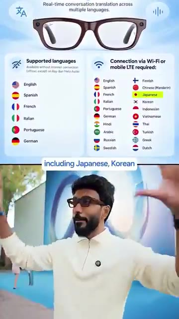

# 🎬 Meta’s New AI Glasses Translate ANY Language in Real-Time! 🛑

> **Chaîne** : [Vaibhav Sisinty](https://www.youtube.com/@vaibhavsisinty)  
> **Lien YouTube** : [https://www.youtube.com/watch?v=8rbn0YjrSa4](https://www.youtube.com/watch?v=8rbn0YjrSa4)  
> **Date de publication** : 20260930  
> **Durée** : 00:01:02  
> **Identifiant vidéo** : `8rbn0YjrSa4`  
> **Transcription & Analyse** : `whisper-v3-large-turbo+gemini-3.5-flash-lite`  

---

## 📌 Synthèse Exécutive & Outils

### 💡 Résumé

Cette vidéo de Vaibhav Sisinty met en lumière une avancée majeure dans le domaine de l'intelligence artificielle incarnée et de l'informatique ambiante : la fonctionnalité de traduction en direct intégrée aux dernières lunettes connectées de Meta (incluant les gammes Ray-Ban Meta, Oakley Meta et les nouveaux modèles de la marque). L'analyste démontre, à travers une expérience personnelle menée au Japon, la capacité de ces montures à transcender la barrière de la langue de manière fluide, naturelle et totalement mains libres, permettant de tenir des conversations complexes dans plus de 20 langues (dont le japonais, l'hindi, le coréen, le mandarin, l'arabe et l'espagnol) sans prononcer un seul mot d'anglais.

Sur le plan technique, la prouesse ne réside pas seulement dans la traduction linguistique, mais dans l'ingénierie audio et la puissance du traitement en temps réel. Grâce à un réseau de six microphones intégrés à la monture, l'appareil est capable d'isoler avec précision la voix de l'interlocuteur du bruit ambiant et de la séparer de celle de l'utilisateur. Contrairement aux traducteurs traditionnels qui imposent une latence en attendant la fin complète d'une phrase, le système analyse, traduit et restitue l'audio directement dans l'oreille de l'utilisateur toutes les quelques mots, pendant même que l'interlocuteur continue de parler.

Cette technologie redéfinit les standards du growth hacking personnel, du voyage d'affaires et de la communication interculturelle. En s'affranchissant des écrans de smartphones (les « yeux baissés »), Meta propose une expérience immersive qui maintient le contact visuel et l'attention dans le monde réel (« les yeux levés »). Pour les entrepreneurs, marketeurs et professionnels du numérique, cet usage illustre le basculement progressif vers des interfaces invisibles et contextuelles, ouvrant la voie à de nouveaux cas d'usage en matière de productivité globale et d'expansion sur les marchés internationaux.

---

### 🛠️ Outils, Modèles & Logiciels Présentés

* **Ray-Ban Meta / Oakley Meta / Lunettes Meta** : Montures connectées équipées de six microphones directionnels et de capacités de traitement audio avancées, servant de support matériel (hardware) pour l'exécution des fonctionnalités d'intelligence artificielle contextuelle et de traduction vocale.
* **Traduction en direct (Meta Live Translation)** : Fonctionnalité logicielle intégrée à l'écosystème Meta, capable de décoder, segmenter, traduire et restituer simultanément plus de 20 langues en audio binaural directement dans l'oreille de l'utilisateur.
* **Système de séparation vocale par IA** : Algorithme embarqué exploitant les capteurs de la monture pour dissocier la voix de l'utilisateur de celle de son interlocuteur au milieu des nuisances sonores, garantissant une clarté d'écoute optimale.
* **Midjourney** *(Mentionné dans l'écosystème de la chaîne)* : Modèle de génération d'images par IA, utilisé par les créateurs pour concevoir des visuels marketing percutants et illustrer des concepts futuristes.
* **Gemini** *(Mentionné dans l'écosystème de la chaîne)* : Modèle multimodal de Google, exploité pour le traitement de données textuelles, visuelles et l'analyse stratégique.
* **Perplexity** *(Mentionné dans l'écosystème de la chaîne)* : Moteur de recherche conversationnel propulsé par l'IA, utilisé pour la veille technologique et la recherche rapide d'informations complexes.
* **ChatGPT & Claude** *(Mentionnés dans l'écosystème de la chaîne)* : Assistants conversationnels majeurs mobilisés pour la création de contenu, la rédaction de scripts et l'automatisation des processus textuels.
* **Make & n8n** *(Mentionnés dans l'écosystème de la chaîne)* : Plateformes d'automatisation de workflows sans code (no-code), essentielles pour connecter entre eux différents logiciels et optimiser les tunnels de conversion marketing.

---

### 🔑 Points Clés & Enseignements Stratégiques

1. **L'essor de l'informatique ambiante (Ambient Computing)** : Le passage des écrans physiques (smartphones, tablettes) à des dispositifs portables et invisibles (lunettes connectées) redéfinit l'interaction homme-machine en éliminant la friction technologique.
2. **La traduction simultanée micro-segmentée** : Ne plus attendre la fin d'une phrase pour traduire révolutionne le rythme des échanges, rendant les conversations interlinguistiques aussi fluides qu'un dialogue dans une même langue.
3. **L'ingénierie audio au service de l'IA** : L'utilisation de six microphones pour l'isolation spatiale et la dissociation des flux vocaux prouve que le succès d'une IA dépend autant de la capture physique (hardware) que du traitement logiciel.
4. **Maintien du lien social et du contact visuel** : Contrairement aux applications mobiles de traduction qui obligent à fixer un écran, les lunettes encouragent le « regard haut », préservant la communication non verbale et la posture relationnelle.
5. **Démocratisation d'une technologie agnostique** : La fonctionnalité ne nécessite pas de modèle de lunettes excessivement onéreux ou de niche ; elle est déployée à grande échelle sur les gammes grand public existantes (Ray-Ban Meta, Oakley Meta).
6. **Agilité géopolitique et commerciale** : La prise en charge native de plus de 20 langues (japonais, coréen, arabe, mandarin, espagnol, etc.) permet aux entrepreneurs et nomades digitaux de s'implanter ou de négocier instantanément sur de nouveaux marchés sans barrière linguistique.
7. **Suppression de la dépendance à l'anglais** : Il est désormais possible de voyager, de prospecter et de collaborer dans des pays non anglophones (comme le démontre l'expérience au Japon) en utilisant sa langue maternelle ou une langue pivot sans effort d'apprentissage préalable.
8. **Expérience utilisateur (UX) invisible** : La restitution audio directe dans l'oreille crée une intimité technologique où l'outil s'efface au profit de l'efficacité de la communication.
9. **Stratégie de croissance internationale (Growth Hacking)** : Pour les marketeurs et créateurs de contenu, ces outils permettent de tester des marchés étrangers en conditions réelles et de nouer des partenariats locaux sans les coûts liés à l'embauche immédiate d'interprètes.
10. **Convergence hardware et software** : La valeur ajoutée ne réside plus dans la seule intelligence logicielle de traduction, mais dans sa fusion parfaite avec un objet du quotidien esthétique et ergonomique.
11. **Engagement communautaire et viralité** : Inviter l'audience à partager ses cas d'usage dans les commentaires (« Comment allez-vous utiliser cette techno ? ») stimule l'algorithme d'engagement et permet de co-créer de nouveaux scénarios d'utilisation pour les prochaines vidéos.

---

## ⏱️ Chronologie & Transcription Complète Audio & Visuelle (Mot pour Mot)

### ⏱️ `[00:00:00 - 00:00:20]` | Segment #01

**🔊 Audio (Transcription Intégrale Mot pour Mot en Français) :**
> Je viens de faire parler Zuckerberg en hindi et ces lunettes ont fait tout cela. Laissez-moi donc revenir en arrière et vous dire ce que c'est réellement, car il ne s'agit pas seulement de l'hindi. Ce sont 20 langues, dont le japonais, le coréen, le mandarin, l'arabe, l'espagnol et bien d'autres encore. De plus, il ne s'agit pas non plus d'une paire spéciale. Ray-Ban Meta, Oakley Meta et les nouvelles lunettes Meta que vous pouvez voir ici, toutes font cela.

**👁️ Analyse Visuelle d'Écran (gemini-3.5-flash-lite) :**
**Interface & Outils** : Interface graphique de présentation des fonctionnalités des lunettes (listing des langues de traduction).

**Contenu textuel & Code** : Liste détaillée des langues supportées (anglais, espagnol, français, italien, portugais, allemand, japonais, coréen, mandarin, arabe, etc.) pour la traduction en temps réel.

**Action / Démonstration** : Présentation des spécifications techniques et des capacités de traduction multilingue des lunettes connectées.

*⏱️ 00:00:10 — Infographie montrant les langues prises en charge par les lunettes Ray-Ban Meta, divisées entre hors-ligne et connexion Wi-Fi/LTE, avec le présentateur en bas.*

---

### ⏱️ `[00:00:20 - 00:00:40]` | Segment #02

**🔊 Audio (Transcription Intégrale Mot pour Mot en Français) :**
> J'étais au Japon il y a quelques semaines et beaucoup de ces conversations se sont déroulées entièrement en japonais, pas un seul mot d'anglais. J'ai juste activé ceci et j'ai continué à marcher. Ça a fait l'affaire. La fonctionnalité s'appelle la traduction en direct et la façon dont elle fonctionne est vraiment folle. Les Meta glasses utilisent six micros sur leur monture et leur premier rôle n'est pas de traduire, c'est de comprendre qui parle. Ça sépare votre voix de la voix en face de vous.

**👁️ Analyse Visuelle d'Écran (gemini-3.5-flash-lite) :**
**Interface & Outils** : Aucune interface logicielle ou numérique visible (le présentateur porte des lunettes connectées et parle face caméra).

**Contenu textuel & Code** : Sous-titres textuels affichés à l'écran (« I just turned this on », « and how it works », « isn't translating »).

**Action / Démonstration** : Le présentateur parle directement à la caméra en expliquant l'utilisation de la fonctionnalité de traduction.

---

### ⏱️ `[00:00:40 - 00:01:02]` | Segment #03

**🔊 Audio (Transcription Intégrale Mot pour Mot en Français) :**
> Et le truc fou, c'est que ça n'attend pas que la personne ait fini sa phrase. Ça traduit littéralement toutes les quelques mots pendant qu'ils parlent encore, puis ça retransforme ça en audio et ça le lit dans votre oreille. La plupart des technologies vous font baisser les yeux. Celle-ci vous fait lever les yeux et c'est juste incroyable. Je me demande comment vous allez utiliser cette techno de fou, dites-le-moi dans les commentaires ci-dessous et je vous vois dans la prochaine !

**👁️ Analyse Visuelle d'Écran (gemini-3.5-flash-lite) :**
**Interface & Outils** : AUCUNE

**Contenu textuel & Code** : Sous-titres textuels affichés à l'écran ("every few words", "makes you look down", "I wonder how will you").

**Action / Démonstration** : Le créateur parle à la caméra pour illustrer les limites des technologies traditionnelles de traduction.

---

