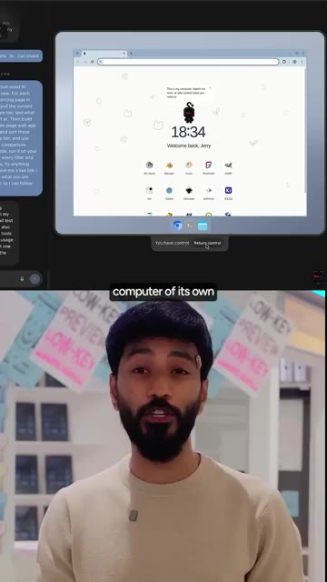
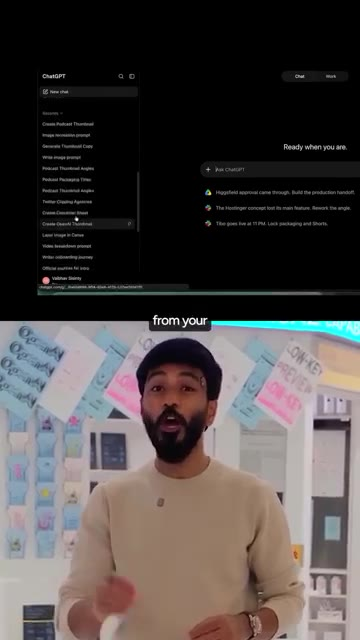
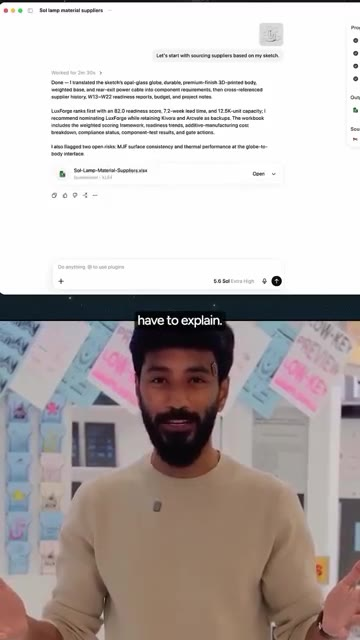
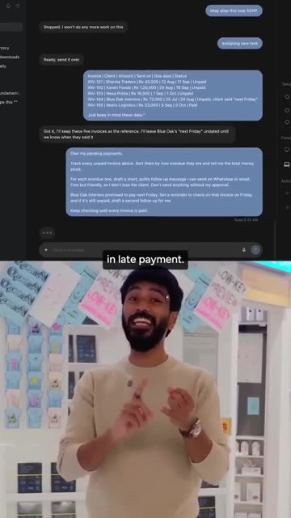
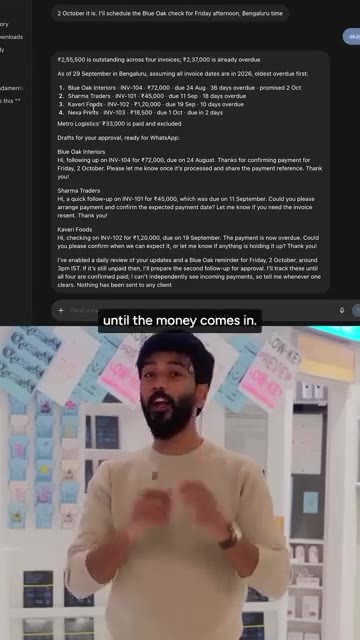
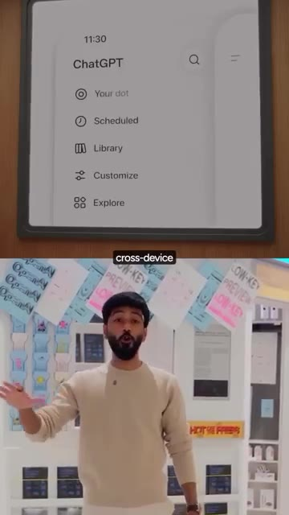
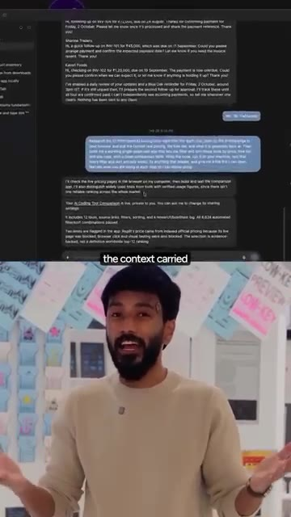
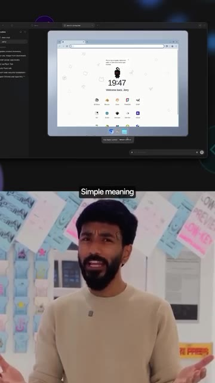
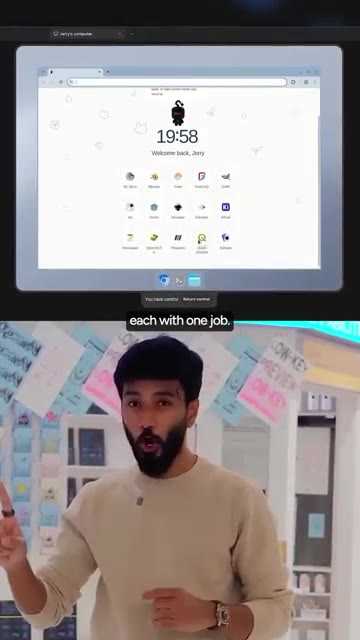
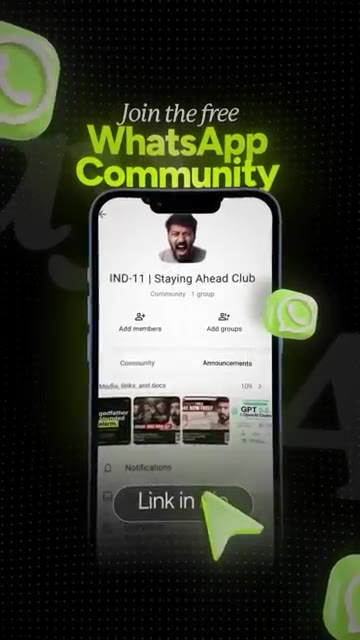

# 🎬 OpenAI Invited Me to Test Their Secret New AI Agent! ("Dots") 🤯

> **Chaîne** : [Vaibhav Sisinty](https://www.youtube.com/@vaibhavsisinty)  
> **Lien YouTube** : [https://www.youtube.com/watch?v=BtUA3IGDxVQ](https://www.youtube.com/watch?v=BtUA3IGDxVQ)  
> **Date de publication** : 20261001  
> **Durée** : 00:02:09  
> **Identifiant vidéo** : `BtUA3IGDxVQ`  
> **Transcription & Analyse** : `whisper-v3-large-turbo+gemini-3.5-flash-lite`  

---

## 📌 Synthèse Exécutive & Outils

### 💡 Résumé

Dans cette vidéo exclusive enregistrée directement depuis les bureaux d'OpenAI, Vaibhav Sisinty lève le voile sur « Dots », le nouvel agent IA révolutionnaire et le plus puissant jamais conçu par l'entreprise. Présenté comme le symbole de l'ère de l'AGI (Intelligence Artificielle Générale), cet outil marque une rupture fondamentale : on ne parle plus de simples chatbots réactifs, mais d'agents autonomes, permanents et proactifs, propulsés par le modèle de pointe GPT-6 Astra. Dots redéfinit la productivité en s'affranchissant du format traditionnel du *prompt* pour passer à une logique de délégation de missions de longue durée.

La force de Dots réside dans son architecture hybride. Doté de sa propre infrastructure cloud (ordinateur virtuel distant) et capable d'interagir localement avec la machine de l'utilisateur, l'agent combine exécution technique, mémoire persistante et orchestration multi-agents. Il apprend en continu des habitudes et des standards de son utilisateur, s'intègre à l'écosystème professionnel (Slack, Teams, e-mails, SMS) et gère des workflows complexes — comme le recouvrement automatisé de factures impayées — tout en maintenant un contrôle strict via des mécanismes de validation humaine (*human-in-the-loop*). 

Cette approche s'inscrit dans la droite ligne des stratégies de growth hacking et d'automatisation avancée prônées par Vaibhav Sisinty. En transformant un assistant personnel unique en une véritable armée de 80 agents spécialisés interconnectés, OpenAI ouvre la voie à une automatisation globale des PME et des solopreneurs. Déployé sur les offres ChatGPT Pro et Business Premium (avec un premier mois offert hors quotas), Dots illustre le passage de l'ère de l'assistance numérique à celle de la collaboration avec des entités autonomes capables d'exécuter des tâches de fond de manière ininterrompue.

---

### 🛠️ Outils, Modèles & Logiciels Présentés

* **Dots** : Le nouvel agent IA secret d'OpenAI, conçu comme un assistant permanent et proactif capable de gérer des tâches de longue durée, d'apprendre des habitudes de l'utilisateur et d'orchestrer un système multi-agents.
* **GPT-6 Astra** : Le modèle de pointe d'OpenAI propulsant Dots, présenté comme l'incarnation de l'ère de l'AGI, capable de traiter des raisonnements complexes et d'exécuter des actions techniques lourdes.
* **ChatGPT (Pro & Business Premium)** : Les abonnements d'OpenAI sur lesquels Dots est déployé, offrant un accès privilégié à l'écosystème d'agents avec une exemption de quotas pour le premier mois.
* **Make** : Mentionné dans l'écosystème global d'automatisation (faisant écho aux méthodologies de la chaîne de Vaibhav Sisinty pour connecter les flux de travail).
* **n8n** : Également cité dans la galaxie des outils d'automatisation et de productivité avancée maîtrisés par la communauté pour interconnecter les applications.
* **Claude** : Modèle d'IA concurrent (mentionné dans le profil technologique global de la chaîne), utilisé pour le benchmark des performances conversationnelles et textuelles.
* **Midjourney** : Outil de génération d'images par IA, intégré aux analyses de veille technologique de l'écosystème.
* **Gemini** : Modèle d'IA de Google, évoqué dans le paysage concurrentiel des grands modèles de langage.
* **Perplexity** : Moteur de recherche conversationnel basé sur l'IA, utilisé pour la recherche et l'analyse de données avancées.

---

### 🔑 Points Clés & Enseignements Stratégiques

* **Agents toujours actifs (Always-On)** : Contrairement aux assistants traditionnels qui s'éteignent à la fermeture de l'application, les Dots continuent de travailler en arrière-plan de manière autonome, même lorsque l'utilisateur est déconnecté.
* **Exécution locale et cloud hybride** : Chaque Dot dispose de son propre ordinateur virtuel dans le cloud (avec navigateur, environnement de code et outils de recherche), tout en pouvant se connecter directement au PC portable de l'utilisateur pour manipuler des fichiers locaux.
* **Mémoire persistante et apprentissage contextuel** : L'agent assimule les priorités, le ton et les standards de travail à partir de l'historique ChatGPT et des applications connectées, réduisant drastiquement le besoin de réexpliciter les consignes au fil du temps.
* **Passage du prompt à la responsabilité** : L'utilisation bascule d'une logique de questions-réponses ponctuelles à une délégation de missions de longue durée, où l'IA gère des processus métiers entiers de A à Z.
* **Gestion automatisée des processus métiers (Cas d'usage)** : Illustration concrète avec le recouvrement de factures impayées, où Dots suit les créances, rédige des relances adaptées, relance les clients de manière persistante et ajuste son calendrier selon leurs réponses.
* **Continuité multi-appareils** : Une seule entité et un fil de discussion unique accessibles indifféremment sur ordinateur, mobile ou web, avec une synchronisation transparente à travers les canaux de communication (SMS, Slack, Teams, e-mails).
* **Gouvernance et contrôle (Humain dans la boucle)** : Implémentation de règles personnalisées permettant de définir précisément les actions autonomes de l'agent et celles exigeant une validation humaine, complétée par un journal d'activité exhaustif.
* **Architecture multi-agents spécialisés** : Évolution d'un point personnel initial vers un écosystème interconnecté de 80 agents spécialisés, où chaque sous-agent gère une brique spécifique de l'activité professionnelle.
* **Stratégie de déploiement commercial** : Intégration directe de Dots dans les abonnements ChatGPT Pro et Business Premium, soutenue par une offre d'essai d'un mois sans décompte des limites de forfaits pour favoriser l'adoption.
* **Croissance communautaire et lead generation** : Utilisation d'un aimant à prospects (*lead magnet*) qualifié — le partage des 10 meilleurs cas d'usage de Dots via une communauté WhatsApp gratuite — pour dynamiser l'engagement de l'audience.

---

## ⏱️ Chronologie & Transcription Complète Audio & Visuelle (Mot pour Mot)

### ⏱️ `[00:00:00 - 00:00:20]` | Segment #01

**🔊 Audio (Transcription Intégrale Mot pour Mot en Français) :**
> Nous sommes au bureau d'OpenAI en ce moment même parce que j'ai été invité à voir ceci. Je suis tellement excité. Ce n'est plus un secret. Je peux tout raconter à ce sujet. Ça s'appelle Dots et c'est l'assistant le plus puissant jamais créé. Voici huit choses qui le font se démarquer. Numéro un, il ne s'éteint jamais. Les Dots sont des agents toujours actifs. Ce qui signifie simplement qu'il continue de travailler même après que vous ayez fermé l'application.

**👁️ Analyse Visuelle d'Écran (gemini-3.5-flash-lite) :**
**Interface & Outils** : AUCUNE

**Contenu textuel & Code** : Sous-titres textuels et mention "#01 It never switches off."

**Action / Démonstration** : Le présentateur s'adresse directement à la caméra pour introduire le premier point de la liste.

---

### ⏱️ `[00:00:20 - 00:00:43]` | Segment #02

**🔊 Audio (Transcription Intégrale Mot pour Mot en Français) :**
> Vous obtenez votre propre point et vous lui donnez un nom. Numéro deux, il fonctionne sur GPT-6 Astra. C'est le modèle de pointe d'OpenAI. Le même qu'ils ont lancé avec ces mots : bienvenue dans l'ère de l'AGI. Donc oui, il peut gérer les choses difficiles. Numéro trois, il a son propre ordinateur et il peut aussi utiliser le vôtre. C'est ce qu'on appelle l'exécution locale. En clair, votre point obtient son propre ordinateur cloud avec un navigateur, du travail ChatGPT et des codecs pour faire des recherches, analyser des données, et créer et tester des logiciels.

**👁️ Analyse Visuelle d'Écran (gemini-3.5-flash-lite) :**
**Interface & Outils** : Interface de bureau virtuel et interface de chat IA (GPT-6 / Astra).

**Contenu textuel & Code** : Texte du prompt dans le chat et affichage d'un environnement de bureau virtuel ("Welcome back, Jerry").

**Action / Démonstration** : Démonstration de l'ordinateur virtuel attribué à l'intelligence artificielle.

*⏱️ 00:00:38 — Capture d'écran montrant une interface de bureau virtuel et un panneau de chat avec l'IA en haut, et le présentateur en bas.*

---

### ⏱️ `[00:00:44 - 00:01:03]` | Segment #03

**🔊 Audio (Transcription Intégrale Mot pour Mot en Français) :**
> Et quand il a besoin de vos fichiers, vous connectez votre ordinateur portable et ça fonctionne directement là. Numéro quatre, il apprend comment vous travaillez. C'est ce qu'on appelle la mémoire persistante. En clair, il apprend vos priorités et vos standards à partir de votre mémoire ChatGPT et des applications que vous connectez. Donc plus vous travaillez ensemble, moins vous avez à expliquer. Numéro cinq, il prend des responsabilités, pas des prompts. C'est ce qu'on appelle une tâche de longue durée.

**👁️ Analyse Visuelle d'Écran (gemini-3.5-flash-lite) :**
**Interface & Outils** : ChatGPT, interface web de chatbot IA, tableur Excel.

**Contenu textuel & Code** : Historique de chats, prompts de recherche de fournisseurs, résultats d'analyse avec scores et recommandations, fichiers joints.

**Action / Démonstration** : Démonstration de l'utilisation de ChatGPT pour analyser des données et gérer des processus de fabrication.

*⏱️ 00:00:53 — Capture d'écran de l'interface ChatGPT en haut, montrant l'historique des conversations et le panneau latéral, avec le présentateur en bas.*

*⏱️ 00:00:58 — Capture d'écran montrant une interface de génération d'IA avec un fichier Excel partagé ('Sol-Lamp-Material-Suppliers.xlsx'), avec le présentateur en bas.*

---

### ⏱️ `[00:01:03 - 00:01:26]` | Segment #04

**🔊 Audio (Transcription Intégrale Mot pour Mot en Français) :**
> En clair, vous lui donnez un travail, pas une question. Les petites entreprises indiennes ont 8,1 lakh crore de roupies bloquées dans les retards de paiement. Dites donc à votre dot : gère mes paiements en attente. Elle suit chaque facture impayée, rédige des relances pour votre approbation et continue de vérifier jusqu'à ce que l'argent rentre. Le client dit vendredi prochain, elle revérifie vendredi. Numéro six, accédez-y de n'importe où. C'est ce qu'on appelle la continuité multi-appareils. En clair, une seule dot, une seule conversation sur votre ordinateur, votre téléphone ou le web.

**👁️ Analyse Visuelle d'Écran (gemini-3.5-flash-lite) :**
**Interface & Outils** : Interface de chat textuel et menu d'application mobile/web (ChatGPT).

**Contenu textuel & Code** : Liste de factures (INV-101 à INV-105) avec montants en roupies indiennes (Rs), statuts de paiement, et messages de relance rédigés automatiquement.

**Action / Démonstration** : Démonstration de l'automatisation du suivi des factures impayées et de la génération de messages de relance via une IA conversationnelle.

*⏱️ 00:01:09 — Interface de chat montrant l'envoi d'une liste de factures impayées à l'IA avec un prompt de gestion des paiements.*

*⏱️ 00:01:14 — Réponse détaillée de l'IA affichant le statut des factures et des brouillons de messages de relance prêts pour WhatsApp.*

*⏱️ 00:01:20 — Interface de navigation d'une application (similaire à ChatGPT) montrant le menu avec les options 'Your dot', 'Scheduled' et 'Library'.*

---

### ⏱️ `[00:01:26 - 00:01:44]` | Segment #05

**🔊 Audio (Transcription Intégrale Mot pour Mot en Français) :**
> Envoyez-lui un message ou appelez-le simplement. Et les SMS, Slack, Teams et les e-mails arrivent avec le contexte transmis à tout le monde. Numéro sept, vous gardez le contrôle. C'est ce qu'on appelle l'humain dans la boucle. Ce qui signifie simplement qu'il demande avant toute chose importante. Avec des règles personnalisées, vous décidez de ce qu'il fait seul et de ce qui nécessite votre approbation. Et la vue des activités montre tout ce qu'il a fait. Et numéro huit, des points de spécialistes.

**👁️ Analyse Visuelle d'Écran (gemini-3.5-flash-lite) :**
**Interface & Outils** : Interface de chat textuel et navigateur web sur bureau virtuel.

**Contenu textuel & Code** : Historique de messages textuels professionnels et interface de bureau avec horloge et icônes d'applications.

**Action / Démonstration** : Présentation des fonctionnalités de communication et d'automatisation avec un assistant IA.

*⏱️ 00:01:30 — L'image montre le présentateur en bas et une capture d'écran d'une interface de chat avec des messages textuels en haut.*

*⏱️ 00:01:35 — L'image montre le présentateur en bas et une interface de bureau virtuel avec un navigateur web affichant une page d'accueil en haut.*

---

### ⏱️ `[00:01:44 - 00:02:04]` | Segment #06

**🔊 Audio (Transcription Intégrale Mot pour Mot en Français) :**
> C'est ce qu'on appelle un système multi-agents, un système de 80 agents. En clair, une équipe d'agents, chacun ayant un seul travail. Vous commencez par un point personnel. Viennent ensuite les points spécialisés, chacun s'occupant d'une partie de votre travail. Un point aujourd'hui, toute une équipe de points demain. C'est à cela que ressemble réellement l'ère de l'AGI. Les points sont déployés sur ChatGPT Pro et Business Premium, et pendant le premier mois, cela ne sera pas décompté des limites de votre forfait.

**👁️ Analyse Visuelle d'Écran (gemini-3.5-flash-lite) :**
**Interface & Outils** : Bureau virtuel / Interface SaaS (« Jerry's computer ») avec icônes d'applications.

**Contenu textuel & Code** : Écran affichant un bureau virtuel avec l'heure (19:58) et des applications variées.

**Action / Démonstration** : Le présentateur explique le fonctionnement du système multi-agents tout en illustrant l'environnement virtuel à l'écran.

*⏱️ 00:01:49 — Le présentateur s'exprime tandis qu'au-dessus de lui s'affiche l'interface d'un bureau virtuel (« Jerry's computer ») avec différentes applications.*

---

### ⏱️ `[00:02:04 - 00:02:09]` | Segment #07

**🔊 Audio (Transcription Intégrale Mot pour Mot en Français) :**
> Je partage les 10 meilleurs cas d'utilisation de Dots dans ma communauté WhatsApp gratuite. Lien dans la bio.

**👁️ Analyse Visuelle d'Écran (gemini-3.5-flash-lite) :**
**Interface & Outils** : Application mobile WhatsApp (Interface de communauté).

**Contenu textuel & Code** : Texte "Join the free WhatsApp Community", nom de la communauté "IND-11 | Staying Ahead Club", et bouton "Link in bio".

**Action / Démonstration** : Promotion visuelle de la communauté WhatsApp gratuite avec un appel à l'action invitant à rejoindre le groupe via le lien en bio.

*⏱️ 00:02:05 — Un écran de smartphone affichant une communauté WhatsApp intitulée "IND-11 | Staying Ahead Club", avec un bouton cliquable "Link in bio" et des icônes WhatsApp en arrière-plan.*

---

