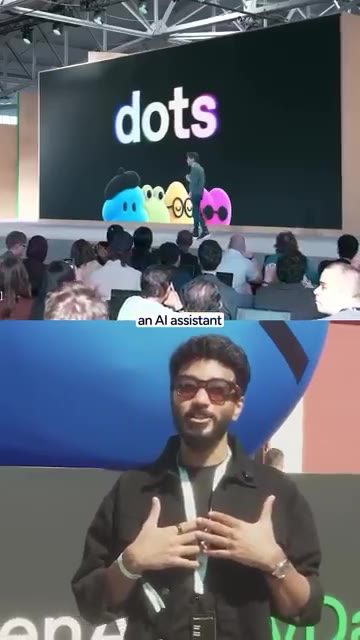
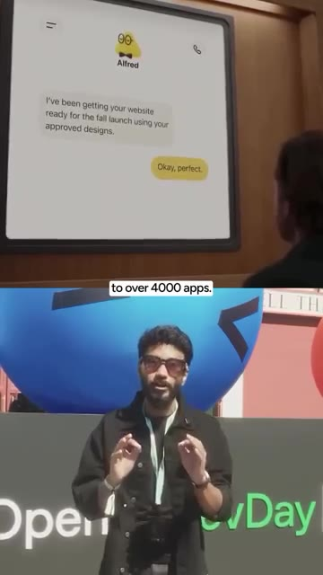
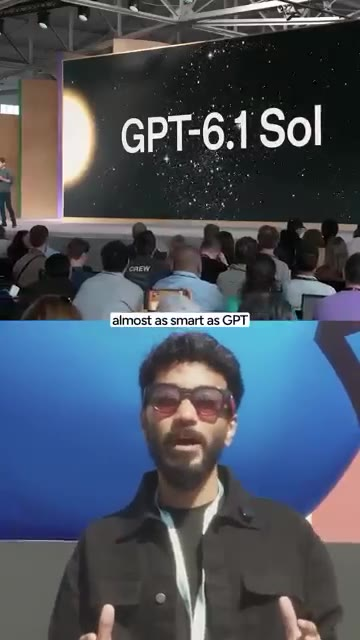
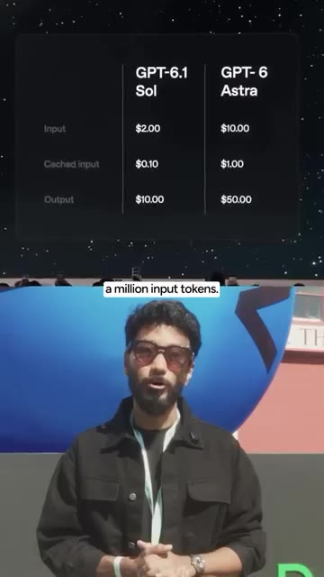
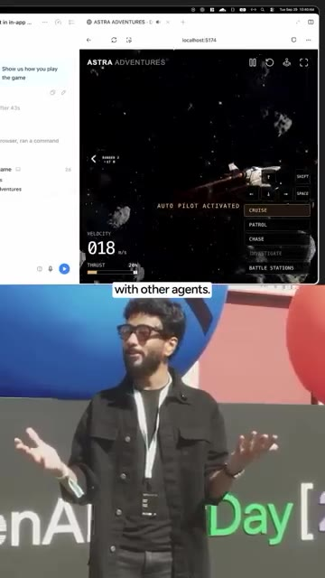
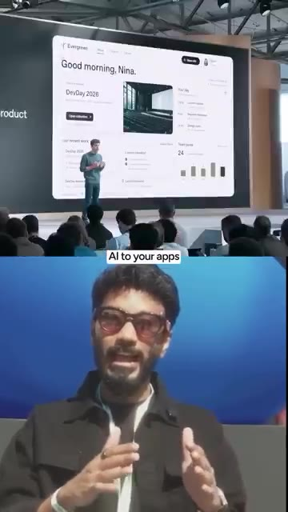
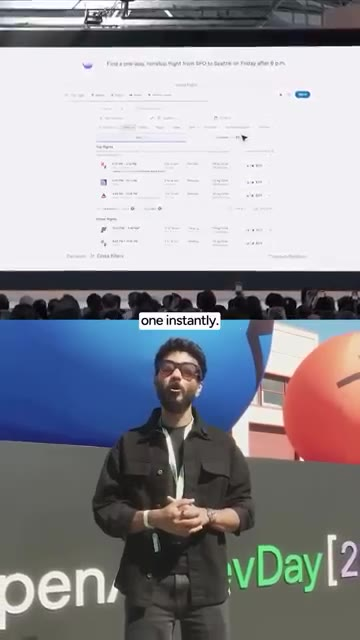
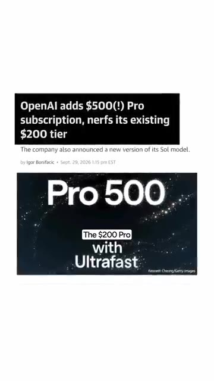
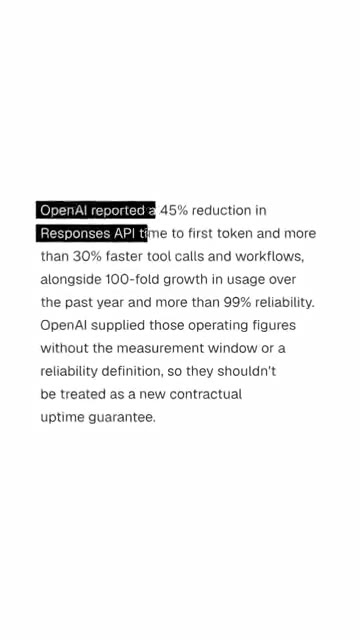

# 🎬 OpenAI DevDay 2026: Sam Altman Just Changed AI Forever! 🤯

> **Chaîne** : [Vaibhav Sisinty](https://www.youtube.com/@vaibhavsisinty)  
> **Lien YouTube** : [https://www.youtube.com/watch?v=2GOE_Zpa40c](https://www.youtube.com/watch?v=2GOE_Zpa40c)  
> **Date de publication** : 20261003  
> **Durée** : 00:02:55  
> **Identifiant vidéo** : `2GOE_Zpa40c`  
> **Transcription & Analyse** : `whisper-v3-large-turbo+gemini-3.5-flash-lite`  

---

## 📌 Synthèse Exécutive & Outils

### 💡 Résumé

Cette vidéo marque un tournant historique dans l'industrie de l'intelligence artificielle, qualifié par Vaibhav Sisinty de véritable séisme technologique. Lors de cet OpenAI DevDay fictif mais visionnaire, Sam Altman ne présente plus de simple chatbot conversationnel, mais redéfinit l'IA comme un véritable écosystème d'employés autonomes. L'introduction de concepts révolutionnaires tels que les « Dots » — des assistants persistants dotés de leur propre machine virtuelle cloud et connectés à plus de 4 000 applications — démontre un passage net vers une automatisation de fond, capable de travailler en arrière-plan même la fenêtre fermée. 

Sur le plan stratégique et marketing, l'événement redéfinit l'accessibilité et la puissance de calcul avec des modèles ultra-performants comme GPT 6.1 Sol proposés à prix cassé, tout en instaurant des options de vitesse payante et un positionnement haut de gamme agressif avec le forfait Pro 500 à 500 $ par mois. Les professionnels du growth hacking et du marketing digital disposent désormais d'une boîte à outils sans précédent : agents autonomes capables d'exécuter des tâches de navigation sur ordinateur, espaces de travail collaboratifs hybrides (humains et IA) sur des documents partagés, et intégrations natives cross-plateformes avec des géants comme Notion ou AWS.

Cette transformation structurelle impose aux entrepreneurs et marketeurs de repenser totalement leurs tunnels de productivité et leurs processus d'automatisation (Make, n8n). En déléguant non plus de simples requêtes, mais des rôles spécialisés à des agents managés et sécurisés (via Microsoft Agent 365 ou AWS Bedrock), les entreprises peuvent désormais automatiser le support client en temps réel, le tri des tickets, la programmation et la gestion de projets complexes sans intervention humaine constante. La valeur ne réside plus dans l'accès au modèle, mais dans l'orchestration de ces nouveaux collaborateurs synthétiques.

---

### 🛠️ Outils, Modèles & Logiciels Présentés

*   **ChatGPT :** La plateforme centrale qui héberge désormais les « Dots », les espaces de travail partagés (ChatGPT Space) et gère les connexions directes avec l'écosystème d'applications tierces.
*   **Dots :** Assistants IA persistants dotés d'une machine virtuelle cloud dédiée, connectés à plus de 4 000 applications, fonctionnant en arrière-plan et s'améliorant continuellement grâce aux retours utilisateurs.
*   **GPT 6.1 Sol :** Modèle hautement optimisé, presque aussi intelligent que le fleuron GPT 6 Astra mais proposé à un cinquième du prix (2 $ par million de jetons d'entrée), idéal pour le code, l'usage bureautique et le traitement de données.
*   **Codex :** Environnement de développement dopé au mode ultra-rapide, atteignant jusqu'à 300 jetons par seconde pour une efficacité maximale en programmation.
*   **Agent 365 (Microsoft) :** Outil de gestion et de sécurisation d'entreprise utilisé pour administrer les points spécialistes et les employés IA à grande échelle.
*   **AWS Bedrock :** Infrastructure cloud d'Amazon permettant d'exécuter directement les agents OpenAI, illustrant une alliance stratégique multi-cloud inattendue.
*   **Luna (API de décision) :** Moteur décisionnel instantané conçu pour analyser une liste fixe de réponses et sélectionner immédiatement la bonne, optimisé pour le tri automatisé de tickets de support.
*   **Notion, Vercel & Devin :** Premiers partenaires majeurs de la fonctionnalité « Se connecter avec ChatGPT », permettant d'utiliser l'IA et les forfaits ChatGPT directement au sein de ces applications tierces.
*   **Make & n8n :** Outils d'automatisation indispensables pour orchestrer les flux de données et connecter les nouvelles API d'agents aux processus marketing existants.

---

### 🔑 Points Clés & Enseignements Stratégiques

*   **Transition vers les employés IA :** OpenAI ne vend plus un simple assistant textuel, mais une force de travail synthétique capable d'exécuter des missions complexes de manière autonome et persistante.
*   **Persistance et arrière-plan (Dots) :** L'IA ne dépend plus de la session active de l'utilisateur ; les Dots continuent de travailler, d'exécuter des tâches et d'apprendre dans le cloud même lorsque l'application est fermée.
*   **Démocratisation du coût des modèles :** L'arrivée de modèles économiques ultra-puissants comme GPT 6.1 Sol (à 2 $ le million de jetons) réduit drastiquement les barrières financières pour intégrer l'IA dans les flux de travail quotidiens.
*   **Monétisation de la vitesse :** La mise en place de niveaux ultra-rapides (jusqu'à 6 à 8 fois plus rapides pour l'API et Codex) introduit un nouveau modèle tarifaire où la rapidité d'exécution devient une option premium facturée.
*   **Agents avec utilisation de l'ordinateur :** Les agents ne se contentent plus d'appeler des API ; ils interagissent visuellement avec les logiciels (clics, frappe, défilement) exactement comme le ferait un opérateur humain.
*   **Collaboration hybride en temps réel :** La fonctionnalité « Pages » permet à des équipes mixtes d'humains et d'IA de co-éditer et de modifier des documents de manière synchrone et contextuelle.
*   **Interopérabilité et écosystème ouvert :** Grâce au protocole MCP (Model Context Protocol) et aux 16 partenaires initiaux, ChatGPT s'intègre profondément dans les applications de productivité courantes sans friction.
*   **Sécurité et conformité d'entreprise :** L'intégration avec Microsoft Agent 365 et AWS Bedrock garantit que le déploiement d'agents IA respecte les standards stricts de sécurité exigibles par les grands groupes.
*   **Confidentialité totale (Intelligence Privée) :** La politique de rétention de données zéro et les vérifications automatisées sans intervention humaine permettent de manipuler des données sensibles en toute quiétude.
*   **Segmentation tarifaire agressive :** L'introduction du forfait Pro 500 à 500 $ par mois cible les power-users et les entreprises prêtes à payer pour un usage multiplié par 25 et des performances maximales.
*   **Optimisation globale des performances de l'API :** L'amélioration générale de l'infrastructure réduit la latence des premières réponses de 45 % et accélère l'exécution des appels d'outils de plus de 30 %.
*   **Stratégie de croissance communautaire :** Utilisation habile des appels à l'action (« commentez le chiffre ») combinée à la redirection vers une communauté WhatsApp privée pour nourrir le tunnel de conversion marketing.

---

## ⏱️ Chronologie & Transcription Complète Audio & Visuelle (Mot pour Mot)

### ⏱️ `[00:00:00 - 00:00:24]` | Segment #01

**🔊 Audio (Transcription Intégrale Mot pour Mot en Français) :**
> Sam va débarquer et va balancer tout ce sur quoi j'ai travaillé ces derniers jours. Je vais tout balancer d'un coup, comme d'habitude, sous forme de série. Voici tout ce que le Dev Day a couvert aujourd'hui. Numéro un : Dots. Un assistant IA qui ne s'éteint jamais. Un Dot vit à l'intérieur de ChatGPT, dispose de sa propre machine virtuelle dans le cloud et se connecte à plus de 4 000 applications. Il continue de travailler en arrière-plan même après la fermeture de l'onglet et il apprend de vos retours pour s'améliorer chaque semaine.

**👁️ Analyse Visuelle d'Écran (gemini-3.5-flash-lite) :**
**Interface & Outils** : Présentation de conférence, interface de chat d'assistant IA.

**Contenu textuel & Code** : Titre « dots », personnages colorés représentant des assistants IA, interface de discussion avec l'assistant Alfred.

**Action / Démonstration** : Présentation des nouveautés du Dev Day concernant les assistants IA persistants.

*⏱️ 00:00:12 — Écran de présentation affichant « dots » et des personnages colorés animés lors d'une conférence Dev Day.*

*⏱️ 00:00:18 — Interface de démonstration montrant l'assistant IA « Alfred » en train de discuter d'un projet de site web.*

---

### ⏱️ `[00:00:24 - 00:00:46]` | Segment #02

**🔊 Audio (Transcription Intégrale Mot pour Mot en Français) :**
> Le premier point est offert avec les versions Pro et Business Premium. Numéro deux, GPT 6.1 Sol. Presque aussi intelligent que GPT 6 Astra, le meilleur modèle d'OpenAI, mais à un cinquième du prix. Seulement 2 dollars pour un million de jetons d'entrée. Les jetons sont de petits morceaux de texte que l'IA lit. Il est conçu pour la programmation, l'utilisation d'ordinateurs et le travail de bureau. Numéro trois, le niveau ultra-rapide. La vitesse est désormais une option payante. Jusqu'à huit fois plus rapide dans Codex, environ 300 jetons par seconde.

**👁️ Analyse Visuelle d'Écran (gemini-3.5-flash-lite) :**
**Interface & Outils** : Présentation sur grand écran / Diapositive de conférence avec tableau comparatif des prix des modèles d'IA.

**Contenu textuel & Code** : Texte "GPT-6.1 Sol" et tableau de tarification comparant GPT-6.1 Sol et GPT-6 Astra (Input, Cached input, Output).

**Action / Démonstration** : Présentation des spécifications et des tarifs des nouveaux modèles d'intelligence artificielle sur scène.

*⏱️ 00:00:30 — Image montrant en haut une diapositive de présentation avec le titre "GPT-6.1 Sol" et en bas le présentateur dans un cadre divisé.*

*⏱️ 00:00:35 — Image montrant en haut un tableau comparatif des prix entre "GPT-6.1 Sol" et "GPT-6 Astra" (Input $2.00 vs $10.00) et en bas le présentateur.*

---

### ⏱️ `[00:00:47 - 00:01:08]` | Segment #03

**🔊 Audio (Transcription Intégrale Mot pour Mot en Français) :**
> Jusqu'à six fois plus rapide dans l'API. Le piège ? Cela coûte six fois plus cher. Numéro quatre, l'API des agents avec l'utilisation de l'ordinateur. Les développeurs peuvent désormais créer des agents qui se souviennent, utilisent des outils et font équipe avec d'autres agents. OpenAI héberge le tout et grâce à l'utilisation de l'ordinateur, l'agent clique, tape et fait défiler du contenu dans les logiciels exactement comme un humain. Numéro cinq, l'espace ChatGPT. Un espace partagé pour votre équipe. Tout le monde y dépose des fichiers et du contexte.

**👁️ Analyse Visuelle d'Écran (gemini-3.5-flash-lite) :**
**Interface & Outils** : Navigateur web, interface de jeu Astra Adventures sur localhost:5174

**Contenu textuel & Code** : Jeu spatial interactif avec indicateurs de vitesse et de pilotage automatique (Auto Pilot Activated)

**Action / Démonstration** : Démonstration d'un agent utilisant l'ordinateur pour interagir avec un jeu en temps réel.

*⏱️ 00:00:57 — Une interface d'application de jeu spatial 'Astra Adventures' affichée à l'écran, avec le présentateur en bas.*

---

### ⏱️ `[00:01:08 - 00:01:44]` | Segment #04

**🔊 Audio (Transcription Intégrale Mot pour Mot en Français) :**
> Le point de chaque coéquipier lit la même connaissance de projet et Pages permet aux humains et à l'IA de modifier un même document ensemble. Numéro six, se connecter avec ChatGPT. Se connecter à d'autres applications avec votre compte ChatGPT. 16 partenaires au lancement, incluant Notion, Vercel et Devin. L'IA que vous utilisez à l'intérieur de celles-ci peut provenir de votre forfait ChatGPT. Numéro sept, des points spécialistes. Pour les entreprises, chaque point obtient un travail, comme donner à chaque équipe sa propre IA employée. Et OpenAI prévoit de les gérer via Agent 365 de Microsoft, les mêmes outils de sécurité que les grandes entreprises utilisent déjà. Numéro huit, des agents gérés par Bedrock. OpenAI

**👁️ Analyse Visuelle d'Écran (gemini-3.5-flash-lite) :**
**Interface & Outils** : Interface de présentation sur grand écran et application ChatGPT.

**Contenu textuel & Code** : Texte de transcription de réunion ou de notes affiché sur l'écran de la conférence.
[DESC_IMAGE_2] Présentation des fonctionnalités de ChatGPT sur écran géant devant un public.

**Action / Démonstration** : Explications face caméra et présentation conceptuelle.

*⏱️ 00:01:26 — Le présentateur s'exprime devant un grand écran de conférence montrant un document ou une transcription, avec un public en arrière-plan.*

---

### ⏱️ `[00:01:44 - 00:02:17]` | Segment #05

**🔊 Audio (Transcription Intégrale Mot pour Mot en Français) :**
> les agents s'exécutent désormais directement dans le cloud d'Amazon, AWS. Oui, l'entreprise que Microsoft a soutenue à coups de milliards vient de s'installer chez Amazon. Numéro neuf, les extensions de plugins et les événements MCP. Les plugins peuvent désormais ouvrir des panneaux latéraux et des visionneuses de fichiers directement dans ChatGPT. Et le MCP, le connecteur qui relie l'IA à vos applications, peut désormais déclencher des automatisations de lui-même. Numéro dix, l'API de décision, propulsée par Luna. Vous lui donnez une liste fixe de réponses et elle choisit la bonne instantanément. Pensez au tri de tickets de support en temps réel. Numéro onze, l'intelligence privée. Rétention de données zéro. OpenAI ne conserve pas vos données et la sécurité

**👁️ Analyse Visuelle d'Écran (gemini-3.5-flash-lite) :**
**Interface & Outils** : Écran de conférence affichant une application web / interface SaaS (Evergreen) et un comparateur de vols.

**Contenu textuel & Code** : Tableau de bord utilisateur 'Evergreen', calendrier, statistiques d'équipe et interface de recherche de vols ('Find a one-way, nonstop flight...').

**Action / Démonstration** : Présentation sur scène avec projection sur grand écran montrant l'intégration d'applications et de fonctionnalités logicielles.

*⏱️ 00:02:01 — Le présentateur parle en bas, tandis qu'en haut un écran de conférence affiche une interface SaaS de tableau de bord 'Evergreen' avec le texte 'Good morning, Nina.'*

*⏱️ 00:02:09 — Le présentateur parle en bas, tandis qu'en haut l'écran de conférence montre une interface de recherche de vols en ligne avec des résultats de recherche.*

---

### ⏱️ `[00:02:17 - 00:02:37]` | Segment #06

**🔊 Audio (Transcription Intégrale Mot pour Mot en Français) :**
> les vérifications s'exécutent automatiquement sans qu'aucun employé d'OpenAI ne les voie. Numéro 12, Pro500. Un nouveau forfait à 500 dollars qui coûte plus de 40 000 roupies par mois. 25 fois l'utilisation du forfait Plus et une vitesse ultra-rapide. Mais voici la partie dont personne ne parle. Le forfait Pro à 200 dollars est à nouveau ouvert. Sauf que les nouveaux utilisateurs obtiennent la moitié de l'utilisation qu'avaient les anciens utilisateurs.

**👁️ Analyse Visuelle d'Écran (gemini-3.5-flash-lite) :**
**Interface & Outils** : Capture d'article de presse et écran de présentation événementielle.

**Contenu textuel & Code** : Texte sur l'abonnement Pro 500 et article de presse mentionnant le forfait à 500$.

**Action / Démonstration** : Présentation des détails et caractéristiques du nouveau forfait tarifaire d'OpenAI.

*⏱️ 00:02:22 — Le présentateur s'exprime devant un écran affichant les détails du forfait Pro 500.*

*⏱️ 00:02:32 — Capture d'article de presse en ligne commentant l'abonnement Pro à 500 $ d'OpenAI.*

---

### ⏱️ `[00:02:37 - 00:02:55]` | Segment #07

**🔊 Audio (Transcription Intégrale Mot pour Mot en Français) :**
> Et un bonus, toute l'API vient de devenir plus rapide. Les premières réponses arrivent 45 % plus vite et les appels d'outils s'exécutent plus de 30 % plus rapidement. OpenAI ne vend plus un chatbot. Elle vend des employés IA. Lequel essayez-vous en premier ? Commentez le chiffre. La liste complète avec les liens est dans ma communauté WhatsApp gratuite. Lien dans la bio.

**👁️ Analyse Visuelle d'Écran (gemini-3.5-flash-lite) :**
**Interface & Outils** : Document texte explicatif.

**Contenu textuel & Code** : Texte rapportant une réduction de 45% du temps de l'API OpenAI et plus de 30% d'appels d'outils plus rapides.

**Action / Démonstration** : Affichage des statistiques de performance de l'API OpenAI.

*⏱️ 00:02:42 — Texte sur fond blanc détaillant les performances de l'API OpenAI (réduction de 45% du temps).*

---

