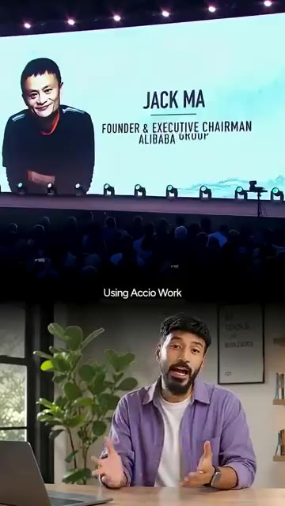
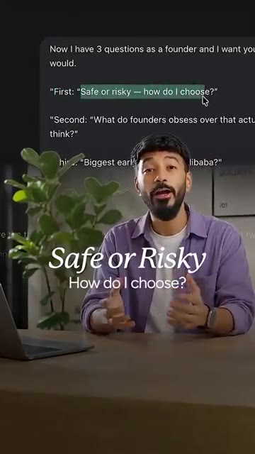
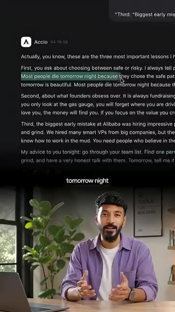
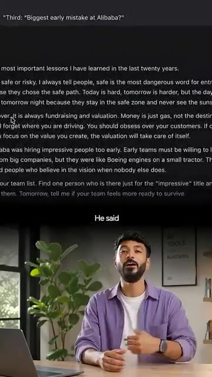
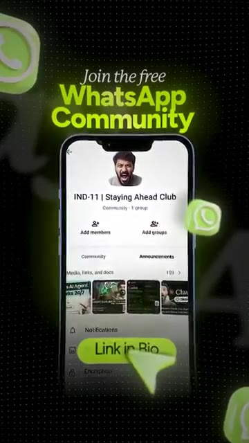

# 🎬 How I Cloned Alibaba's Jack Ma Into a 24/7 AI Mentor

> **Chaîne** : [Vaibhav Sisinty](https://www.youtube.com/@vaibhavsisinty)  
> **Lien YouTube** : [https://www.youtube.com/watch?v=bxrmWw4qt0Y](https://www.youtube.com/watch?v=bxrmWw4qt0Y)  
> **Date de publication** : 20261005  
> **Durée** : 00:01:41  
> **Identifiant vidéo** : `bxrmWw4qt0Y`  
> **Transcription & Analyse** : `whisper-v3-large-turbo+gemini-3.5-flash-lite`  

---

## 📌 Synthèse Exécutive & Outils

### 💡 Résumé

Dans cette vidéo au format percutant, Vaibhav Sisinty s'attaque à la solitude du fondateur solo et propose une solution radicale permise par l'intelligence artificielle : le clonage mental d'une figure tutélaire du business, en l'occurrence Jack Ma, le fondateur d'Alibaba. Confronté aux doutes nocturnes et à la pression inhérente à l'entrepreneuriat, Sisinty détourne les barrières technologiques traditionnelles en utilisant la plateforme *Axio Work* (issue de l'écosystème d'Alibaba) pour façonner une compétence décisionnelle sur mesure. Ce clone virtuel ne se contente pas de répéter des citations génériques ; il est configuré pour penser, philosopher et trancher avec la franchise brute, l'expérience de la crise et la philosophie pragmatique propre au milliardaire chinois. 

L'expérimentation prend une tournure fascinante lorsque le créateur soumet son "mentor 24h/24 et 7j/7" à trois interrogations existentielles et taboues pour tout entrepreneur : l'arbitrage entre sécurité et risque, l'obsession de la levée de fonds, et les erreurs originelles de recrutement. Les réponses obtenues — qualifiant notamment la "sécurité" de piège mortel pour une startup ou dévaluant l'importance des CV brillants au profit de la résilience — démontrent la puissance des agents conversationnels personnalisés lorsqu'ils sont alimentés par des visions fortes. Cette approche dépasse le simple gadget technique : elle redéfinit le growth hacking personnel en transformant l'IA en un outil de sparring-partner stratégique capable de briser les biais cognitifs du dirigeant.

Enfin, la vidéo débouche sur une stratégie marketing redoutable d'engagement communautaire. En proposant d'offrir le "pack de compétences" aux utilisateurs commentant un mot-clé précis, Sisinty orchestre un entonnoir de conversion fluide vers sa communauté WhatsApp privée. Cette mécanique illustre parfaitement l'intersection moderne entre l'automatisation conversationnelle, la création de contenu à forte résonance émotionnelle et le développement d'audience organique, des piliers essentiels pour tout solopreneur cherchant à scaler son influence et son impact en 2024.

---

### 🛠️ Outils, Modèles & Logiciels Présentés

*   **Axio Work** : Outil d'IA issu de l'écosystème d'Alibaba, utilisé dans la vidéo pour configurer et entraîner la compétence comportementale et décisionnelle imitant Jack Ma.
*   **Midjourney** *(mentionné dans le contexte global de la chaîne)* : Modèle de génération d'images par IA, incontournable pour la création de visuels marketing et de miniatures percutantes.
*   **Gemini** *(mentionné dans le contexte global de la chaîne)* : Modèle multimodal de Google, exploité pour le traitement de données textuelles complexes et l'assistance à la recherche.
*   **Perplexity** *(mentionné dans le contexte global de la chaîne)* : Moteur de recherche conversationnel basé sur l'IA, utilisé pour la veille stratégique et l'analyse de marché en temps réel.
*   **Make** *(mentionné dans le contexte global de la chaîne)* : Plateforme d'automatisation de workflows (anciennement Integromat) permettant de connecter les outils entre eux sans coder.
*   **ChatGPT** *(mentionné dans le contexte global de la chaîne)* : Modèle conversationnel d'OpenAI, employé pour la rédaction de scripts, la génération d'idées et l'assistance générale au copywriting.
*   **n8n** *(mentionné dans le contexte global de la chaîne)* : Outil d'automatisation puissant et flexible (open-source/self-hostable) pour orchestrer des tunnels marketing complexes.
*   **Claude** *(mentionné dans le contexte global de la chaîne)* : Modèle linguistique d'Anthropic, privilégié pour la rédaction de contenus longs, l'analyse contextuelle et le raisonnement nuancé.
*   **WhatsApp** : Canal de messagerie instantanée utilisé comme destination finale de l'entonnoir de conversion pour fédérer et animer une communauté privée de fondateurs.

---

### 🔑 Points Clés & Enseignements Stratégiques

1.  **L'IA comme antidote à la solitude du fondateur** : Transformer des figures historiques ou inspirantes en mentors virtuels disponibles 24h/24 et 7j/7 permet de surmonter la solitude décisionnelle à 2 heures du matin, servant de bouée de sauvetage psychologique et stratégique pour les solopreneurs.
2.  **Le piège de la sécurité** : Suivre la voie de la sécurité est qualifié par le clone de Jack Ma comme « le mot le plus dangereux pour les entrepreneurs », car cela pousse à faire ce que tout le monde fait, condamnant la startup à l'inertie et à l'échec lent.
3.  **Redéfinir le rapport au risque** : Le véritable risque entrepreneurial n'est pas d'échouer dans l'inconnu, mais de s'enfermer dans un faux sentiment de sécurité qui étouffe l'innovation et paralyse la prise de décision rapide.
4.  **Relativiser la levée de fonds** : L'obsession pour la valorisation et la recherche d'investisseurs détourne l'attention des fondateurs de la seule métrique qui compte : la résolution de la douleur réelle des utilisateurs.
5.  **L'argent n'est qu'un carburant** : Le capital levé ne doit pas être perçu comme une fin en soi ou une validation du succès, mais simplement comme de l'essence pour propulser un produit qui répond déjà à un besoin de marché.
6.  **Erreur de recrutement originelle** : Embaucher des profils aux CV impressionnants trop tôt dans la vie d'une entreprise est une erreur stratégique majeure ; les équipes de départ doivent avant tout être composées de battants.
7.  **Privilégier la résilience aux compétences techniques** : Dans les phases initiales, une startup a besoin de collaborateurs prêts à souffrir, à apprendre de leurs échecs et à trimer dur pour la mission, plutôt que d'experts surqualifiés mais déconnectés de la réalité du terrain.
8.  **Personnalisation contextuelle des agents IA** : Pour qu'un clone d'IA soit réellement utile, il doit être nourri par des philosophies de vie, des échecs passés et des cadres de pensée spécifiques (comme ceux de Jack Ma) plutôt que de se limiter à des réponses consensuelles.
9.  **Growth hacking par l'engagement communautaire** : Utiliser un appel à l'action textuel (demander de commenter un mot-clé comme "Jack Ma") permet de hacker l'algorithme des réseaux sociaux tout en qualifiant précisément l'audience.
10. **Tunnel de conversion vers le privé** : Rediriger les prospects engagés d'une publication publique vers une communauté WhatsApp privée crée un sentiment d'appartenance forte et facilite la fidélisation à long terme.

---

## ⏱️ Chronologie & Transcription Complète Audio & Visuelle (Mot pour Mot)

### ⏱️ `[00:00:00 - 00:00:18]` | Segment #01

**🔊 Audio (Transcription Intégrale Mot pour Mot en Français) :**
> Je déteste le mot IA appelé Intelligence Artificielle. J'appelle ça l'Intelligence Alibaba. Ouais. Et maintenant Jack Ma est en train de le prouver. J'ai cloné Jack Ma en une IA et je lui ai posé trois des questions les plus difficiles en tant que fondateur et ce qui est sorti comme réponses va vous choquer. Construire en tant que fondateur solo est difficile. Chaque décision vous revient.

**👁️ Analyse Visuelle d'Écran (gemini-3.5-flash-lite) :**
**Interface & Outils** : AUCUNE

**Contenu textuel & Code** : Texte incrusté à l'écran : "Jack Ma Returns - Inside the Alibaba Founder's Bold AI Comeback in 2026" et sous-titres du discours.

**Action / Démonstration** : Le présentateur s'adresse directement à la caméra en faisant des gestes pour introduire le sujet sur Jack Ma.

---

### ⏱️ `[00:00:18 - 00:00:39]` | Segment #02

**🔊 Audio (Transcription Intégrale Mot pour Mot en Français) :**
> La pression, l'incertitude et cette solitude à 2 heures du matin, sans cofondateur, sans mentor à qui parler. Cela m'a fait penser à Jack Ma, quelqu'un qui a échoué de nombreuses fois en créant Alibaba et qui a failli abandonner plus d'une fois. Je me suis donc demandé : et si j'avais un mentor dans le style de Jack Ma à qui je pourrais parler à tout moment ? En utilisant Axio Work, un outil d'IA de l'entreprise de Jack Ma, j'ai créé une compétence qui réfléchit et répond comme lui.

**👁️ Analyse Visuelle d'Écran (gemini-3.5-flash-lite) :**
**Interface & Outils** : Présentation vidéo sur scène et studio personnel.

**Contenu textuel & Code** : Texte 'Jack Ma - Founder & Executive Chairman Alibaba Group' et 'Using Accio Work'.

**Action / Démonstration** : Présentation d'archives vidéo de Jack Ma en lien avec le sujet des mentors et d'Alibaba.

*⏱️ 00:00:34 — Écran divisé montrant Jack Ma sur une grande scène de conférence en haut et Vaibhav Sisinty en bas.*

---

### ⏱️ `[00:00:39 - 00:00:59]` | Segment #03

**🔊 Audio (Transcription Intégrale Mot pour Mot en Français) :**
> Ensuite, je lui ai posé trois questions que je n'avais jamais dites à voix haute à personne. Premièrement, sûr ou risqué ? Comment choisir ? Il a dit, « sûr » est le mot le plus dangereux pour les entrepreneurs. La plupart des gens meurent demain soir parce qu'ils ont choisi la voie de la sécurité. Cette phrase m'a vraiment marqué. J'avais l'habitude de trop réfléchir entre la sécurité et le risque. Maintenant, je réalise que la sécurité signifie souvent faire ce que tout le monde fait et cela peut vous piéger pendant des années.

**👁️ Analyse Visuelle d'Écran (gemini-3.5-flash-lite) :**
**Interface & Outils** : Interface de type application de notes ou outil textuel avec un curseur (Accio).

**Contenu textuel & Code** : Texte affichant des questions de fondateur et la réponse sur les choix « safe or risky ».

**Action / Démonstration** : Le présentateur commente le contenu textuel affiché à l'écran concernant les conseils pour entrepreneurs.

*⏱️ 00:00:44 — Le présentateur s'exprime face caméra avec un extrait de texte souligné « Safe or Risky » affiché dans l'interface en haut.*

*⏱️ 00:00:49 — Le présentateur parle tandis qu'une interface montre la réponse complète avec la phrase « Most people die tomorrow night ».*

---

### ⏱️ `[00:00:59 - 00:01:19]` | Segment #04

**🔊 Audio (Transcription Intégrale Mot pour Mot en Français) :**
> Deuxièmement, sur quoi est-ce que les fondateurs font une fixation alors que ça compte beaucoup moins qu'ils ne le pensent ? Il a dit, la levée de fonds et la valorisation. L'argent n'est que de l'essence, pas la destination. Ça a vraiment fait écho en moi. Nous nous concentrons trop sur le nombre d'investisseurs et nous oublions la vraie douleur des utilisateurs. Troisièmement, la plus grande erreur de début chez Alibaba. Il a dit, embaucher des personnes impressionnantes trop tôt. Les équipes de départ doivent être prêtes à apprendre, à échouer et à trimer dur.

**👁️ Analyse Visuelle d'Écran (gemini-3.5-flash-lite) :**
**Interface & Outils** : AUCUNE

**Contenu textuel & Code** : Texte extrait d'une réflexion sur Alibaba et la levée de fonds ("Third: 'Biggest early mistake at Alibaba?'", "Money is just gas, not the destination").

**Action / Démonstration** : Le présentateur s'exprime face caméra en studio, illustré par un texte textuel en surimpression.

*⏱️ 00:01:04 — Vaibhav Sisinty en studio avec un texte affiché en haut de l'écran concernant les erreurs chez Alibaba.*

---

### ⏱️ `[00:01:19 - 00:01:40]` | Segment #05

**🔊 Audio (Transcription Intégrale Mot pour Mot en Français) :**
> Ça fait mouche. Au début, il vous faut des personnes prêtes à souffrir et à croire en la mission. Pas seulement des CV brillants. Ce n'est pas du baratin motivationnel. Ça bouscule, ça vous met au défi mais ça semble réel. Comme un mentor de la vieille école qui est passé par le feu et qui est assis en face de vous à 2h du matin. Si vous galérez aussi en solo et que vous voulez quelque chose comme ça dans votre poche, commentez Jack Ma et je vous enverrai le pack de compétences. Je partage d'autres compétences comme celle-ci chaque jour dans ma communauté WhatsApp.

**👁️ Analyse Visuelle d'Écran (gemini-3.5-flash-lite) :**
**Interface & Outils** : Aucun outil, logiciel ou site web affiché.

**Contenu textuel & Code** : Texte sous-titré en anglais : "Like an old school mentor who's been through the fire" et "and want something like this in your pocket grinding solo".

**Action / Démonstration** : Le présentateur parle directement à la caméra en gesticulant pour appuyer son propos.

---

### ⏱️ `[00:01:40 - 00:01:40]` | Segment #06

**🔊 Audio (Transcription Intégrale Mot pour Mot en Français) :**
> Lien dans la bio.

**👁️ Analyse Visuelle d'Écran (gemini-3.5-flash-lite) :**
**Interface & Outils** : Application mobile WhatsApp

**Contenu textuel & Code** : Texte 'Join the free WhatsApp Community', nom de la communauté 'IND-11 | Staying Ahead Club', options 'Add members' et 'Add groups', et un bouton jaune 'Link in Bio'.

**Action / Démonstration** : Incitation à rejoindre la communauté WhatsApp via un lien en bio.

*⏱️ 00:01:40 — Un écran de smartphone affichant une communauté WhatsApp intitulée 'IND-11 | Staying Ahead Club' avec un appel à l'action 'Link in Bio'.*

---

