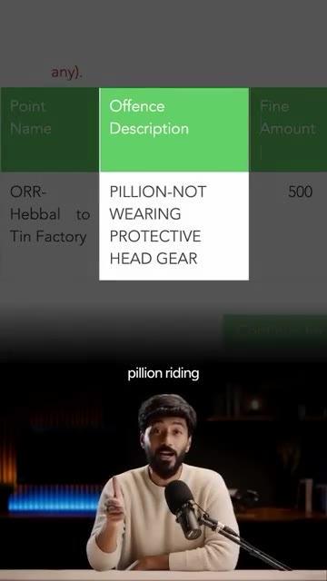
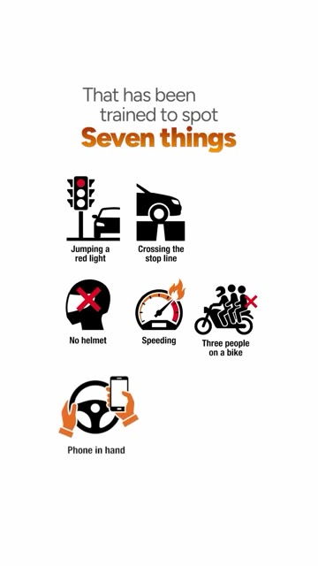
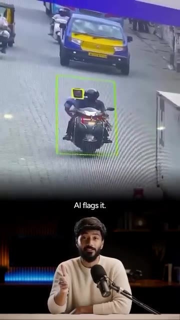
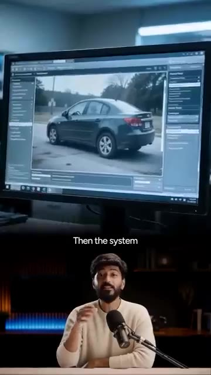
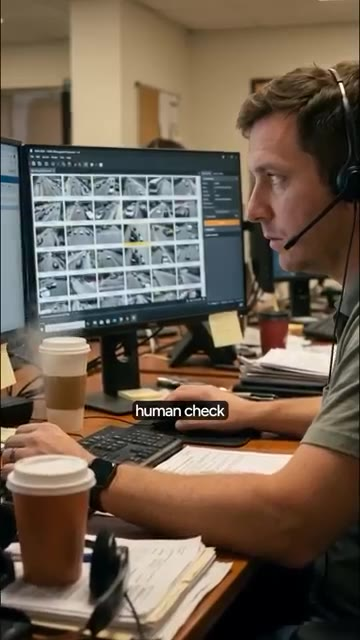

# 🎬 How an AI Camera Confused a Guitar for a Helmetless Passenger!

> **Chaîne** : [Vaibhav Sisinty](https://www.youtube.com/@vaibhavsisinty)  
> **Lien YouTube** : [https://www.youtube.com/watch?v=GQGK3U0FOcY](https://www.youtube.com/watch?v=GQGK3U0FOcY)  
> **Date de publication** : 20261007  
> **Durée** : 00:02:00  
> **Identifiant vidéo** : `GQGK3U0FOcY`  
> **Transcription & Analyse** : `whisper-v3-large-turbo+gemini-3.5-flash-lite`  

---

## 📌 Synthèse Exécutive & Outils

### 💡 Résumé

Cette vidéo, dans la droite lignée des analyses de la chaîne Vaibhav Sisinty, décrypte un cas fascinant et révélateur des limites de l'automatisation par l'intelligence artificielle à grande échelle. À Bengaluru, en Inde, un automobiliste a écopé d'une amende de 500 roupies pour avoir transporté... une guitare sur son dos, prise par erreur pour un passager sans casque par le système de surveillance de la ville. Cet incident cocasse met en lumière le fonctionnement de l'ITMS (Système de gestion intelligente du trafic), un réseau de 250 caméras dopées à l'IA déployées sur 50 carrefours majeurs pour automatiser la détection des infractions routières (feux rouges, absence de casque, excès de vitesse, etc.) sans intervention humaine directe.

Au-delà de l'anecdote virale — qui a également vu une voiture être verbalisée pour défaut de casque —, la vidéo met en exergue une faille critique dans les processus d'automatisation : l'excès de confiance dans les algorithmes de vision par ordinateur couplé à la fatigue de la supervision humaine. Alors que l'IA analyse les flux en temps réel pour repérer des motifs spécifiques à partir d'une seule image, la double vérification humaine censée valider les infractions pèche sous la charge de travail massive. 

L'enseignement stratégique pour les professionnels du marketing, des technologies et du growth hacking est limpide : l'automatisation accélère et fluidifie les opérations à grande échelle (24h/24, 7j/7), mais elle ne peut se passer d'une gouvernance rigoureuse et de boucles de rétroaction (feedback loops). Lorsqu'un système automatisé déraille, la capacité à contester, ajuster et corriger (comme le montre le service d'automatisation de la police invitant à rectifier l'erreur) devient un composant indispensable de l'expérience utilisateur et de la crédibilité technologique.

---

### 🛠️ Outils, Modèles & Logiciels Présentés

*   **ITMS (Système de gestion intelligente du trafic)** : Réseau urbain de caméras et de logiciels de vision par ordinateur entraînés à détecter automatiquement 7 infractions routières spécifiques (feux rouges, absence de casque, téléphone au volant, etc.) en temps réel.
*   **Vision par ordinateur / IA générique** : Modèles de deep learning et de traitement d'image utilisés pour analyser les flux vidéo en direct, identifier des formes (comme une guitare ou une silhouette) et corréler des plaques d'immatriculation.
*   **X (anciennement Twitter)** : Plateforme sociale utilisée comme canal de signalisation publique et de support client par les citoyens pour contester les erreurs d'automatisation auprès des autorités.
*   **Système d'e-challan automatisé** : Infrastructure logicielle couplée par SMS et bases de données gouvernementales pour générer et envoyer instantanément des amendes électroniques aux contrevenants.
*   **WhatsApp** : Canal communautaire privilégié par le créateur pour diffuser en avant-première les actualités, analyses de cas et mises à jour sur l'IA et le growth hacking (mentionné via le lien dans la bio).

---

### 🔑 Points Clés & Enseignements Stratégiques

1.  **L'illusion de l'infaillibilité algorithmique** : Un système d'IA, aussi performant soit-il, reste sujet à des erreurs d'interprétation contextuelle (confondre la forme organique d'une guitare sur un dos avec un passager humain).
2.  **Le piège de la vision monoculaire** : S'appuyer sur une seule photo ou un angle unique pour prendre une décision automatisée (comme l'émission d'une amende) augmente mécaniquement le taux de faux positifs.
3.  **La fatigue de la supervision humaine (« Human-in-the-loop »)** : La double vérification humaine devient inefficace lorsque les opérateurs sont submergés par un volume massif de données à valider, transformant le gardien de la qualité en simple chambre d'enregistrement.
4.  **L'automatisation du 24/7** : La grande force des technologies d'IA réside dans leur capacité à opérer sans interruption, générant des gains de productivité et de couverture impossibles à atteindre avec de la main-d'œuvre humaine seule.
5.  **L'impact de la viralité sociale** : Les plateformes comme X agissent comme un contre-pouvoir puissant, permettant aux utilisateurs de contourner les lourdeurs bureaucratiques en exposant publiquement les bugs d'automatisation.
6.  **L'importance d'un canal de résolution des litiges** : Tout système automatisé orienté client ou citoyen doit intégrer une porte de sortie claire et accessible (un service ou un bot de rattrapage) pour annuler rapidement les erreurs inévitables.
7.  **Le syndrome du dysfonctionnement technique étendu** : Un bug d'IA isolé (la guitare) cache souvent des anomalies plus vastes dans la logique de la machine (comme verbaliser une voiture pour absence de casque), révélant un manque de garde-fous logiques basiques.
8.  **Le réflexe de vérification indispensable** : Pour le consommateur ou l'utilisateur final, face à la multiplication des notifications automatisées (factures, amendes, alertes), le réflexe de vérification manuelle des pièces justificatives devient primordial avant tout paiement ou action.
9.  **L'optimisation des boucles de rétroaction** : Pour qu'un système automatisé progresse, les erreurs signalées par les utilisateurs finaux doivent être réinjectées dans l'entraînement du modèle pour éviter les récidives.
10. **La monétisation de l'attention et de l'actualité** : Transformer des anecdotes absurdes liées à l'IA en contenus éducatifs captivants est une stratégie de growth hacking redoutable pour engager une communauté (notamment sur WhatsApp).

---

## ⏱️ Chronologie & Transcription Complète Audio & Visuelle (Mot pour Mot)

### ⏱️ `[00:00:00 - 00:00:22]` | Segment #01

**🔊 Audio (Transcription Intégrale Mot pour Mot en Français) :**
> La caméra de circulation intelligente de Bengaluru a infligé une amende de 500 roupies à un homme pour avoir transporté une guitare. La semaine dernière, une femme de Bengaluru a reçu sur son téléphone une amende de circulation de 500 roupies. L'infraction était de circuler en passager sans casque, mais elle n'était pas sur le scooter. Son mari roulait seul, portant un casque avec une guitare sur le dos. Pour comprendre comment une guitare a reçu une amende, vous devez savoir comment Bengaluru détecte désormais les infractions routières.

**👁️ Analyse Visuelle d'Écran (gemini-3.5-flash-lite) :**
**Interface & Outils** : Interface web ou mobile de consultation d'amendes de circulation.

**Contenu textuel & Code** : Tableau des amendes détaillant les infractions et les montants (ex: 'PILLION-NOT WEARING PROTECTIVE HEAD GEAR', 500 roupies).

**Action / Démonstration** : Le présentateur explique et commente des cas insolites d'amendes infligées par des caméras de circulation intelligentes à Bengaluru.

*⏱️ 00:00:11 — Capture d'écran d'un tableau des amendes de circulation montrant l'infraction 'PILLION-NOT WEARING PROTECTIVE HEAD GEAR' pour un montant de 500, avec le présentateur en bas.*

*⏱️ 00:00:17 — Image de caméra de surveillance montrant un homme sur un scooter transportant une guitare sur son dos.*

---

### ⏱️ `[00:00:22 - 00:00:41]` | Segment #02

**🔊 Audio (Transcription Intégrale Mot pour Mot en Français) :**
> La ville exploite ce que l'on appelle l'ITMS, le Système de gestion intelligente du trafic. Considérez-le comme un réseau de 250 caméras IA réparties sur 50 grands carrefours. Ce ne sont pas des caméras de vidéosurveillance normales. Elles lisent votre plaque d'immatriculation dès que vous passez. Et elles exécutent une IA sur le flux vidéo en direct qui a été entraînée repérer 7 choses.

**👁️ Analyse Visuelle d'Écran (gemini-3.5-flash-lite) :**
**Interface & Outils** : AUCUNE

**Contenu textuel & Code** : Texte affiché : "Think of it", "big junctions", "you pass,"

**Action / Démonstration** : Le présentateur s'exprime face caméra en expliquant le système de gestion du trafic.

---

### ⏱️ `[00:00:41 - 00:01:00]` | Segment #03

**🔊 Audio (Transcription Intégrale Mot pour Mot en Français) :**
> Griller un feu rouge, franchir la ligne d'arrêt, pas de casque, excès de vitesse, 3 personnes sur une moto, téléphone à la main, pas de ceinture de sécurité, aucun policier n'est nécessaire. La caméra le voit, l'IA le signale. Une équipe au centre de gestion du trafic est censée examiner la photo et la confirmer. Ensuite, le système récupère les détails de votre véhicule, génère une amende électronique et vous recevez un SMS avec un lien vers la photo.

**👁️ Analyse Visuelle d'Écran (gemini-3.5-flash-lite) :**
**Interface & Outils** : Logiciel de surveillance et de gestion du trafic routier par IA.

**Contenu textuel & Code** : Graphiques illustrant des infractions routières et interfaces de vision par ordinateur.
[DESC_IMAGE_3] Analyse et traitement automatisé des images de véhicules par le système.

**Action / Démonstration** : Explications face caméra et présentation conceptuelle.

*⏱️ 00:00:46 — Une infographie présente les sept infractions routières détectées par l'IA, accompagnées d'icônes explicatives.*

*⏱️ 00:00:50 — Une caméra de surveillance capture une infraction en direct tandis que le présentateur explique le fonctionnement de l'IA.*

*⏱️ 00:00:55 — Un moniteur affiche un logiciel de gestion du trafic analysant l'image d'une voiture sur la route.*

---

### ⏱️ `[00:01:00 - 00:01:18]` | Segment #04

**🔊 Audio (Transcription Intégrale Mot pour Mot en Français) :**
> Un avis papier arrive chez vous. Alors, qu'est-ce qui n'a pas fonctionné avec la guitare ? L'IA a vu une grande forme noire derrière le conducteur. À peu près de la taille d'une personne. Rien qui ne ressemblait à un casque sur le dessus. Pour la machine, c'était un deuxième passager. Elle a signalé l'infraction. Et la vérification humaine ne l'a pas non plus remarquée. Le conducteur a publié la photo sur X et a identifié la police de la circulation.

**👁️ Analyse Visuelle d'Écran (gemini-3.5-flash-lite) :**
**Interface & Outils** : Logiciel de vidéosurveillance ou de contrôle routier affichant une grille de flux vidéo.

**Contenu textuel & Code** : Texte affiché 'human check'.

**Action / Démonstration** : Un opérateur examine des images de caméras de circulation pour une vérification humaine.

*⏱️ 00:01:14 — Un employé avec un casque-micro travaillant sur un ordinateur affichant de multiples caméras de vidéosurveillance, avec le texte 'human check'.*

---

### ⏱️ `[00:01:18 - 00:01:51]` | Segment #05

**🔊 Audio (Transcription Intégrale Mot pour Mot en Français) :**
> Ils ont répondu en lui demandant de contacter leur service d'automatisation pour l'annuler. Maintenant, voici la partie honnête. Ce n'est pas un cas isolé. Au début du mois, également dans le Karnataka, une voiture a reçu une amende pour défaut de casque. Une voiture. La police a qualifié cela de dysfonctionnement technique. Le système est rapide, il fonctionne 24 heures sur 24, et il attrape des milliers de vrais contrevenants. Mais l'IA devine à partir d'une seule photo, et l'humain censé faire une double vérification en examine des milliers. L'IA fait la surveillance. L'humain reste la dernière ligne de défense, et cette ligne a des failles. Alors la prochaine fois qu'un e-challan arrive sur votre téléphone, ouvrez la photo avant de payer. Si vous voyez une guitare se faire verbaliser

**👁️ Analyse Visuelle d'Écran (gemini-3.5-flash-lite) :**
**Interface & Outils** : Aucune interface ou logiciel visible.

**Contenu textuel & Code** : Aucun texte, code ou diapositive affiché (uniquement des sous-titres de la vidéo).

**Action / Démonstration** : Aucune démonstration ou manipulation en direct (vidéo d'illustration de circulation).

---

### ⏱️ `[00:01:51 - 00:02:00]` | Segment #06

**🔊 Audio (Transcription Intégrale Mot pour Mot en Français) :**
> pour un casque, vous savez quoi faire. Avez-vous déjà eu un défi qui n'avait aucun sens ? Dites-le-moi dans les commentaires et je partage ce genre de mises à jour en premier dans ma communauté WhatsApp gratuite. Lien dans la bio.

**👁️ Analyse Visuelle d'Écran (gemini-3.5-flash-lite) :**
**Interface & Outils** : Interface mobile WhatsApp (groupe "IND-11 | Staying Ahead Club").

**Contenu textuel & Code** : Texte « Join the free WhatsApp Community » et « Link in bio » affichés autour de l'interface mobile.

**Action / Démonstration** : Promotion et appel à l'action pour rejoindre la communauté WhatsApp gratuite du créateur.

*⏱️ 00:01:58 — Capture d'écran d'un smartphone affichant une communauté WhatsApp intitulée "IND-11 | Staying Ahead Club" avec des icônes WhatsApp flottantes.*

---

