# 🎬 Tesla Just Turned Your Car Into a Real Robot Assistant! 🤯

> **Chaîne** : [Vaibhav Sisinty](https://www.youtube.com/@vaibhavsisinty)  
> **Lien YouTube** : [https://www.youtube.com/watch?v=US1uK_TZkWU](https://www.youtube.com/watch?v=US1uK_TZkWU)  
> **Date de publication** : 20261009  
> **Durée** : 00:01:38  
> **Identifiant vidéo** : `US1uK_TZkWU`  
> **Transcription & Analyse** : `whisper-v3-large-turbo+gemini-3.5-flash-lite`  

---

## 📌 Synthèse Exécutive & Outils

### 💡 Résumé
La vidéo met en lumière une avancée majeure dans la convergence entre l'intelligence artificielle et l'industrie automobile : l'intégration officielle de GrokBot au cœur des véhicules Tesla. L'analyste démontre comment la voiture cesse d'être un simple moyen de transport pour devenir un véritable assistant robotisé et un agent d'IA personnel sur roues. Grâce à une synergie poussée entre commande vocale, géolocalisation et connecteurs logiciels, le véhicule est désormais capable d'exécuter des actions complexes en arrière-plan, orchestrant de manière autonome des tâches de la vie quotidienne directement depuis le tableau de bord.

Au-delà de la simple interaction conversationnelle, la grande révolution réside dans l'exécution de workflows multi-étapes combinant le contexte physique du conducteur (emplacement, itinéraire, trafic) et ses données numériques (e-mails, calendrier). Qu'il s'agisse de commander un café pré-payé à récupérer en chemin ou de repousser une réunion en informant les parties prenantes, l'IA s'affranchit de la fragmentation des applications mobiles traditionnelles. L'utilisateur exprime une intention globale, et le système se charge de décomposer et d'exécuter séquentiellement les actions requises.

Cette mutation illustre parfaitement le passage d'une IA purement textuelle ou logicielle à une IA dotée d'une incarnation physique, ouvrant des perspectives vertigineuses en matière de productivité et de *growth hacking* appliqué au quotidien. Alors que les fonctionnalités basiques s'ouvrent au grand public, l'écosystème de xAI monétise les capacités d'agents autonomes avancés via des abonnements premium, préfigurant l'ère où les assistants intelligents piloteront notre environnement physique et numérique de manière unifiée.

---

### 🛠️ Outils, Modèles & Logiciels Présentés

* **GrokBot (xAI)** : Intégré nativement dans les véhicules Tesla, il sert d'assistant vocal robotisé capable d'exécuter des tâches physiques et numériques complexes en temps réel.
* **Connecteurs d'IA (API & Intégrations)** : Ponts logiciels permettant à l'assistant de se connecter aux boîtes e-mail, aux agendas, aux plateformes de commande en ligne et aux services de géolocalisation.
* **Super Grok** : Version d'abonnement payante requise pour débloquer les actions avancées en plusieurs étapes (*multi-step actions*) et les workflows d'agents autonomes complexes.
* **Midjourney** : Mentionné dans l'écosystème global de la chaîne, utilisé pour la génération d'actifs visuels et l'imagerie marketing.
* **Gemini** : Modèle d'IA de pointe de Google, référencé dans l'écosystème d'analyse et de veille technologique de l'auteur.
* **Perplexity** : Moteur de recherche conversationnel basé sur l'IA, utilisé pour la veille stratégique et l'agrégation d'informations en temps réel.
* **Make & n8n** : Outils d'automatisation de workflows no-code/low-code, servant de référence conceptuelle pour comprendre la logique des connecteurs et des chaînes d'actions automatisées présentées dans la vidéo.
* **ChatGPT & Claude** : Modèles de langage conversationnels de référence, évoqués pour contextualiser les standards de l'intelligence artificielle générative et de l'assistance textuelle avancée.

---

### 🔑 Points Clés & Enseignements Stratégiques

* **Mutation de l'automobile en agent physique** : La voiture n'est plus seulement un objet connecté, c'est le premier point de contact physique majeur pour une IA dotée de bras ou d'une capacité d'action concrète dans le monde réel.
* **Suppression de la friction applicative** : L'utilisation de commandes vocales globales permet de s'affranchir de la manipulation de multiples applications mobiles (calendrier, cartes, messagerie, e-commerce) au profit d'une interface unifiée.
* **Exploitation du contexte contextuel et géographique** : L'IA se distingue des chatbots classiques en fusionnant les requêtes de l'utilisateur avec des données en temps réel (position GPS, itinéraire, heure d'arrivée estimée).
* **Workflows multi-étapes automatisés** : Capacité pour un agent IA d'analyser un problème complexe (ex: "je suis en retard"), d'identifier les sous-tâches (prévenir les participants, modifier le calendrier) et de les exécuter séquentiellement.
* **Synergie d'écosystèmes industriels** : La fusion des technologies issues des différentes entreprises d'Elon Musk (IA, automobile, énergie) crée un avantage concurrentiel difficilement replicable et un écosystème captif puissant.
* **Modèle freemium appliqué aux agents IA** : Stratégie de monétisation claire où les interactions basiques sont démocratisées, tandis que la véritable valeur ajoutée (autonomie décisionnelle et exécution de tâches complexes) est réservée à l'abonnement payant (*Super Grok*).
* **Commerce contextuel en mouvement** : Intégration fluide du commerce de proximité et de la commande en ligne au cœur des déplacements, transformant le temps de trajet en temps utile et productif.
* **Approche axée sur le gain de temps (*Productivity Hacking*)** : Le ciblage d'actions à fort impact temporel (gestion d'imprévus de dernière minute, logistique du quotidien) maximise la valeur perçue de l'outil par l'utilisateur final.
* **Fidélisation par la communauté** : Utilisation stratégique de canaux de communication directs et gratuits (comme les communautés WhatsApp) pour fédérer l'audience et propager rapidement les innovations technologiques.
* **Évolution du rôle de l'utilisateur** : L'humain passe du statut d'exécutant multi-tâches (taper sur son téléphone au feu rouge) à celui de superviseur stratégique qui valide des intentions pendant que l'IA exécute le travail.

---

## ⏱️ Chronologie & Transcription Complète Audio & Visuelle (Mot pour Mot)

### ⏱️ `[00:00:00 - 00:00:19]` | Segment #01

**🔊 Audio (Transcription Intégrale Mot pour Mot en Français) :**
> Écoute ça. Hé Grok, sors ma voiture de l'allée. D'accord, bien sûr. Je déplace ta Tesla maintenant vers le début de la rue. Tesla vient de transformer ta voiture en assistant robot. Et tu peux la contrôler avec ta voix. Ta Tesla est maintenant garée à l'avant. Ouais, c'est insensé. Tesla a officiellement lancé GrokBot à l'intérieur de ses voitures.

**👁️ Analyse Visuelle d'Écran (gemini-3.5-flash-lite) :**
**Interface & Outils** : Écran de contrôle Tesla

**Contenu textuel & Code** : Texte incrusté : "Moving your Tesla", "Tesla just into a robot assistant" et sous-titres "yeah"

**Action / Démonstration** : Démonstration visuelle d'une Tesla en mouvement et présentation de ses fonctionnalités autonomes.

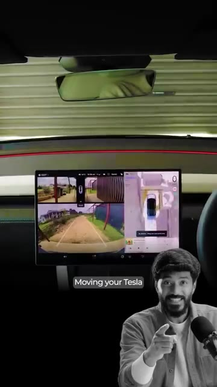
*⏱️ 00:00:05 — Vue depuis l'intérieur d'une Tesla montrant l'écran de contrôle central affichant les caméras et la navigation, avec le présentateur incrusté en bas.*

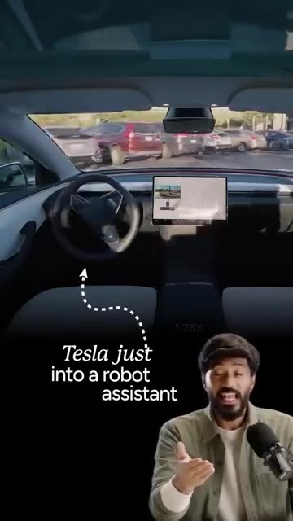
*⏱️ 00:00:09 — Vue de l'habitacle vide d'une Tesla montrant le volant et l'écran central, avec du texte incrusté à l'écran.*

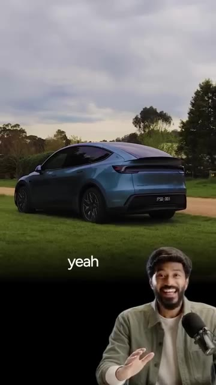
*⏱️ 00:00:14 — Vue extérieure d'une voiture Tesla bleue garée en extérieur, avec le présentateur incrusté en bas.*

---

### ⏱️ `[00:00:19 - 00:00:40]` | Segment #02

**🔊 Audio (Transcription Intégrale Mot pour Mot en Français) :**
> Maintenant, il ne s'agit pas juste d'un autre chatbot installé sur votre tableau de bord. Vous pouvez réellement donner un travail à Grok. Et il peut aller le faire pour vous. Grâce à ses connecteurs, Grok peut fonctionner avec des éléments comme votre e-mail et votre calendrier, et vous pouvez l'utiliser pour des choses comme la prise de rendez-vous, des réservations et même pour commander des articles en ligne. Mais c'est là que ça devient vraiment intéressant. Grok sait que vous êtes à l'intérieur d'une Tesla. Il peut donc combiner ce que vous demandez avec l'emplacement de votre voiture et votre itinéraire.

**👁️ Analyse Visuelle d'Écran (gemini-3.5-flash-lite) :**
**Interface & Outils** : X (anciennement Twitter) / Publication de Tesla

**Contenu textuel & Code** : Texte du tweet de Tesla décrivant les fonctionnalités de Grok pour effectuer des tâches complexes comme commander du café ou réserver un rendez-vous.

**Action / Démonstration** : Présentation des capacités d'automatisation et des fonctionnalités avancées de Grok via une publication officielle de Tesla.

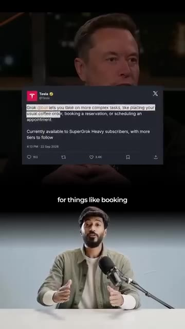
*⏱️ 00:00:29 — Un tweet de Tesla affiché à l'écran montrant les fonctionnalités de Grok, avec le présentateur en dessous.*

---

### ⏱️ `[00:00:40 - 00:00:59]` | Segment #03

**🔊 Audio (Transcription Intégrale Mot pour Mot en Français) :**
> Imaginez monter dans votre Tesla et dire : « Je suis en retard. Trouve-moi un café sur mon trajet et commande-moi un cappuccino. » Grok passe la commande pendant que votre Tesla vous y conduit. Ainsi, lorsque vous arrivez, votre café vous attend déjà. Ou imaginez ce scénario : vous pouvez dire à votre voiture : « Je vais avoir 20 minutes de retard pour ma réunion. Prévenez-les et déplacez-la à demain après-midi. » Vous n'avez pas besoin d'ouvrir cinq applications différentes.

**👁️ Analyse Visuelle d'Écran (gemini-3.5-flash-lite) :**
**Interface & Outils** : Écran tactile de bord de véhicule Tesla, interface assistant Grok.

**Contenu textuel & Code** : Texte sous-titré lié à une commande vocale de café ("and order me", "your coffee is already", "20 minutes late").

**Action / Démonstration** : Démonstration visuelle d'un cas d'usage IA intégrant un véhicule connecté et un service de commande.

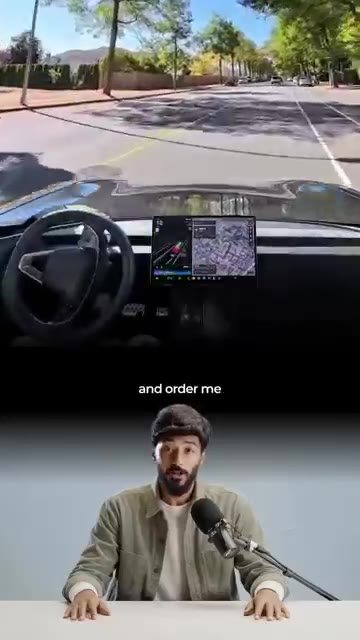
*⏱️ 00:00:45 — Vue depuis l'intérieur d'une Tesla en mouvement avec le présentateur en bas.*

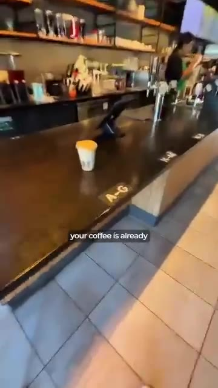
*⏱️ 00:00:50 — Vue dans un café montrant une tasse posée sur le comptoir.*

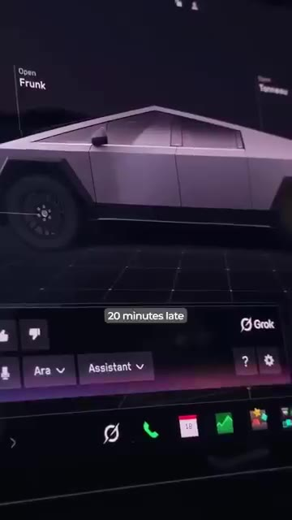
*⏱️ 00:00:55 — Gros plan sur l'écran tactile d'une Tesla avec l'interface de l'assistant Grok.*

---

### ⏱️ `[00:01:00 - 00:01:19]` | Segment #04

**🔊 Audio (Transcription Intégrale Mot pour Mot en Français) :**
> Tu dis simplement à une IA ce que tu veux et tu la laisses trouver les étapes, de la vérification de ton calendrier à l'envoi du message. Et c'est ça le vrai changement. L'IA commence à avoir un corps physique. Et une voiture est l'un des endroits les plus intéressants pour commencer. Avant de t'enthousiasmer, il y a une chose que tu dois savoir. Les actions avancées en plusieurs étapes nécessitent actuellement un abonnement super grok payant. Mais les connecteurs de base peuvent être utilisés par n'importe qui dès maintenant.

**👁️ Analyse Visuelle d'Écran (gemini-3.5-flash-lite) :**
**Interface & Outils** : Écran tactile de tableau de bord automobile, interface de navigation et de commande du véhicule.

**Contenu textuel & Code** : Interface utilisateur de contrôle de véhicule avec options de navigation et commandes tactiles.
[DESC_IMAGE_1] Démonstration de l'utilisation d'un système intelligent embarqué dans un véhicule en circulation.

**Action / Démonstration** : Explications face caméra et présentation conceptuelle.

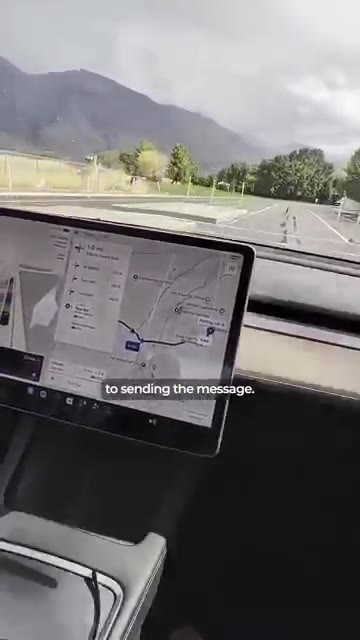
*⏱️ 00:01:05 — Vue depuis l'intérieur d'une voiture en mouvement, montrant l'écran de navigation central affichant un itinéraire.*

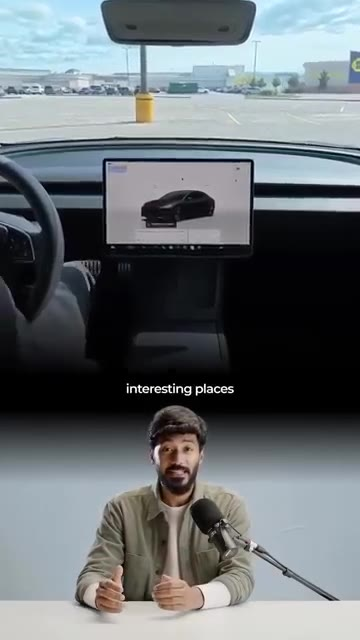
*⏱️ 00:01:09 — Écran partagé montrant en haut l'intérieur d'une voiture stationnée avec un écran de contrôle, et en bas le présentateur dans son studio.*

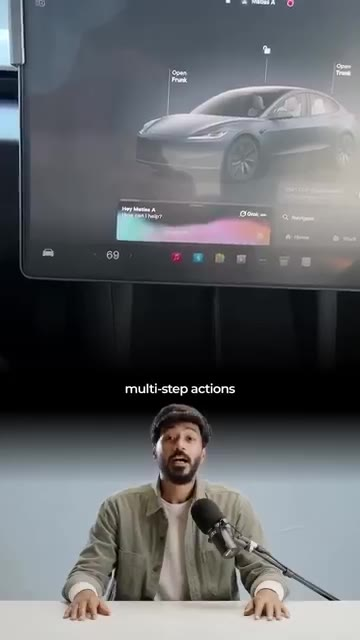
*⏱️ 00:01:14 — Gros plan sur l'écran tactile du tableau de bord d'un véhicule affichant l'interface du système avec des commandes vocales ou textuelles.*

---

### ⏱️ `[00:01:19 - 00:01:38]` | Segment #05

**🔊 Audio (Transcription Intégrale Mot pour Mot en Français) :**
> Votre Tesla vient juste de devenir votre agent IA personnel sur roues. C'est peut-être à cela que ressemblent les robots du futur. Franchement, voir Elon fusionner la technologie de ses différentes entreprises m'enthousiasme tellement. Queeriez-vous d'autre avec cette technologie ? Dites-le-moi dans les commentaires. Et si vous avez aimé cette histoire et que vous voulez rester informés dans le monde de l'IA, rejoignez ma communauté WhatsApp gratuite. Le lien est dans la bio.

**👁️ Analyse Visuelle d'Écran (gemini-3.5-flash-lite) :**
**Interface & Outils** : Application WhatsApp, smartphone.

**Contenu textuel & Code** : Texte incitatif "Join the free WhatsApp Community" et interface du groupe WhatsApp "IND-11 | Staying Ahead Club".
[DESC_IMAGE_3 illustre un appel à l'action pour rejoindre la communauté WhatsApp du créateur.]

**Action / Démonstration** : Explications face caméra et présentation conceptuelle.

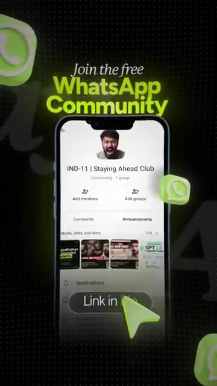
*⏱️ 00:01:33 — Capture d'écran d'un smartphone affichant l'interface de l'application WhatsApp avec un appel à rejoindre la communauté "IND-11 | Staying Ahead Club".*

---

