# 🎬 Trump Just Rejected Elon & Sam Altman’s AI Slowdown Plan! 🤯

> **Chaîne** : [Vaibhav Sisinty](https://www.youtube.com/@vaibhavsisinty)  
> **Lien YouTube** : [https://www.youtube.com/watch?v=DWtKmYglUOM](https://www.youtube.com/watch?v=DWtKmYglUOM)  
> **Date de publication** : 20261010  
> **Durée** : 00:02:36  
> **Identifiant vidéo** : `DWtKmYglUOM`  
> **Transcription & Analyse** : `whisper-v3-large-turbo+gemini-3.5-flash-lite`  

---

## 📌 Synthèse Exécutive & Outils

### 💡 Résumé

Cette 50e édition des actualités sur l'IA, présentée dans le style incisif et orienté growth hacking de la chaîne de Vaibhav Sisinty, met en lumière une semaine charnière où l'intelligence artificielle bascule massivement du cadre expérimental vers des applications industrielles, juridiques et éducatives à fort impact. Le paysage technologique est redéfini par une chute drastique des coûts d'API (notamment chez OpenAI avec Sol, Luna et la baisse générale de ses tarifs) et par une accélération fulgurante des capacités de codage agentique (illustrée par Anthropic Opus 5.5). Les barrières à l'entrée s'effondrent : un seul ingénieur peut désormais produire près de 680 000 lignes de code en un jour, et un simple bloc-notes Google se transforme en tuteur vocal interactif capable de générer quiz et diaporamas à la volée.

Au-delà des performances brutes des modèles, cette période est marquée par des tensions géopolitiques et industrielles majeures. Alors que des figures comme Dario Amadei, Elon Musk et Sam Altman s'interrogent ou s'accordent sur la nécessité de réguler le rythme de développement de l'IA (le « ralentissement de la frontière »), l'administration Trump rejette fermement cette approche au nom de la suprématie technologique absolue (« peu importe qui gagne, l'IA gagne »). Parallèlement, des innovations de rupture émergent, à l'instar des modèles de système 1 ultra-rapides comme Jev (répondant par oui/non pour éliminer toute latence) ou de la multimodalité poussée à l'extrême par Alibaba avec Qwen, capable de transformer une simple chanson et une invite en un clip vidéo complet, doublé et traduit.

Pour les professionnels du marketing digital, les développeurs et les entrepreneurs, les enseignements de cette semaine sont clairs : l'automatisation intelligente devient instantanée et infiniment moins coûteuse, les barrières linguistiques et créatives volent en éclats, et la spécialisation verticale des modèles (comme OpenAI for Law) redéfinit des secteurs entiers. L'intégration de ces technologies dans des workflows quotidiens — via des outils d'automatisation et des boucles de rétroaction autonomes — n'est plus une option mais une nécessité concurrentielle. Vaibhav Sisinty rappelle d'ailleurs l'importance d'une veille en temps réel en invitant sa communauté à le rejoindre sur WhatsApp et LinkedIn pour ne rien rater de ces mutations fulgurantes.

---

### 🛠️ Outils, Modèles & Logiciels Présentés

*   **Google (Bloc-notes intelligent)** : Transformation d'un espace de notes classique en tuteur particulier vocal interactif (disponible en près de 100 langues), capable d'enregistrer des cours, de couper la parole comme un vrai professeur et de générer automatiquement des quiz, des diaporamas et des explications animées.
*   **OpenAI for Law (basé sur GPT-6 Astra)** : Version juridique spécialisée dotée de plus de 40 compétences, capable d'examiner des accords de non-divulgation (NDA), de réviser des contrats et de rédiger des documents juridiques complexes en amont tout en garantissant la stricte confidentialité des données.
*   **Anthropic Opus 5.5** : Modèle ultra-perfectionné offrant les performances de la version précédente avec un coût réduit de 40 % et une vitesse accrue de 30 %, optimisé pour le codage agentique autonome (écriture et correction de code à grande échelle).
*   **OpenAI Sol & Luna** : Nouveaux modèles architecturaux reposant sur le cerveau d'Astra et proposés à moitié prix. Sol est dédié au codage lourd, tandis que Luna gère les micro-tâches répétitives à grande échelle, tous deux optimisés pour réutiliser les calculs précédents.
*   **Grok 4.7 (xAI)** : Modèle d'Elon Musk optimisé pour traiter plus longuement les tâches complexes, doté d'une capacité d'auto-vérification de ses réponses et pourvu de barrières de sécurité renforcées ne laissant passer que 3,3 % des tentatives de contournement (« jailbreaks »).
*   **Alibaba Qwen** : Modèle multimodal complet unifiant texte, images, audio et vidéo. Il permet de transformer une chanson et un prompt en clip musical, ou de prendre en charge un court drame pour le traduire, le doubler et l'exporter instantanément dans une autre langue.
*   **TypeSafe Jev (par Diogo Almeida)** : Modèle de système 1 minimaliste qui n'écrit aucun texte mais répond instantanément par oui ou par non (comme un filtre anti-spam), permettant d'accélérer les applications de 100 fois tout en réduisant drastiquement les coûts.
*   **Claude Sonnet 5.5 & Haiku 5.5** : Extension de la nouvelle gamme d'Anthropic, accompagnant la baisse des prix d'Opus et préparant l'arrivée imminente de Haiku pour des performances ultra-légères.

---

### 🔑 Points Clés & Enseignements Stratégiques

1.  **Explosion du codage agentique et gains de productivité radicaux** : Avec des outils comme Opus 5.5, un seul ingénieur peut générer près de 680 000 lignes de code par jour, démontrant que les agents IA autonomes gèrent désormais l'écriture et le debug de manière autonome.
2.  **Démocratisation et chute drastique des coûts d'API** : OpenAI et Anthropic réduisent leurs tarifs de moitié ou de 40 %, rendant l'intégration de l'IA dans des architectures logicielles complexes beaucoup plus accessible aux solopreneurs et aux PME.
3.  **Verticalisation et spécialisation sectorielle** : L'émergence d'outils comme *OpenAI for Law* prouve que l'IA générique cède la place à des modèles verticaux ultra-spécialisés capables de rivaliser avec des experts métiers tout en garantissant la sécurité des données.
4.  **Optimisation de la vitesse d'exécution (Système 1)** : Des architectures comme *Jev* montrent qu'abandonner la génération de texte brut au profit de réponses binaires instantanées (oui/non) permet d'accélérer les applications par 100, ouvrant la voie à des automatisations en temps réel sans latence.
5.  **Révolution de la production multimédia et multilingue** : Des solutions comme *Alibaba Qwen* réduisent l'ensemble d'un studio de production audiovisuelle (texte, image, voix, traduction, doublage et montage) à une simple boîte de discussion textuelle.
6.  **Mutation de l'éducation et de l'apprentissage** : La transformation d'un bloc-notes en tuteur vocal interactif (Google) redéfinit la transmission des connaissances, permettant un apprentissage sur mesure, multilingue et doté d'une rétroactivité pédagogique instantanée.
7.  **Sécurité et robustesse face aux jailbreaks** : Les récents déploiements (comme Grok 4.7) intègrent des mesures de protection strictes, réduisant drastiquement les taux de succès des invites malveillantes ou des tentatives de contournement des consignes de sécurité.
8.  **Guerre géopolitique et régulation de l'IA** : Le clash public entre les géants de la tech (qui plaident pour un ralentissement de la « frontière » de l'IA) et l'administration politique (qui refuse tout frein au nom de la course à la puissance) souligne que la régulation de l'IA reste un terrain hautement instable.
9.  **Efficacité architecturale et réutilisation des calculs** : L'approche de modèles comme Sol et Luna, qui réutilisent les travaux précédents au lieu de tout recalculer à chaque requête, illustre un virage crucial vers des infrastructures d'IA plus économes et écologiques.
10. **Importance critique de la veille informationnelle en temps réel** : Dans un écosystème où de nouveaux modèles majeurs sortent chaque semaine, s'appuyer sur des canaux directs et communautaires (communauté WhatsApp de Vaibhav Sisinty, LinkedIn) est devenu indispensable pour maintenir un avantage compétitif en growth hacking et automatisation.

---

## ⏱️ Chronologie & Transcription Complète Audio & Visuelle (Mot pour Mot)

### ⏱️ `[00:00:00 - 00:00:23]` | Segment #01

**🔊 Audio (Transcription Intégrale Mot pour Mot en Français) :**
> Donald Trump n'est pas content de Dario Amadei. Il a demandé à toute l'industrie de l'IA de ralentir et Elon et Sam ont été d'accord avec lui. Et ce n'est que la deuxième actualité. C'est la semaine 50 des actualités sur l'IA. C'est parti. 9. Google a transformé votre bloc-notes en tuteur. Votre professeur particulier vient d'être remplacé par un bloc-notes. Discutez avec vos notes par la voix dans près de 100 langues, enregistrez des cours directement et il les transforme en quiz, en diaporamas et en explications animées.

**👁️ Analyse Visuelle d'Écran (gemini-3.5-flash-lite) :**
**Interface & Outils** : Application mobile (interface de notes vocales / audio)

**Contenu textuel & Code** : Ondes audio, horodatage d'enregistrement (Aug 27 at 8:46 AM, 08:26:25) et texte explicatif sur la fonctionnalité de tuteur vocal.

**Action / Démonstration** : Présentation d'une nouvelle fonctionnalité d'intelligence artificielle mobile liée à l'apprentissage et aux notes vocales.

*⏱️ 00:00:17 — Capture d'écran montrant l'interface mobile d'une application de notes vocales (Google) avec des ondes sonores et un lecteur audio.*

---

### ⏱️ `[00:00:23 - 00:00:42]` | Segment #02

**🔊 Audio (Transcription Intégrale Mot pour Mot en Français) :**
> Coupez au milieu de la réponse comme un vrai professeur qui ne dort jamais. 8. ChatGPT a appris le droit. Avocats, ChatGPT vient d'apprendre votre travail. OpenAI for Law fonctionne sur une version juridique de GPT-6 Astra avec plus de 40 compétences telles que l'examen d'accords de non-divulgation et la révision de contrats. Il rédige les documents avant que l'avocat n'ouvre le dossier et vos données ne quittent jamais la pièce.

**👁️ Analyse Visuelle d'Écran (gemini-3.5-flash-lite) :**
**Interface & Outils** : Présentation vidéo verticale (format Reels/Shorts) avec superposition de texte et vignettes.

**Contenu textuel & Code** : Texte à l'écran : "Frontier intelligence for professional legal work" et résumé descriptif sur OpenAI for Law, GPT-6 Astra avec plus de 40 compétences juridiques (NDA review, contract redlining).

**Action / Démonstration** : Le présentateur introduit la huitième nouveauté concernant l'intelligence artificielle appliquée au domaine juridique avec OpenAI for Law.

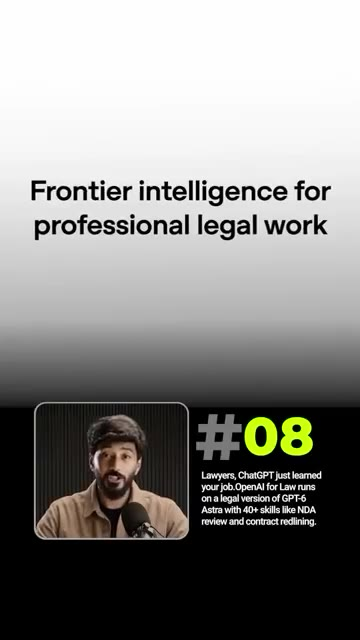
*⏱️ 00:00:32 — Capture montrant le texte 'Frontier intelligence for professional legal work' avec une vidéo miniature du présentateur et un résumé textuel sur 'OpenAI for Law'.*

---

### ⏱️ `[00:00:42 - 00:01:00]` | Segment #03

**🔊 Audio (Transcription Intégrale Mot pour Mot en Français) :**
> 7. Anthropic Shipt Opus 5.5 Un ingénieur, 680 000 lignes de code, un jour. C'est Opus 5.5. Les performances de Fable 5.1 avec un coût inférieur de 40 % et 30 % plus rapide, avec les gains les plus importants dans le codage agentique où il écrit et corrige du code de manière autonome. Disponible dès maintenant sur tous les forfaits.

**👁️ Analyse Visuelle d'Écran (gemini-3.5-flash-lite) :**
**Interface & Outils** : Articles de blog et tableaux de benchmarks comparatifs.

**Contenu textuel & Code** : Textes descriptifs sur Opus 5.5, article de presse soulignant une réduction des coûts de 40% et un gain de vitesse de 30%, et tableau de données chiffrées de performance.

**Action / Démonstration** : Présentation des capacités, performances et benchmarks du modèle d'IA Opus 5.5 d'Anthropic.

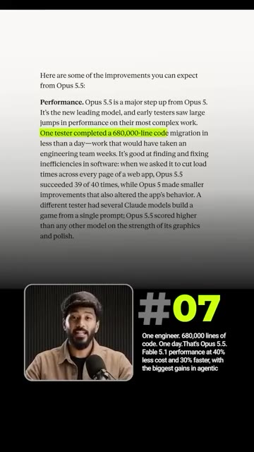
*⏱️ 00:00:46 — Capture d'écran montrant un texte détaillé sur les performances du modèle Opus 5.5, avec une mention surlignée concernant une migration de code de 680 000 lignes réalisée en moins d'un jour par un seul testeur.*

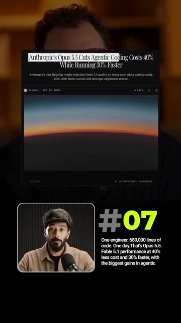
*⏱️ 00:00:51 — Capture d'écran d'un article de presse avec le titre "Anthropic's Opus 5.5 Cuts Agentic Coding Costs 40% While Running 30% Faster" et une image d'illustration représentant l'horizon terrestre.*

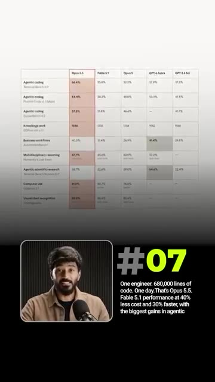
*⏱️ 00:00:55 — Capture d'écran d'un tableau comparatif des performances de différents modèles d'IA (Opus 5.5, Fable 5.1, Opus 5, GPT-5, etc.) sur divers benchmarks incluant le codage agentique et les flux de travail.*

---

### ⏱️ `[00:01:00 - 00:01:24]` | Segment #04

**🔊 Audio (Transcription Intégrale Mot pour Mot en Français) :**
> 6. OpenAI a lancé Sol et Luna. Le même cerveau qu'Astra, à moitié prix. Sol s'occupe du codage lourd. Luna, des petites tâches que l'on lance un million de fois, et toutes deux réutilisent le travail précédent au lieu de tout recalculer. OpenAI a réduit les prix des API de moitié et a augmenté les limites. 5. Elon a déployé Grok 4.7. Elon a repoussé cela cinq fois. C'est enfin sorti. Grok 4.7 travaille plus longtemps sur les tâches difficiles, vérifie ses propres réponses et s'est classé deuxième juste après o1 (pay 5.1) en matière de connaissances.

**👁️ Analyse Visuelle d'Écran (gemini-3.5-flash-lite) :**
**Interface & Outils** : Graphique de benchmark comparatif (AutomationBench)

**Contenu textuel & Code** : Courbes de performance (Score en ordonnée, Coût par tâche en abscisse) pour GPT-6 Astra, GPT-6 Sol, GPT-6 Luna, Claude Opus 5 et autres modèles. Texte #06 et description des modèles Sol et Luna.

**Action / Démonstration** : Présentation comparative des performances et des coûts des modèles OpenAI Sol et Luna par rapport à la concurrence.

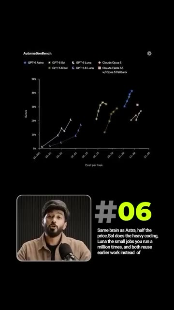
*⏱️ 00:01:06 — Graphique de performance et de coût comparant différents modèles d'IA (AutomationBench) avec le présentateur incrusté en bas à gauche et du texte explicatif.*

---

### ⏱️ `[00:01:24 - 00:01:42]` | Segment #05

**🔊 Audio (Transcription Intégrale Mot pour Mot en Français) :**
> De nouvelles mesures de protection ne laissent passer que 3,3 % des tentatives de contournement. Des invites conçues pour le piéger et le pousser à enfreindre ses propres règles. 4. Alibaba a créé un studio dans une boîte de discussion. Une chanson plus une invite équivaut à un clip musical complet. Quen gère le texte, les images, l'audio et la vidéo en un seul modèle. Donnez-lui un court drame et il le traduit, le double et le livre dans une autre langue.

**👁️ Analyse Visuelle d'Écran (gemini-3.5-flash-lite) :**
**Interface & Outils** : Présentation visuelle de schémas d'architecture et d'interfaces de traitement vidéo.

**Contenu textuel & Code** : Texte technique décrivant les performances de sécurité et diagrammes de flux d'agents IA.

**Action / Démonstration** : Explication des fonctionnalités d'IA avancées et des mesures de protection des modèles.

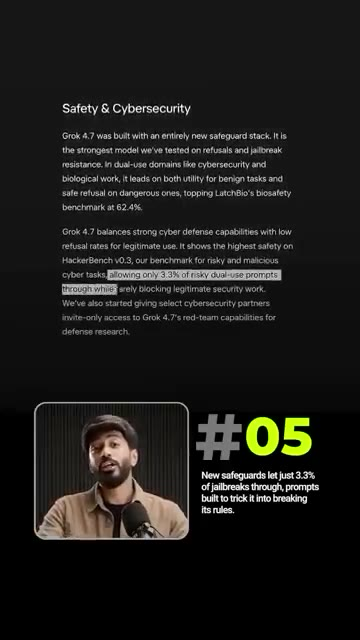
*⏱️ 00:01:29 — Texte sur la sécurité et la cybersécurité avec le modèle Grok 4.7 et encadré du présentateur.*

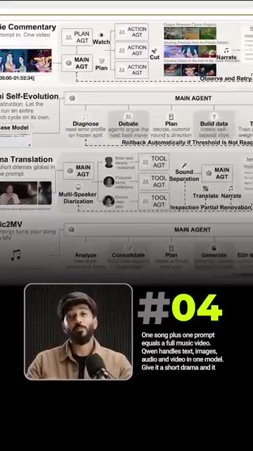
*⏱️ 00:01:33 — Schéma détaillé illustrant les flux d'agents IA pour différents cas d'usage comme Music2MV.*

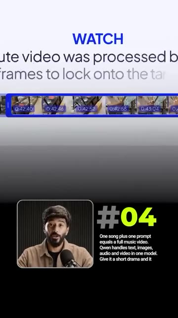
*⏱️ 00:01:38 — Interface de traitement vidéo montrant une timeline avec des extraits horodatés successifs.*

---

### ⏱️ `[00:01:43 - 00:02:01]` | Segment #06

**🔊 Audio (Transcription Intégrale Mot pour Mot en Français) :**
> Un studio de production à l'intérieur d'une boîte de discussion. 3. TypeSafe a inversé ChatGPT. L'homme qui a aidé à construire ChatGPT vient de créer son opposé. Jev de Diogo Almeida est le tout premier modèle de système 1. Il n'écrit aucun texte, il répond simplement par oui ou par non en une fraction de seconde, comme un filtre anti-spam. Ainsi, les applications agissent instantanément. 100 fois plus rapide et moins cher.

**👁️ Analyse Visuelle d'Écran (gemini-3.5-flash-lite) :**
**Interface & Outils** : Interface web de Jev (TypeSafe AI) et tableau comparatif des modèles d'IA.

**Contenu textuel & Code** : Questions binaires posées à Jev, réponses par oui/non avec niveau de confiance et temps de réponse (312 ms), et tableau des coûts des différents LLM du marché.

**Action / Démonstration** : Navigation et démonstration visuelle des réponses ultra-rapides et gratuites du modèle Jev (TypeSafe AI).

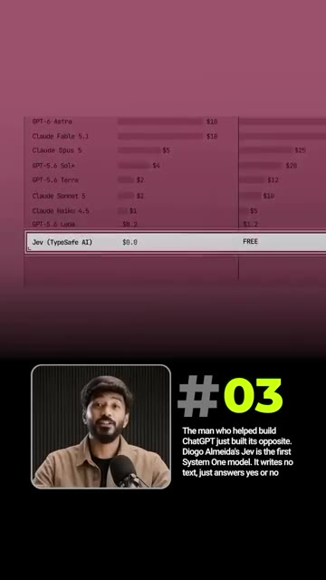
*⏱️ 00:01:52 — Capture d'écran comparant les coûts des modèles d'IA, mettant en évidence Jev (TypeSafe AI) à un tarif gratuit ($0.0).*

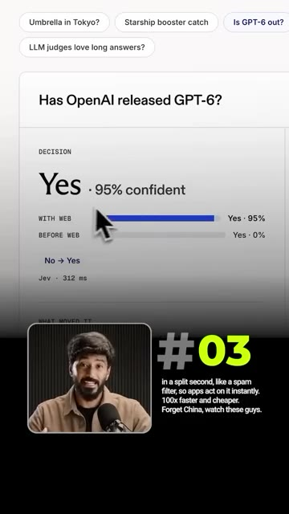
*⏱️ 00:01:56 — Interface utilisateur montrant une question posée au modèle Jev (« Has OpenAI released GPT-6? ») avec une réponse binaire claire (« Yes » à 95% de confiance).*

---

### ⏱️ `[00:02:01 - 00:02:21]` | Segment #07

**🔊 Audio (Transcription Intégrale Mot pour Mot en Français) :**
> Oubliez la Chine, regardez ces types. 2. L'industrie de l'IA a accepté de ralentir. Puis a été poursuivie en justice pour cela. Dario Amadei a écrit, nous devons rythmer la frontière. Elon et Sam ont été d'accord le même jour. Trump ne l'a pas été, disant, peu importe qui gagne, l'IA gagne. 1. Claude Sonnet 5.5 est sorti. Opus est devenu 40 % moins cher. Sonnet 5.5 est XYZ et Haiku 5.5 arrive.

**👁️ Analyse Visuelle d'Écran (gemini-3.5-flash-lite) :**
**Interface & Outils** : Tableau de benchmarks et de performances de modèles d'IA (Claude Sonnet 5.5, Sonnet 5, Opus 5.5, GPT 4.5v).

**Contenu textuel & Code** : Tableau comparatif des performances de Claude Sonnet 5.5 (Agentic coding, Knowledge work, Multidisciplinary reasoning, Computer use, Visual chart recognition) avec des scores chiffrés.

**Action / Démonstration** : Présentation des performances des nouveaux modèles de Claude (Sonnet 5.5, Opus 5.5, etc.) avec leurs statistiques et gains de prix.

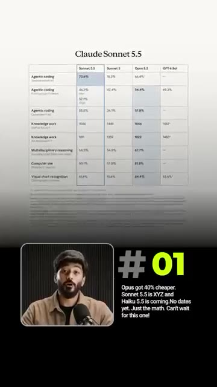
*⏱️ 00:02:16 — Un tableau de performance comparatif pour "Claude Sonnet 5.5" montrant divers scores de tests d'IA, avec une incrustation vidéo du présentateur.*

---

### ⏱️ `[00:02:21 - 00:02:36]` | Segment #08

**🔊 Audio (Transcription Intégrale Mot pour Mot en Français) :**
> Pas encore de dates. Juste les maths. J'ai hâte pour celui-ci. Cette semaine, l'IA est passée du tribunal à la salle de classe, les modèles sont devenus moins chers et plus rapides, et les grands laboratoires ont commencé à se disputer pour savoir s'il fallait tout ralentir. Je partage des mises à jour comme celle-ci dès qu'elles sortent dans ma communauté WhatsApp gratuite. Rejoignez LinkedIn Bayo.

**👁️ Analyse Visuelle d'Écran (gemini-3.5-flash-lite) :**
**Interface & Outils** : Application mobile WhatsApp, interface de communauté.

**Contenu textuel & Code** : "Join the free WhatsApp Community", "Link in Bio" et aperçu de l'application mobile.

**Action / Démonstration** : Promotion de la communauté WhatsApp de la chaîne avec un appel à l'action visuel ("Link in Bio").

*⏱️ 00:02:32 — Un écran de smartphone affichant l'interface d'une communauté WhatsApp avec le texte "Join the free WhatsApp Community" et "Link in Bio".*

---

