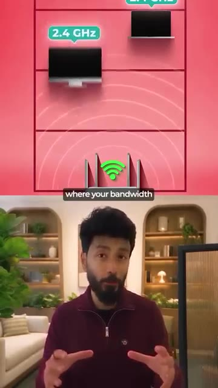
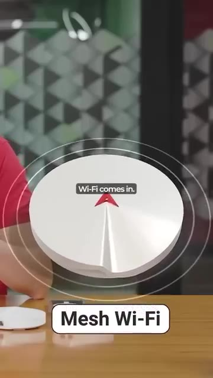
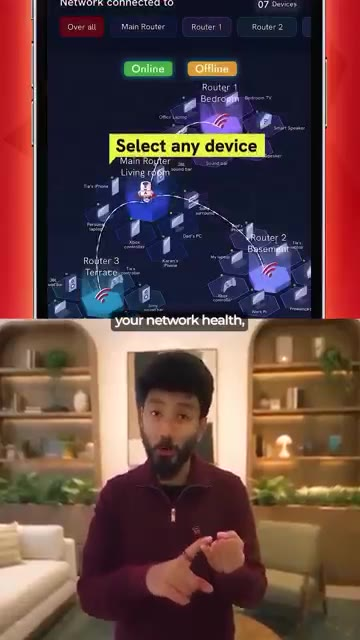
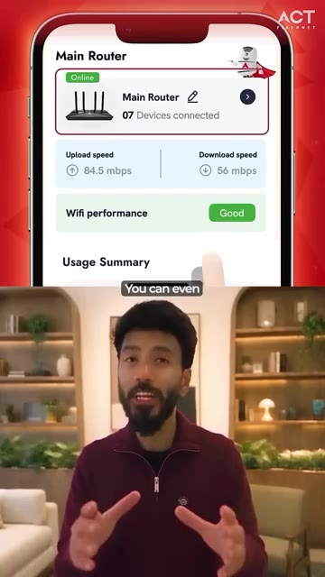
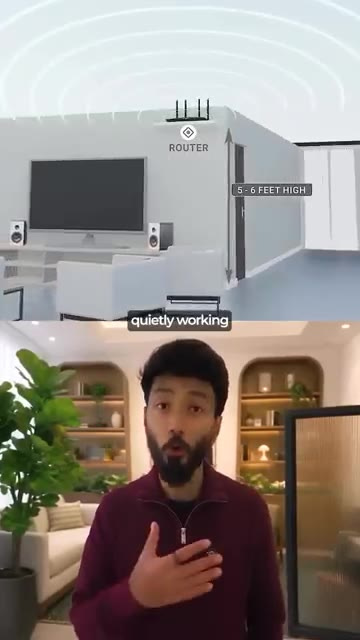
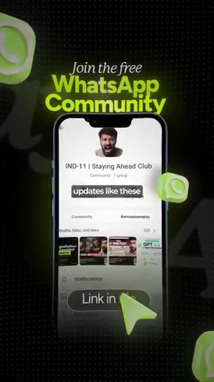

# 🎬 Your Slow Internet Isn’t What You Think... Fix It With AI! 🤯

> **Chaîne** : [Vaibhav Sisinty](https://www.youtube.com/@vaibhavsisinty)  
> **Lien YouTube** : [https://www.youtube.com/watch?v=tMSqFrAiggw](https://www.youtube.com/watch?v=tMSqFrAiggw)  
> **Date de publication** : 20261012  
> **Durée** : 00:01:44  
> **Identifiant vidéo** : `tMSqFrAiggw`  
> **Transcription & Analyse** : `whisper-v3-large-turbo+gemini-3.5-flash-lite`  

---

## 📌 Synthèse Exécutive & Outils

### 💡 Résumé

Cette vidéo aborde une problématique universelle et frustrante : la lenteur perçue d'Internet à la maison, que nous attribuons systématiquement à notre fournisseur d'accès, alors qu'elle trouve souvent sa source dans la congestion interne de notre réseau domestique. Entre les jeux vidéo, les appels en visioconférence, le streaming 4K et la multitude d'objets connectés s'arrachant la bande passante à travers les murs, le signal s'effondre. Pour résoudre ce défi d'optimisation complexe, l'entreprise indienne ACT Fibernet introduit une solution innovante baptisée ACT Smart Wi-Fi, propulsée par un agent d'intelligence artificielle nommé « ACT Zippy ».

Plutôt que de recourir à l'IA pour faire du simple battage médiatique (« AI washing »), cette technologie déploie une approche pragmatique d'automatisation invisible. Agissant comme un agent de circulation intelligent 24h/24 et 7j/7, Zippy surveille en permanence le réseau, ajuste dynamiquement la répartition de la bande passante, anticipe et résout les pertes de signal, et s'associe à une architecture de Wi-Fi maillé. Cette synergie garantit qu'aucun usage (comme un appel professionnel critique) ne pâtisse d'un autre (comme le streaming du salon), tout en offrant à l'utilisateur final un contrôle granulaire via une application dédiée permettant de cartographier, analyser et planifier l'accès des appareils.

L'analyse de ce cas met en lumière une tendance forte du marché : l'intégration de l'IA et de l'automatisation dans les infrastructures du quotidien pour éliminer les frictions de l'expérience utilisateur. En transformant un équipement passif en un système autonome capable de « se débrouiller tout seul », la marque améliore radicalement la satisfaction client tout en fidélisant sa base grâce à une mise à niveau gratuite et sans friction. Une stratégie marketing et produit redoutable axée sur la valeur perçue et l'utilité réelle.

---

### 🛠️ Outils, Modèles & Logiciels Présentés

*   **ACT Smart Wi-Fi / ACT Zippy** : Le système de gestion de réseau intelligent propulsé par l'IA qui surveille, optimise la bande passante et résout les problèmes de signal en arrière-plan 24h/24 et 7j/7.
*   **Application ACT** : L'interface utilisateur mobile permettant de visualiser l'état de santé du réseau, d'accéder à une carte interactive des appareils connectés, d'analyser l'utilisation individuelle et de gérer le contrôle d'accès ou les restrictions horaires.
*   **Système de Wi-Fi Maillé (Mesh)** : La technologie matérielle complémentaire qui remplace un routeur unique par plusieurs points d'accès pour diffuser uniformément le signal à travers toute la maison, éliminant les zones mortes.
*   *Note sur l'écosystème IA global (Midjourney, Gemini, Perplexity, Make, ChatGPT, n8n, Claude)* : Bien que la vidéo cible spécifiquement une IA réseau (ACT Zippy), l'expertise globale de la chaîne Vaibhav Sisinty mobilise ces outils d'automatisation et de génération pour le growth hacking, la création de contenus et l'optimisation des workflows digitaux au quotidien.

---

### 🔑 Points Clés & Enseignements Stratégiques

1.  **Identifier la vraie source du problème** : Ne pas confondre la performance brute d'un fournisseur d'accès avec la capacité de distribution locale et la congestion de son propre réseau domestique.
2.  **L'IA utilitaire vs l'effet de mode** : Utiliser l'intelligence artificielle pour résoudre des frictions concrètes et invisibles (comme la gestion du trafic réseau) plutôt que de l'implémenter superficiellement pour le marketing.
3.  **L'automatisation proactive 24/7** : Concevoir des systèmes capables de s'auto-diagnostiquer et de se réguler en arrière-plan sans nécessiter d'intervention humaine ou de redémarrage manuel du routeur.
4.  **La priorisation intelligente des flux (Bande passante)** : Appliquer une logique de routage dynamique pour que les usages critiques (appels professionnels) ne subissent pas la concurrence des usages lourds (streaming 4K, jeux en réseau).
5.  **Dépasser les limites physiques** : Combiner l'intelligence logicielle avec du matériel adapté (comme le Wi-Fi maillé) pour surmonter les obstacles architecturaux (murs, éloignement) et garantir une couverture homogène.
6.  **Transparence et gouvernance par la donnée** : Offrir aux utilisateurs finaux un tableau de bord applicatif clair pour auditer la santé de leur réseau, identifier les appareils gourmands et comprendre leurs usages.
7.  **Contrôle parental et gestion des accès** : Permettre de planifier des plages horaires d'utilisation par appareil pour responsabiliser la consommation numérique au sein du foyer.
8.  **Stratégie de fidélisation par la mise à niveau gratuite** : Transformer une innovation technologique en un argument de rétention client massif en proposant l'amélioration sans frais ni tracas d'installation pour les abonnés existants.
9.  **L'expérience utilisateur (UX) sans friction** : Masquer la complexité technique derrière une automatisation fluide où la technologie travaille silencieusement au service du confort de l'utilisateur.
10. **Growth Hacking et viralité communautaire** : Capitaliser sur la curiosité et la valeur éducative de ces innovations pour nourrir des communautés engagées (comme les canaux WhatsApp) et créer un trafic organique qualifié.

---

## ⏱️ Chronologie & Transcription Complète Audio & Visuelle (Mot pour Mot)

### ⏱️ `[00:00:00 - 00:00:19]` | Segment #01

**🔊 Audio (Transcription Intégrale Mot pour Mot en Français) :**
> Pendant des années, le Wi-Fi servait uniquement à obtenir un Internet plus rapide. Aujourd'hui, une entreprise indienne essaie de le rendre plus intelligent en y intégrant de l'intelligence artificielle. Voici les actualités. Nous blâmons généralement Internet pour la lenteur du Wi-Fi. Mais le problème peut en réalité venir de ce qui se passe chez vous. Quelqu'un joue à des jeux vidéo, quelqu'un est en appel vidéo, la télévision diffuse en streaming dans le salon, et soudain tout ralentit.

**👁️ Analyse Visuelle d'Écran (gemini-3.5-flash-lite) :**
**Interface & Outils** : AUCUNE

**Contenu textuel & Code** : Texte à l'écran : "is trying" puis "We usually blame slow WI-FI Error" et "Someone's gaming".

**Action / Démonstration** : Présentation introductive d'un sujet technologique avec des animations graphiques explicatives.

---

### ⏱️ `[00:00:19 - 00:00:39]` | Segment #02

**🔊 Audio (Transcription Intégrale Mot pour Mot en Français) :**
> Mais Internet allait probablement bien. La vraie bataille se jouait à l'intérieur de chez vous. Tous vos appareils connectés à la même connexion en même temps, avec quelques murs au milieu, et le signal qui a du mal à atteindre la pièce d'à côté. C'est là que ACT Smart Wi-Fi devient intéressant. Il est doté d'un cerveau d'intelligence artificielle appelé ACT Zippy, qui fonctionne en arrière-plan 24h/24 et 7j/7. Considérez Zippy comme un agent de circulation intelligent pour votre Wi-Fi.

**👁️ Analyse Visuelle d'Écran (gemini-3.5-flash-lite) :**
**Interface & Outils** : Publicité animée pour ACT Fibernet

**Contenu textuel & Code** : Texte promotionnel 'ACT Zippy is here with great advice, for a great Wi-Fi connection.' et hashtag '#BreakFreeWithZippy'

**Action / Démonstration** : Présentation publicitaire d'un service Wi-Fi avec un personnage mascotté animé.

*⏱️ 00:00:34 — Publicité animée pour ACT Fibernet présentant le personnage 'ACT Zippy' sur fond rouge avec le texte 'ACT Zippy is here with great advice for a great Wi-Fi connection.'*

---

### ⏱️ `[00:00:39 - 00:00:59]` | Segment #03

**🔊 Audio (Transcription Intégrale Mot pour Mot en Français) :**
> Il surveille constamment votre réseau, optimise automatiquement la connexion, gère la répartition de votre bande passante, et peut même résoudre certains problèmes de signal avant que vous ne les remarquiez. Ainsi, au lieu d'aller vers votre routeur chaque fois que quelque chose ne va pas, votre Wi-Fi essaie fondamentalement de se débrouiller tout seul. C'est là que le Wi-Fi maillé entre en jeu. Au lieu d'un seul routeur qui crie depuis un coin, le signal se propage dans toute votre maison.

**👁️ Analyse Visuelle d'Écran (gemini-3.5-flash-lite) :**
**Interface & Outils** : Animation graphique de réseau et dispositif matériel Mesh Wi-Fi

**Contenu textuel & Code** : Schéma explicatif de routeur avec fréquences (2.4 GHz) et texte "Mesh Wi-Fi"

**Action / Démonstration** : Explication visuelle et démonstration matérielle du fonctionnement d'un routeur Mesh Wi-Fi et de la gestion de bande passante

*⏱️ 00:00:44 — Animation explicative montrant le fonctionnement du routeur Wi-Fi et la répartition de la bande vitesse avec le présentateur en dessous.*

*⏱️ 00:00:54 — Présentation d'un routeur Mesh Wi-Fi physique sur une table avec une animation graphique de signal autour.*

---

### ⏱️ `[00:00:59 - 00:01:22]` | Segment #04

**🔊 Audio (Transcription Intégrale Mot pour Mot en Français) :**
> Ainsi, vos jeux n'ont pas à rivaliser avec votre téléviseur 4K. Votre appel professionnel n'a pas à rivaliser avec les appareils de tout le monde. Et vos objets connectés peuvent également rester connectés. Et vous pouvez réellement voir ce qui se passe grâce à l'application ACT. Vous pouvez vérifier l'état de santé de votre réseau, voir chaque appareil connecté sur la carte des appareils et obtenir des analyses d'utilisation pour chaque appareil individuel. Vous pouvez même gérer des choses comme l'accès des appareils et définir des périodes spécifiques pendant lesquelles un appareil peut ou ne peut pas utiliser le Wi-Fi.

**👁️ Analyse Visuelle d'Écran (gemini-3.5-flash-lite) :**
**Interface & Outils** : Application mobile ACT

**Contenu textuel & Code** : Vitesse d'upload (84.5 mbps), vitesse de download (56 mbps), performance Wi-Fi ("Good"), nombre d'appareils connectés.

**Action / Démonstration** : Le présentateur explique les fonctionnalités de l'application mobile en montrant des captures d'écran de l'interface de gestion du réseau.

*⏱️ 00:01:11 — Interface mobile montrant la carte du réseau connectée avec les routeurs et les appareils connectés.*

*⏱️ 00:01:17 — Interface de l'application ACT affichant le statut du routeur principal, la vitesse de téléchargement et la performance Wi-Fi.*

---

### ⏱️ `[00:01:23 - 00:01:41]` | Segment #05

**🔊 Audio (Transcription Intégrale Mot pour Mot en Français) :**
> C'est ce qui rend cela intéressant pour moi. Ce n'est pas de l'intelligence artificielle pour le simple fait de faire de l'intelligence artificielle. C'est de l'intelligence artificielle qui travaille discrètement en arrière-plan pour vous offrir une meilleure expérience Wi-Fi à la maison. Et le meilleur, c'est que si vous êtes un utilisateur nouveau ou existant d'ACT Fibernet, la mise à niveau est gratuite, sans tracas d'installation supplémentaire. Un Wi-Fi plus rapide, plus puissant et plus intelligent propulsé par l'intelligence artificielle.

**👁️ Analyse Visuelle d'Écran (gemini-3.5-flash-lite) :**
**Interface & Outils** : AUCUNE

**Contenu textuel & Code** : Sous-titres textuels ("quietly working", "If you are a new", "extra installation hassle") et animation 3D illustrant la portée du signal d'un routeur Wi-Fi.

**Action / Démonstration** : Présentation orale avec support visuel animé illustrant l'emplacement du routeur Wi-Fi à la maison.

*⏱️ 00:01:27 — L'écran est divisé : en haut, une animation 3D illustrant le positionnement idéal d'un routeur Wi-Fi (à 5-6 pieds de hauteur) ; en bas, le présentateur s'exprime face caméra.*

---

### ⏱️ `[00:01:41 - 00:01:44]` | Segment #06

**🔊 Audio (Transcription Intégrale Mot pour Mot en Français) :**
> Je partage des mises à jour comme celles-ci dans ma communauté WhatsApp. Lien dans la bio.

**👁️ Analyse Visuelle d'Écran (gemini-3.5-flash-lite) :**
**Interface & Outils** : Application WhatsApp (interface mobile)

**Contenu textuel & Code** : Texte "Join the free WhatsApp Community" et "IND-11 | Staying Ahead Club" avec des aperçus de médias partagés et un bouton cliquable "Link in bio".

**Action / Démonstration** : Incitation à rejoindre la communauté WhatsApp via le lien indiqué.

*⏱️ 00:01:42 — Capture d'écran montrant l'interface d'un smartphone affichant la communauté WhatsApp "IND-11 | Staying Ahead Club" avec un appel à l'action pour rejoindre.*

---

