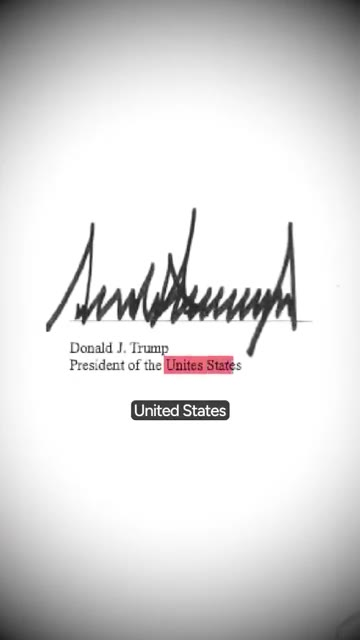
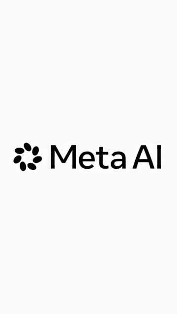
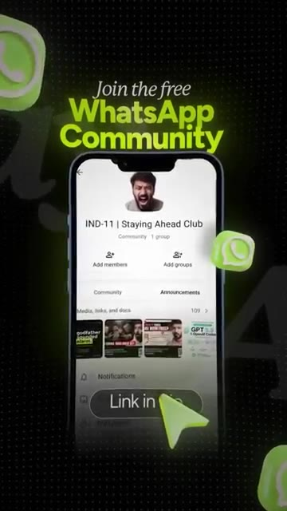

# 🎬 Trump, Elon & Zuck Signed a Promise NO ONE Can Enforce! 🤯

> **Chaîne** : [Vaibhav Sisinty](https://www.youtube.com/@vaibhavsisinty)  
> **Lien YouTube** : [https://www.youtube.com/watch?v=OR1cvD8JqEk](https://www.youtube.com/watch?v=OR1cvD8JqEk)  
> **Date de publication** : 20261013  
> **Durée** : 00:01:36  
> **Identifiant vidéo** : `OR1cvD8JqEk`  
> **Transcription & Analyse** : `whisper-v3-large-turbo+gemini-3.5-flash-lite`  

---

## 📌 Synthèse Exécutive & Outils

### 💡 Résumé

Cette vidéo aborde un tournant géopolitique et réglementaire majeur dans l'écosystème de l'intelligence artificielle, marqué par une réunion au sommet à la Maison-Blanche réunissant les figures de proue de la tech mondiale, d'Elon Musk à Mark Zuckerberg en passant par Jensen Huang et les dirigeants d'OpenAI et d'Anthropic. L'analyse met en lumière la décision politique de rebaptiser l'IA en « SI » (Super Intelligence) pour les services du gouvernement américain, une anticipation sémantique d'un stade technologique que l'humanité n'a pourtant pas encore atteint. 

Au cœur de la séquence, l'examen minutieux d'un accord de sécurité signé par six géants de l'IA révèle un paradoxe saisissant : un système de contrôle à quatre niveaux entièrement autorégulé (équipes internes croisées, auditeurs externes et conseils d'administration), mais totalement dépourvu de contrainte légale ou de sanctions financières. Qualifié de « moralement contraignant » par l'administration fédérale et vivement critiqué par les autorités locales californiennes, cet accord illustre l'absence criante d'un arbitre indépendant pour superviser le développement des technologies qui façonnent notre quotidien.

Enfin, la vidéo connecte ces enjeux macro-politiques à la réalité des utilisateurs finaux à l'échelle mondiale. Alors que des millions de personnes s'appuient quotidiennement sur des modèles comme ChatGPT, Gemini, Claude ou Meta AI, la question de l'auto-régulation éthique des entreprises pose un risque systémique direct sur la fiabilité, la sécurité et l'évaluation de ces outils. L'analyse conclut sur la nécessité d'une prise de conscience collective face à un vide juridique persistant où les créateurs de l'IA agissent à la fois comme juges et parties.

### 🛠️ Outils, Modèles & Logiciels Présentés

* **ChatGPT** : Modèle de langage conversationnel d'OpenAI, cité parmi les solutions grand public massivement adoptées à l'échelle internationale dont la sécurité et l'évaluation dépendent directement des politiques d'autorégulation des entreprises.
* **Gemini** : Modèle d'intelligence artificielle de Google, mentionné comme l'une des plateformes de référence utilisées quotidiennement par des millions d'utilisateurs et soumise aux mêmes incertitudes réglementaires.
* **Claude** : Modèle conversationnel d'Anthropic (dont les dirigeants étaient présents au sommet de la Maison-Blanche), faisant partie des IA majeures dont les protocoles de sécurité internes manquent d'un arbitrage externe et contraignant.
* **Meta AI** : Écosystème d'intelligence artificielle de Meta (Mark Zuckerberg), intégré aux plateformes sociales et impliqué dans les discussions politiques et les promesses de sécurité non contraignantes.
* **Midjourney** : Logiciel de génération d'images par IA (mentionné dans la constellation technologique globale de la chaîne bien qu'implicitement lié aux outils de création de contenu de pointe).
* **Make** : Outil d'automatisation no-code (faisant partie de la boîte à outils experte de la chaîne Vaibhav Sisinty pour connecter les flux de travail marketing).
* **n8n** : Solution d'automatisation de workflows open-source et avancée (utilisée dans les stratégies de productivité et de growth hacking de la chaîne).
* **Perplexity** : Moteur de recherche conversationnel propulsé par l'IA (intégré aux pratiques de veille technologique et de productivité avancée).
* **ChatGPT & Claude (pour l'automatisation marketing)** : Outils mobilisés dans les stratégies de croissance pour scaler les processus digitaux (bien que le focus principal de la vidéo reste géopolitique et réglementaire).

### 🔑 Points Clés & Enseignements Stratégiques

1. **Le pivot sémantique gouvernemental** : Le passage officiel de l'appellation « IA » (Intelligence Artificielle) à « SI » (Super Intelligence) pour les bureaux du gouvernement américain démontre une volonté politique d'anticiper et de marquer les esprits, malgré un décalage avéré avec l'état actuel réel de la technologie.
2. **L'illusion de la régulation par l'engagement** : Les promesses de sécurité signées par les six géants de la tech reposent sur une base volontaire et « moralement contraignante », ce qui équivaut à une absence totale de force exécutoire ou de sanctions en cas de non-respect.
3. **Le modèle des quatre niveaux de contrôle interne** : L'architecture de surveillance présentée (équipes internes, double-vérification, auditeurs externes et validation par le board) donne une impression de rigueur bureaucratique mais souffre d'un manque fondamental d'indépendance et d'impartialité.
4. **La fracture fédérale vs locale** : L'opposition immédiate entre le décret fédéral et la réaction du gouverneur de Californie (qui maintient le terme d'IA et impose ses propres règles) met en lumière la cacophonie réglementaire et l'absence de vision unifiée face au développement de l'IA.
5. **Le piège de l'auto-évaluation** : Lorsque les entreprises concepteurs de modèles d'IA évaluent elles-mêmes leurs propres copies et risques, le conflit d'intérêts devient structurel, menaçant l'objectivité des mesures de sécurité déployées.
6. **L'impact direct sur les utilisateurs finaux** : Les décisions prises au sommet de l'État et dans les conseils d'administration de la Silicon Valley impactent directement des millions d'utilisateurs à travers le monde (notamment en Inde) qui utilisent ChatGPT, Gemini ou Claude au quotidien sans visibilité réelle sur les garde-fous appliqués.
7. **L'absence d'arbitre indépendant** : Le constat central de la vidéo réside dans le vide institutionnel : aucun régulateur neutre ou tiers de confiance doté de pouvoirs de sanction ne supervise de manière indépendante l'industrie de l'IA générative.
8. **L'importance de la vigilance critique en marketing et tech** : Pour les professionnels du digital, des créateurs de contenu et des growth hackers, s'appuyer sur des outils d'IA nécessite de comprendre que la sécurité et l'éthique de ces plateformes reposent entièrement sur la bonne volonté de leurs créateurs.
9. **Le rôle de l'engagement communautaire** : L'utilisation stratégique de canaux directs (comme les communautés WhatsApp) pour relayer des actualités géopolitiques et technologiques de premierplan constitue un levier puissant d'engagement et de fidélisation d'audience.
10. **L'appel à l'interactivité et au débat** : Poser des questions claires et tranchées à sa communauté (« Feriez-vous confiance à ces entreprises pour s'auto-réguler ? ») est une méthode redoutable pour maximiser l'engagement, stimuler l'algorithme et capter le pouls des utilisateurs sur des sujets complexes.

---

## ⏱️ Chronologie & Transcription Complète Audio & Visuelle (Mot pour Mot)

### ⏱️ `[00:00:00 - 00:00:26]` | Segment #01

**🔊 Audio (Transcription Intégrale Mot pour Mot en Français) :**
> Elon Musk, Mark Zuckerberg et Sundar Pichai viennent de signer une promesse que personne ne peut faire respecter. Imaginez un peu. Un déjeuner chic à la Maison-Blanche. Autour de la table, Elon Musk, Mark Zuckerberg, Sundar Pichai, Jensen Huang et les patrons d'OpenAI et d'Anthropic. En gros, les personnes qui créent toutes les intelligences artificielles sur votre téléphone. Ce même jour, Trump a signé un décret. Tous les bureaux du gouvernement américain doivent maintenant arrêter d'écrire IA et commencer à écrire SI. Super intelligence.

**👁️ Analyse Visuelle d'Écran (gemini-3.5-flash-lite) :**
**Interface & Outils** : AUCUNE

**Contenu textuel & Code** : Sous-titres textuels de la narration (« a fancy lunch at », « and the bosses », « an order »).

**Action / Démonstration** : Narration et présentation vidéo avec illustration par des images d'illustration et d'archives.

---

### ⏱️ `[00:00:26 - 00:00:48]` | Segment #02

**🔊 Audio (Transcription Intégrale Mot pour Mot en Français) :**
> Voici la partie drôle. Dans la tech, la super intelligence signifie qu'une IA est plus intelligente que chaque humain dans tous les domaines. Les experts disent qu'on n'y est pas encore. Donc l'Amérique a juste nommé le bébé avant qu'il ne naisse. Ensuite est venu le vrai truc. Six entreprises d'IA ont signé une promesse de sécurité avec quatre niveaux de contrôle. Leur propre équipe surveille l'IA. Une deuxième équipe surveille cette équipe. Un auditeur externe vérifie tout.

**👁️ Analyse Visuelle d'Écran (gemini-3.5-flash-lite) :**
**Interface & Outils** : AUCUNE

**Contenu textuel & Code** : AUCUNE
[N/A] Le présentateur parle face caméra sans outil ou interface visible.

**Action / Démonstration** : Explications face caméra et présentation conceptuelle.

---

### ⏱️ `[00:00:48 - 00:01:08]` | Segment #03

**🔊 Audio (Transcription Intégrale Mot pour Mot en Français) :**
> Et le conseil d'administration de l'entreprise reçoit le bulletin. Ça a l'air strict, n'est-ce pas ? Saisissez bien la nuance. S'ils le rompent, il ne se passe rien. Pas de loi, pas d'amende. Trump a qualifié cela de moralement contraignant. Ce qui est fondamentalement une promesse sur le p'tit doigt. Une promesse sur le p'tit doigt très, très coûteuse. Le lendemain, le gouverneur de Californie, Gavin Newsom, a qualifié cela d'irresponsable. Ensuite, il a signé son propre décret. En Californie, l'IA reste l'IA.

**👁️ Analyse Visuelle d'Écran (gemini-3.5-flash-lite) :**
**Interface & Outils** : AUCUNE

**Contenu textuel & Code** : AUCUNE

**Action / Démonstration** : AUCUNE

---

### ⏱️ `[00:01:08 - 00:01:26]` | Segment #04

**🔊 Audio (Transcription Intégrale Mot pour Mot en Français) :**
> Et la cerise sur le gâteau, le document officiel sur la sécurité de l'IA a mal orthographié « United States », juste sous la signature de Trump. Blagues mises à part, cela nous concerne. Des millions d'Indiens utilisent ChatGPT, Gemini, Claude et Meta AI chaque jour. Si ces entreprises corrigent elles-mêmes leurs propres copies, notre IA sera évaluée de la même manière.

**👁️ Analyse Visuelle d'Écran (gemini-3.5-flash-lite) :**
**Interface & Outils** : Document officiel et affichage du logo Meta AI.

**Contenu textuel & Code** : Texte « Donald J. Trump President of the Unites States » et logo Meta AI.

**Action / Démonstration** : Illustration visuelle du document officiel avec la faute d'orthographe puis affichage d'un logo d'outil d'IA.

*⏱️ 00:01:12 — Gros plan sur un document officiel montrant la signature de Donald J. Trump avec une coquille sur « Unites States ».*

*⏱️ 00:01:21 — Logo officiel de Meta AI sur fond blanc.*

---

### ⏱️ `[00:01:26 - 00:01:36]` | Segment #05

**🔊 Audio (Transcription Intégrale Mot pour Mot en Français) :**
> Un nouveau nom, une nouvelle promesse et toujours pas d'arbitre. Feriez-vous confiance à ces entreprises pour s'auto-réguler, oui ou non, dans les commentaires ? Je partage des actualités comme celle-ci dans ma communauté WhatsApp. Lien dans la bio.

**👁️ Analyse Visuelle d'Écran (gemini-3.5-flash-lite) :**
**Interface & Outils** : Application mobile WhatsApp (interface de communauté).

**Contenu textuel & Code** : Texte incitatif "Join the free WhatsApp Community" avec affichage d'un smartphone et un bouton "Link in bio".

**Action / Démonstration** : Promotion et appel à rejoindre la communauté WhatsApp du créateur.

*⏱️ 00:01:33 — Image 3 : Capture d'écran d'un smartphone montrant l'interface d'une communauté WhatsApp avec l'appel à l'action "Link in bio".*

---

