# 🎬 Google Gemini 4 Argon Is Here. We Tested It (+11 AI Updates)

> **Chaîne** : [Vaibhav Sisinty](https://www.youtube.com/@vaibhavsisinty)  
> **Lien YouTube** : [https://www.youtube.com/watch?v=2XpIMa1BSPc](https://www.youtube.com/watch?v=2XpIMa1BSPc)  
> **Date de publication** : 20261015  
> **Durée** : 00:20:42  
> **Identifiant vidéo** : `2XpIMa1BSPc`  
> **Transcription & Analyse** : `whisper-v3-large-turbo+gemini-3.5-flash-lite`  

---

## 📌 Synthèse Exécutive & Outils

### 💡 Résumé

Cette vidéo proposée par la chaîne de Vaibhav Sisinty dresse un panorama exhaustif et percutant des dernières évolutions majeures de l'écosystème de l'intelligence artificielle, dominé par une course effrénée à la superintelligence, à l'agentique et à l'interaction visuelle. Au cœur des annonces, Google frappe un grand coup avec le lancement de **Gemini 4 Argon**, un modèle orienté vers le raisonnement complexe doté d'une fenêtre de contexte massive d'un million de jetons, pensé pour rivaliser directement avec les poids lourds du secteur comme Claude. Parallèlement, OpenAI révolutionne l'expérience utilisateur de ChatGPT (via des versions futuristes évoquées) en introduisant des interfaces utilisateur intelligentes capables de générer des visuels 3D interactifs, des cartes dynamiques et des calculateurs directement dans le fil de discussion, s'éloignant ainsi du format textuel traditionnel.

Du côté de Meta, la vision d'une superintelligence personnelle prend forme avec **Muse Wonder**, un assistant doté d'une "mémoire active" et d'une "concentration active" capable d'exécuter des tâches en arrière-plan pendant des semaines ou des mois pour atteindre les objectifs de l'utilisateur. Microsoft n'est pas en reste en imbriquant profondément Copilot au cœur de Windows grâce à une architecture hybride capable de manipuler les fichiers locaux, et en développant ses propres puces **Maia 100** pour s'affranchir de la dépendance à NVIDIA. Enfin, Anthropic continue de structurer le marché professionnel en lançant **Claude Haiku 5.5** (ultra-économique et rapide) ainsi que des fonctionnalités novatrices comme *Claude Motion* et *Claude Dashboards*, qui transforment des ensembles de données brutes d'entreprise en tableaux de bord interactifs et en vidéos animées prêtes pour le partage.

Cette édition met également en lumière les nouveaux défis stratégiques de l'IA, notamment la sécurité des modèles face aux "attaques par distillation" (où des laboratoires tiers tentent d'extraire les capacités de Claude), et l'émergence de modèles régionaux ultra-performants comme le **Bulbul V4 Flash** de Sarvam AI en Inde, taillé pour la voix multilingue et expressive. L'ensemble démontre une transition claire : l'IA quitte le simple statut de chatbot conversationnel pour devenir un véritable système d'exploitation agentique, visuel et autonome, profondément intégré dans les flux de travail quotidiens et professionnels.

---

### 🛠️ Outils, Modèles & Logiciels Présentés

*   **Gemini 4 Argon** : Modèle de pointe de Google pour le raisonnement complexe, doté d'un million de jetons de contexte, conçu pour analyser des documents denses, optimiser le code et générer des visualisations 3D.
*   **Muse Wonder** : Assistant personnel intelligent de Meta, équipé d'une mémoire active à long terme et d'une concentration active pour exécuter des objectifs complexes en arrière-plan sur plusieurs mois.
*   **ChatGPT (GPT-6 / fonctionnalités IU intelligente)** : Version évoluée d'OpenAI capable de produire des visuels interactifs (modèles 3D, cartes, calculateurs, animations d'origami) et d'afficher des réponses en temps réel pendant leur génération.
*   **Microsoft Copilot (Mise à jour Windows hybride)** : Assistant intégré au système d'exploitation Windows, capable d'accéder aux fichiers locaux, de les organiser, d'automatiser des tâches administratives et d'exécuter des modèles d'IA en local ou dans le cloud.
*   **Maia 100** : Puce d'intelligence artificielle propriétaire développée par Microsoft pour réduire sa dépendance à NVIDIA, optimisant l'efficacité énergétique et la puissance de calcul pour Copilot et Teams.
*   **Bulbul V4 Flash** : Modèle de voix d'IA développé par Sarvam AI en Inde, spécialisé dans la génération de discours naturels, expressifs et multilingues avec une gestion fine des émotions et des accents.
*   **Claude Haiku 5.5** : Modèle le plus rapide et le plus économique d'Anthropic, affichant une réduction de coût de 75 % par rapport à la version précédente tout en excellant dans le code et la gestion de tâches répétitives multi-étapes.
*   **Claude Dashboards & Claude Motion** : Outils d'Anthropic permettant de transformer des données d'entreprise complexes en tableaux de bord interactifs et en vidéos animées modifiables par simple rétroaction textuelle.
*   **Agent One** : Nouvel agent IA autonome de Google conçu pour se connecter aux applications d'entreprise et coordonner des flux de travail complexes à l'échelle d'une organisation.

---

### 🔑 Points Clés & Enseignements Stratégiques

1.  **L'ère de la fenêtre de contexte géante** : Avec un million de jetons de contexte sur Gemini 4 Argon, l'analyse intégrale de bases documentaires massives, de codes sources tentaculaires et d'archives d'entreprise devient instantanée et fluide.
2.  **Transition du texte vers l'interface interactive** : Les assistants ne se contentent plus de rédiger des paragraphes ; ils génèrent désormais des outils fonctionnels (calculateurs, graphiques, modèles 3D interactifs) pour matérialiser l'information et faciliter la prise de décision.
3.  **Persistance et autonomie à long terme (Mémoire Active)** : Des outils comme Muse Wonder de Meta marquent un tournant en introduisant la capacité de travailler en arrière-plan sur des objectifs à long terme (semaines ou mois), transformant l'IA d'un outil réactif en un collaborateur proactif.
4.  **Intégration profonde au système d'exploitation (Copilot)** : L'hybridation des calculs (entre le traitement local sur PC et le cloud) permet à Microsoft Copilot d'interagir directement avec les fichiers locaux, garantissant rapidité, confidentialité et automatisation des tâches administratives.
5.  **Souveraineté matérielle des géants de la tech** : Le développement de puces propriétaires comme la Maia 100 de Microsoft illustre la nécessité stratégique de réduire les coûts d'infrastructure et la dépendance monopolistique envers des fabricants tiers comme NVIDIA.
6.  **Sécurité des modèles et menaces de distillation** : L'incident relevé par Anthropic (concernant l'utilisation de Claude par des acteurs tiers pour entraîner leurs propres modèles) démontre que la protection de la propriété intellectuelle des IA devient un enjeu de cybersécurité critique.
7.  **Hyper-accessibilité et compression des coûts** : La baisse drastique des coûts (comme les réductions de 75 % observées sur Claude Haiku 5.5) démocratise l'automatisation à grande échelle pour les entreprises traitant des milliers de requêtes quotidiennes.
8.  **Data-storytelling visuel et dynamique** : Les fonctionnalités comme *Claude Motion* permettent de convertir des tableaux de données arides en animations vidéo fluides, simplifiant considérablement la communication et la vulgarisation d'insights complexes auprès des équipes.
9.  **Montée en puissance des IA vocales contextuelles régionales** : Le modèle Bulbul V4 Flash prouve que l'avenir de la voix réside dans la capacité à maîtriser le multilinguisme nuancé, les codes culturels locaux et l'expressivité émotionnelle dynamique.
10. **Granularité dans le contrôle de l'effort** : La possibilité de moduler l'effort computationnel accordé par une IA à une tâche spécifique (via les réglages de Claude) permet d'optimiser finement le ratio entre vitesse, coût et complexité de traitement.

---

## ⏱️ Chronologie & Transcription Complète Audio & Visuelle (Mot pour Mot)

### ⏱️ `[00:00:00 - 00:00:18]` | Segment #01

**🔊 Audio (Transcription Intégrale Mot pour Mot en Français) :**
> Google est de retour ! Et son nouveau Gemini 4 Argon pourrait bien donner du fil à retordre à Claude. Mais est-il vraiment à la hauteur de sa réputation ?

**👁️ Analyse Visuelle d'Écran (gemini-3.5-flash-lite) :**
**Interface & Outils** : Interface de chat Gemini Advanced.

**Contenu textuel & Code** : Prompt utilisateur demandant une recette de cuisine originale et réponse générée par l'IA.

**Action / Démonstration** : Affichage d'un exemple de conversation avec l'assistant IA Gemini.

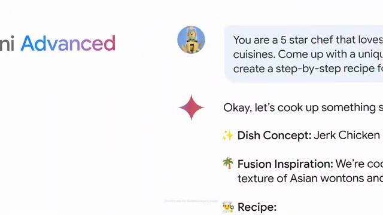
*⏱️ 00:00:05 — Interface de Gemini Advanced montrant un échange de chat avec une recette de cuisine personnalisée.*

---

### ⏱️ `[00:00:19 - 00:00:43]` | Segment #02

**🔊 Audio (Transcription Intégrale Mot pour Mot en Français) :**
> Nous avons testé les deux sur des tâches du monde réel. À la fin, vous verrez lequel a obtenu de meilleurs résultats et comment essayer Gemini vous-même. Pendant ce temps, Mark Zuckerberg vient de faire un pas majeur vers la superintelligence personnelle. Notre vision est de construire une superintelligence personnelle pour tout le monde. Le nouveau Muse Wonder de Meta peut se souvenir de ce qui compte pour vous et est conçu pour travailler à la réalisation de vos objectifs pendant des mois, même lorsque vous ne l'utilisez pas.

**👁️ Analyse Visuelle d'Écran (gemini-3.5-flash-lite) :**
**Interface & Outils** : Interface de développement et de code (type IDE ou outil de prompt).

**Contenu textuel & Code** : Texte technique et instructions de code pour un projet "Cyber-Dino".

**Action / Démonstration** : Affichage d'un environnement de travail logiciel avec du code et des révisions.

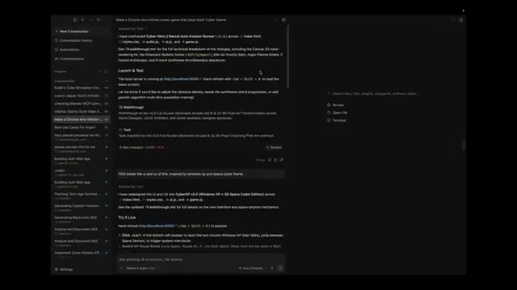
*⏱️ 00:00:25 — Interface d'une application de développement avec un panneau de code sombre et des instructions textuelles.*

---

### ⏱️ `[00:00:43 - 00:01:02]` | Segment #03

**🔊 Audio (Transcription Intégrale Mot pour Mot en Français) :**
> Et OpenAI vient de changer la façon dont ChatGPT fonctionne. Au lieu de vous donner de longues réponses écrites, GPT-6 peut désormais créer des visuels interactifs que vous pouvez réellement utiliser. Mais alors que les entreprises se livrent une course pour créer une IA plus intelligente, Anthropic a surpris d'autres laboratoires d'IA en train d'utiliser Claude pour améliorer leurs propres modèles. Et la riposte s'organise.

**👁️ Analyse Visuelle d'Écran (gemini-3.5-flash-lite) :**
**Interface & Outils** : Application mobile interactive sur smartphone (iOS/Android).

**Contenu textuel & Code** : Carte interactive de San Francisco, sections de voyage, images miniatures et texte descriptif de destinations.

**Action / Démonstration** : Présentation d'une interface mobile interactive générée par IA pour planifier un voyage.

*⏱️ 00:00:52 — Un smartphone affichant une application mobile interactive avec une carte de San Francisco, des photos et des options de navigation.*

---

### ⏱️ `[00:01:03 - 00:01:21]` | Segment #04

**🔊 Audio (Transcription Intégrale Mot pour Mot en Français) :**
> Ce ne sont là que quatre des douze plus grandes actualités sur l'IA de cette semaine. Et à la fin, nous mettrons à l'épreuve les plus grandes affirmations de Google et nous vous montrerons exactement comment utiliser Gemini 4 Argon vous-même, étape par étape. Comme toujours, si une section devient trop technique, vous pouvez passer directement à la mise à jour suivante qui vous intéresse. Tout est horodaté dans la description.

**👁️ Analyse Visuelle d'Écran (gemini-3.5-flash-lite) :**
**Interface & Outils** : Interface logicielle de type tableau de bord avec graphiques en pixel art.

**Contenu textuel & Code** : Visuel de ville futuriste en style rétro pixel art avec graphiques et barres de données latérales.

**Action / Démonstration** : Affichage d'une interface logicielle ou d'un outil visuel à l'écran pendant la présentation.

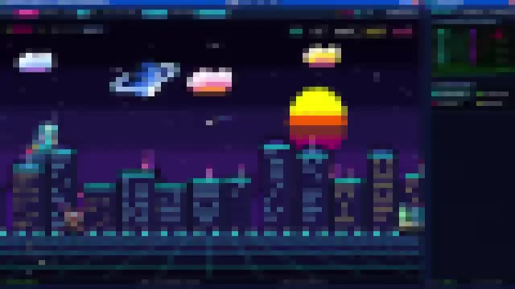
*⏱️ 00:01:12 — Capture d'écran montrant une interface graphique avec un style rétro/pixel art représentant une ville futuriste.*

---

### ⏱️ `[00:01:22 - 00:01:42]` | Segment #05

**🔊 Audio (Transcription Intégrale Mot pour Mot en Français) :**
> J'ai également mis tous les invites, les outils et les ressources utiles dans notre communauté WhatsApp gratuite. Le lien est dans la description. Maintenant, entrons dans le vif du sujet. Google vient de rendre son modèle d'IA le plus avancé pour le raisonnement complexe disponible dans le monde entier. Il s'appelle Gemini 4 Argon et il est doté d'une immense fenêtre de contexte d'un million de jetons.

**👁️ Analyse Visuelle d'Écran (gemini-3.5-flash-lite) :**
**Interface & Outils** : Non applicable

**Contenu textuel & Code** : Texte 'Join the Global AI Community', 'Staying Ahead Club', et 'Gemini 4 Argon'

**Action / Démonstration** : Transition graphique et présentation du titre Gemini 4 Argon

---

### ⏱️ `[00:01:42 - 00:02:01]` | Segment #06

**🔊 Audio (Transcription Intégrale Mot pour Mot en Français) :**
> Vous pouvez l'utiliser pour analyser des documents complexes, améliorer votre code, créer des visualisations 3D et même transformer vos idées en expériences interactives. Et le meilleur, c'est que Gemini 4 Argon est désormais disponible via l'application Gemini, Google Search, Google Anti-Gravity et l'API Gemini selon votre forfait.

**👁️ Analyse Visuelle d'Écran (gemini-3.5-flash-lite) :**
**Interface & Outils** : Interface de recherche Google et visualisations graphiques 3D.

**Contenu textuel & Code** : Logos de recherche Google et illustrations visuelles 3D abstraites.

**Action / Démonstration** : Présentation des capacités visuelles et de recherche des fonctionnalités de l'IA.

*⏱️ 00:01:46 — Animation 3D complexe montrant des touches de piano disposées en spirale sur un fond noir.*

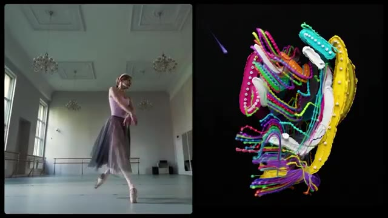
*⏱️ 00:01:51 — Écran partagé montrant à gauche une danseuse de ballet en action et à droite une visualisation 3D colorée correspondante.*

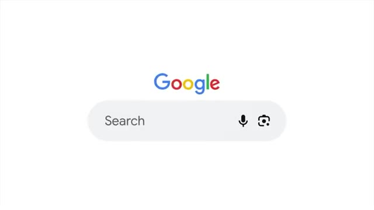
*⏱️ 00:01:56 — Page d'accueil minimaliste de Google Search avec le logo coloré et la barre de recherche centrale.*

---

### ⏱️ `[00:02:01 - 00:02:21]` | Segment #07

**🔊 Audio (Transcription Intégrale Mot pour Mot en Français) :**
> Maintenant, nous avons été tellement impressionnés par ce que ce modèle peut faire que nous avons décidé de le tester nous-mêmes. Et plus tard dans cette vidéo, nous vous montrerons exactement comment l'utiliser avec un tutoriel complet étape par étape. Mais avant d'en arriver là, passons en revue les autres plus grandes actualités IA de la semaine. Meta vient de lancer Muse Wonder, son modèle d'IA le plus puissant à ce jour.

**👁️ Analyse Visuelle d'Écran (gemini-3.5-flash-lite) :**
**Interface & Outils** : Aucune interface logicielle ou outil d'IA présenté dans ce segment.

**Contenu textuel & Code** : Aucun prompt, code ou donnée chiffrée affichés.

**Action / Démonstration** : Le présentateur s'adresse directement à la caméra pour introduire le sujet et annoncer un tutoriel.

---

### ⏱️ `[00:02:21 - 00:02:42]` | Segment #08

**🔊 Audio (Transcription Intégrale Mot pour Mot en Français) :**
> Et l'objectif est de construire un assistant IA qui comprend votre vie, se souvient de ce qui compte pour vous et vous aide à accomplir vos tâches. L'une de ses plus grandes fonctionnalités est la mémoire active, ce qui signifie que vous n'avez pas besoin de tout réexpliquer depuis le début à chaque fois. Par exemple, si votre machine à laver tombe en panne, vous pouvez demander à Muse Wonder de trouver votre garantie et de vous aider à déposer une réclamation.

**👁️ Analyse Visuelle d'Écran (gemini-3.5-flash-lite) :**
**Interface & Outils** : AUCUNE

**Contenu textuel & Code** : AUCUNE

**Action / Démonstration** : AUCUNE

---

### ⏱️ `[00:02:43 - 00:03:03]` | Segment #09

**🔊 Audio (Transcription Intégrale Mot pour Mot en Français) :**
> Ou si vous aidez votre père à se remettre d'une chirurgie du genou, cela peut vous aider à suivre son calendrier de rétablissement. Et puis il y a la concentration active. Lorsque vous confiez à Muse Wonder une tâche difficile, il est conçu pour continuer à chercher des solutions, même lorsqu'il rencontre des problèmes. Meta affirme qu'il peut même continuer à travailler pour atteindre vos objectifs en arrière-plan pendant des jours, des semaines ou des mois.

**👁️ Analyse Visuelle d'Écran (gemini-3.5-flash-lite) :**
**Interface & Outils** : AUCUNE

**Contenu textuel & Code** : AUCUNE

**Action / Démonstration** : AUCUNE

---

### ⏱️ `[00:03:04 - 00:03:26]` | Segment #10

**🔊 Audio (Transcription Intégrale Mot pour Mot en Français) :**
> Et c'est la plus grande vision de Meta, une super intelligence personnelle pour tout le monde. Une IA qui se souvient de ce qui compte pour vous et vous aide à atteindre vos objectifs. OpenAI vient de changer la façon dont ChatGPT répond à vos questions. Il a lancé GPT-6 avec une nouvelle fonctionnalité appelée IU intelligente. Et maintenant, ChatGPT peut vous montrer des visuels interactifs au lieu de vous donner seulement de longs paragraphes de texte.

**👁️ Analyse Visuelle d'Écran (gemini-3.5-flash-lite) :**
**Interface & Outils** : Interface graphique animée de type présentation/vidéo liée à ChatGPT.

**Contenu textuel & Code** : Texte 'ChatG' au centre entouré d'icônes variées (logo OpenAI, vélos, pinceau, nuages, palettes de couleurs).

**Action / Démonstration** : Animation graphique introduisant le sujet de ChatGPT et GPT-6 avec divers visuels.

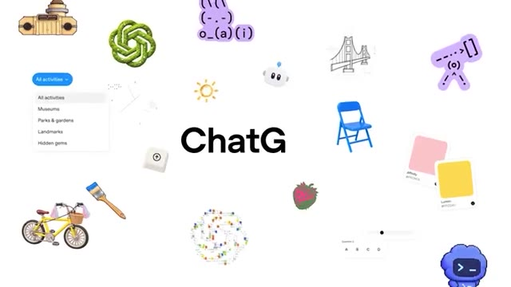
*⏱️ 00:03:20 — Un écran blanc animé avec le logo 'ChatG' et divers autocollants et icônes colorés autour.*

---

### ⏱️ `[00:03:26 - 00:03:45]` | Segment #11

**🔊 Audio (Transcription Intégrale Mot pour Mot en Français) :**
> Par exemple, imaginez que vous essayez d'assembler un vélo. Au lieu de parcourir un manuel d'instructions compliqué, ChatGPT peut vous montrer un modèle 3D interactif afin que vous puissiez voir exactement comment les différentes pièces s'assemblent. Ou disons que vous explorez San Francisco. ChatGPT peut vous montrer une carte interactive avec des endroits que vous pouvez visiter.

**👁️ Analyse Visuelle d'Écran (gemini-3.5-flash-lite) :**
**Interface & Outils** : Application mobile sur smartphone (ChatGPT ou interface similaire)

**Contenu textuel & Code** : Modèle 3D interactif d'un vélo et guide interactif de San Francisco avec cartes et photos.

**Action / Démonstration** : Démonstration de l'utilisation de l'IA pour afficher des instructions interactives et des guides de voyage.

*⏱️ 00:03:35 — Gros plan sur un smartphone affichant un modèle 3D interactif d'un vélo avec le titre "Explore your bike".*

*⏱️ 00:03:40 — Une interface mobile superposée montrant une carte de San Francisco et des informations touristiques ("San Francisco, your way").*

---

### ⏱️ `[00:03:45 - 00:04:17]` | Segment #12

**🔊 Audio (Transcription Intégrale Mot pour Mot en Français) :**
> Vous pouvez même prévisualiser différentes couleurs de peinture sur vos murs avant de peindre réellement votre pièce. Et regardez ceci, ChatGPT peut également vous guider dans la fabrication d'un renard en origami avec des animations étape par étape au lieu de simples instructions écrites et cela va au-delà du visuel. ChatGPT peut désormais créer des outils interactifs tels que des calculateurs, des graphiques et des boutons directement dans votre conversation. Il y a une autre amélioration utile. GPT-4 peut désormais commencer à vous montrer une réponse pendant qu'il travaille encore sur votre question afin que vous n'ayez pas à attendre toute la réponse et cela se déploie

**👁️ Analyse Visuelle d'Écran (gemini-3.5-flash-lite) :**
**Interface & Outils** : Application ou assistant virtuel avec interface textuelle et visuelle d'origami.

**Contenu textuel & Code** : Texte à l'écran : "Let's fold an origami baby fox!".

**Action / Démonstration** : Démonstration visuelle d'une personne guidée pour fabriquer un renard en origami.

*⏱️ 00:03:53 — Une femme assise à une table plie du papier en origami, avec une fenêtre d'interface affichant le texte "Let's fold an origami baby fox!".*

---

### ⏱️ `[00:04:17 - 00:04:41]` | Segment #13

**🔊 Audio (Transcription Intégrale Mot pour Mot en Français) :**
> à tout le monde, y compris aux utilisateurs gratuits. Donc au lieu de simplement lire les réponses de ChatGPT, vous pouvez désormais interagir avec elles et voir concrètement comment les choses fonctionnent. Anthropic vient de surprendre des entreprises d'IA en train d'utiliser Claude pour rendre leurs propres modèles plus intelligents. Elle a identifié une activité impliquant les entreprises d'IA chinoises Z.AI et Moonshot, qui utilisaient les capacités de Claude pour améliorer leurs propres modèles d'IA.

**👁️ Analyse Visuelle d'Écran (gemini-3.5-flash-lite) :**
**Interface & Outils** : Application X (anciennement Twitter).

**Contenu textuel & Code** : Texte du tweet de Vaibhav Sisinty détaillant l'actualité sur Anthropic et la citation d'un tweet officiel d'Anthropic.

**Action / Démonstration** : Affichage d'un article ou d'un tweet d'actualité illustrant les propos du présentateur.

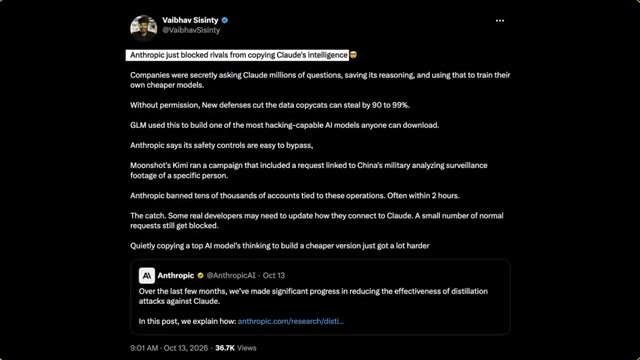
*⏱️ 00:04:29 — Une capture d'écran d'un tweet de Vaibhav Sisinty expliquant comment Anthropic a bloqué des rivaux copiant l'intelligence de Claude.*

---

### ⏱️ `[00:04:41 - 00:05:02]` | Segment #14

**🔊 Audio (Transcription Intégrale Mot pour Mot en Français) :**
> Cette technique est connue sous le nom d'attaque par distillation. Maintenant, Anthropic a introduit de nouvelles mesures de protection pour empêcher cela. Et voici ce qui est intéressant, selon Anthropic, ces défenses ont réduit la quantité d'informations que les attaquants peuvent extraire de 90 à 99 %. Anthropic a également banni des dizaines de milliers de comptes liés à ces attaques.

**👁️ Analyse Visuelle d'Écran (gemini-3.5-flash-lite) :**
**Interface & Outils** : Navigateur web / Application X (Twitter)

**Contenu textuel & Code** : Texte d'un post expliquant la réduction de 90 à 99% des données volées par distillation et un tweet intégré d'Anthropic.

**Action / Démonstration** : Affichage à l'écran du post X détaillant la protection d'Anthropic contre l'attaque par distillation.

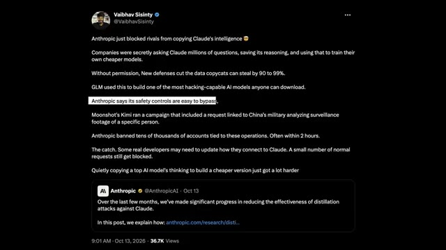
*⏱️ 00:04:46 — Publication X (Twitter) de Vaibhav Sisinty expliquant comment Anthropic a bloqué les rivaux copiant l'intelligence de Claude.*

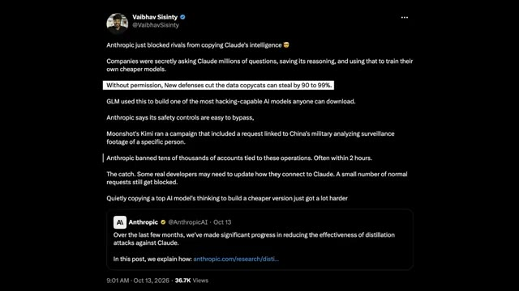
*⏱️ 00:04:57 — Publication X (Twitter) de Vaibhav Sisinty montrant la ligne surlignée 'Without permission, New defenses cut the data copycats can steal by 90 to 99%'.*

---

### ⏱️ `[00:05:02 - 00:05:36]` | Segment #15

**🔊 Audio (Transcription Intégrale Mot pour Mot en Français) :**
> La course à l'intelligence artificielle ne consiste donc plus seulement à créer des modèles plus intelligents, il s'agit aussi de les protéger contre le piratage. Microsoft vient de doter Copilot d'une mise à jour majeure qui lui permet de fonctionner directement sur votre ordinateur Windows. Grâce à l'intelligence hybride, Copilot peut désormais accéder à vos fichiers, organiser des documents et accomplir des tâches sur votre PC avec votre autorisation. Par exemple, il peut effectuer des recherches dans vos fichiers, les renommer et les déplacer automatiquement dans les bons dossiers, et il ne se limite pas à l'organisation de fichiers. Vous pouvez tout simplement demander à Copilot : je viens de recevoir un e-mail de mon comptable,

**👁️ Analyse Visuelle d'Écran (gemini-3.5-flash-lite) :**
**Interface & Outils** : Interface logicielle Microsoft Copilot et paramètres Windows.

**Contenu textuel & Code** : Texte "MICROSOFT COPILOT HYBRID INTELLIGENCE" et descriptions relatives aux fichiers et modèles locaux sur le PC.

**Action / Démonstration** : Présentation des fonctionnalités de Microsoft Copilot fonctionnant directement sur l'ordinateur Windows.

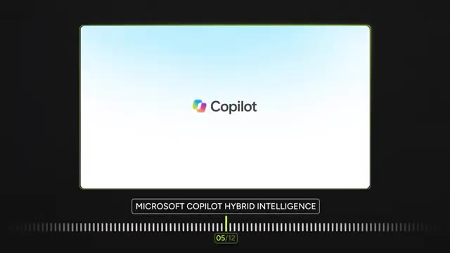
*⏱️ 00:05:11 — Logo Microsoft Copilot avec le texte "MICROSOFT COPILOT HYBRID INTELLIGENCE" en bas.*

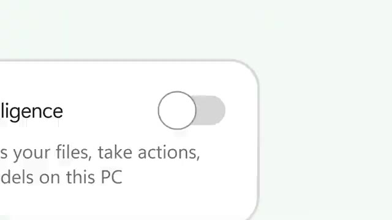
*⏱️ 00:05:19 — Gros plan sur une interface utilisateur montrant un interrupteur à bascule (toggle) avec du texte explicatif.*

---

### ⏱️ `[00:05:36 - 00:06:10]` | Segment #16

**🔊 Audio (Transcription Intégrale Mot pour Mot en Français) :**
> peux-tu m'aider avec mes impôts et lui procurer ce dont elle a besoin ? Copilot effectue des recherches sur votre ordinateur, trouve les documents requis, organise le tout dans un seul dossier et rédige un e-mail à votre comptable et, avant de l'envoyer, Copilot demande votre approbation. De plus, Copilot peut désormais exécuter des modèles d'IA directement sur votre ordinateur au lieu d'envoyer chaque tâche dans le cloud, ce qui peut rendre certaines tâches plus rapides, réduire les coûts et contribuer à garder les données sensibles sur votre appareil et, lorsqu'il a besoin de plus de puissance, il peut également utiliser des modèles d'IA en ligne, donc au lieu de se contenter de répondre à des questions, Copilot peut désormais travailler avec

**👁️ Analyse Visuelle d'Écran (gemini-3.5-flash-lite) :**
**Interface & Outils** : Microsoft Outlook et interface de l'assistant Copilot.

**Contenu textuel & Code** : Brouillon d'e-mail intitulé « RE: 2025 return, a few things still needed » adressé à Grace Whitaker avec le texte « Hi Grace, Attach ».

**Action / Démonstration** : Démonstration de l'automatisation de la rédaction d'un e-mail par l'IA basé sur les documents fiscaux rassemblés.

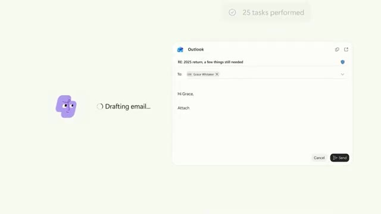
*⏱️ 00:05:44 — Interface d'Outlook montrant un brouillon d'e-mail rédigé par Copilot à l'attention de Grace Whitaker concernant la déclaration fiscale de 2025.*

---

### ⏱️ `[00:06:10 - 00:06:33]` | Segment #17

**🔊 Audio (Transcription Intégrale Mot pour Mot en Français) :**
> vos fichiers et effectuer des tâches directement sur votre PC. Microsoft vient de dévoiler une nouvelle puce IA puissante pour réduire sa dépendance envers NVIDIA. Elle s'appelle Maia 100 et elle est conçue pour alimenter des outils d'IA comme Copilot et Microsoft Teams. Selon Microsoft, elle peut produire 40 % de résultats d'IA en plus avec la même quantité d'électricité que les principaux systèmes basés sur des GPU.

**👁️ Analyse Visuelle d'Écran (gemini-3.5-flash-lite) :**
**Interface & Outils** : Matériel informatique et puces électroniques présentés en vidéo.

**Contenu textuel & Code** : Présentation visuelle de la nouvelle puce IA de Microsoft nommée "Maia 100".

**Action / Démonstration** : Présentation matérielle et visuelle du nouveau processeur IA de Microsoft pour réduire la dépendance envers NVIDIA.

*⏱️ 00:06:21 — Gros plan sur la nouvelle puce IA de Microsoft, la Maia 100, sur fond bleu.*

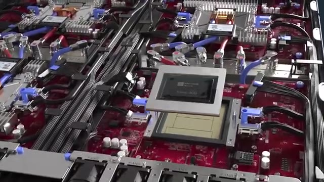
*⏱️ 00:06:27 — Vue détaillée du matériel informatique montrant l'installation de la puce Microsoft Maia 100 sur une carte mère.*

---

### ⏱️ `[00:06:33 - 00:06:54]` | Segment #18

**🔊 Audio (Transcription Intégrale Mot pour Mot en Français) :**
> Et avec 96 puces travaillant ensemble, elle peut délivrer jusqu'à 7 fois la production de la génération précédente. Microsoft prévoit de commencer à déployer Maya 300 en 2027. Microsoft construit donc maintenant ses propres puces pour rendre l'IA plus rapide, moins chère et plus efficace à grande échelle. L'Inde affronte les États-Unis dans la technologie vocale de l'IA.

**👁️ Analyse Visuelle d'Écran (gemini-3.5-flash-lite) :**
**Interface & Outils** : AUCUNE

**Contenu textuel & Code** : AUCUNE

**Action / Démonstration** : AUCUNE

*⏱️ 00:06:38 — Un serveur informatique ou rack de serveurs illustrant l'infrastructure matérielle.*

---

### ⏱️ `[00:06:54 - 00:07:17]` | Segment #19

**🔊 Audio (Transcription Intégrale Mot pour Mot en Français) :**
> Savam AI vient tout juste de lancer Bulbul V4 Flash, un nouveau modèle de voix d'IA qui peut générer un discours étonnamment naturel et expressif dans de multiples langues indiennes. Il peut assurer des commentaires de cricket en anglais, des conversations sur la santé en kannada, des contes en marathi, des rappels de paiement en odia et des publicités en hindi. Il peut modifier son ton et son émotion pour s'adapter à la situation et même mélanger naturellement des langues indiennes avec l'anglais.

**👁️ Analyse Visuelle d'Écran (gemini-3.5-flash-lite) :**
**Interface & Outils** : Présentation vidéo illustrant les capacités multilingues du modèle de voix Bulbul V4 Flash de Sarvam AI.

**Contenu textuel & Code** : Textes en langues indiennes (« Hindi », « Storytelling », « KANNADA VOICE BOT ») et phrases de démonstration sur la santé.

**Action / Démonstration** : Démonstration visuelle des différentes applications linguistiques et vocales de l'IA (contenu en hindi, bot vocal en kannada).

*⏱️ 00:07:00 — Titre « Hindi » avec une icône florale verte et le mot « Storytelling » en bas.*

*⏱️ 00:07:05 — Interface de bot vocal en kannada avec du texte en kannada et anglais, et un cercle violet décoratif en bas.*

---

### ⏱️ `[00:07:17 - 00:07:53]` | Segment #20

**🔊 Audio (Transcription Intégrale Mot pour Mot en Français) :**
> Bulbul v4 flash est désormais disponible via l'API de Sarvam avec une réduction de lancement pour une durée limitée. Anthropic vient de lancer son modèle Claude le moins cher et le plus rapide à ce jour. Il s'agit de Claude Haiku 5.5, et la plus grande surprise est de voir à quel point il est moins cher. Selon Anthropic, l'utilisation de Haiku 5.5 coûte environ 75 % de moins que celle de Haiku 4.5 en moyenne, tout en étant beaucoup plus performant, et les améliorations vont bien au-delà de la simple vitesse et du coût. Haiku 5.5 est désormais bien meilleur pour coder à l'aide d'ordinateurs et pour gérer des tâches comportant plusieurs étapes. Il est également conçu pour gérer les tâches répétitives comme

**👁️ Analyse Visuelle d'Écran (gemini-3.5-flash-lite) :**
**Interface & Outils** : Communiqué de presse et tableau comparatif officiel au format web/diapositive.

**Contenu textuel & Code** : Texte d'annonce de Claude Haiku 5.5 soulignant qu'il coûte environ 75 % de moins à exécuter, et tableau de benchmarks comparant Haiku 5.5, Haiku 4.5, GPT-6 Luna et Sonnet 5.5.

**Action / Démonstration** : Présentation textuelle et chiffrée des nouveautés et performances du modèle Haiku 5.5.

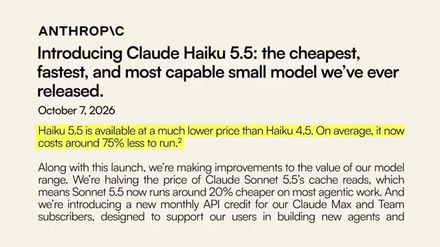
*⏱️ 00:07:35 — Communiqué officiel d'Anthropic annonçant le lancement de Claude Haiku 5.5.*

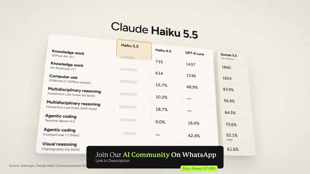
*⏱️ 00:07:44 — Tableau comparatif des performances de Claude Haiku 5.5 face à d'autres modèles d'IA.*

---

### ⏱️ `[00:07:53 - 00:08:28]` | Segment #21

**🔊 Audio (Transcription Intégrale Mot pour Mot en Français) :**
> trier de grandes quantités d'informations et créer des résumés. Et voici ce qui est intéressant : vous pouvez désormais contrôler l'effort que Claude consacre à chaque tâche. Ainsi, pour les travaux plus simples, vous pouvez faire en sorte que ce soit rapide et économique, tandis que les tâches plus difficiles peuvent recevoir plus d'attention. Anthropic a également réduit de 50 % le coût de la réutilisation d'informations précédemment traitées avec Claude Sonnet 5.5. Haiku 5.5 est déjà disponible pour les développeurs via Anthropic, Amazon, Google et Microsoft. Ainsi, Anthropic rend l'IA non seulement plus performante, mais aussi beaucoup moins chère pour les entreprises qui ont besoin de faire tourner

**👁️ Analyse Visuelle d'Écran (gemini-3.5-flash-lite) :**
**Interface & Outils** : Document texte et graphique comparatif Anthropic.

**Contenu textuel & Code** : Annonce de Claude Haiku 5.5, comparaisons de performances, prix des tokens et options d'effort.

**Action / Démonstration** : Présentation des spécifications, des performances et de la tarification des nouveaux modèles Anthropic.

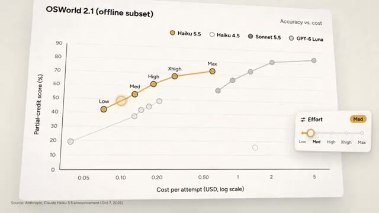
*⏱️ 00:08:02 — Graphique comparatif des performances (OSWorld 2.1) en fonction du coût pour Claude Haiku 5.5, avec contrôle du niveau d'effort.*

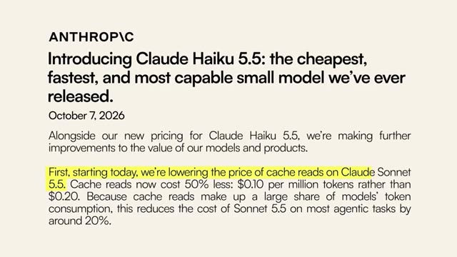
*⏱️ 00:08:11 — Communiqué officiel d'Anthropic annonçant Claude Haiku 5.5 et la baisse des prix des lectures en cache pour Claude Sonnet 5.5.*

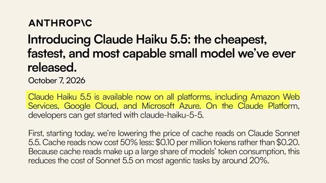
*⏱️ 00:08:19 — Communiqué officiel détaillant la disponibilité de Claude Haiku 5.5 sur AWS, Google Cloud et Microsoft Azure.*

---

### ⏱️ `[00:08:28 - 00:09:00]` | Segment #22

**🔊 Audio (Transcription Intégrale Mot pour Mot en Français) :**
> des milliers de tâches chaque jour. Claude peut maintenant transformer les données de votre entreprise en tableaux de bord interactifs et même en vidéos animées. Anthropic vient de lancer les tableaux de bord Claude et Claude Motion. Par exemple, disons que vous dirigez une entreprise de location de vélos et que chaque matin, certaines stations manquent de vélos. Pour comprendre pourquoi, vous connectez les données de votre entreprise à Claude. Claude analyse une année entière de données de trajet et crée un tableau de bord montrant quand les gens louent des vélos, quelles stations sont les plus fréquentées et combien de vélos il reste. Maintenant, si vous voulez expliquer

**👁️ Analyse Visuelle d'Écran (gemini-3.5-flash-lite) :**
**Interface & Outils** : Interface web de l'outil Claude (Anthropic) intégrant un panneau de chat interactif et un tableau de bord de type SaaS.

**Contenu textuel & Code** : Un prompt textuel demandant de créer un tableau de bord basé sur un an de données de location de vélos, associé à des graphiques statistiques détaillés (rides per day, rides by hour, cartes).

**Action / Démonstration** : Démonstration de la génération automatique d'un tableau de bord interactif par l'intelligence artificielle Claude à partir d'une requête textuelle.

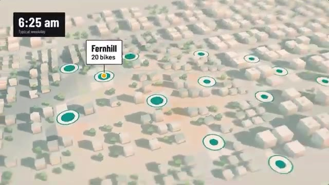
*⏱️ 00:08:36 — Animation 3D stylisée d'une carte urbaine représentant des stations de vélos en libre-service à 6:25 du matin.*

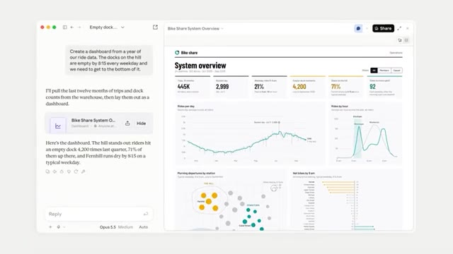
*⏱️ 00:08:52 — Interface de l'application Claude affichant une conversation textuelle à gauche et un tableau de bord analytique complet de gestion de vélos à droite.*

---

### ⏱️ `[00:09:00 - 00:09:24]` | Segment #23

**🔊 Audio (Transcription Intégrale Mot pour Mot en Français) :**
> ce qui se passe lors de votre prochaine réunion d'équipe, vous pouvez simplement sélectionner un graphique et demander à Claude de le transformer en animation. Claude crée ensuite une vidéo montrant comment les vélos se déplacent dans la ville tout au long de la matinée. Vous pouvez même laisser des commentaires directement sur la vidéo, comme « montrer la station de vélos vide un peu plus longtemps », et Claude effectue la modification. Vos coéquipiers peuvent également laisser des commentaires et vous pouvez exporter l'animation terminée vers vos outils de conception.

**👁️ Analyse Visuelle d'Écran (gemini-3.5-flash-lite) :**
**Interface & Outils** : Interface SaaS de création de visualisations et vidéos animées (style outil de présentation IA type Claude Artifacts / Motion).

**Contenu textuel & Code** : Graphiques de trafic de vélos, animations de cartes urbaines en 3D, et commentaires d'utilisateurs (Sam, Dev, Nate).

**Action / Démonstration** : Démonstration de la transformation d'un graphique de données en animation vidéo fluide avec des retours d'équipe interactifs.

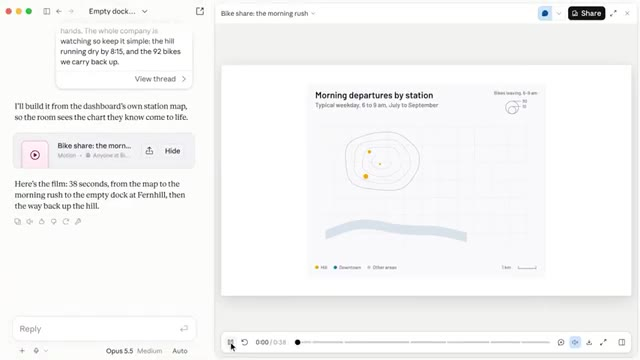
*⏱️ 00:09:06 — Interface montrant l'application avec un graphique intitulé "Morning departures by station" et une interface de discussion textuelle.*

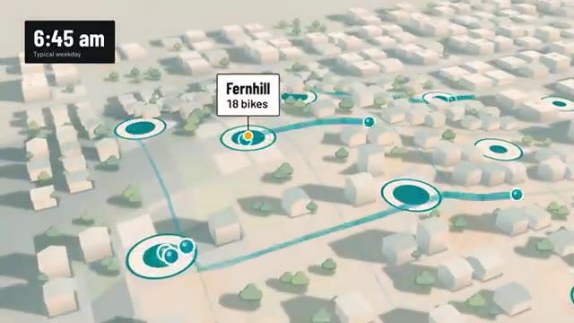
*⏱️ 00:09:12 — Animation 3D isométrique d'une ville montrant les déplacements de vélos à "6:45 am" avec des indicateurs de stations comme "Fernhill".*

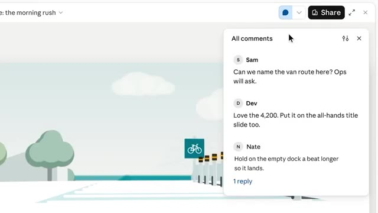
*⏱️ 00:09:18 — Interface de l'application avec un panneau latéral affichant des commentaires d'équipe de Sam, Dev et Nate sur l'animation.*

---

### ⏱️ `[00:09:24 - 00:09:57]` | Segment #24

**🔊 Audio (Transcription Intégrale Mot pour Mot en Français) :**
> Donc, au lieu de guider votre équipe à travers des graphiques compliqués, vous pouvez maintenant leur montrer exactement ce qui se passe grâce à une simple vidéo animée. Google vient de lancer un nouvel agent IA qui peut travailler comme toute une équipe au sein de votre entreprise. Il s'appelle l'agent One et, contrairement à un chatbot classique, il peut comprendre votre travail, se connecter à vos applications et continuer à travailler 24h/24 et 7j/7, même lorsque vous n'êtes pas là. Vous pouvez télécharger une demande de proposition commerciale et simplement demander à Gemini de la compléter. Gemini lit le document, comprend ce qui doit être fait, élabore un plan et demande

**👁️ Analyse Visuelle d'Écran (gemini-3.5-flash-lite) :**
**Interface & Outils** : Interface utilisateur minimaliste d'un agent IA ou d'un assistant documentaire.

**Contenu textuel & Code** : Un document PDF intitulé "Request for Proposal" et un prompt débutant par "Complete the attached".

**Action / Démonstration** : Saisie d'une instruction textuelle pour interagir avec un document au sein d'une interface d'agent IA.

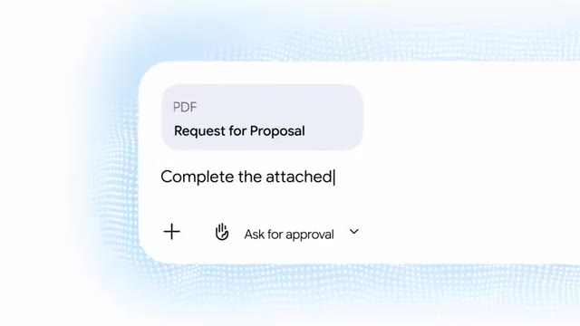
*⏱️ 00:09:49 — Une interface d'agent IA montrant un fichier PDF et un champ de saisie de texte.*

---

### ⏱️ `[00:09:57 - 00:10:18]` | Segment #25

**🔊 Audio (Transcription Intégrale Mot pour Mot en Français) :**
> approbation avant de commencer. Une fois approuvé, Gemini crée plusieurs agents IA pour s'occuper de différentes parties du travail. L'un vérifie les dossiers des clients, un autre effectue des recherches sur le web, et un autre examine les exigences de l'entreprise. Tous ces agents travaillent ensemble pendant que Gemini coordonne le tout, et le travail continue en arrière-plan. Le lendemain matin, le projet terminé est prêt.

**👁️ Analyse Visuelle d'Écran (gemini-3.5-flash-lite) :**
**Interface & Outils** : Interface graphique de gestion d'agents IA (workflow builder).

**Contenu textuel & Code** : Blocs interactifs nommés "CRM Agent" et "Web Search Agent" avec des étiquettes "Subagent".

**Action / Démonstration** : Présentation visuelle et dynamique du fonctionnement de différents agents IA spécialisés interconnectés.

*⏱️ 00:10:07 — Une vue rapprochée d'une interface de workflow montrant un "CRM Agent" et un "Web Search Agent" connectés par des lignes lumineuses.*

---

### ⏱️ `[00:10:18 - 00:10:37]` | Segment #26

**🔊 Audio (Transcription Intégrale Mot pour Mot en Français) :**
> Vous pouvez l'utiliser à travers des outils comme Gmail, Google Drive, Slack et d'autres applications professionnelles. Google vous permet également de choisir entre différents modèles d'IA, y compris Gemini et Claude, selon la tâche. Et les entreprises bénéficient de contrôles de sécurité pour décider à quoi l'IA peut accéder et quelles actions nécessitent une approbation humaine.

**👁️ Analyse Visuelle d'Écran (gemini-3.5-flash-lite) :**
**Interface & Outils** : Interface de type interface logicielle / outil professionnel, menu déroulant avec option "Auto".

**Contenu textuel & Code** : Texte « with enterprise-grade security and governance » et options d'IA.

**Action / Démonstration** : Navigation à travers différentes applications et sélection du mode automatique pour les modèles d'IA.

*⏱️ 00:10:23 — Aperçu de plusieurs applications professionnelles et interfaces logicielles (Gmail, Slack, etc.) présentées sous forme de carrousel.*

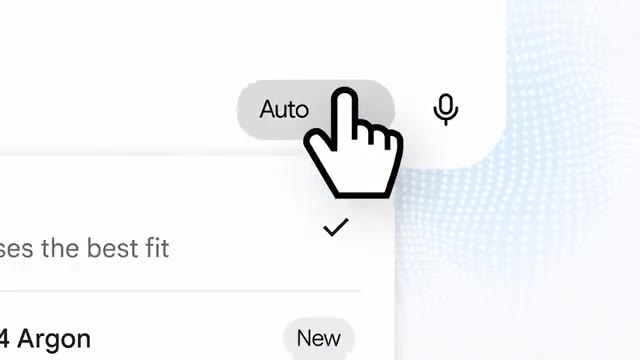
*⏱️ 00:10:27 — Gros plan sur une interface utilisateur avec une icône de curseur pointant sur le bouton « Auto ».*

---

### ⏱️ `[00:10:37 - 00:10:56]` | Segment #27

**🔊 Audio (Transcription Intégrale Mot pour Mot en Français) :**
> Donc, au lieu de donner des instructions à l'IA pour chaque petite tâche, vous pouvez désormais confier à Gemini un travail entier et le laisser coordonner le travail pour vous. Anthropic vient de lancer une nouvelle initiative pour protéger certains des systèmes les plus importants au monde contre les cyberattaques. Elle s'appelle l'Anthropic Cyber Mission, et elle se concentre sur deux grands domaines.

**👁️ Analyse Visuelle d'Écran (gemini-3.5-flash-lite) :**
**Interface & Outils** : Site web d'Anthropic (page d'accueil ou blog dédié à la mission cyber).

**Contenu textuel & Code** : Texte affiché : "Introducing the Anthropic Cyber Mission" et un visuel abstrait aux tons pastels, typique des présentations institutionnelles d'Anthropic.

**Action / Démonstration** : Le présentateur commente le lancement d'une nouvelle initiative de sécurité cyber par Anthropic, illustrée par la transition vers la page web dédiée.

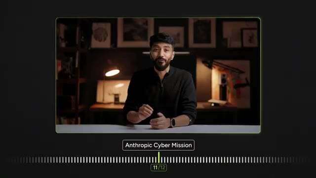
*⏱️ 00:10:46 — Le présentateur apparaît dans un encadré central sur fond sombre, avec une barre de progression en bas et un badge textuel "Anthropic Cyber Mission".*

*⏱️ 00:10:51 — Une capture d'écran d'une page web présentant le titre "Introducing the Anthropic Cyber Mission" avec un graphique épuré et minimaliste.*

---

### ⏱️ `[00:10:56 - 00:11:21]` | Segment #28

**🔊 Audio (Transcription Intégrale Mot pour Mot en Français) :**
> Premièrement, Anthropic travaille avec des entreprises comme CrowdStrike, Deloitte et Palo Alto Networks pour aider à sécuriser les réseaux électriques, les systèmes d'eau, les usines et les réseaux de transport. Claude aidera les équipes de sécurité à trouver et à corriger les faiblesses avant que les attaquants ne puissent les exploiter. Deuxièmement, Anthropic a lancé OSS Scanner, un outil gratuit qui vérifie régulièrement les logiciels open source à la recherche de problèmes de sécurité.

**👁️ Analyse Visuelle d'Écran (gemini-3.5-flash-lite) :**
**Interface & Outils** : Document texte / Article de blog institutionnel (Anthropic)

**Contenu textuel & Code** : Texte officiel sur le lancement d'Anthropic Cyber Mission, mentionnant le Critical Infrastructure Defense Program, des partenaires (CrowdStrike, Deloitte, Palo Alto Networks) et OSS Scanner.

**Action / Démonstration** : Le présentateur commente le communiqué officiel d'Anthropic sur les nouveaux programmes de cybersécurité.

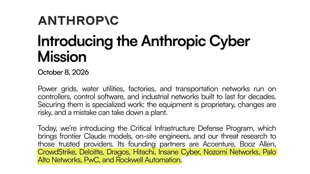
*⏱️ 00:11:02 — Capture d'écran d'un article d'Anthropic intitulé « Introducing the Anthropic Cyber Mission » détaillant le programme de défense des infrastructures critiques.*

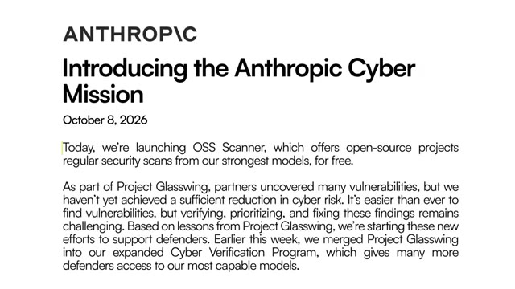
*⏱️ 00:11:14 — Capture d'écran de la suite de l'article d'Anthropic annonçant le lancement d'« OSS Scanner » et le programme Cyber Verification.*

---

### ⏱️ `[00:11:21 - 00:11:44]` | Segment #29

**🔊 Audio (Transcription Intégrale Mot pour Mot en Français) :**
> Il peut identifier des faiblesses potentielles, expliquer comment elles pourraient être exploitées et suggérer des corrections. Les rapports sont générés par IA, ils ont donc toujours besoin d'être vérifiés. Ainsi, Anthropic utilise désormais Claude pour aider à protéger l'infrastructure et les logiciels dont les gens dépendent chaque jour. Alibaba a trouvé un moyen d'entraîner des agents d'IA sans gaspiller autant de puissance de calcul.

**👁️ Analyse Visuelle d'Écran (gemini-3.5-flash-lite) :**
**Interface & Outils** : Vidéo explicative avec graphismes animés.

**Contenu textuel & Code** : Diagramme arborescent représentant une structure cybernétique ou un réseau de données.

**Action / Démonstration** : Animation graphique illustrant le sujet de la cybersécurité avec Claude d'Anthropic.

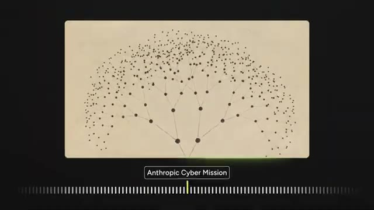
*⏱️ 00:11:38 — Un diagramme arborescent complexe en noir et blanc sur fond beige illustrant des ramifications de données, avec le texte explicatif "Anthropic Cyber Mission".*

---

### ⏱️ `[00:11:44 - 00:12:04]` | Segment #30

**🔊 Audio (Transcription Intégrale Mot pour Mot en Français) :**
> Ça s'appelle QuenJaya. Pensez-y comme à une façon plus intelligente de gérer les ordinateurs qui apprennent aux agents d'IA à accomplir des tâches complexes. Lorsqu'un agent d'IA est en train d'être entraîné, il peut avoir besoin de différentes quantités de puissance de calcul à différentes étapes. Khenjaya peut réattribuer ces ressources pendant que l'entraînement est toujours en cours, au lieu de les laisser se gaspiller.

**👁️ Analyse Visuelle d'Écran (gemini-3.5-flash-lite) :**
**Interface & Outils** : Twitter (X)

**Contenu textuel & Code** : Post de Qwen détaillant QwenGyre, un outil d'apprentissage par renforcement élastique pour agents d'IA, avec un schéma des fonctionnalités clés (Elastic GPU Scheduling, Trajectory Processing).

**Action / Démonstration** : Affichage d'une publication officielle sur les réseaux sociaux pour illustrer les détails techniques présentés oralement.

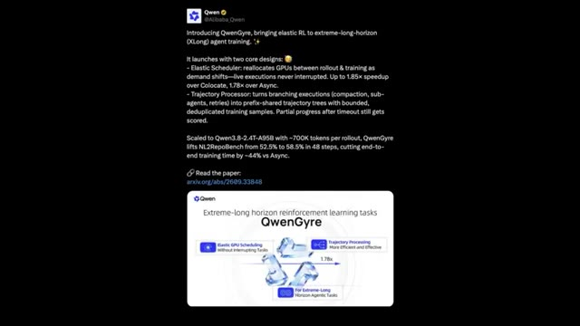
*⏱️ 00:11:59 — Capture d'un post Twitter/X de Qwen annonçant "QwenGyre" avec des détails techniques et un schéma explicatif.*

---

### ⏱️ `[00:12:05 - 00:12:24]` | Segment #31

**🔊 Audio (Transcription Intégrale Mot pour Mot en Français) :**
> Il aide également à réduire le travail répété lorsqu'un agent explore différentes manières de résoudre un problème. Lors des tests d'Alibaba, cette approche a réduit le temps d'entraînement d'environ 44 % et a amélioré les performances sur un test de codage. En termes simples, QuenJaya aide les agents IA à apprendre plus efficacement en utilisant moins de temps et de puissance de calcul.

**👁️ Analyse Visuelle d'Écran (gemini-3.5-flash-lite) :**
**Interface & Outils** : Capture d'écran d'un tweet sur la plateforme Twitter/X.

**Contenu textuel & Code** : Texte du tweet présentant QwenGyre (Elastic Scheduler, Trajectory Processor) et ses performances par rapport à Async.

**Action / Démonstration** : Le créateur montre un article et une annonce officielle d'Alibaba sur QwenGyre pour illustrer les performances d'entraînement des agents.

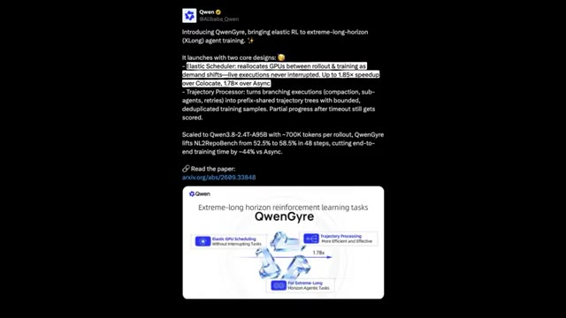
*⏱️ 00:12:10 — Une capture d'écran d'une publication Twitter/X du compte officiel de Qwen (@Alibaba_Qwen) présentant QwenGyre et ses fonctionnalités d'entraînement d'agents en renforcement.*

---

### ⏱️ `[00:12:25 - 00:12:47]` | Segment #32

**🔊 Audio (Transcription Intégrale Mot pour Mot en Français) :**
> Google est de retour avec Gemini 4 Argon. Mais peut-il réellement battre Claude ? Google affirme qu'il s'agit de l'un de ses modèles d'IA les plus puissants à ce jour, avec des améliorations majeures en matière de programmation, de raisonnement et de gestion de tâches complexes. Et si l'on regarde les démonstrations de Google, les résultats sont plutôt impressionnants. Mais nous avons déjà vu cela auparavant. Chaque nouveau modèle d'IA est lancé avec des démonstrations incroyables et des scores de référence.

**👁️ Analyse Visuelle d'Écran (gemini-3.5-flash-lite) :**
**Interface & Outils** : Site web d'actualités (CNBC).

**Contenu textuel & Code** : Article de presse mentionnant le lancement de Gemini 4 Argon par Alphabet et ses performances en programmation, cybersécurité et tâches professionnelles complexes.

**Action / Démonstration** : Le présentateur illustre ses propos en affichant un article de presse majeur sur l'annonce du modèle Gemini 4 Argon.

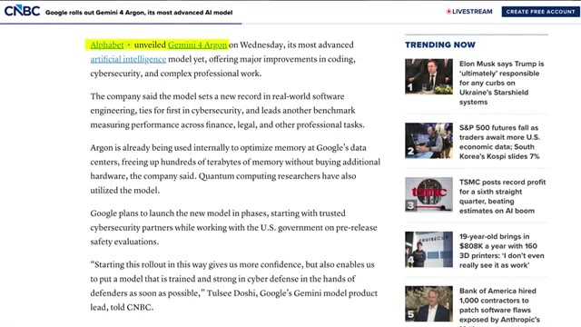
*⏱️ 00:12:30 — Capture d'écran large d'un article CNBC présentant Google Gemini 4 Argon avec des sections surlignées.*

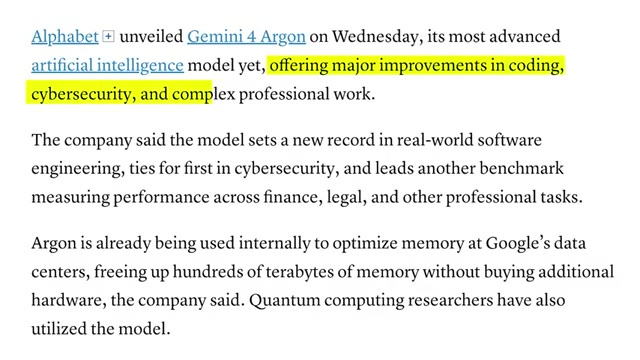
*⏱️ 00:12:36 — Gros plan sur le paragraphe de l'article CNBC détaillant les améliorations majeures en programmation et cybersécurité de Gemini 4 Argon.*

---

### ⏱️ `[00:12:47 - 00:13:07]` | Segment #33

**🔊 Audio (Transcription Intégrale Mot pour Mot en Français) :**
> Et presque chaque entreprise prétend que son modèle est le meilleur. Alors, que se passe-t-il lorsque l'on confie à ces modèles les mêmes tâches du monde réel ? C'est exactement ce que nous allons découvrir. Nous avons testé Gemini 4 Argon sur plusieurs projets et avons donné à Claude les mêmes instructions pour voir comment leurs résultats se comparent. Et nous ne nous contentons pas de vérifier s'ils peuvent accomplir une tâche.

**👁️ Analyse Visuelle d'Écran (gemini-3.5-flash-lite) :**
**Interface & Outils** : Interface de développement et site web interactif de présentation automobile.

**Contenu textuel & Code** : Code source, structure de projet, invites de création de simulation de Rubik's Cube et interface web de design automobile Jaguar.

**Action / Démonstration** : Navigation dans l'interface de programmation et démonstration d'un projet web interactif de design automobile.

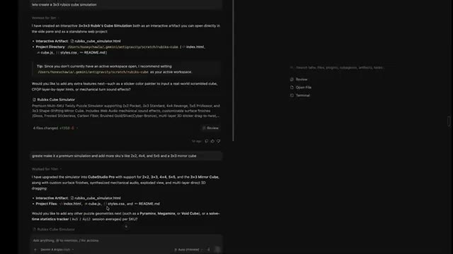
*⏱️ 00:12:57 — Interface sombre d'une application de développement avec des lignes de code et des invites de chat textuel.*

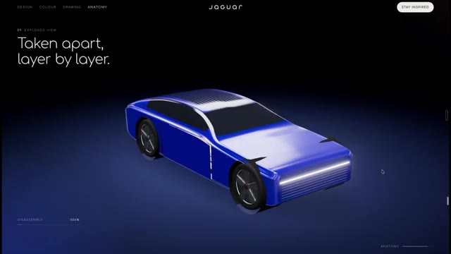
*⏱️ 00:13:02 — Présentation web interactive d'un modèle de voiture bleue avec le logo Jaguar et le texte "Taken apart, layer by layer".*

---

### ⏱️ `[00:13:07 - 00:13:30]` | Segment #34

**🔊 Audio (Transcription Intégrale Mot pour Mot en Français) :**
> Nous examinons le design, la fonctionnalité, les petits détails et si vous auriez réellement envie d'utiliser ce qu'ils créent. Parce qu'un modèle peut sembler incroyable sur un benchmark et pourtant peiner quand vous lui confiez du vrai travail. À la fin, vous saurez où se situe Gemini par rapport à Claude et quel modèle a le plus de sens pour votre travail. Je partagerai également tous les prompts dans notre communauté WhatsApp gratuite Staying Ahead, le lien est dans la description.

**👁️ Analyse Visuelle d'Écran (gemini-3.5-flash-lite) :**
**Interface & Outils** : Applications web interactives créées par des modèles d'IA (interfaces utilisateur de type dashboard ou simulateur 3D).

**Contenu textuel & Code** : Éléments d'interface utilisateur, maquettes de sites web (Jaguar), simulateur de Rubik's Cube 3D et tableaux de bord de contrôle.

**Action / Démonstration** : Comparaison comparative des performances de design et de fonctionnalité entre Gemini et Claude.

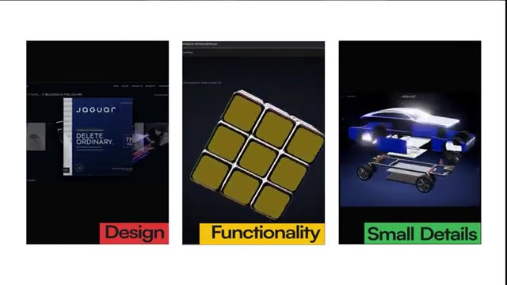
*⏱️ 00:13:13 — Écran montrant trois critères d'évaluation : Design, Functionality, Small Details avec des illustrations visuelles associées.*

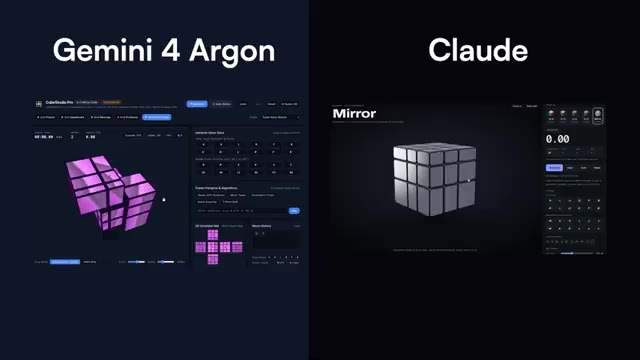
*⏱️ 00:13:19 — Comparatif en écran partagé entre l'interface générée par Gemini 4 Argon et celle générée par Claude représentant un Rubik's Cube interactif.*

---

### ⏱️ `[00:13:30 - 00:13:54]` | Segment #35

**🔊 Audio (Transcription Intégrale Mot pour Mot en Français) :**
> Mais avant de passer à notre test, Google a présenté quelque chose avec Gemini 4 Argon qui vaut la peine qu'on y regarde de plus près. Google montre un robot humanoïde en train d'apprendre à jouer au cornhole, un jeu où l'on lance des sacs de haricots dans un trou sur une planche. Des chercheurs ont d'abord montré au robot une vidéo d'une personne effectuant le lancer. Gemini étudie le mouvement, puis utilise les caméras du robot pour déterminer exactement où se trouve la planche.

**👁️ Analyse Visuelle d'Écran (gemini-3.5-flash-lite) :**
**Interface & Outils** : Interface de simulation robotique et tableaux de bord de télémétrie technique (MuJoCo).

**Contenu textuel & Code** : Courbes de télémétrie, angles d'articulation, vitesses angulaires et graphiques de stabilité dynamique pour le robot humanoïde.

**Action / Démonstration** : Démonstration d'apprentissage du jeu de cornhole par un robot humanoïde à partir d'exemples humains et analyse de données cinématiques.

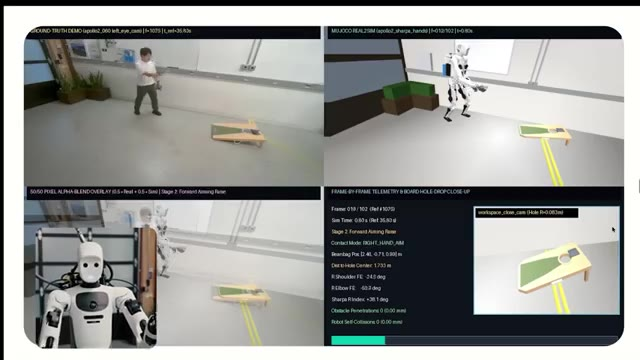
*⏱️ 00:13:36 — Vue quadruple écran combinant une simulation 3D du robot, une vue réelle et des données de télémétrie.*

*⏱️ 00:13:42 — Un humain montre un lancer de sac de haricots (cornhole) devant un robot humanoïde blanc dans un atelier.*

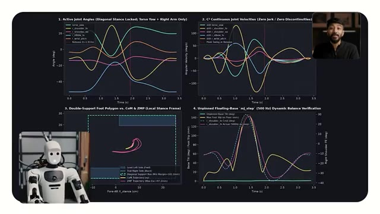
*⏱️ 00:13:48 — Quatre graphiques de télémétrie et de cinématique affichant les angles d'articulation, la vitesse et l'équilibre dynamique du robot.*

---

### ⏱️ `[00:13:54 - 00:14:13]` | Segment #36

**🔊 Audio (Transcription Intégrale Mot pour Mot en Français) :**
> Ensuite, il s'entraîne à l'intérieur de Mujoco, un simulateur qui lui permet de tester différents mouvements avant de les essayer dans le monde réel. Après chaque lancer, il vérifie où le sac a atterri, analyse ce qui n'a pas fonctionné et ajuste la tentative suivante. Dans la démonstration de Google, le robot finit par réussir 7 tirs d'affilée.

**👁️ Analyse Visuelle d'Écran (gemini-3.5-flash-lite) :**
**Interface & Outils** : Simulateur physique MuJoCo (Multi-Joint dynamics with Contact).

**Contenu textuel & Code** : Superposition d'interfaces de simulation avec des métadonnées techniques (telles que "Translucent Convex Hulls", "Stage 7: Upright Stance Recovery") et captures vidéo en temps réel du robot.

**Action / Démonstration** : Démonstration de l'entraînement robotique : transition de la simulation numérique (MuJoCo) vers l'exécution physique réelle pour optimiser la précision du lancer.

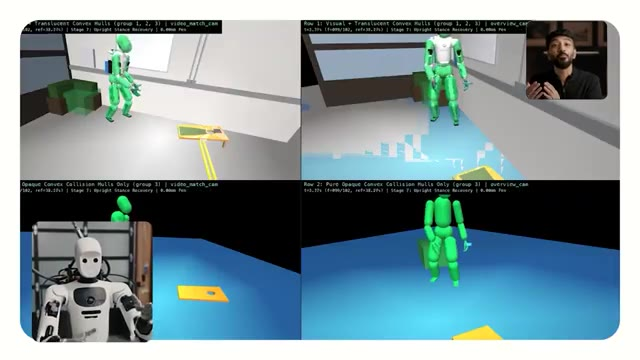
*⏱️ 00:13:59 — Interface du simulateur MuJoCo affichant quatre vues distinctes de la simulation physique du robot effectuant des mouvements.*

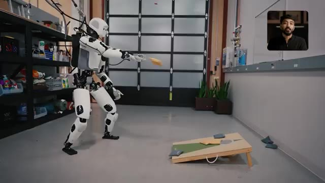
*⏱️ 00:14:04 — Le robot humanoïde physique en train de lancer un sac de jeu sur une cible (cornhole) dans un environnement de test réel.*

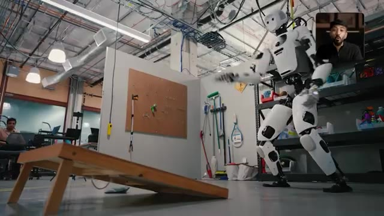
*⏱️ 00:14:08 — Le robot humanoïde dans le laboratoire, se préparant à une nouvelle tentative de lancer après avoir ajusté sa posture.*

---

### ⏱️ `[00:14:13 - 00:14:47]` | Segment #37

**🔊 Audio (Transcription Intégrale Mot pour Mot en Français) :**
> La partie intéressante est la façon dont Gemini combine ce qu'il voit dans une vidéo avec de la pratique et des retours. Et Google a montré le même modèle en train de créer des projets visuels très différents. Sur le site Web de Google, vous pouvez voir des pagodes 3D générées par du code, un circuit de course, un échiquier, une pièce et une architecture gothique détaillée. Sa fiche technique couvre également l'ingénierie, la finance, le travail juridique et la cybersécurité. Et il prend en charge jusqu'à 1 million de jetons entre l'entrée et la sortie, ce qui lui laisse la place de traiter une quantité énorme d'informations. Les résultats des benchmarks sont solides,

**👁️ Analyse Visuelle d'Écran (gemini-3.5-flash-lite) :**
**Interface & Outils** : Navigateur web affichant le blog officiel de Google ("Google India Blog") concernant Gemini 4 Argon.

**Contenu textuel & Code** : Textes explicatifs sur les capacités de raisonnement spatial, l'optimisation de code Rust/SIMD, et mise en évidence en surbrillance jaune du chiffre "1M tokens".

**Action / Démonstration** : Démonstration visuelle de projets 3D générés par l'IA et présentation textuelle des avancées techniques du modèle.

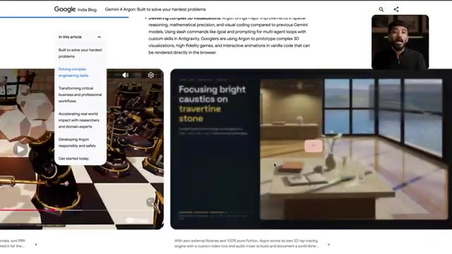
*⏱️ 00:14:30 — Capture d'écran du blog de Google présentant le projet Argon, incluant des vidéos de démonstration 3D et des menus de navigation techniques.*

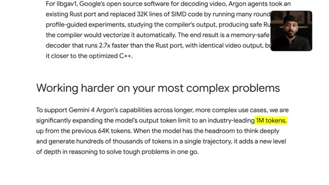
*⏱️ 00:14:39 — Capture d'écran montrant un paragraphe textuel soulignant l'augmentation de la limite de tokens à 1 million pour le modèle Gemini 4 Argon.*

---

### ⏱️ `[00:14:47 - 00:15:16]` | Segment #38

**🔊 Audio (Transcription Intégrale Mot pour Mot en Français) :**
> bien que Gemini ne soit pas en tête de tous les tests, y compris Frontier SWE et Terminal Bench dans la comparaison de Google. Mais au lieu de passer tout notre temps sur des graphiques, ouvrons l'outil et testons les résultats réels. Pour ces projets, nous utilisons l'espace de travail anti-gravité de Google. Ouvrez le menu des modèles, sélectionnez Gemini 4 Argon, et vous verrez des paramètres d'effort faible, moyen et élevé. Nous avons utilisé le niveau élevé pour les tests de Gemini, alors commençons par un projet qui nécessite à la fois un bon design et des commandes fonctionnelles.

**👁️ Analyse Visuelle d'Écran (gemini-3.5-flash-lite) :**
**Interface & Outils** : Interface de l'outil logiciel ou espace de travail présenté.
[DESC_IMAGE_2] Boîte de dialogue et de recherche avec les options "Gemini 4 Argon High" et "Auto [Preview]".

**Contenu textuel & Code** : Explications orales, astuces de productivité et méthodologie IA.

**Action / Démonstration** : Présentation de l'interface logicielle et ouverture de l'outil pour tester ses fonctionnalités en direct.

*⏱️ 00:15:02 — Interface sombre d'une application ou d'un espace de travail montrant une boîte de saisie de texte "Ask anything, @ to mention, / for actions" et le présentateur visible en médaillon vidéo dans le coin supérieur droit.*

---

### ⏱️ `[00:15:16 - 00:15:49]` | Segment #39

**🔊 Audio (Transcription Intégrale Mot pour Mot en Français) :**
> Tout d'abord, nous avons demandé à Gemini de construire un Rubik's Cube interactif. Ouvrons le projet terminé appelé Cube Studio Pro. Vous pouvez basculer entre les puzzles 2x2, 3x3, 4x4, 5x5 et le cube miroir, il y a aussi un menu de finitions avec des options comme l'or brossé, la fibre de carbone et le cyber rose. Maintenant, cliquons sur Mélanger puis essayons la résolution automatique. Vous pouvez ouvrir une vue 2D à plat, vérifier l'historique des mouvements et choisir des motifs prédéfinis. Il a même une vue éclatée qui sépare les pièces ainsi que des commandes pour le zoom et l'animation.

**👁️ Analyse Visuelle d'Écran (gemini-3.5-flash-lite) :**
**Interface & Outils** : Interface de développement de type IDE/chat IA et application web interactive (Cube Studio Pro).

**Contenu textuel & Code** : Prompts de création de simulateur, description du projet Cube Studio Pro avec fichiers générés (HTML, JS, CSS) et interface de contrôle avec mouvements et historique.

**Action / Démonstration** : Présentation du projet terminé et de l'interface interactive du simulateur de cube.

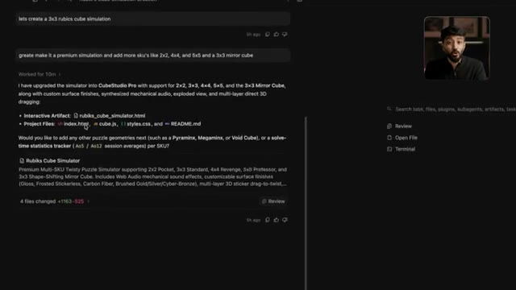
*⏱️ 00:15:24 — Interface de développement ou de chat montrant la génération et l'optimisation d'un simulateur de Rubik's Cube par l'IA.*

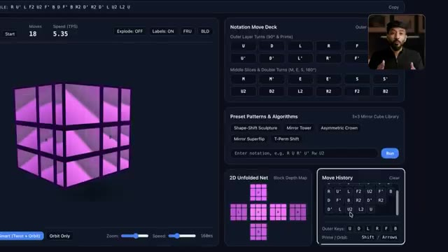
*⏱️ 00:15:41 — Interface complète de l'application Cube Studio Pro avec un Rubik's Cube interactif en 3D à gauche et des panneaux de contrôle à droite.*

---

### ⏱️ `[00:15:49 - 00:16:23]` | Segment #40

**🔊 Audio (Transcription Intégrale Mot pour Mot en Français) :**
> vitesse. Vous avez donc plusieurs façons différentes de jouer avec le cube. Maintenant, ouvrons la version de Claude pour la même tâche. Vous obtenez différentes tailles de cube et, si vous regardez les textures et écoutez les effets sonores, le cube semble beaucoup plus réaliste. Vous pouvez également le mélanger et le résoudre, suivre vos mouvements et votre temps, et basculer entre les finitions argentée et dorée pour le cube miroir. Gemini vous offre donc plus d'options de personnalisation, tandis que la version de Claude a l'air et se sent plus aboutie. Mais peuvent-ils construire quelque chose qui se joue sans que vous le contrôliez ? Ensuite, nous avons demandé à Gemini de créer un jeu de dinosaure de style chrome qui se joue

**👁️ Analyse Visuelle d'Écran (gemini-3.5-flash-lite) :**
**Interface & Outils** : Cube Studio (application web interactive de résolution de cubes)

**Contenu textuel & Code** : Interface utilisateur avec un cube 3D interactif monochrome gris, des boutons de contrôle (Scramble, Solve, Undo, Reset), un chronomètre à 0.00 et des options de notation WCA.

**Action / Démonstration** : Le présentateur démontre la version 'Mirror' du cube virtuel en montrant les différentes tailles de pièces et les textures réalistes.

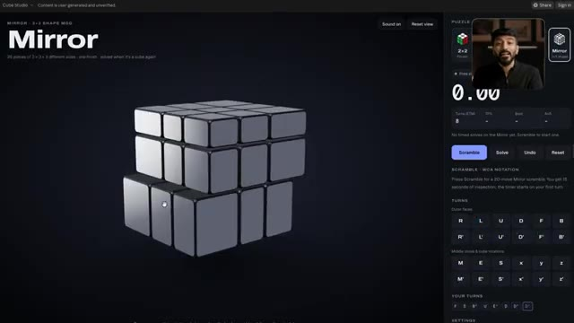
*⏱️ 00:15:58 — Capture d'écran montrant l'interface web de Cube Studio avec la version 'Mirror' (un Rubik's cube monochrome de tailles de pièces variables) et la webcam du présentateur en incrustation dans le coin supérieur droit.*

---

### ⏱️ `[00:16:23 - 00:16:41]` | Segment #41

**🔊 Audio (Transcription Intégrale Mot pour Mot en Français) :**
> lui-même avec un thème Windows rétro. Exécutons le projet existant localement. Il s'appelle Cyber Rex Pixels et vous pouvez voir le dinosaur se déplaçant dans un environnement de pixel art coloré. Sur la droite, il y a un panneau de style gestionnaire de tâches avec un graphique de réseau de neurones, des commandes de réglage et des journaux affichant les décisions du jeu.

**👁️ Analyse Visuelle d'Écran (gemini-3.5-flash-lite) :**
**Interface & Outils** : Interface du jeu Cyber Rex Pixels, style gestionnaire de tâches Windows, panneau de réseau de neurones.

**Contenu textuel & Code** : Graphiques de réseaux de neurones, scores de jeu, options de personnalisation et thèmes rétro.

**Action / Démonstration** : Démonstration en direct du jeu Cyber Rex Pixels fonctionnant localement avec un panneau de contrôle de réseau de neurones actif.

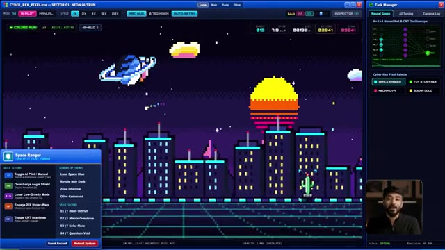
*⏱️ 00:16:32 — Interface du jeu Cyber Rex Pixels avec un style rétro Windows, montrant un dinosaure en pixel art dans un environnement urbain futuriste et un panneau de gestionnaire de tâches avec un graphique de réseau de neurones à droite.*

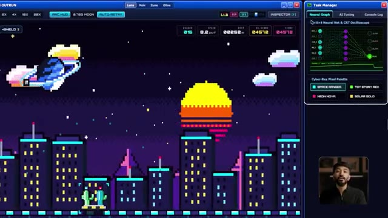
*⏱️ 00:16:37 — Vue similaire du jeu Cyber Rex Pixels montrant l'animation du personnage et le panneau latéral du réseau de neurones en action.*

---

### ⏱️ `[00:16:41 - 00:17:16]` | Segment #42

**🔊 Audio (Transcription Intégrale Mot pour Mot en Français) :**
> Vous pouvez augmenter la vitesse jusqu'à 16x, basculer entre le mode pilote automatique et manuel, et ajuster la musique, les effets sonores et les couleurs. Maintenant, ouvrons la version de Claude, Nebula Runner. Elle présente un thème spatial plus sombre, un mode de jeu automatique, un compteur de score et des paramètres de vitesse. Et regardez ce qui se passe lorsque vous fermez la fenêtre. Vous obtenez les options veille, éteindre et redémarrer, et la sélection du redémarrage lance une animation de démarrage rétro. Les deux versions sont jouables, mais Gemini offre davantage de commandes de jeu tandis que Claude ajoute plus de personnalité à l'interface. Maintenant, essayons quelque chose que vous pourriez réellement

**👁️ Analyse Visuelle d'Écran (gemini-3.5-flash-lite) :**
**Interface & Outils** : Interface web de développement et interface du jeu Nebula Runner.

**Contenu textuel & Code** : Notes de design, explications des modifications UX, et interface du jeu spatial avec mode pilote automatique.

**Action / Démonstration** : Présentation des modifications et démonstration du jeu Nebula Runner.

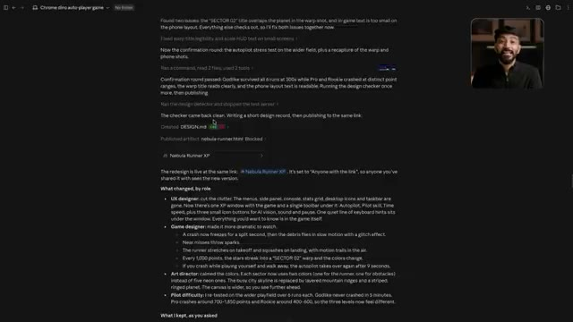
*⏱️ 00:16:50 — Interface textuelle sombre avec des notes de développement sur le jeu et les modifications apportées.*

*⏱️ 00:16:58 — Capture du jeu Nebula Runner montrant un dinosaure sautant avec un thème spatial et un mode pilote automatique.*

---

### ⏱️ `[00:17:16 - 00:17:52]` | Segment #43

**🔊 Audio (Transcription Intégrale Mot pour Mot en Français) :**
> à utiliser lors de la création de contenu. Nous avons donné à Gemini un montage de référence et des images d'un présentateur généré par IA qui parle de Neuralink. L'objectif était de créer une vidéo verticale dans un style de montage similaire. Ouvrons le fichier terminé. Vous verrez des écrans partagés, des sous-titres animés, du texte incrusté et des graphiques animés qui apparaissent en même temps que la narration. Lissons maintenant la version de Claude en utilisant le même matériel. Elle ajoute des images de soutien, du texte animé et des transitions qui suivent ce que dit le présentateur. Les deux vous donnent de premiers montages utiles. Vous voudriez quand même vérifier le timing et les détails avant de publier, mais il est intéressant de voir à quel point

**👁️ Analyse Visuelle d'Écran (gemini-3.5-flash-lite) :**
**Interface & Outils** : Interface de lecteur vidéo et éditeur de code/notes.

**Contenu textuel & Code** : Texte descriptif détaillant le montage vidéo, le script, les logos de Neuralink et xAI, et des sous-titres.

**Action / Démonstration** : Présentation du fichier vidéo terminé et lecture de l'extrait vertical avec des superpositions graphiques.

*⏱️ 00:17:25 — Image de code/texte affichant l'interface de développement et les spécifications de montage vidéo.*

*⏱️ 00:17:34 — Aperçu vidéo vertical montrant Elon Musk avec des infographies graphiques sur Neuralink et xAI.*

*⏱️ 00:17:43 — Aperçu vidéo vertical montrant un couple posant ensemble lors d'un événement formel.*

---

### ⏱️ `[00:17:52 - 00:18:20]` | Segment #44

**🔊 Audio (Transcription Intégrale Mot pour Mot en Français) :**
> de l'édition que chaque modèle a gérée et si vous pensez que le design compte dans une courte vidéo, il compte encore plus sur notre prochain projet, cherchons Jaguar Type 00 et ouvrons le site officiel, ce concept-car futuriste est notre référence de design, nous avons demandé à Gemini de créer un site web à défilement où une version 3D de la voiture se déplace lorsque vous faites défiler, maintenant ouvrons ce qu'il a construit, vous obtenez des sections animées, une voiture en rotation, une vue éclatée et des informations sur les matériaux.

**👁️ Analyse Visuelle d'Écran (gemini-3.5-flash-lite) :**
**Interface & Outils** : Navigateur web affichant le site officiel de Jaguar (jaguar.com).

**Contenu textuel & Code** : Présentation du modèle "Jaguar Type 00", avec le texte "An original work of art" et une vue 3D éclatée du véhicule.

**Action / Démonstration** : Navigation sur le site officiel de Jaguar pour présenter le design futuriste du concept-car Type 00.

*⏱️ 00:18:06 — Le site officiel de Jaguar affichant la page de présentation du concept-car Jaguar Type 00.*

*⏱️ 00:18:13 — Vue éclatée en 3D interactive du concept-car Jaguar Type 00 sur le site officiel de la marque.*

---

### ⏱️ `[00:18:20 - 00:18:44]` | Segment #45

**🔊 Audio (Transcription Intégrale Mot pour Mot en Français) :**
> Le défilement est fluide mais la voiture 3D n'a pas l'air tout aussi convaincante que l'originale. Maintenant, ouvrons la version de Claude, également créée avec un effort élevé. La Jaguar bleue a l'air plus détaillée et, au fur et à mesure que vous faites défiler, vous voyez les roues, les options de couleur, les portes papillon et l'animation de vue éclatée. L'éclairage, la typographie et le design global semblent plus cohérents, donc Claude produit le site Web le plus impressionnant dans ce test.

**👁️ Analyse Visuelle d'Écran (gemini-3.5-flash-lite) :**
**Interface & Outils** : Navigateur web présentant le site interactif de Jaguar avec un modèle 3D.

**Contenu textuel & Code** : Texte du site Jaguar ("Not an evolution. A redrawing.", "Taken apart, layer by layer.") et annotations techniques des composants.

**Action / Démonstration** : Navigation et défilement à travers le site web interactif pour explorer le modèle 3D de la voiture en vue éclatée.

*⏱️ 00:18:32 — Le site web interactif de Jaguar affichant un modèle 3D de voiture bleue avec le texte "Not an evolution. A redrawing."*

*⏱️ 00:18:38 — Vue éclatée layer par layer du modèle 3D de la voiture montrant les composants internes et les roues.*

---

### ⏱️ `[00:18:44 - 00:19:06]` | Segment #46

**🔊 Audio (Transcription Intégrale Mot pour Mot en Français) :**
> Mais avant de désigner un vainqueur pour l'ensemble, il convient d'examiner le coût pour obtenir ces résultats. Sur le graphique d'analyse artificielle présenté ici, Gemini obtient un score d'environ 53 sur l'indice d'intelligence, contre environ 58 pour le modèle Claude Opus présenté. Il y a aussi une comparaison de vitesse, bien que le graphique ne nous donne pas une comparaison claire entre tous les modèles dont nous discutons.

**👁️ Analyse Visuelle d'Écran (gemini-3.5-flash-lite) :**
**Interface & Outils** : Site web d'analyse comparative d'intelligence artificielle (Artificial Analysis).

**Contenu textuel & Code** : Graphiques de performance des modèles d'IA (Claude Opus, Gemini 4 Argon, etc.) évaluant l'intelligence, la vitesse et le coût par tâche.

**Action / Démonstration** : Navigation et survol d'un graphique comparatif de modèles d'IA sur le web.

*⏱️ 00:18:50 — Vue d'ensemble du site web Artificial Analysis affichant trois graphiques comparatifs : Intelligence, Speed et Cost per Task.*

*⏱️ 00:18:55 — Gros plan sur le graphique 'Intelligence' montrant un infobulle sur le modèle Gemini 4 Argon (high) avec un score de 53, et Claude Opus en tête avec 58.*

*⏱️ 00:19:01 — Gros plan sur les graphiques 'Speed' et 'Cost per Task' comparant la vitesse de génération et le coût moyen par tâche des différents modèles d'IA.*

---

### ⏱️ `[00:19:06 - 00:19:29]` | Segment #47

**🔊 Audio (Transcription Intégrale Mot pour Mot en Français) :**
> Mais quand on regarde le coût par tâche, Gemini est moins cher que plusieurs modèles de premier plan. Le meilleur choix dépend donc de la qualité du résultat, de la rapidité avec laquelle vous en avez besoin et de ce que cela coûte à produire. Il y a un test de plus et cette fois, nous sortons du navigateur. Pour le projet final, nous avons connecté Gemini à Blender via MCP, ce qui permet à l'IA de travailler directement avec le logiciel.

**👁️ Analyse Visuelle d'Écran (gemini-3.5-flash-lite) :**
**Interface & Outils** : Navigateur web avec interface textuelle et de code, intégrant une vignette vidéo du présentateur.

**Contenu textuel & Code** : Texte descriptif technique et code (« Key Highlights & Architecture », « Top-to-Bottom Scrollytelling & 60fps 3D Stage ») concernant un projet web Jaguar.

**Action / Démonstration** : Présentation et analyse d'un cas pratique ou d'un code généré pour un projet web interactif.

*⏱️ 00:19:18 — Une interface web affichant des notes textuelles et du code avec des détails sur l'architecture d'un site web animé pour Jaguar, avec la vidéo du présentateur en médaillon.*

---

### ⏱️ `[00:19:29 - 00:19:50]` | Segment #48

**🔊 Audio (Transcription Intégrale Mot pour Mot en Français) :**
> Nous avons utilisé cette photo de référence d'un homme la bouche ouverte et avons demandé à Gemini d'en faire un modèle 3D. Ouvrons maintenant Blender et comparons le résultat avec la photo originale. Ce qui est utile, c'est qu'il s'agit d'un véritable modèle 3D que vous pouvez continuer à modifier, et pas seulement d'une image générée. Vous pourriez le préparer pour l'impression 3D, bien que l'enregistrement ne montre pas d'impression physique.

**👁️ Analyse Visuelle d'Écran (gemini-3.5-flash-lite) :**
**Interface & Outils** : Interface de Blender, interface d'un outil IA de génération 3D.

**Contenu textuel & Code** : Texte descriptif de la sculpture faciale : "Expressive Facial Anatomy (Screaming_Head, Sculpted_LashLines, Sculpted_Eyebrows)".

**Action / Démonstration** : Présentation du modèle 3D finalisé généré et affiché dans le logiciel Blender.

*⏱️ 00:19:34 — Interface textuelle montrant la description détaillée du modèle 3D généré avec des détails sur l'anatomie faciale.*

*⏱️ 00:19:39 — Interface du logiciel Blender affichant le modèle 3D texturé d'un buste d'homme hurlant.*

---

### ⏱️ `[00:19:50 - 00:20:15]` | Segment #49

**🔊 Audio (Transcription Intégrale Mot pour Mot en Français) :**
> Donc, après tous ces projets, quel modèle devriez-vous réellement utiliser ? Après ces tests, vous pouvez voir pourquoi il vaut la verrez de juger les modèles par ce qu'ils créent, plutôt que simplement par ce que leurs pages de benchmarks promettent. Gemini gère plusieurs types de projets, tandis que Claude offre le site web de Jaguar le plus esthétique dans cette comparaison. Donc, au lieu de choisir un modèle pour tout, comparez les résultats et choisissez celui qui fonctionne le mieux pour votre tâche.

**👁️ Analyse Visuelle d'Écran (gemini-3.5-flash-lite) :**
**Interface & Outils** : Interface de développement ou navigateur affichant du code et des détails de projet (Luxury Jaguar Scroll Animation Website).

**Contenu textuel & Code** : Spécifications techniques et notes sur les animations CSS, les couches de composants et les éléments interactifs d'un site web, avec une petite fenêtre vidéo du présentateur en haut à droite.

**Action / Démonstration** : Présentation d'un projet de développement web et analyse de code à l'écran.

*⏱️ 00:20:02 — Interface sombre affichant du code et du texte sur un projet de site web animé "Luxury Jaguar Scroll Animation Website".*

---

### ⏱️ `[00:20:15 - 00:20:37]` | Segment #50

**🔊 Audio (Transcription Intégrale Mot pour Mot en Français) :**
> Vous pouvez retrouver tous les prompts et ressources dans notre communauté WhatsApp gratuite Staying Ahead. Le lien est dans la description. Et si vous voulez explorer davantage ce que les derniers modèles d'IA peuvent faire, regardez cette vidéo ensuite. Enfin, environ 70 % des personnes qui regardent ces vidéos ne sont toujours pas abonnées. Alors, si vous voulez garder une longueur d'avance grâce aux dernières actualités et tutoriels sur l'IA, cliquez sur ce bouton d'abonnement.

**👁️ Analyse Visuelle d'Écran (gemini-3.5-flash-lite) :**
**Interface & Outils** : Application mobile WhatsApp, navigateur affichant YouTube.

**Contenu textuel & Code** : Texte incitant à rejoindre la communauté WhatsApp 'Staying Ahead' avec des documents partagés (Prompts, Resources).

**Action / Démonstration** : Promotion de la communauté WhatsApp et suggestion de vidéos complémentaires à regarder ensuite.

*⏱️ 00:20:20 — Capture montrant l'appel à l'action pour rejoindre la communauté WhatsApp avec l'aperçu du téléphone et du bouton d'appel.*

*⏱️ 00:20:26 — Capture montrant la page de profil de la chaîne YouTube de Vaibhav Sisinty avec plusieurs vidéos recommandées.*

---

### ⏱️ `[00:20:37 - 00:20:38]` | Segment #51

**🔊 Audio (Transcription Intégrale Mot pour Mot en Français) :**
> À la prochaine dans la vidéo.

**👁️ Analyse Visuelle d'Écran (gemini-3.5-flash-lite) :**
**Interface & Outils** : Écran de fin YouTube avec éléments graphiques textuels et QR code.

**Contenu textuel & Code** : "SUBSCRIBE", "Stay ahead in the AI first world", "Scan to join the Global AI WhatsApp Community", handle "@vaibhavsisinty".

**Action / Démonstration** : Conclusion de la vidéo et affichage de l'appel à l'action final.

---

