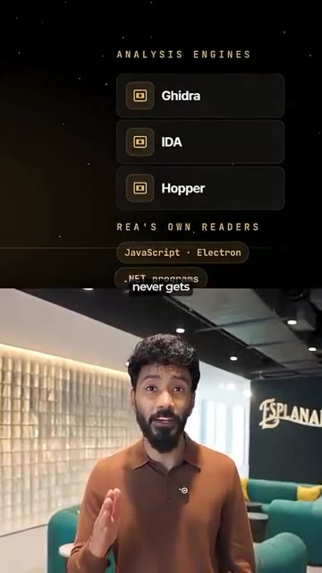

# 🎬 This Open-Source AI Tool Can REVERSE ENGINEER Any App! 🤯

> **Chaîne** : [Vaibhav Sisinty](https://www.youtube.com/@vaibhavsisinty)  
> **Lien YouTube** : [https://www.youtube.com/watch?v=uoO2EIJoE58](https://www.youtube.com/watch?v=uoO2EIJoE58)  
> **Date de publication** : 20261016  
> **Durée** : 00:01:15  
> **Identifiant vidéo** : `uoO2EIJoE58`  
> **Transcription & Analyse** : `whisper-v3-large-turbo+gemini-3.5-flash-lite`  

---

## 📌 Synthèse Exécutive & Outils

### 💡 Résumé

La vidéo met en lumière le dépôt GitHub tendance de la semaine : « Reverse Engineer Anything », un outil gratuit et open-source qui révolutionne l'analyse logicielle. Auparavant, la rétro-ingénierie d'une application nécessitait des compétences d'expert en lecture de code machine brut, rendant cette pratique élitiste et inaccessible au plus grand nombre. Aujourd'hui, en combinant cet outil open-source à des agents IA de pointe comme Claude Code ou Cursor, il devient possible de pointer n'importe quelle application pour en comprendre instantanément le fonctionnement interne, analyser le comportement d'une fonctionnalité spécifique, et ce, sans même disposer du code source d'origine. L'intégralité du processus s'exécute localement sur la machine de l'utilisateur, garantissant une sécurité et une confidentialité totales, puisque l'application cible n'est jamais téléchargée sur des serveurs tiers.

Au-delà de la simple analyse, ce duo formé par l'IA et la rétro-ingénierie ouvre la voie à des cas d'usage disruptifs où les utilisateurs ne se contentent plus de lire le code, mais reconstruisent les produits de zéro. La vidéo illustre cette bascule par des exemples concrets et saisissants : un utilisateur frustré par la lenteur de sa télévision (trente secondes pour ouvrir une application) a rétro-conçu le système pour ramener ce délai à trois secondes sur le même matériel ; un autre a réussi à faire tourner la fonctionnalité AirDrop d'Apple sur un ordinateur portable Linux ; tandis qu'un troisième a détourné des cadres photo à 50 dollars pour en faire des tableaux de bord domotiques sophistiqués. Ce qui nécessitait autrefois des mois de travail à une équipe entière d'ingénieurs ne demande désormais plus qu'une seule instruction textuelle.

Ce paradigme redéfinit profondément le rapport aux logiciels et au matériel du quotidien. Le message adressé à la communauté est un appel direct au *growth hacking* appliqué à l'ingénierie personnelle : les consommateurs ne sont plus tenus de subir des logiciels lents, fermés ou verrouillés qu'ils ont pourtant achetés. Grâce à l'automatisation et aux agents intelligents, chacun dispose des leviers pour comprendre, réparer et reconstruire ses propres solutions technologiques. Pour démocratiser cette approche, un guide gratuit contenant les étapes d'installation et les prompts exacts a été mis à disposition dans la communauté WhatsApp du créateur, illustrant parfaitement une stratégie d'acquisition et de rétention d'audience axée sur la valeur.

---

### 🛠️ Outils, Modèles & Logiciels Présentés

* **Reverse Engineer Anything** : Dépôt GitHub open-source et gratuit servant de moteur principal pour analyser le fonctionnement d'applications et de fonctionnalités sans nécessiter le code source d'origine.
* **Claude Code** : Agent IA conversationnel et de développement avancé utilisé pour interpréter les données de rétro-ingénierie et assister dans la compréhension ou la réécriture du code.
* **Cursor** : Éditeur de code assisté par IA agissant comme agent d'exécution pour analyser, modifier et reconstruire des architectures logicielles complexes.
* **Make** : (Mentionné dans l'écosystème global de la chaîne) Outil d'automatisation no-code utilisé pour connecter les flux de travail et orchestrer des tâches complexes.
* **n8n** : (Mentionné dans l'écosystème global de la chaîne) Alternative open-source d'automatisation pour connecter des applications et déclencher des actions basées sur l'IA.
* **ChatGPT** : (Mentionné dans l'écosystème global de la chaîne) Modèle de langage conversationnel de référence pour la génération de contenu et l'assistance stratégique.
* **Gemini** : (Mentionné dans l'écosystème global de la chaîne) Modèle multimodal de Google mobilisé pour le traitement rapide d'informations textuelles et contextuelles.
* **Perplexity** : (Mentionné dans l'écosystème global de la chaîne) Moteur de recherche conversationnel basé sur l'IA pour la veille technologique et l'analyse de tendances.
* **Midjourney** : (Mentionné dans l'écosystème global de la chaîne) Générateur d'images par IA de premier plan pour la création de visuels marketing et d'assets graphiques.

---

### 🔑 Points Clés & Enseignements Stratégiques

* **Démocratisation de la rétro-ingénierie** : Ce qui était autrefois l'apanage exclusif d'experts en code machine brut est désormais accessible à toute personne capable d'utiliser un agent IA.
* **Exécution 100 % locale** : L'analyse s'effectue directement sur la machine de l'utilisateur, garantissant une confidentialité maximale puisque les applications cibles ne quittent jamais l'environnement local.
* **Du diagnostic à la reconstruction** : L'outil ne sert pas seulement à auditer ou comprendre le code, mais permet de reconstruire activement des logiciels et des systèmes sur mesure.
* **Optimisation drastique des performances matérielles** : Possibilité de contourner les limitations logicielles imposées par les constructeurs, comme l'illustre le passage du temps de chargement d'une application TV de 30 à 3 secondes.
* **Interopérabilité inter-plateformes** : Capacité à porter des technologies propriétaires (comme AirDrop d'Apple) sur des environnements ouverts (Linux).
* **Détournement d'hardware abordable** : Transformation d'objets du quotidien à faible coût (comme des cadres photo à 50 dollars) en interfaces de contrôle domotique haut de gamme.
* **Réduction exponentielle des coûts de développement** : Des projets nécessitant traditionnellement une équipe entière d'ingénieurs qualifiés peuvent désormais être amorcés via une simple instruction textuelle (*prompt*).
* **Émancipation technologique du consommateur** : Fin de la dépendance aux mises à jour ou aux correctifs des entreprises ; l'utilisateur final reprend le contrôle total sur les outils qu'il possède et a payés.
* **Stratégie de lead generation communautaire** : Utilisation d'un guide technique gratuit et exclusif comme aimant à prospects (*lead magnet*) pour alimenter une communauté WhatsApp privée.
* **Appel à l'action comportemental** : Encourager l'audience à adopter une posture proactive (« Ne soyez pas la personne qui attend... Soyez la personne qui l'ouvre et le fait ») pour renforcer l'engagement et la viralité de la chaîne.

---

## ⏱️ Chronologie & Transcription Complète Audio & Visuelle (Mot pour Mot)

### ⏱️ `[00:00:00 - 00:00:34]` | Segment #01

**🔊 Audio (Transcription Intégrale Mot pour Mot en Français) :**
> Le dépôt GitHub numéro un en tendance cette semaine s'appelle Reverse Engineer Anything, un outil gratuit et open source. Voici ce qu'il fait. Jusqu'à présent, si vous vouliez savoir comment une application fonctionnait vraiment, vous aviez besoin d'un expert en rétro-ingénierie. Quelqu'un qui sait lire le code machine brut. Presque personne ne peut faire ça. Vous le branchez sur votre agent IA comme Claude Code ou Cursor, vous le pointez sur n'importe quelle application, et il vous dit exactement comment fonctionne une fonctionnalité, même sans le code source. Et l'analyse s'exécute sur votre propre machine. Votre application n'est jamais téléchargée nulle part. Mais c'est là que ça devient fou. Les gens ne font plus seulement lire du code. Ils reconstruisent des choses. Un type était tellement agacé que sa télé prenne 30

**👁️ Analyse Visuelle d'Écran (gemini-3.5-flash-lite) :**
**Interface & Outils** : Interface graphique textuelle présentant les moteurs d'analyse et lecteurs REA.

**Contenu textuel & Code** : Texte affichant 'ANALYSIS ENGINES', 'Ghidra', 'IDA', 'Hopper' et 'REA's OWN READERS'.

**Action / Démonstration** : Présentation visuelle des différents outils et moteurs d'analyse utilisés par le logiciel.

*⏱️ 00:00:26 — Présentation des moteurs d'analyse (Ghidra, IDA, Hopper) et des lecteurs REA au-dessus du présentateur.*

---

### ⏱️ `[00:00:34 - 00:00:59]` | Segment #02

**🔊 Audio (Transcription Intégrale Mot pour Mot en Français) :**
> secondes pour ouvrir une application. Il a fait de la rétro-ingénierie sur tout le système et a créé le sien. Même téléviseur, même matériel. Maintenant, elle s'ouvre en trois secondes. Quelqu'un a fait tourner AirDrop, la propre fonctionnalité d'Apple, sur un ordinateur portable Linux. Une autre personne a transformé des cadres photo à 50 dollars en tableaux de bord pour maison connectée. Un travail qui nécessitait autrefois toute une équipe d'ingénieurs ne demande plus qu'une seule instruction. Alors, voici le problème : vous n'êtes pas obligé d'accepter les versions lentes et verrouillées des choses que vous avez déjà payées.

**👁️ Analyse Visuelle d'Écran (gemini-3.5-flash-lite) :**
**Interface & Outils** : Cadre photo numérique reconverti en tableau de bord intelligent.

**Contenu textuel & Code** : Interface utilisateur affichant l'heure (3:20), la météo (15°C) et divers widgets de suivi ou statistiques.

**Action / Démonstration** : Présentation d'un matériel détourné de sa fonction initiale pour afficher un tableau de bord intelligent fait maison.

*⏱️ 00:00:47 — Un homme tient un cadre photo numérique affichant une interface personnalisée avec horloge, météo et graphiques.*

---

### ⏱️ `[00:00:59 - 00:01:15]` | Segment #03

**🔊 Audio (Transcription Intégrale Mot pour Mot en Français) :**
> Vous pouvez les comprendre. Vous pouvez les réparer. Vous pouvez les reconstruire vous-même. Ne soyez pas la personne qui attend qu'une entreprise répare les choses. Soyez la personne qui l'ouvre et le fait. J'ai préparé un guide gratuit avec les étapes d'installation exactes et les prompts pour commencer. Il est dans ma communauté WhatsApp. Cliquez sur le lien dans ma bio.

**👁️ Analyse Visuelle d'Écran (gemini-3.5-flash-lite) :**
**Interface & Outils** : Aucun outil, interface ou logiciel n'est affiché.

**Contenu textuel & Code** : Texte affiché en sous-titre uniquement : "Don't be the person", "and does it.", "and the prompts".

**Action / Démonstration** : Le présentateur s'adresse directement à l'audience en parlant face caméra, sans démonstration technique.

---

