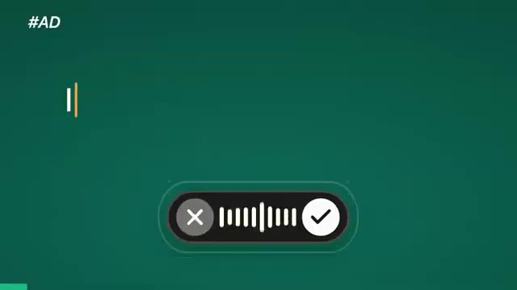
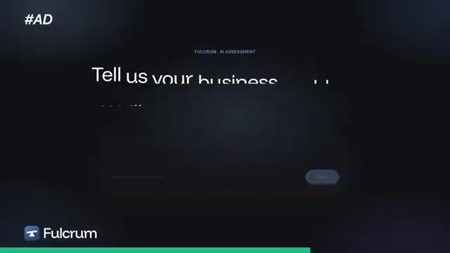
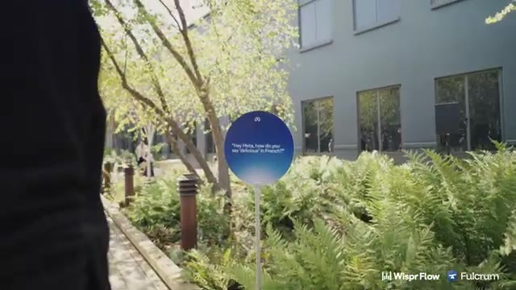
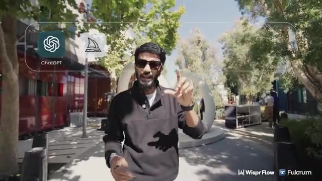
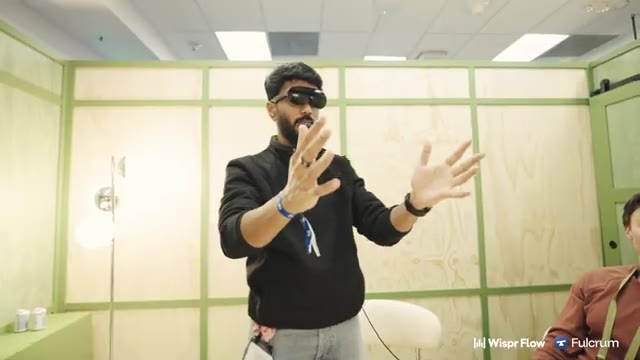
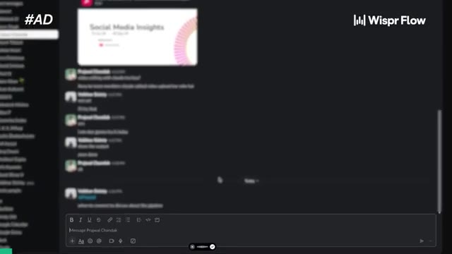
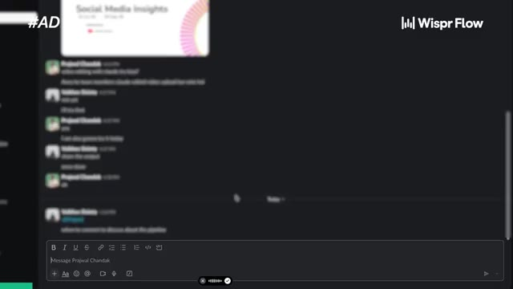
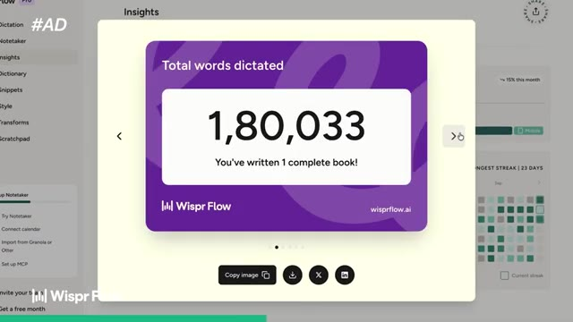
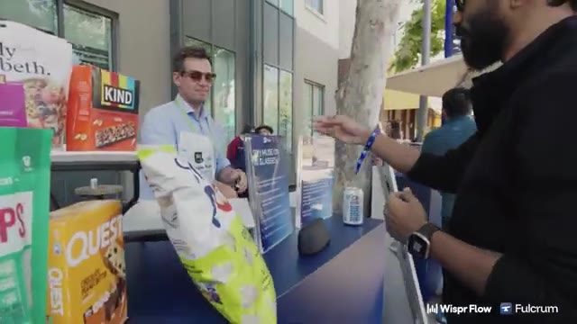
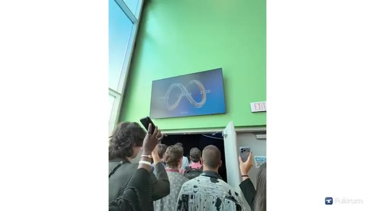

# 🎬 I Spent 48 Hours Inside Meta. Are Glasses Replacing iPhones?

> **Chaîne** : [Vaibhav Sisinty](https://www.youtube.com/@vaibhavsisinty)  
> **Lien YouTube** : [https://www.youtube.com/watch?v=ZkKxud5gPfw](https://www.youtube.com/watch?v=ZkKxud5gPfw)  
> **Date de publication** : 20261017  
> **Durée** : 00:27:12  
> **Identifiant vidéo** : `ZkKxud5gPfw`  
> **Transcription & Analyse** : `whisper-v3-large-turbo+gemini-3.5-flash-lite`  

---

## 📌 Synthèse Exécutive & Outils

### 💡 Résumé
Dans cette vidéo intitulée **I Spent 48 Hours Inside Meta. Are Glasses Replacing iPhones?**, Vaibhav Sisinty présente des stratégies d'optimisation et d'automatisation propulsées par les technologies IA.

### 🛠️ Outils, Modèles & Logiciels Présentés
- **Outils IA & Automatisation** : Solutions de productivité et d'ingénierie présentées dans la vidéo.

### 🔑 Points Clés & Enseignements Stratégiques
- Exploiter les modèles d'IA récents pour décupler sa productivité quotidienne.
- Mettre en place des automatisations scalables et reproductibles.

---

## ⏱️ Chronologie & Transcription Complète Audio & Visuelle (Mot pour Mot)

### ⏱️ `[00:00:00 - 00:00:18]` | Segment #01

**🔊 Audio (Transcription Intégrale Mot pour Mot en Français) :**
> I've got a quick question for you. How many times have you opened your phone today? I've been told that the average person opens it 90 times every single day. And when it comes to me, it's probably going to be more. Today, we're going to do something different. I'm going to ditch my phone for the next 24 hours. Guess what I'm going to be using? My Meta glasses.

**👁️ Analyse Visuelle d'Écran (gemini-3.5-flash-lite) :**
**Interface & Outils** : Aucune interface logicielle ou outil n'est visible sur les captures.

**Contenu textuel & Code** : Texte incrusté en bas de l'image reprenant une partie de la narration ("I've been told that", "its probably", "for the next").

**Action / Démonstration** : Le présentateur présente son sujet en marchant et en gesticulant, sans effectuer de démonstration technique.

---

### ⏱️ `[00:00:19 - 00:00:43]` | Segment #02

**🔊 Audio (Transcription Intégrale Mot pour Mot en Français) :**
> And we're going to see how we're going to roll with just these two glasses. And I'm going to explore a bunch of new updates that Meta is dropping. because we are right now in the Silicon Valley exploring all the new updates that Meta is gonna drop and very soon we are also gonna see Zuck live on stage. It's gonna be fun. Be with me today. It's usually an AI clone that we are in real wonder.

**👁️ Analyse Visuelle d'Écran (gemini-3.5-flash-lite) :**
**Interface & Outils** : Présentation ou face-caméra explicatif sans interface logicielle partagée.

**Contenu textuel & Code** : Explications orales, astuces de productivité et méthodologie IA.

**Action / Démonstration** : Explications face caméra et présentation conceptuelle.

---

### ⏱️ `[00:00:46 - 00:01:07]` | Segment #03

**🔊 Audio (Transcription Intégrale Mot pour Mot en Français) :**
> GBC faster. It's okay. It's okay. It's okay. It's okay. Morning. Morning. We are following the boss lady. Ma'am, where do we go? Actually, we get the fact check before you say it's done.

**👁️ Analyse Visuelle d'Écran (gemini-3.5-flash-lite) :**
**Interface & Outils** : AUCUNE

**Contenu textuel & Code** : AUCUNE

**Action / Démonstration** : Déplacement du groupe dans un environnement extérieur (campus ou lieu de transit).

---

### ⏱️ `[00:01:07 - 00:01:28]` | Segment #04

**🔊 Audio (Transcription Intégrale Mot pour Mot en Français) :**
> Urvashi said that's the first building. And Urvashi works for Meta. If anything goes wrong, you can get in touch with her. Okay, we have to verify a fact right now that Urvashi threw it around. Urvashi was like, that building, the hacker company was supposed to be the first office of Meta where Zuck sits out of.

**👁️ Analyse Visuelle d'Écran (gemini-3.5-flash-lite) :**
**Interface & Outils** : AUCUNE

**Contenu textuel & Code** : AUCUN

**Action / Démonstration** : Le présentateur déambule dans un environnement public tout en parlant de l'histoire du premier bâtiment de Meta. Aucune démonstration technique ou interface logicielle n'est présentée.

---

### ⏱️ `[00:01:28 - 00:02:00]` | Segment #05

**🔊 Audio (Transcription Intégrale Mot pour Mot en Français) :**
> Is that true or not? I mean, who gives that punch back? I heard one! Alright guys, so we've got our coffee, we've had our very quick breakfast. All set for some fun demos. Yeah, let's do it. Guys, I think we're making a transition towards being a tech creator right now.

**👁️ Analyse Visuelle d'Écran (gemini-3.5-flash-lite) :**
**Interface & Outils** : Présentation ou face-caméra explicatif sans interface logicielle partagée.

**Contenu textuel & Code** : Explications orales, astuces de productivité et méthodologie IA.

**Action / Démonstration** : Explications face caméra et présentation conceptuelle.

---

### ⏱️ `[00:02:00 - 00:02:20]` | Segment #06

**🔊 Audio (Transcription Intégrale Mot pour Mot en Français) :**
> So MKBHD, I'm coming for you my friend. So, we have a brand new Meta Ray-Ban. Sorry, we have a brand new Meta glasses. This turns out to be not a Ray-Ban branded one, but actually by Meta. So that's going to be interesting. Let's try it out. I think this is a flat case, if I'm not wrong.

**👁️ Analyse Visuelle d'Écran (gemini-3.5-flash-lite) :**
**Interface & Outils** : Aucune interface logicielle ou outil numérique n'est affiché.

**Contenu textuel & Code** : Aucun contenu textuel, code ou donnée n'est visible.

**Action / Démonstration** : Le présentateur effectue une présentation physique de l'emballage d'un nouveau produit technologique (Meta glasses).

---

### ⏱️ `[00:02:21 - 00:02:45]` | Segment #07

**🔊 Audio (Transcription Intégrale Mot pour Mot en Français) :**
> This is a flat case. Yes, you can see that it flattens out, fits in your pocket, which is quite cool. My old one is quite bulky. I have one more, the Oakley ones of last generation. The case of this is quite bulky. That's been a problem. We have interesting glasses. What do you think? It's cool. Why just glasses? Because wearables could be a watch, could be your phones, could be something like a Neuralink.

**👁️ Analyse Visuelle d'Écran (gemini-3.5-flash-lite) :**
**Interface & Outils** : AUCUNE

**Contenu textuel & Code** : AUCUN

**Action / Démonstration** : Le présentateur montre physiquement ses lunettes et discute de leur aspect pratique (boîtier plat) par rapport à d'anciens modèles, sans démonstration de logiciel ou d'interface.

---

### ⏱️ `[00:02:45 - 00:03:04]` | Segment #08

**🔊 Audio (Transcription Intégrale Mot pour Mot en Français) :**
> I don't know. Because if the interface that we are building is for an interface to talk to an agent, there could be multiple of those. What could those be, according to you, and what are you guys cooking right now? I definitely think that there's a place for different form factors for different people. And the obvious one you didn't mention is a phone, which people do use.

**👁️ Analyse Visuelle d'Écran (gemini-3.5-flash-lite) :**
**Interface & Outils** : Présentation ou face-caméra explicatif sans interface logicielle partagée.

**Contenu textuel & Code** : Explications orales, astuces de productivité et méthodologie IA.

**Action / Démonstration** : Explications face caméra et présentation conceptuelle.

---

### ⏱️ `[00:03:04 - 00:03:41]` | Segment #09

**🔊 Audio (Transcription Intégrale Mot pour Mot en Français) :**
> Yeah, sure. Right now, or a desktop computer or a laptop. up um the reason so glasses has always we've always believed glasses would be the most common form factor and the most important one because more people wear glasses than anything else uh over two billion people wear prescription glasses in the world more than that wear sunglasses like think of the people you know and try to think of a single person who does not wear sunglasses or prescription glasses me you're the second person i've met who meets that criteria and so So for you, we do need, although you do have a beautiful pair of ears, for you, we do need

**👁️ Analyse Visuelle d'Écran (gemini-3.5-flash-lite) :**
**Interface & Outils** : Présentation ou face-caméra explicatif sans interface logicielle partagée.

**Contenu textuel & Code** : Explications orales, astuces de productivité et méthodologie IA.

**Action / Démonstration** : Explications face caméra et présentation conceptuelle.

---

### ⏱️ `[00:03:41 - 00:04:01]` | Segment #10

**🔊 Audio (Transcription Intégrale Mot pour Mot en Français) :**
> to find an alternative form factor. But because so many people wear glasses and it can see what you see, it can hear what you hear, it really is a great form factor for the AI. And a core thing that we want to look at is 90% of the time, this device is doing nothing, right? You're just wearing it, whether it's a watch or a phone in your pocket or glasses.

**👁️ Analyse Visuelle d'Écran (gemini-3.5-flash-lite) :**
**Interface & Outils** : Aucune interface logicielle ou outil numérique n'est présenté.

**Contenu textuel & Code** : Aucun texte, code, ou donnée affiché à l'écran.

**Action / Démonstration** : Conversation informelle ; le segment se compose uniquement d'une discussion orale sans support visuel de démonstration.

---

### ⏱️ `[00:04:01 - 00:04:35]` | Segment #11

**🔊 Audio (Transcription Intégrale Mot pour Mot en Français) :**
> and so you know my favorite analogy is that an escalator doesn't break it just becomes stairs and so similarly if the glasses are on and they're doing nothing they just have to be a stylish good looking prayer glasses that are still useful to you um so i think that that's going to be the most ubiquitous form factor doesn't mean the only one this video is sponsored by whisper flow it lets me write just by talking i hold one key i speak and it types for me in whatsapp slack Gmail, my favorite AI apps, pretty much anywhere. And with AI that really helps because the more you

**👁️ Analyse Visuelle d'Écran (gemini-3.5-flash-lite) :**
**Interface & Outils** : Widget d'interface utilisateur (UI) propriétaire, probablement lié à une application de commande vocale ou d'IA.

**Contenu textuel & Code** : Barre de visualisation audio centrale avec options d'annulation et de confirmation, mention "#AD" dans le coin supérieur gauche.

**Action / Démonstration** : Présentation visuelle de l'interface utilisateur du produit (overlay graphique) illustrant le fonctionnement du système de commande ou d'interaction vocale.

*⏱️ 00:04:26 — Interface graphique minimale sur fond vert présentant un widget de contrôle vocal avec un indicateur de niveau sonore, un bouton "X" (annuler) et un bouton "V" (valider).*

---

### ⏱️ `[00:04:35 - 00:05:02]` | Segment #12

**🔊 Audio (Transcription Intégrale Mot pour Mot en Français) :**
> tell it, the better it works. And we say a lot more when we talk than when we type. And this video is also sponsored by Fulcrum. A lot of companies know they want to use AI but have no idea what to build or who can actually build it. With Fulcrum, you just describe what you want to get done. It gives you an AI assessment of exactly what it would take and then their team helps you turn it into a working solution and I'll show you both of these in action later in the episode. You'll find the links to both in the description.

**👁️ Analyse Visuelle d'Écran (gemini-3.5-flash-lite) :**
**Interface & Outils** : Plateforme SaaS Fulcrum (AI Assessment).

**Contenu textuel & Code** : Texte affiché : "FULCRUM - AI ASSESSMENT" et "Tell us your business".

**Action / Démonstration** : Présentation visuelle de l'interface utilisateur de l'outil Fulcrum pour évaluer les besoins métier liés à l'IA.

*⏱️ 00:04:49 — Interface de l'outil Fulcrum présentant un formulaire "AI Assessment" avec la question "Tell us your business".*

---

### ⏱️ `[00:05:02 - 00:05:23]` | Segment #13

**🔊 Audio (Transcription Intégrale Mot pour Mot en Français) :**
> I think I'm butchering it. I've screwed it up. I don't know how to fold this. Oh, there you go. No. Done, done, done. To pull off what she is. She's probably going to take me a two-year course. Alright, so let's go explore all the glasses. Looks like they have all the glasses here.

**👁️ Analyse Visuelle d'Écran (gemini-3.5-flash-lite) :**
**Interface & Outils** : Présentation ou face-caméra explicatif sans interface logicielle partagée.

**Contenu textuel & Code** : Explications orales, astuces de productivité et méthodologie IA.

**Action / Démonstration** : Explications face caméra et présentation conceptuelle.

---

### ⏱️ `[00:05:24 - 00:05:43]` | Segment #14

**🔊 Audio (Transcription Intégrale Mot pour Mot en Français) :**
> There's no line. It's all for us right now. Let's go explore. Hello. Can we? Can we come explore? This is the style pavilion. Is this a display? What is this? It is a personalized gem. So on all the Starfire's they're gonna come with a personalized gem. Oh! Interesting. And these are our new meta adventure of VISA. These are a VISA collab.

**👁️ Analyse Visuelle d'Écran (gemini-3.5-flash-lite) :**
**Interface & Outils** : Aucune interface logicielle ou numérique n'est affichée ; il s'agit d'une séquence de visite physique d'un stand.

**Contenu textuel & Code** : Aucun contenu numérique, texte, slide ou code n'est visible. L'arrière-plan montre uniquement le logo de Meta sur un mur bleu.

**Action / Démonstration** : Le présentateur explore physiquement un stand d'exposition, observe des objets (probablement des lunettes) posés sur un présentoir et interagit avec son environnement immédiat.

---

### ⏱️ `[00:05:43 - 00:06:02]` | Segment #15

**🔊 Audio (Transcription Intégrale Mot pour Mot en Français) :**
> I like them. Oh yeah, they look good. So we actually have two variations of it. So those are the VISA adventures that come in this plush lens. You see how it's almost like translucent? You can see the tech inside. Quite cool. Yeah, you were saying. And then there's another variation where they have the Merlot lens.

**👁️ Analyse Visuelle d'Écran (gemini-3.5-flash-lite) :**
**Interface & Outils** : Présentation ou face-caméra explicatif sans interface logicielle partagée.

**Contenu textuel & Code** : Explications orales, astuces de productivité et méthodologie IA.

**Action / Démonstration** : Explications face caméra et présentation conceptuelle.

---

### ⏱️ `[00:06:04 - 00:06:24]` | Segment #16

**🔊 Audio (Transcription Intégrale Mot pour Mot en Français) :**
> And these are our new Ray-Zan Meta Gen 3 8mm. We saw them. We tried it out. Oh, we got the brother. Absolutely. Like this? Okay. Sorry, big hands. I'm showing out the displays. The Meta Display. Sorry, I'm pushing it.

**👁️ Analyse Visuelle d'Écran (gemini-3.5-flash-lite) :**
**Interface & Outils** : Aucune interface numérique, logiciel ou outil SaaS n'est affiché dans ce segment.

**Contenu textuel & Code** : Aucun contenu informationnel, texte, code ou donnée n'est présent à l'écran.

**Action / Démonstration** : Le segment se concentre exclusivement sur une visite physique dans un showroom et la manipulation d'objets réels (lunettes).

---

### ⏱️ `[00:06:24 - 00:06:52]` | Segment #17

**🔊 Audio (Transcription Intégrale Mot pour Mot en Français) :**
> No, don't worry. I did the same thing. It should be a nice thing. Oh, there you go. I see. It's loading up. I see a bunch of activations there. I love the pop colors that are in there. Let's go try them out.

**👁️ Analyse Visuelle d'Écran (gemini-3.5-flash-lite) :**
**Interface & Outils** : Présentation ou face-caméra explicatif sans interface logicielle partagée.

**Contenu textuel & Code** : Explications orales, astuces de productivité et méthodologie IA.

**Action / Démonstration** : Explications face caméra et présentation conceptuelle.

---

### ⏱️ `[00:06:59 - 00:07:19]` | Segment #18

**🔊 Audio (Transcription Intégrale Mot pour Mot en Français) :**
> Okay, perfect. So, welcome. This is going to be our Cedric Verlet experience. Okay. So, with the glasses, I want you to go ahead. We're going to read this prompt here first. Hey, Mehta. How do you say delicious in French? Delice you. Gotcha. Okay. Follow me. Yes, ma'am. Hello. Thank you. Of course. In France. You said what? In France?

**👁️ Analyse Visuelle d'Écran (gemini-3.5-flash-lite) :**
**Interface & Outils** : Meta AI (utilisé via des lunettes connectées).

**Contenu textuel & Code** : Texte affiché dans la bulle d'interface : "Hey Meta, how do you say 'delicious' in French?".

**Action / Démonstration** : Démonstration de l'utilisation de l'assistant vocal Meta AI via des lunettes connectées pour traduire une expression en temps réel.

*⏱️ 00:07:09 — Une bulle d'interface augmentée (Meta AI) apparaît au centre de l'écran affichant la question : "Hey Meta, how do you say 'delicious' in French?".*

---

### ⏱️ `[00:07:19 - 00:07:38]` | Segment #19

**🔊 Audio (Transcription Intégrale Mot pour Mot en Français) :**
> Yeah, to your prayer and I yell in France. It says going to France. Yeah, right. Are we going to France by eating this? Are you ready to go France? Oh, let's do it. I don't have the visa though. We've got some... What is it called? It's popcorn. It's popcorn, yes. It's a caramel filled... How can a popcorn be this big? Okay. It's made with popcorn. Can I eat it?

**👁️ Analyse Visuelle d'Écran (gemini-3.5-flash-lite) :**
**Interface & Outils** : Présentation ou face-caméra explicatif sans interface logicielle partagée.

**Contenu textuel & Code** : Explications orales, astuces de productivité et méthodologie IA.

**Action / Démonstration** : Explications face caméra et présentation conceptuelle.

---

### ⏱️ `[00:07:39 - 00:07:57]` | Segment #20

**🔊 Audio (Transcription Intégrale Mot pour Mot en Français) :**
> 500 calories. Right there. How are you going for sure? Thank you. Alright, follow me. Awesome. So good. Thank you. Nice to meet you, bye. Would you like to try this pastry? This is a pastry? Yes. This is not a pear? No. What? How can this not be a pear?

**👁️ Analyse Visuelle d'Écran (gemini-3.5-flash-lite) :**
**Interface & Outils** : Aucune interface logicielle, outil SaaS ou contenu numérique n'est affiché. Il s'agit d'une séquence de type "vlog" en extérieur.

**Contenu textuel & Code** : Aucun contenu informationnel, code, prompt ou donnée chiffrée n'est présent à l'écran.

**Action / Démonstration** : Le présentateur interagit physiquement avec des passants dans un cadre informel et discute de la nature d'un aliment (pastisserie versus fruit).

---

### ⏱️ `[00:07:57 - 00:08:19]` | Segment #21

**🔊 Audio (Transcription Intégrale Mot pour Mot en Français) :**
> It's a pear. So Cedric Roulet has made fish, he's made pears, flowers. That's not a pear, that's a pastry. Shit. Oh man, more food? Oh my. Thank you. We are basically making up for the whole week of food in single day. I feel bad wasting it.

**👁️ Analyse Visuelle d'Écran (gemini-3.5-flash-lite) :**
**Interface & Outils** : Présentation ou face-caméra explicatif sans interface logicielle partagée.

**Contenu textuel & Code** : Explications orales, astuces de productivité et méthodologie IA.

**Action / Démonstration** : Explications face caméra et présentation conceptuelle.

---

### ⏱️ `[00:08:19 - 00:08:38]` | Segment #22

**🔊 Audio (Transcription Intégrale Mot pour Mot en Français) :**
> I'll have a bite and I'll leave it. Oh, okay. Is that okay? Sorry? Yeah. Thank you. Alright, so this is not a pear. This is a pastry. Let's try. Very good.

**👁️ Analyse Visuelle d'Écran (gemini-3.5-flash-lite) :**
**Interface & Outils** : AUCUNE

**Contenu textuel & Code** : AUCUNE

**Action / Démonstration** : Le présentateur teste une pâtisserie achetée sur un stand extérieur, ce qui ne correspond pas aux critères de démonstration d'outils technologiques ou logiciels demandés.

---

### ⏱️ `[00:08:47 - 00:09:06]` | Segment #23

**🔊 Audio (Transcription Intégrale Mot pour Mot en Français) :**
> Alright, so I think we can make our own wordy set, right? So this is the glasses that's been going viral on Twitter as the big leak of Meta Connect. How do you feel about it? Stop it. What was the name? I forgot the project name.

**👁️ Analyse Visuelle d'Écran (gemini-3.5-flash-lite) :**
**Interface & Outils** : Aucune interface logicielle, application ou outil numérique n'est visible à l'écran.

**Contenu textuel & Code** : Aucun contenu informatif tel que du texte, des prompts ou des tableaux de bord n'est présent.

**Action / Démonstration** : Le présentateur échange verbalement avec une personne hors-champ et manipule des cartes physiques, sans démonstration technique logicielle.

---

### ⏱️ `[00:09:06 - 00:09:29]` | Segment #24

**🔊 Audio (Transcription Intégrale Mot pour Mot en Français) :**
> Mew. Nein. Hatch. Hatch. So I asked Urvashi, when am I getting access to Hatch? She was like, what is Hatch? This was before Muse came out. She was like, what is Hatch? Sure. When did you access? Then I think four or five days later it drops as Muse. And the poor guy who was doing the demo for me in the night, he kept saying Hatch, Hatch, Hatch, because I was so used to the...

**👁️ Analyse Visuelle d'Écran (gemini-3.5-flash-lite) :**
**Interface & Outils** : Aucune interface logicielle, outil SaaS ou contenu technique n'est affiché à l'écran.

**Contenu textuel & Code** : Aucun contenu informationnel, texte, code ou donnée n'est présent.

**Action / Démonstration** : Le segment montre uniquement une interaction sociale et conversationnelle entre deux personnes dans un cadre extérieur ; aucune démonstration technique n'est effectuée.

---

### ⏱️ `[00:09:29 - 00:09:51]` | Segment #25

**🔊 Audio (Transcription Intégrale Mot pour Mot en Français) :**
> When did you start using it? Honestly, not as much as I would like to, because it was just so close and the last week was like a mess for me at work. So I could not get hands on it. I was trying to play with it on my flight and trying to get to work on WhatsApp and I was trying to compare it with instinct.

**👁️ Analyse Visuelle d'Écran (gemini-3.5-flash-lite) :**
**Interface & Outils** : Présentation ou face-caméra explicatif sans interface logicielle partagée.

**Contenu textuel & Code** : Explications orales, astuces de productivité et méthodologie IA.

**Action / Démonstration** : Explications face caméra et présentation conceptuelle.

---

### ⏱️ `[00:09:51 - 00:10:12]` | Segment #26

**🔊 Audio (Transcription Intégrale Mot pour Mot en Français) :**
> Yeah, evidently it ranks higher than that. What we're going to do right now is we're going to do a quick rapid fire. This is going to be a fun one. Okay. And this is going to be more of how you use AI and variables more than anything else.

**👁️ Analyse Visuelle d'Écran (gemini-3.5-flash-lite) :**
**Interface & Outils** : Présentation ou face-caméra explicatif sans interface logicielle partagée.

**Contenu textuel & Code** : Explications orales, astuces de productivité et méthodologie IA.

**Action / Démonstration** : Explications face caméra et présentation conceptuelle.

---

### ⏱️ `[00:10:12 - 00:10:34]` | Segment #27

**🔊 Audio (Transcription Intégrale Mot pour Mot en Français) :**
> Give me a second, I'm going to just pull that out. Alright, here comes the rapid fire, right? How many words per answer? As less as possible. Okay. And it should not start with a no. Okay. No, no. Okay. What's something you do with AI that most people would find super strange?

**👁️ Analyse Visuelle d'Écran (gemini-3.5-flash-lite) :**
**Interface & Outils** : Présentation ou face-caméra explicatif sans interface logicielle partagée.

**Contenu textuel & Code** : Explications orales, astuces de productivité et méthodologie IA.

**Action / Démonstration** : Explications face caméra et présentation conceptuelle.

---

### ⏱️ `[00:10:35 - 00:10:56]` | Segment #28

**🔊 Audio (Transcription Intégrale Mot pour Mot en Français) :**
> Calendar. Calendar? Calendar. So you manage all your calendar using AI? Okay. If you have to delete every single AI app, I'm assuming you're using a bunch of them, what is that that you'd be left with? What is that one app that you can work with? True question. obviously Muse. Perfect. That was the trick one. You got it right.

**👁️ Analyse Visuelle d'Écran (gemini-3.5-flash-lite) :**
**Interface & Outils** : Présentation ou face-caméra explicatif sans interface logicielle partagée.

**Contenu textuel & Code** : Explications orales, astuces de productivité et méthodologie IA.

**Action / Démonstration** : Explications face caméra et présentation conceptuelle.

---

### ⏱️ `[00:10:58 - 00:11:17]` | Segment #29

**🔊 Audio (Transcription Intégrale Mot pour Mot en Français) :**
> I made these for you guys. Thank you. No problem. No, these are pastries. They're all confections. All confections. Sorry. No problem. What's that? What's the difference between pastries and confections?

**👁️ Analyse Visuelle d'Écran (gemini-3.5-flash-lite) :**
**Interface & Outils** : Aucune interface logicielle ou outil numérique n'est affiché.

**Contenu textuel & Code** : Aucun texte, code, tableau de bord ou donnée numérique n'est visible à l'écran.

**Action / Démonstration** : Échange informel et manipulation d'objets physiques (boîtes de confiseries) au comptoir d'une boutique.

---

### ⏱️ `[00:11:17 - 00:11:35]` | Segment #30

**🔊 Audio (Transcription Intégrale Mot pour Mot en Français) :**
> So confections are more, they're smaller. Okay. And they're more sugary. Oh, they're more sugary? Right. They're more like a candy. As opposed to a pastry would be something more of that sound. It's more composed. It has different elements.

**👁️ Analyse Visuelle d'Écran (gemini-3.5-flash-lite) :**
**Interface & Outils** : Présentation ou face-caméra explicatif sans interface logicielle partagée.

**Contenu textuel & Code** : Explications orales, astuces de productivité et méthodologie IA.

**Action / Démonstration** : Explications face caméra et présentation conceptuelle.

---

### ⏱️ `[00:11:36 - 00:11:55]` | Segment #31

**🔊 Audio (Transcription Intégrale Mot pour Mot en Français) :**
> Thank you. Let's get some ice cream. This is Gen 3, right? This is the first edition of Meta Glasses. So this is non Ray-Ban.

**👁️ Analyse Visuelle d'Écran (gemini-3.5-flash-lite) :**
**Interface & Outils** : Présentation ou face-caméra explicatif sans interface logicielle partagée.

**Contenu textuel & Code** : Explications orales, astuces de productivité et méthodologie IA.

**Action / Démonstration** : Explications face caméra et présentation conceptuelle.

---

### ⏱️ `[00:11:55 - 00:12:32]` | Segment #32

**🔊 Audio (Transcription Intégrale Mot pour Mot en Français) :**
> No, but this is the one that is going out tomorrow. No, this is available today. What do you mean? This is not the new one? No, this is already released. oh okay the new one is coming in tomorrow correct yeah um for new ones for meta glasses we have uh nova and so this is gen 2 it's the first generation of meta glasses when did they come out they came out earlier this year oh okay so they're still current i took a check got it but they're coming out with some new styles uh there's uh little glasses and capris so more like a rounder frame

**👁️ Analyse Visuelle d'Écran (gemini-3.5-flash-lite) :**
**Interface & Outils** : Présentation ou face-caméra explicatif sans interface logicielle partagée.

**Contenu textuel & Code** : Explications orales, astuces de productivité et méthodologie IA.

**Action / Démonstration** : Explications face caméra et présentation conceptuelle.

---

### ⏱️ `[00:12:32 - 00:12:59]` | Segment #33

**🔊 Audio (Transcription Intégrale Mot pour Mot en Français) :**
> and then also more of a cat eye really at generation three is going to be more towards uh ray-bans yeah i uh we just got the adventure oh nice yeah adventure metagloss yeah we got the adventure ones yeah yeah that'll be 60 dollars it's okay you're gonna purchase it yeah yeah It's like a lot of password that you have to say.

**👁️ Analyse Visuelle d'Écran (gemini-3.5-flash-lite) :**
**Interface & Outils** : Aucune interface logicielle, application SaaS ou outil numérique n'est affiché.

**Contenu textuel & Code** : Aucun contenu informationnel, texte, code ou donnée n'est présent à l'écran.

**Action / Démonstration** : Discussion informelle et interaction commerciale dans un point de vente physique, sans démonstration technique ou logicielle.

---

### ⏱️ `[00:12:59 - 00:13:19]` | Segment #34

**🔊 Audio (Transcription Intégrale Mot pour Mot en Français) :**
> Yeah. Sometimes you're like, yeah. Pick it for us, how for me? Thank you. You're welcome. You see, everybody I talk to at Meta has said one thing that is common across. They all say that people who are able to use the right AI tools will be able to harness the world that we live in much better than everybody else.

**👁️ Analyse Visuelle d'Écran (gemini-3.5-flash-lite) :**
**Interface & Outils** : ChatGPT, Midjourney.

**Contenu textuel & Code** : Icônes de l'interface de ChatGPT et du logo de Midjourney apparaissant à l'écran lors du discours du présentateur.

**Action / Démonstration** : Démonstration visuelle illustrant les outils IA mentionnés oralement.

*⏱️ 00:13:14 — Le présentateur à l'extérieur, avec des icônes d'outils IA superposées graphiquement à l'image.*

---

### ⏱️ `[00:13:19 - 00:13:40]` | Segment #35

**🔊 Audio (Transcription Intégrale Mot pour Mot en Français) :**
> That's why at all our Outskill programs, we actually never try to train you on one single AI tool. We try to give you a suite of tools that you can actually use and find your right workflows. Pretty much everything, right? From automating your workflows to generating images to writing the right prompts to getting your content work done to getting your data work done to getting presentations done to building products, literally everything under the hood.

**👁️ Analyse Visuelle d'Écran (gemini-3.5-flash-lite) :**
**Interface & Outils** : Présentation ou face-caméra explicatif sans interface logicielle partagée.

**Contenu textuel & Code** : Explications orales, astuces de productivité et méthodologie IA.

**Action / Démonstration** : Explications face caméra et présentation conceptuelle.

---

### ⏱️ `[00:13:40 - 00:14:00]` | Segment #36

**🔊 Audio (Transcription Intégrale Mot pour Mot en Français) :**
> We teach you the right tools for the right problems. So when AI changes again, you're not actually starting from zero. You literally know how to put it to work. The workshop is free for a while. So click on the link below and register now. All right, guys. So I can't be very loud, but what we're going to see right now is going to be a super secretive VR headset demo.

**👁️ Analyse Visuelle d'Écran (gemini-3.5-flash-lite) :**
**Interface & Outils** : Présentation ou face-caméra explicatif sans interface logicielle partagée.

**Contenu textuel & Code** : Explications orales, astuces de productivité et méthodologie IA.

**Action / Démonstration** : Explications face caméra et présentation conceptuelle.

---

### ⏱️ `[00:14:01 - 00:14:23]` | Segment #37

**🔊 Audio (Transcription Intégrale Mot pour Mot en Français) :**
> Let's see. The cameras are not allowed. No, they are. We're not doing anything illegal. It's going to be fun. All right. I'm also thinking about, is there a world that we're going to live in where almost everything is being captured?

**👁️ Analyse Visuelle d'Écran (gemini-3.5-flash-lite) :**
**Interface & Outils** : Lunettes de réalité augmentée / environnement de computing spatial.

**Contenu textuel & Code** : Aucun contenu logiciel spécifique affiché, démonstration de hardware porté.

**Action / Démonstration** : Démonstration de l'utilisation de lunettes AR avec des gestes de la main pour interagir avec une interface invisible.

*⏱️ 00:14:12 — Le présentateur porte un casque de réalité augmentée/virtuelle et effectue une manipulation gestuelle dans l'espace.*

---

### ⏱️ `[00:14:24 - 00:14:57]` | Segment #38

**🔊 Audio (Transcription Intégrale Mot pour Mot en Français) :**
> Not, I know there's a privacy concern with that, but not to save it, but actually to understand what's happening. I'll give you an example. I want to track my calories all the time. The best way to track a calorie is take a picture, upload it and Metaglasses can do that with Muse. Right now it's even better. But why do you have to say it take a picture? It knows what I'm eating as I look down. Why can't it just capture and not save it anywhere so that there is no privacy issue? And on top of that, why can't it do the meeting note taker for me all throughout? Are there use cases like this

**👁️ Analyse Visuelle d'Écran (gemini-3.5-flash-lite) :**
**Interface & Outils** : Aucune interface logicielle ou outil IA n'est visible à l'écran.

**Contenu textuel & Code** : Aucun contenu visuel pertinent (slides, code ou démo) n'est affiché.

**Action / Démonstration** : Conversation entre le présentateur et l'invité.

---

### ⏱️ `[00:14:57 - 00:15:18]` | Segment #39

**🔊 Audio (Transcription Intégrale Mot pour Mot en Français) :**
> we're exploring, do you think we're going to get there someday? Yeah, so we did acquire Limitless. Dan Stroker and team are absolutely awesome. And I think we have a shared vision of what we're trying to get to, which is that your assistant is helping you throughout the day. And one of the best ways to think about it is people are constantly writing little to-do lists down.

**👁️ Analyse Visuelle d'Écran (gemini-3.5-flash-lite) :**
**Interface & Outils** : Présentation ou face-caméra explicatif sans interface logicielle partagée.

**Contenu textuel & Code** : Explications orales, astuces de productivité et méthodologie IA.

**Action / Démonstration** : Explications face caméra et présentation conceptuelle.

---

### ⏱️ `[00:15:18 - 00:15:39]` | Segment #40

**🔊 Audio (Transcription Intégrale Mot pour Mot en Français) :**
> Maybe it's Post-it notes. Maybe it's in a notes app on your phone somewhere. But AI version of that is the list gets done on your behalf. It's not just written down, right? Easier and easier with the glasses. So if you take a photo, we'll automatically try to see if there's food. And if so, log it. We have even lighter weight versions of that that should be coming soon.

**👁️ Analyse Visuelle d'Écran (gemini-3.5-flash-lite) :**
**Interface & Outils** : Aucune.

**Contenu textuel & Code** : Aucun contenu visuel (code, interface, démonstration) n'est présent à l'écran.

**Action / Démonstration** : Discussion orale entre le présentateur et son invité.

---

### ⏱️ `[00:15:39 - 00:15:58]` | Segment #41

**🔊 Audio (Transcription Intégrale Mot pour Mot en Français) :**
> It's a common thing that people want. Features that are really capable. So not just limited to what can be done on device, but also have the same privacy and security guarantees that you'd have if it stayed on your device. And so look for more features to be added that are in there. Okay, quick pause. because this has honestly changed how I work.

**👁️ Analyse Visuelle d'Écran (gemini-3.5-flash-lite) :**
**Interface & Outils** : Aucune interface logicielle ou outil numérique n'est affiché.

**Contenu textuel & Code** : Aucun texte, code, graphique ou donnée n'est visible.

**Action / Démonstration** : Discussion en face à face entre deux personnes.

---

### ⏱️ `[00:15:58 - 00:16:18]` | Segment #42

**🔊 Audio (Transcription Intégrale Mot pour Mot en Français) :**
> I barely type anymore, I just talk. Using Whisperflow, I hold one key in Slack and say, Prajwal, can you send the SF series thumbnails by tomorrow? Actually, no, by tonight. Share three options for each episode. Keep the text short and bold and loop in the editor so we can lock them before the upload. See, it kept only what I meant.

**👁️ Analyse Visuelle d'Écran (gemini-3.5-flash-lite) :**
**Interface & Outils** : Slack, Wispr Flow (extension de saisie vocale IA).

**Contenu textuel & Code** : Historique de messagerie sur Slack, interface de dictée vocale Wispr Flow active en bas.

**Action / Démonstration** : Démonstration de l'utilisation de Wispr Flow pour dicter un message complexe à un collaborateur (Prajwal) sans utiliser le clavier.

*⏱️ 00:16:03 — Interface Slack montrant une discussion en cours avec Prajwal Chandak, avec l'outil Wispr Flow actif en bas de l'écran.*

*⏱️ 00:16:08 — Même interface Slack, montrant la transcription en temps réel du message vocal converti en texte dans la barre de saisie.*

---

### ⏱️ `[00:16:18 - 00:16:55]` | Segment #43

**🔊 Audio (Transcription Intégrale Mot pour Mot en Français) :**
> And when I'm walking around between meetings, I hold FN key, go hands-free and keep talking. And the reason I use Whisper over the dictation built into my laptop is that it actually learns how I talk, my names, my projects, and it keeps getting better the more I use it. I've spoken almost 180,000 words with it now. That's basically a whole book and nearly 4,000 of those were AI prompts. And if you'd rather have AI running whole parts of your business, that's exactly what Fulcrum is for. You describe what you want in plain language. So let's say an AI agent that replies to every customer message on WhatsApp for my store

**👁️ Analyse Visuelle d'Écran (gemini-3.5-flash-lite) :**
**Interface & Outils** : Wispr Flow, Fulcrum.

**Contenu textuel & Code** : Statistiques utilisateur : "Total words dictated: 1,80,033" et message de félicitations "You've written 1 complete book!".

**Action / Démonstration** : Présentation d'un tableau de bord analytique (Insights) illustrant le volume de dictée vocale accumulé par l'utilisateur.

*⏱️ 00:16:37 — Capture d'écran de l'interface Wispr Flow montrant les statistiques d'utilisation (« Total words dictated : 1,80,033 »).*

---

### ⏱️ `[00:16:55 - 00:17:15]` | Segment #44

**🔊 Audio (Transcription Intégrale Mot pour Mot en Français) :**
> and sends the tricky ones to my team. It analyzes the problem and gives you an AI assessment report of exactly what it would take to build it. And if you want it done, you can book a call with the Fulcrum team right here and they take it from there to a working solution. Both links are in the description and each of them has something special waiting there for you.

**👁️ Analyse Visuelle d'Écran (gemini-3.5-flash-lite) :**
**Interface & Outils** : Présentation ou face-caméra explicatif sans interface logicielle partagée.

**Contenu textuel & Code** : Explications orales, astuces de productivité et méthodologie IA.

**Action / Démonstration** : Explications face caméra et présentation conceptuelle.

---

### ⏱️ `[00:17:15 - 00:17:52]` | Segment #45

**🔊 Audio (Transcription Intégrale Mot pour Mot en Français) :**
> Now, back to the conversation. Alright guys, so what we're trying to do is, we all know what Muse is. So we're trying to use Muse via my glasses. this this is not out there yet so let's see how it goes it's not available so if you have views on your computer on your phone you can't really use voice mode but this is gonna be shipping very soon with the glasses so let's try it out there's a good demo hey Henry introduce yourself can I see the phone gotcha I feel a little hungry so could you tell me what I could eat out of everything

**👁️ Analyse Visuelle d'Écran (gemini-3.5-flash-lite) :**
**Interface & Outils** : Aucune interface logicielle montrée (contexte de démonstration matérielle physique).

**Contenu textuel & Code** : Affiche publicitaire sur le stand avec le texte : « Try Muse on my glasses ».

**Action / Démonstration** : Le présentateur interagit avec un stand physique pour démontrer l'usage de l'outil « Muse » intégré à des lunettes connectées dans un environnement réel.

*⏱️ 00:17:42 — Vue sur un stand physique présentant une affiche informative intitulée « Try Muse on my glasses ».*

---

### ⏱️ `[00:17:52 - 00:18:27]` | Segment #46

**🔊 Audio (Transcription Intégrale Mot pour Mot en Français) :**
> we're here that we have got here so i think this is very interesting uh i've never thought of this with meta ai directly what we have seen before is i could point at something ask a question get an answer but because muse is an agent which can take you know action for me i can just imagine pointing it out to a product on a shelf and i could say that could you look up the internet and and find me the best price for this. I could show it a movie poster and say could you like book this ticket for me at 7 p.m today or I could just point it to a restaurant and say find me a reservation

**👁️ Analyse Visuelle d'Écran (gemini-3.5-flash-lite) :**
**Interface & Outils** : Aucune interface logicielle, application ou outil IA n'est visible sur ces captures.

**Contenu textuel & Code** : Aucun contenu informatif (texte, code, présentation) n'est affiché.

**Action / Démonstration** : Aucune action de démonstration ou de manipulation technique n'est montrée ; il s'agit uniquement d'une séquence de prise de parole du présentateur.

---

### ⏱️ `[00:18:27 - 00:18:47]` | Segment #47

**🔊 Audio (Transcription Intégrale Mot pour Mot en Français) :**
> at this place. It opens up quite interesting things because visually you're taking it not from a I mean visually you're just taking it to a action rather than question and answer. So it's very interesting I've not imagined this but it looks very exciting can't wait to get my hands on this very soon as they ship it out.

**👁️ Analyse Visuelle d'Écran (gemini-3.5-flash-lite) :**
**Interface & Outils** : Présentation ou face-caméra explicatif sans interface logicielle partagée.

**Contenu textuel & Code** : Explications orales, astuces de productivité et méthodologie IA.

**Action / Démonstration** : Explications face caméra et présentation conceptuelle.

---

### ⏱️ `[00:19:03 - 00:19:22]` | Segment #48

**🔊 Audio (Transcription Intégrale Mot pour Mot en Français) :**
> Bhavik, hi. Good man. This is your second, third, tenth time, correct? No, first time. I've never been to Meta Connect before. This is the first time. What you get in the keynote? Oh, we saw everything yesterday. They gave us early access to everything.

**👁️ Analyse Visuelle d'Écran (gemini-3.5-flash-lite) :**
**Interface & Outils** : AUCUNE

**Contenu textuel & Code** : AUCUN

**Action / Démonstration** : Conversation informelle entre deux individus lors d'un événement.

---

### ⏱️ `[00:19:22 - 00:19:42]` | Segment #49

**🔊 Audio (Transcription Intégrale Mot pour Mot en Français) :**
> Yeah, yesterday. I'm coming as a creator. What do you do? I am an engineer, software engineer Well, I have a developer. Nice. So, you came in for the connect? Yes, I am. Good. Good stuff. Good luck. Thank you. Do you see the number of people here today?

**👁️ Analyse Visuelle d'Écran (gemini-3.5-flash-lite) :**
**Interface & Outils** : Aucune interface logicielle, outil IA ou démonstration technique n'est visible.

**Contenu textuel & Code** : Aucun contenu informationnel, texte, code ou donnée n'est affiché.

**Action / Démonstration** : Une simple conversation informelle entre le présentateur et un participant à l'événement.

---

### ⏱️ `[00:19:42 - 00:20:00]` | Segment #50

**🔊 Audio (Transcription Intégrale Mot pour Mot en Français) :**
> It's just 10 times more than what we had yesterday. And it's like 500 people are having a party together. Yeah, it's sick, dude. Oh, this fool. I'm watching your videos from last four years. Oh, thanks. For my bachelor's.

**👁️ Analyse Visuelle d'Écran (gemini-3.5-flash-lite) :**
**Interface & Outils** : AUCUNE

**Contenu textuel & Code** : AUCUN

**Action / Démonstration** : Le présentateur interagit physiquement avec des participants lors d'un événement en extérieur ; aucune interface logicielle ou outil n'est affiché.

---

### ⏱️ `[00:20:00 - 00:20:18]` | Segment #51

**🔊 Audio (Transcription Intégrale Mot pour Mot en Français) :**
> I growed my LinkedIn using your job. Oh, that's awesome, dude. Awesome dude, thank you. Currently I am building a launch app and a app and testing software. Oh very good. Yeah in San Francisco. Very good. Good job, good luck. Yeah. As I got into the keynote of course the thing that I was most excited about was that we'll have Zuck.

**👁️ Analyse Visuelle d'Écran (gemini-3.5-flash-lite) :**
**Interface & Outils** : Aucun logiciel ou interface numérique n'est affiché. Il s'agit d'une séquence de reportage terrain.

**Contenu textuel & Code** : L'écran affiche le logo officiel de l'événement "Meta Connect 2026".

**Action / Démonstration** : Les participants font la queue pour entrer dans la salle de conférence principale de l'événement Meta Connect.

*⏱️ 00:20:14 — Vue en contre-plongée montrant une foule entrant dans une salle sous un écran affichant le logo "Meta Connect 2026".*

---

### ⏱️ `[00:20:18 - 00:20:38]` | Segment #52

**🔊 Audio (Transcription Intégrale Mot pour Mot en Français) :**
> And I could see Zuck this close. Which I did which is very cool. Most of the things they spoke about are things that we knew of. Because we got early access right. What we probably missed is today in Alex's conversation I asked him about Limitless. You remember? But you guys did acquire Limitless, the pendant company, right?

**👁️ Analyse Visuelle d'Écran (gemini-3.5-flash-lite) :**
**Interface & Outils** : Aucune interface logicielle, outil IA ou démonstration d'écran n'est visible.

**Contenu textuel & Code** : Aucun contenu technique, texte ou donnée affichée.

**Action / Démonstration** : Le présentateur s'exprime oralement face caméra sans aucune démonstration visuelle complémentaire.

---

### ⏱️ `[00:20:38 - 00:20:57]` | Segment #53

**🔊 Audio (Transcription Intégrale Mot pour Mot en Français) :**
> I was actually one of the early buyers of Limitless. Oh, you were? Of course. I still have one. It still works. That you acquired Limitless and why are you not doing anything about it? You should have a wearable which is like a penning. Guess what they shipped today? They announced a penning which has a display which is for Muse.

**👁️ Analyse Visuelle d'Écran (gemini-3.5-flash-lite) :**
**Interface & Outils** : AUCUNE

**Contenu textuel & Code** : AUCUN

**Action / Démonstration** : AUCUNE

---

### ⏱️ `[00:20:57 - 00:21:31]` | Segment #54

**🔊 Audio (Transcription Intégrale Mot pour Mot en Français) :**
> Now I know why Alex like when I asked him the question, he's like, huh? He laughed. know why because they had it to be shown today how cool is that so that was my mind-blowing moment for me because i was like we just met the guy a couple of hours back and here's the product like this is so cool it's like oh i can i see future no i can't but you get the idea so i think that was very cool uh it was good to see alex wong as well uh of course right like uh and they announced computer use which is very very cool uh because for you to be able to get an ai to do

**👁️ Analyse Visuelle d'Écran (gemini-3.5-flash-lite) :**
**Interface & Outils** : Aucune interface logicielle ou outil n'est montré à l'écran.

**Contenu textuel & Code** : Aucun contenu visuel de type démonstration, code, diapositives ou texte n'est présent.

**Action / Démonstration** : Aucune démonstration technique ou manipulation d'outil, il s'agit d'une séquence de type "talking head" (témoignage en face caméra).

---

### ⏱️ `[00:21:31 - 00:22:07]` | Segment #55

**🔊 Audio (Transcription Intégrale Mot pour Mot en Français) :**
> the work that you do today the thing that is most important at this point of time is that an ai should be able to use your computer right if an ai can use your computer it becomes the harness to be able to use your apps to be able to do the work that you can that you do today and if you see the reason why gpt6 astra is as big as it is today or it went viral is because of the ability to use the apps that all of us use every single day better faster and i like the fact that Muse is actually capable of doing that right or will be I think the other big request that

**👁️ Analyse Visuelle d'Écran (gemini-3.5-flash-lite) :**
**Interface & Outils** : Présentation ou face-caméra explicatif sans interface logicielle partagée.

**Contenu textuel & Code** : Explications orales, astuces de productivité et méthodologie IA.

**Action / Démonstration** : Explications face caméra et présentation conceptuelle.

---

### ⏱️ `[00:22:07 - 00:22:41]` | Segment #56

**🔊 Audio (Transcription Intégrale Mot pour Mot en Français) :**
> I had forever was the voice mode because I pretty much use voice for everything and when Alex Wong tweeted saying what are you looking for next my answer was voice mode number one and they shipped it today uh they got they got it to like play with it today like Zuck played with it and it looks very very good so i think uh muse is gonna pretty much take over the world purely because of the distribution that meta has they can plug that on instagram threads facebook whatsapp it's the

**👁️ Analyse Visuelle d'Écran (gemini-3.5-flash-lite) :**
**Interface & Outils** : AUCUNE

**Contenu textuel & Code** : AUCUN

**Action / Démonstration** : AUCUNE (Le présentateur discute simplement du sujet sans démonstration à l'écran).

---

### ⏱️ `[00:22:41 - 00:23:18]` | Segment #57

**🔊 Audio (Transcription Intégrale Mot pour Mot en Français) :**
> biggest distribution that uh anyone has right so i think muse is with muse is going to be the ai agent that i think my dad is going to use you know what i mean that's a big deal that's that's a good thing by the way and it's a big deal so because it works on whatsapp and everything else i think i think uh meta is like so back so back like with the glasses with the vr with the muse i think they're just gonna win it because what you need to understand about ai is that while the whole world is focused on building very good models for coding it is important most of the use cases that

**👁️ Analyse Visuelle d'Écran (gemini-3.5-flash-lite) :**
**Interface & Outils** : Aucune interface logicielle ou outil n'est montré dans ce segment.

**Contenu textuel & Code** : Aucun contenu visuel de type slides, code, prompts ou données n'apparaît à l'écran.

**Action / Démonstration** : Le présentateur discute simplement du sujet face caméra ; aucune démonstration en direct n'est effectuée.

---

### ⏱️ `[00:23:18 - 00:23:37]` | Segment #58

**🔊 Audio (Transcription Intégrale Mot pour Mot en Français) :**
> that humans use is not coding. So you don't need the most powerful coding model for everything. You need the most generally usable model. And that is what Meta is shipping. Because they know they're users. And now this thing also has Whisperflow baked into it. Privacy first, and you're getting value out of it.

**👁️ Analyse Visuelle d'Écran (gemini-3.5-flash-lite) :**
**Interface & Outils** : Aucune interface logicielle, navigateur ou outil SaaS n'est affiché.

**Contenu textuel & Code** : Aucun contenu informatif, code, slide ou donnée n'est visible.

**Action / Démonstration** : Le présentateur parle face caméra et gesticule ; il n'y a aucune manipulation ou démonstration technique d'outil IA.

---

### ⏱️ `[00:23:37 - 00:23:58]` | Segment #59

**🔊 Audio (Transcription Intégrale Mot pour Mot en Français) :**
> Is that one of the reasons why we have now glasses without cameras? Or was this always being built? So it takes two years to build these. So as soon as you say, you know, here's a new style and new platforms. This is a new platform. When we took the cameras out, we re-architected the whole thing so that we're able to, you know, fewer electronics in the front frame.

**👁️ Analyse Visuelle d'Écran (gemini-3.5-flash-lite) :**
**Interface & Outils** : Aucune interface logicielle ou outil numérique n'est affiché.

**Contenu textuel & Code** : Aucun texte, slide, workflow ou donnée chiffrée n'est présent à l'écran.

**Action / Démonstration** : Discussion informelle entre le présentateur et son invité sur le design des lunettes.

---

### ⏱️ `[00:23:58 - 00:24:17]` | Segment #60

**🔊 Audio (Transcription Intégrale Mot pour Mot en Français) :**
> That's how we can do something like a Clubmaster. We slimmed out the temple arms. The battery now lasts all day. They're much lighter. They're 41 grams, almost 10 grams lighter than the existing ones. It takes two years. So two years ago, we decided to do this. And it was just that audio is the number one feature. that's music, podcasts, talking on the phone.

**👁️ Analyse Visuelle d'Écran (gemini-3.5-flash-lite) :**
**Interface & Outils** : Aucune interface logicielle ou outil numérique n'est affiché.

**Contenu textuel & Code** : Aucun contenu textuel, graphique ou de données n'est visible.

**Action / Démonstration** : Démonstration physique d'un produit matériel (lunettes) par l'invité, sans support visuel numérique.

---

### ⏱️ `[00:24:18 - 00:24:37]` | Segment #61

**🔊 Audio (Transcription Intégrale Mot pour Mot en Français) :**
> AI is the fastest growing feature. This could do those. You give up stuff. Like if you don't have the camera, the nutrition login example you just had, gone. Gone, yeah. But you can still talk to your assistant throughout the day, talk to your muse throughout the day. And it's an even more comfortable and stylish pair of glasses.

**👁️ Analyse Visuelle d'Écran (gemini-3.5-flash-lite) :**
**Interface & Outils** : Aucune interface logicielle ou outil numérique n'est présent dans cette capture.

**Contenu textuel & Code** : Aucun contenu textuel, slide ou workflow n'est visible.

**Action / Démonstration** : Les deux personnes discutent lors d'un entretien formel, sans démonstration d'outils.

---

### ⏱️ `[00:24:38 - 00:24:58]` | Segment #62

**🔊 Audio (Transcription Intégrale Mot pour Mot en Français) :**
> So yeah, two years ago, we had a good idea and we got lucky today because muse was launching at the same time. I know there's Muse with glasses and there's AI across your computers.

**👁️ Analyse Visuelle d'Écran (gemini-3.5-flash-lite) :**
**Interface & Outils** : Aucune.

**Contenu textuel & Code** : Aucun contenu technique, dashboard ou workflow n'est présenté.

**Action / Démonstration** : Aucune démonstration technique ou test en direct ; il s'agit de plans de coupe illustrant une discussion et un événement.

---

### ⏱️ `[00:24:59 - 00:25:21]` | Segment #63

**🔊 Audio (Transcription Intégrale Mot pour Mot en Français) :**
> What is your OS like? Do you have an AI OS that I can learn from? Take inspiration from? Is this a one-word answer? Slightly longer, this one. My Muse is named Stan. Stan is named after a caddy. Caddy is the best assistant you can have in your day-to-day. My AI runs, I have a Mac app on my desktop at home where it can basically use the computer on my behalf.

**👁️ Analyse Visuelle d'Écran (gemini-3.5-flash-lite) :**
**Interface & Outils** : Présentation ou face-caméra explicatif sans interface logicielle partagée.

**Contenu textuel & Code** : Explications orales, astuces de productivité et méthodologie IA.

**Action / Démonstration** : Explications face caméra et présentation conceptuelle.

---

### ⏱️ `[00:25:22 - 00:25:41]` | Segment #64

**🔊 Audio (Transcription Intégrale Mot pour Mot en Français) :**
> Is that the Muse? Yes, there's a Muse app. But yeah, and then we've got the personal VM in the cloud where it can do a bunch of other things. Then I have it running on three different phones and on 23 different pairs of glasses. Wow. Are they all connected to the same app?

**👁️ Analyse Visuelle d'Écran (gemini-3.5-flash-lite) :**
**Interface & Outils** : Aucune interface logicielle, application ou démonstration technique n'est affichée à l'écran.

**Contenu textuel & Code** : Aucun texte, code, diapositive ou donnée chiffrée n'est présent.

**Action / Démonstration** : Discussion conversationnelle entre deux personnes ; pas de manipulation d'outil ou de démonstration d'interface.

---

### ⏱️ `[00:25:41 - 00:26:00]` | Segment #65

**🔊 Audio (Transcription Intégrale Mot pour Mot en Français) :**
> Can they connect three? Three phones, so three phones. Oh, you're webbed it down. Do you know where to match what? Yeah, well, you just got to remember. What's your take on AGI with everything that's happening? What do you think is AGI according to you? One word? Yeah. Or two words?

**👁️ Analyse Visuelle d'Écran (gemini-3.5-flash-lite) :**
**Interface & Outils** : Présentation ou face-caméra explicatif sans interface logicielle partagée.

**Contenu textuel & Code** : Explications orales, astuces de productivité et méthodologie IA.

**Action / Démonstration** : Explications face caméra et présentation conceptuelle.

---

### ⏱️ `[00:26:05 - 00:26:28]` | Segment #66

**🔊 Audio (Transcription Intégrale Mot pour Mot en Français) :**
> Proactive, autonomous, personalized. That's where we're getting there. One thing that you would never let your AI to do for you. Send an email, send a text message on my behalf without me reviewing it first.

**👁️ Analyse Visuelle d'Écran (gemini-3.5-flash-lite) :**
**Interface & Outils** : AUCUNE

**Contenu textuel & Code** : AUCUN

**Action / Démonstration** : AUCUNE (Simple discussion entre deux personnes, sans présentation de support visuel ou démonstration d'outil.)

---

### ⏱️ `[00:26:29 - 00:26:57]` | Segment #67

**🔊 Audio (Transcription Intégrale Mot pour Mot en Français) :**
> Oh damn, I do that every single day. to a specific set of people. That makes sense. That makes sense. And if there was a world that you were living in where you can get into a time machine and you're like, this is the future variable that I would like to see how it looks and how it feels, what would that be? Take the MetaVR glasses that you saw today, turn them into a pair of glasses with lenses you can see through and have them be the same size as these.

**👁️ Analyse Visuelle d'Écran (gemini-3.5-flash-lite) :**
**Interface & Outils** : Aucune interface logicielle ou outil n'est affiché.

**Contenu textuel & Code** : Aucun contenu informatif (texte, graphique ou code) n'est présent.

**Action / Démonstration** : Discussion orale entre l'animateur et son invité.

---

### ⏱️ `[00:26:57 - 00:27:21]` | Segment #68

**🔊 Audio (Transcription Intégrale Mot pour Mot en Français) :**
> Perfect. That's a full cycle. That's exactly what we started with. This was incredible. thank you so much for your time and I hope I get to see a lot more glasses as we go. A hundred and counting. A hundred and counting. Thank you very much. Thanks for having me.

**👁️ Analyse Visuelle d'Écran (gemini-3.5-flash-lite) :**
**Interface & Outils** : Aucune interface logicielle ou démonstration technique n'est affichée.

**Contenu textuel & Code** : Aucun contenu informationnel, code ou donnée n'est présent.

**Action / Démonstration** : Discussion informelle de clôture entre l'hôte et son invité.

---

