# 🎬 We Tried 1,000+ AI Tools So You Don’t Have To (Top 10 Free)

> **Chaîne** : [Vaibhav Sisinty](https://www.youtube.com/@vaibhavsisinty)  
> **Lien YouTube** : [https://www.youtube.com/watch?v=nQlzP8Yhujg](https://www.youtube.com/watch?v=nQlzP8Yhujg)  
> **Date de publication** : 20261106  
> **Durée** : 00:16:20  
> **Identifiant vidéo** : `nQlzP8Yhujg`  
> **Transcription & Analyse** : `whisper-v3-large-turbo+gemini-3.5-flash-lite`  

---

## 📌 Synthèse Exécutive & Outils

### 💡 Résumé

Cette vidéo immersive, présentée dans l’écosystème de Vaibhav Sisinty, propose un tour d'horizon percutant et pragmatique de l'état de l'art des outils d'intelligence artificielle gratuits et open-source. En partant du constat que les entreprises technologiques et les créateurs de contenu s'enlisent souvent dans des abonnements SaaS mensuels prohibitifs (pesant lourdement sur les budgets opérationnels), l'analyse démontre qu'il est désormais possible de répliquer des flux de travail complets — de la rétro-ingénierie d'applications SaaS à la génération d'actifs visuels et audio — en s'appuyant exclusivement sur des solutions locales et open-source. Le fil conducteur de la démonstration repose sur un cas pratique audacieux : la conception, de A à Z, d'une application musicale baptisée *After Hours*, entièrement inspirée par rétro-ingénierie d'un lien Spotify.

Tout au long du processus, la vidéo décortique l'utilisation d'agents de code, de modèles multimodaux locaux et de suites logicielles alternatives capables de s'affranchir du cloud. L'expérimentation démontre qu'avec des architectures open-source comme Replica pour la reconstruction d'applications, Qwen Image 2.1 pour la création visuelle locale, Voice Studio pour le clonage vocal hors ligne, et la suite Artcraft pour le remplacement de logiciels de design et de montage, l'entrepreneuriat tech devient accessible sans barrière financière. De plus, la mise en place d'analyses prédictives (via Times FM) et de simulations d'utilisateurs virtuels (via Mirofish) offre un cadre méthodologique rigoureux pour valider la viabilité d'un produit avant même son lancement sur le marché.

### 🛠️ Outils, Modèles & Logiciels Présentés

* **Replica & Replica Recon** : Ensemble de compétences open-source permettant de faire de la rétro-ingénierie sur des applications existantes pour en concevoir de nouvelles versions fonctionnelles et corrigées des bugs.
* **Qwen Image 2.1** : Modèle de génération d'images open-source développé par Alibaba, exécuté localement (notamment via l'interface ComfyUI) sans coût de licence commerciale ni abonnement.
* **Voice Studio** : Outil open-source de clonage vocal fonctionnant entièrement en local sur Mac, Windows et Linux à partir d'un échantillon audio court, garantissant la stricte confidentialité des données vocales.
* **Google AI Edge Foresight** : Application de transcription et de prise de notes en direct fonctionnant hors-ligne sur Mac, garantissant qu'aucune donnée de réunion ne transitera par le cloud.
* **Filmcraft (Artcraft)** : Logiciel open-source de montage vidéo et de motion design (alternative gratuite à Premiere et After Effects) piloté par le développement assisté par Claude.
* **Mirofish** : Outil open-source et gratuit simulant des panels d'utilisateurs IA aux profils variés pour débattre et analyser la pertinence d'un pitch ou d'un produit.
* **Times FM** : Modèle de prévision temporelle de Google permettant de projeter des métriques futures (comme l'acquisition d'utilisateurs) à partir de données historiques.
* **Claude & ChatGPT** : Assistants conversationnels et agents de code mobilisés pour orchestrer le déploiement technique des environnements locaux et structurer le code source des projets.
* **Zapier, n8n & Make** : Outils d'automatisation et de gestion de workflows mentionnés dans l'écosystème global de productivité des créateurs tech.
* **Grok & Gemini** : Modèles de langage avancés utilisés pour la veille stratégique et le traitement itératif des prompts.

### 🔑 Points Clés & Enseignements Stratégiques

* **Rétro-ingénierie fonctionnelle vs contrefaçon** : L'utilisation de frameworks comme Replica démontre qu'il est stratégique de copier la logique métier, l'expérience utilisateur et les fonctionnalités d'une application réussie tout en s'abstenant de dupliquer le code propriétaire, les logos ou les contenus protégés.
* **Exploitation des avis négatifs comme backlog produit** : Chaque avis utilisateur critique sur une application existante constitue une opportunité de marché validée et une liste de fonctionnalités prêtes à être développées pour surpasser la concurrence.
* **Souveraineté des données et exécution locale (Edge AI)** : Déployer des modèles lourds directement sur des ordinateurs portables (via des architectures comme ComfyUI ou Google AI Edge) élimines les risques de fuite de données sensibles lors de réunions stratégiques ou d'appels confidentiels.
* **Optimisation drastique des coûts opérationnels (SaaS vs Open-Source)** : Remplacer des abonnements lourds (Adobe Creative Suite, plateformes de clonage vocal payantes, outils de notes de réunion SaaS) par des alternatives open-source permet de préserver la trésorerie des jeunes entreprises technologiques.
* **Simulation comportementale pré-lancement** : Utiliser des outils de simulation de foules virtuelles (Mirofish) permet d'identifier les frictions psychologiques et les exigences des futurs utilisateurs avant d'investir du temps et de l'argent dans le développement final.
* **Modélisation prédictive des métriques** : L'utilisation de l'intelligence artificielle pour anticiper la croissance (Times FM) permet de modéliser des scénarios d'utilisation pessimistes et optimistes afin d'ajuster la stratégie d'acquisition en amont.
* **Prompt engineering appliqué au déploiement technique** : La complexité technique d'installation de modèles lourds (comme le téléchargement de paquets de 24 Go pour Qwen) est contournée en déléguant la configuration initiale à des agents de code intelligents.
* **Validation itérative de la voix synthétique** : Le clonage vocal open-source local (Voice Studio) s'affranchit des systèmes de crédits payants, autorisant des itérations illimitées pour obtenir un rendu audio de qualité professionnelle sans friction financière.
* **Développement logiciel assisté par IA à grande échelle** : Des projets comme Artcraft illustrent qu'une petite équipe, épaulée par des assistants comme Claude, peut reconstruire des suites logicielles complexes et rivaliser avec des monopoles industriels.
* **Gestion des licences et conformité juridique** : L'utilisation de modèles open-source nécessite une vérification rigoureuse des conditions d'utilisation (recherche, usage personnel vs déploiement commercial) pour éviter tout risque de contentieux juridique.

---

## ⏱️ Chronologie & Transcription Complète Audio & Visuelle (Mot pour Mot)

### ⏱️ `[00:00:00 - 00:00:36]` | Segment #01

**🔊 Audio (Transcription Intégrale Mot pour Mot en Français) :**
> Une IA gratuite vient de copier Spotify et de nous créer notre propre application musicale à partir d'un seul lien en environ 20 minutes. Et ce n'est que la première. À la cinquième, vous aurez un clone vocal qui me ressemble exactement et un preneur de notes de réunion qui ne touche jamais au cloud. De plus, une IA chinoise qui génère des images directement sur votre ordinateur portable et des versions gratuites de Premiere et After Effects. Maintenant, écoutez, mon entreprise dépense près de 50 000 dollars par mois en IA. Chaque semaine, mon équipe teste tout ce qui sort, et la majeure partie est supprimée le jour même, soit parce que c'est une application payante cachée derrière un essai gratuit, soit

**👁️ Analyse Visuelle d'Écran (gemini-3.5-flash-lite) :**
**Interface & Outils** : AUCUNE

**Contenu textuel & Code** : AUCUN

**Action / Démonstration** : AUCUNE

---

### ⏱️ `[00:00:36 - 00:01:02]` | Segment #02

**🔊 Audio (Transcription Intégrale Mot pour Mot en Français) :**
> une démo qui plante dès qu'on lui confie du vrai travail. Sur le millier d'outils que nous avons testés, voici les 10 gratuits qui sont restés sur nos ordinateurs portables. Et juste à la fin, il y a une compétence bonus spéciale pour vous, qui vous aidera à décrocher votre prochain emploi. J'ai également regroupé chaque outil avec son lien et ses étapes dans un document gratuit, ainsi que cinq outils supplémentaires qui n'ont pas figuré dans cette vidéo. Il se trouve dans ma communauté WhatsApp et le lien est juste en dessous. Plongeons donc dans le vif du sujet.

**👁️ Analyse Visuelle d'Écran (gemini-3.5-flash-lite) :**
**Interface & Outils** : Application mobile WhatsApp, interface de messagerie et de partage de documents.

**Contenu textuel & Code** : Liste de documents partagés intitulés "Tool -4" à "Tool -10" au format PDF, accompagnés d'appels à rejoindre une communauté d'intelligence artificielle.

**Action / Démonstration** : Présentation visuelle de la communauté globale d'IA et des ressources partagées sous forme de fichiers PDF.

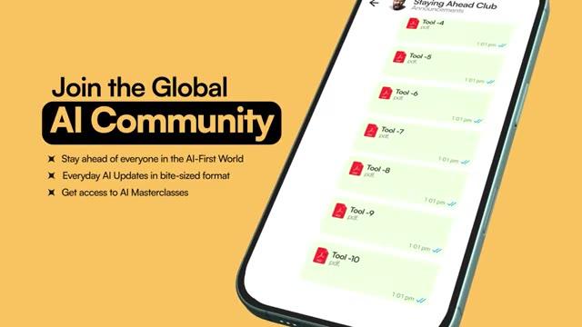
*⏱️ 00:00:56 — Capture d'un smartphone affichant l'application WhatsApp (discussion "Staying Ahead Club") avec des fichiers PDF partagés ("Tool -4", "Tool -5", etc.) et le texte "Join the Global AI Community" sur la gauche.*

---

### ⏱️ `[00:01:03 - 00:01:38]` | Segment #03

**🔊 Audio (Transcription Intégrale Mot pour Mot en Français) :**
> À la première place, il y a After Hours, notre propre application musicale, qu'une IA gratuite a créée rien qu'en regardant le lien Spotify que nous lui avons donné. Tout ce que nous avons tapé, c'est : utilise ce Replica Recon pour construire ceci, avec le lien de Spotify collé à la fin. Elle a une page d'accueil, des playlists, vos chansons aimées, une recherche et votre propre bibliothèque, et elle lit ses propres morceaux originaux. Elle demande même votre prénom, pour qu'on ait l'impression que c'est votre application. Replica Recon est l'une des 11 compétences gratuites d'un projet appelé Replica, et ensemble, elles peuvent cloner presque n'importe quelle application que vous leur désignez. Une compétence fait de la rétro-ingénierie sur l'application que vous

**👁️ Analyse Visuelle d'Écran (gemini-3.5-flash-lite) :**
**Interface & Outils** : Interface web de l'application After Hours, dashboard de développement et présentation graphique.

**Contenu textuel & Code** : Noms de fichiers modifiés (.gitignore, package.json, architecture.md), structure de dossiers "replica-recon" et design d'interface musicale.

**Action / Démonstration** : Démonstration visuelle de l'application musicale créée automatiquement par l'IA à partir d'un lien Spotify.

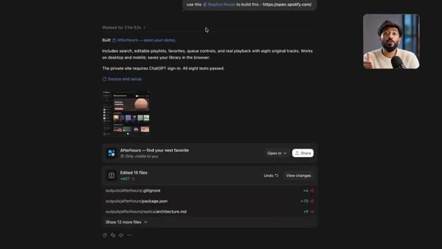
*⏱️ 00:01:12 — Vue d'ensemble de l'interface de l'application After Hours générée par l'IA, montrant les détails de construction et les fichiers édités.*

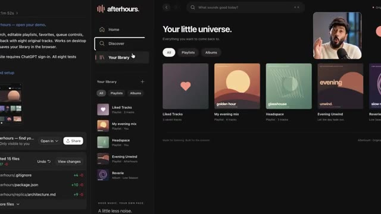
*⏱️ 00:01:20 — Gros plan sur l'interface de l'application musicale After Hours avec le menu de navigation latéral et les listes de lecture inspirées de Spotify.*

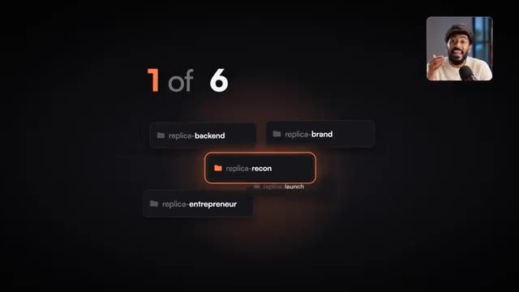
*⏱️ 00:01:29 — Présentation graphique du classement montrant le dossier "replica-recon" en surbrillance (1 sur 6).*

---

### ⏱️ `[00:01:38 - 00:02:08]` | Segment #04

**🔊 Audio (Transcription Intégrale Mot pour Mot en Français) :**
> veut copier, l'un le reconstruit et l'autre teste les bugs. Et il y a celui qu'ils appellent l'entrepreneur. Replica dit qu'il lit ce que les utilisateurs de l'application détestent et corrige cela dans votre version. Et il copie ce que fait une application, jamais ce qu'elle possède, donc pas son code, son logo ou son contenu. Vous avez peut-être vu REA devenir viral pour avoir démonté des applications. Replica est un projet différent qui va encore plus loin parce qu'il vous construit votre propre version. La compilation a duré environ 22 minutes.

**👁️ Analyse Visuelle d'Écran (gemini-3.5-flash-lite) :**
**Interface & Outils** : Navigateur web affichant un dépôt GitHub (README).

**Contenu textuel & Code** : Documentation textuelle expliquant le fonctionnement de "The Replica skill" avec des instructions d'installation pour Claude.

**Action / Démonstration** : Le présentateur présente à l'écran la documentation et les fonctionnalités de l'outil de clonage d'application.

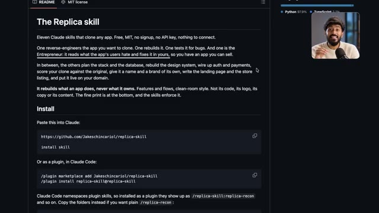
*⏱️ 00:01:46 — Capture d'écran montrant la page README d'un dépôt GitHub décrivant les compétences de Replica pour cloner des applications.*

---

### ⏱️ `[00:02:08 - 00:02:29]` | Segment #05

**🔊 Audio (Transcription Intégrale Mot pour Mot en Français) :**
> Ensuite, l'agent a vérifié son propre travail avec 8 tests et tous ont réussi. Donc vous ne faites pas que copier une application. Chaque application avec des avis négatifs est une liste de fonctionnalités que quelqu'un n'a pas encore construites. Et c'est un raccourci vers votre première version. Mais chaque application a besoin d'un visage. Est-ce qu'une IA gratuite tournant sur votre propre ordinateur portable peut lui donner un logo que vous utiliseriez vraiment ?

**👁️ Analyse Visuelle d'Écran (gemini-3.5-flash-lite) :**
**Interface & Outils** : Interface web d'un agent de génération de code avec un panneau de discussion, des fichiers édités et une incrustation vidéo.

**Contenu textuel & Code** : Résumé des fonctionnalités générées, mention du temps de travail (21m 52s), liste des fichiers modifiés (gitignore, package.json, architecture.md) et invite de commande textuelle.

**Action / Démonstration** : Présentation du résultat de l'application générée et commentée par l'agent IA à l'écran.

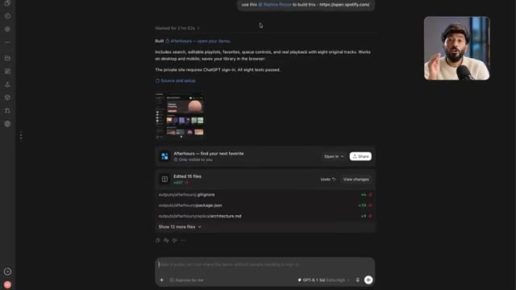
*⏱️ 00:02:13 — Interface d'un agent IA affichant les détails de la construction d'une application de type Spotify, avec une miniature et la liste des fichiers modifiés, et le présentateur visible en incrustation.*

---

### ⏱️ `[00:02:29 - 00:02:48]` | Segment #06

**🔊 Audio (Transcription Intégrale Mot pour Mot en Français) :**
> Voici le numéro 2. Le logo After Hours. Et il a été fait sur notre propre ordinateur portable, sans abonnement et sans crédits. Il vient de Quen Image 2.1, un modèle d'image gratuit d'Alibaba en Chine, et n'importe qui peut le télécharger. Plus de 200 000 personnes l'ont téléchargé le mois dernier seulement.

**👁️ Analyse Visuelle d'Écran (gemini-3.5-flash-lite) :**
**Interface & Outils** : Navigateur web affichant la plateforme Hugging Face.

**Contenu textuel & Code** : Page de présentation du modèle Qwen-Image-2.1 avec ses spécifications (7B parameters, 230,375 téléchargements le mois dernier).

**Action / Démonstration** : Présentation du modèle d'image open-source Qwen-Image-2.1.

*⏱️ 00:02:43 — Page Hugging Face du modèle Qwen-Image-2.1 montrant la documentation, les détails techniques et le nombre de téléchargements.*

---

### ⏱️ `[00:02:48 - 00:03:10]` | Segment #07

**🔊 Audio (Transcription Intégrale Mot pour Mot en Français) :**
> Maintenant, exécuter un modèle vous-même a l'air compliqué. Nous ne l'avons donc pas fait nous-mêmes. Nous avons collé le lien Hugging Face dans notre agent de code et lui avons demandé de tout configurer. Il a téléchargé les 24 gigaoctets, vérifié chaque fichier et créé une image de test pour prouver que cela fonctionnait. Dans l'interface Tomfy UI, vous cherchez Quen et il y a des modèles prêts à l'emploi pour créer des images et pour les modifier.

**👁️ Analyse Visuelle d'Écran (gemini-3.5-flash-lite) :**
**Interface & Outils** : Interface de chat avec un agent de code (Image 1), interface d'application de workflows d'IA avec galerie de modèles (Image 2).

**Contenu textuel & Code** : URL Hugging Face, instructions textuelles de téléchargement (24,5 Go), instructions d'exécution, aperçu d'une image de test (Image 1) ; vignettes de workflows, catégories de templates (Image 2).

**Action / Démonstration** : Interaction avec un agent de code pour configurer et télécharger automatiquement un modèle d'IA (Image 1) ; navigation dans une bibliothèque de workflows de génération d'images (Image 2).

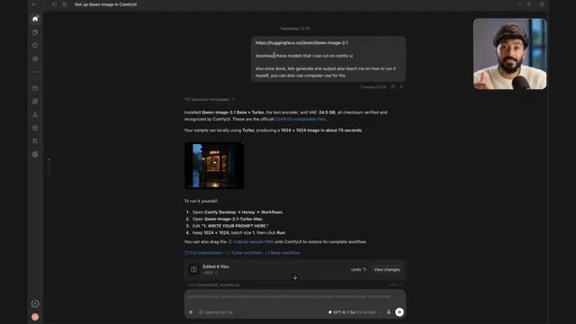
*⏱️ 00:02:53 — Interface d'un agent conversationnel affichant l'historique d'une requête de téléchargement de modèle Hugging Face avec les détails des fichiers et une image de test générée.*

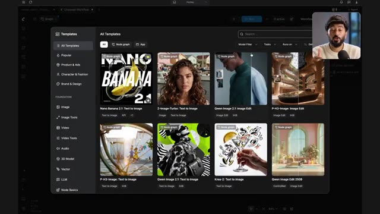
*⏱️ 00:03:04 — Interface d'une application (ComfyUI / Honey) affichant une galerie de modèles et de workflows de génération d'images par IA.*

---

### ⏱️ `[00:03:10 - 00:03:32]` | Segment #08

**🔊 Audio (Transcription Intégrale Mot pour Mot en Français) :**
> Vous tapez votre instruction ici, vous appuyez sur exécuter et l'image est créée directement sur votre machine. Le logo a pris moins de 3 minutes. Ensuite, nous avons essayé une photo, une voiture de sport bleue sur une route de montagne. Et elle tient la route même en plein écran. Le forfait gratuit de ChatGPT vous donne quelques images par celle-ci. Celle-ci fonctionne sur notre propre Mac, donc une fois qu'elle est configurée, vous pouvez en faire autant que vous voulez, gratuitement.

**👁️ Analyse Visuelle d'Écran (gemini-3.5-flash-lite) :**
**Interface & Outils** : Interface web de génération d'images / application de design.

**Contenu textuel & Code** : Visuels générés par intelligence artificielle (logo d'entreprise et photo réaliste d'une voiture).

**Action / Démonstration** : Le présentateur montre les résultats visuels générés directement sur sa machine lors de la démonstration.

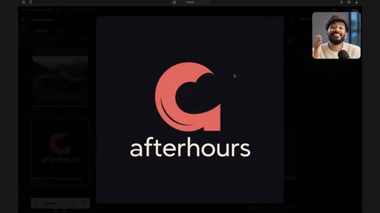
*⏱️ 00:03:15 — Présentation du logo "afterhours" créé par IA sur l'écran d'ordinateur, avec le présentateur en médaillon.*

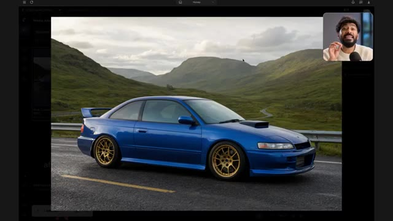
*⏱️ 00:03:21 — Affichage d'une image générée d'une voiture de sport bleue sur une route de montagne, avec le présentateur en haut à droite.*

---

### ⏱️ `[00:03:32 - 00:03:53]` | Segment #09

**🔊 Audio (Transcription Intégrale Mot pour Mot en Français) :**
> Une chose à savoir, la licence est pour un usage personnel et de recherche. Vérifiez donc avant de l'utiliser pour une entreprise. Donc After Hours a un nom et un visage. Maintenant, qu'en est-il d'une voix ? Un outil gratuit peut-il en cloner une sur un ordinateur portable normal ? Assez bien pour vous tromper. Pour le numéro trois, écoutez ces deux extraits. Un mari en Allemagne vient de construire à sa femme l'application professionnelle dont elle avait besoin.

**👁️ Analyse Visuelle d'Écran (gemini-3.5-flash-lite) :**
**Interface & Outils** : Hugging Face

**Contenu textuel & Code** : Page de présentation du modèle Qwen-Image-2.1 sur Hugging Face avec ses spécifications et métriques.

**Action / Démonstration** : Présentation de la page d'un modèle d'intelligence artificielle sur une plateforme web.

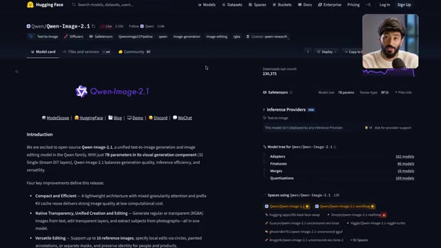
*⏱️ 00:03:38 — Capture d'écran montrant la page Hugging Face du modèle Qwen-Image-2.1 avec les détails du modèle et le présentateur en médaillon.*

---

### ⏱️ `[00:03:53 - 00:04:28]` | Segment #10

**🔊 Audio (Transcription Intégrale Mot pour Mot en Français) :**
> Le truc fou, c'est qu'elle a été embauchée et qu'il a rendu ça gratuit pour le monde entier. La personne qui paie des impôts paie deux fois le PIB par habitant. C'est à quel point l'Inde dépend de ces 20 % parce que l'un d'entre eux est ma vraie voix et l'un est un clone fait sur un clip d'ordinateur portable, le clip A était le clone et tout ce qu'il a fallu, c'est une note vocale de 12 secondes, nous avons tapé une ligne, cliqué sur synthétiser et cela a pris moins de 10 secondes pour le faire, c'est Voice Studio, c'est open source et ça tourne entièrement sur votre propre ordinateur pour que votre voix ne le quitte jamais et les gens adorent ça, c'est fermé.

**👁️ Analyse Visuelle d'Écran (gemini-3.5-flash-lite) :**
**Interface & Outils** : Application Web de génération ou de clonage vocal (type ElevenLabs).

**Contenu textuel & Code** : Script affiché : "A husband in Germany just built his wife the job app she needed. The crazy part? She got hired, and he made it free for the whole world." avec visualiseur de forme d'onde audio.

**Action / Démonstration** : Démonstration de l'interface de synthèse vocale et lecture d'un échantillon audio généré.

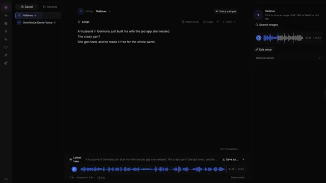
*⏱️ 00:04:02 — Interface d'un outil de clonage vocal affichant un script textuel et une forme d'onde audio.*

---

### ⏱️ `[00:04:28 - 00:04:52]` | Segment #11

**🔊 Audio (Transcription Intégrale Mot pour Mot en Français) :**
> à 100 000 étoiles sur GitHub avec plus de 2 millions de téléchargements. Il fonctionne sur Mac, Windows et Linux, et le pack de modèles standard fait moins de 5 gigas, donc un ordinateur portable normal le gère. Pour cloner une voix sur ElevenLabs, vous avez besoin d'un forfait payant d'environ 6 $ par mois, et chaque nouvelle tentative utilise des crédits. Voice Studio est entièrement gratuit, vous pouvez donc refaire une ligne 50 fois et cela ne vous coûte rien.

**👁️ Analyse Visuelle d'Écran (gemini-3.5-flash-lite) :**
**Interface & Outils** : Site web du projet Open Source AI Voice Studio sur navigateur.

**Contenu textuel & Code** : Statistiques visibles : 2 145 192 téléchargements, 99 834 étoiles GitHub, 151 933 Docker pulls, et version v0.5.7.

**Action / Démonstration** : Présentation de la page d'accueil du dépôt open source et de ses métriques d'adoption par la communauté.

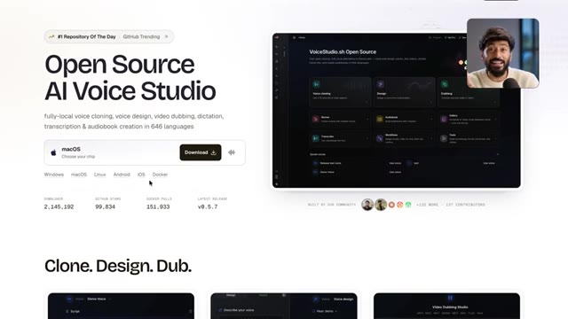
*⏱️ 00:04:34 — Capture d'écran montrant le site web d'un studio vocal open-source avec des statistiques de téléchargements et d'étoiles GitHub.*

---

### ⏱️ `[00:04:52 - 00:05:14]` | Segment #12

**🔊 Audio (Transcription Intégrale Mot pour Mot en Français) :**
> Pour les doublages et les réenregistrements rapides, c'est celui-ci qu'on garderait sur l'ordinateur. Et en parlant de choses qui doivent rester privées, est-ce qu'une IA gratuite peut prendre des notes de réunion sans envoyer un seul mot dans le cloud ? Le numéro quatre tourne en ce moment même parce que tout ce qui est dit ici se transforme en texte en direct et rien de tout cela ne va dans le cloud. Il s'agit de Google AI Edge Foresight.

**👁️ Analyse Visuelle d'Écran (gemini-3.5-flash-lite) :**
**Interface & Outils** : AUCUNE

**Contenu textuel & Code** : AUCUN

**Action / Démonstration** : AUCUNE

---

### ⏱️ `[00:05:14 - 00:05:52]` | Segment #13

**🔊 Audio (Transcription Intégrale Mot pour Mot en Français) :**
> Google l'a sorti gratuitement en octobre en tant qu'expérience et pour l'instant, c'est uniquement sur Mac. Google dit que ça fonctionne hors ligne parce que le modèle d'IA s'exécute sur votre propre ordinateur portable. Dans les paramètres, vous choisissez la taille du modèle. Un petit, un moyen, ou un plus grand si votre Mac peut le supporter. Ensuite, vous appuyez sur Démarrer la transcription et il écrit chaque mot pendant que vous parlez. Vous pouvez également le pointer vers vos propres fichiers et dossiers, de sorte que plus tard, vous puissiez poser des questions sur vos réunions et vos notes. Et regardez la page des statistiques. Deux réunions transcrites, trois chats avec l'IA, et zéro appel d'API cloud. Vous pouvez donc l'utiliser pour les appels que vous ne mettriez jamais en ligne nulle part.

**👁️ Analyse Visuelle d'Écran (gemini-3.5-flash-lite) :**
**Interface & Outils** : Application Google AI Edge Foresight

**Contenu textuel & Code** : Interface utilisateur avec des sections de notes et de chat, affichant 'Google AI Edge Foresight' et un panneau latéral de discussion.

**Action / Démonstration** : Présentation de l'interface de l'application Google AI Edge Foresight.

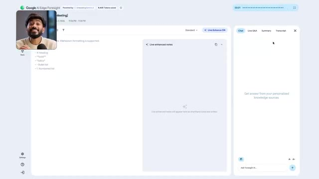
*⏱️ 00:05:33 — Interface de l'application Google AI Edge Foresight avec un panneau de notes et un panneau de chat latéral.*

---

### ⏱️ `[00:05:52 - 00:06:12]` | Segment #14

**🔊 Audio (Transcription Intégrale Mot pour Mot en Français) :**
> appels ou discussions salariales, peu importe. Le forfait payant de Granola coûte environ 14 dollars par mois pour les notes de réunion. Si vous êtes sur Mac, c'est un Granola gratuit et la transcription en direct fonctionne déjà. L'application est donc conçue, les appels sont rédigés et il ne reste plus que la vidéo de lancement. Une application gratuite peut-elle remplacer Premiere et After Effects ?

**👁️ Analyse Visuelle d'Écran (gemini-3.5-flash-lite) :**
**Interface & Outils** : Interface web de tarification et interface logicielle desktop de Granola.

**Contenu textuel & Code** : Tarifs affichés (14$ par mois), fonctionnalités du plan Business et boutons de transcription/exportation de notes.
[ESC_IMAGE_3] Présentation des fonctionnalités et des coûts de l'application de notes de réunion Granola.

**Action / Démonstration** : Explications face caméra et analyse méthodologique.

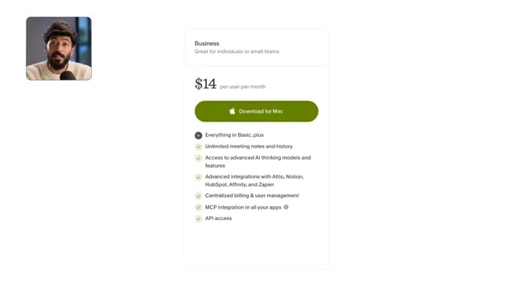
*⏱️ 00:05:57 — Capture d'écran affichant la page de tarification du plan 'Business' de l'application Granola, tarifé à 14 dollars par utilisateur et par mois avec le bouton 'Download for Mac'.*

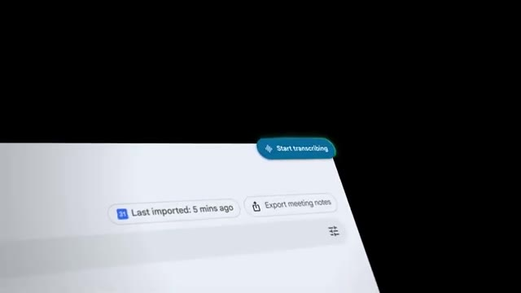
*⏱️ 00:06:02 — Capture d'écran rapprochée de l'interface de l'application Granola montrant un bouton bleu 'Start transcribing' et des options d'importation et d'exportation de notes de réunion.*

---

### ⏱️ `[00:06:12 - 00:06:33]` | Segment #15

**🔊 Audio (Transcription Intégrale Mot pour Mot en Français) :**
> À la position numéro 5, c'est Filmcraft, et il possède une timeline, un moniteur de programme et un panneau d'effets tout comme Premiere. Et il coûte zéro. Nous ouvrons le projet de démonstration, appuyons sur lecture et il fonctionne comme le vrai. Et ce n'est qu'une des 16 applications d'un ensemble appelé Artcraft. Chacune remplace une application que vous loueriez normalement.

**👁️ Analyse Visuelle d'Écran (gemini-3.5-flash-lite) :**
**Interface & Outils** : Page web d'ArtCraft (ArtCraft.io) listant les différentes applications de la suite open-source.

**Contenu textuel & Code** : Grille de 16 applications pour créateurs (PhotoCraft, VectorCraft, Filmcraft, LightCraft, etc.) développées en Rust et gratuites.

**Action / Démonstration** : Présentation visuelle de la suite logicielle ArtCraft par le présentateur (visible en vignette vidéo en haut à droite).

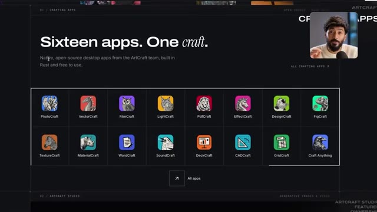
*⏱️ 00:06:27 — Page web présentant une suite de 16 applications open-source ("Sixteen apps. One craft.") incluant Filmcraft, PhotoCraft, etc.*

---

### ⏱️ `[00:06:33 - 00:06:53]` | Segment #16

**🔊 Audio (Transcription Intégrale Mot pour Mot en Français) :**
> Photocraft est leur Photoshop, Vectocraft est Illustrator, Lightcraft est Lightroom et PDFcraft est Acrobat. Et celui-ci, Effectcraft, est pour les motion graphics et les effets visuels. C'est donc leur After Effects. Il y a même des applications pour les documents, les feuilles de calcul et les présentations, donc Word, Excel et PowerPoint sont également couverts.

**👁️ Analyse Visuelle d'Écran (gemini-3.5-flash-lite) :**
**Interface & Outils** : Interface utilisateur de type App Store/Launcher d'applications créatives (Artcraft).

**Contenu textuel & Code** : Liste d'applications alternatives open-source (GridCraft, LightCraft, MaterialCraft, PdfCraft, PhotoCraft, SolidCraft, DesignCraft, EffectCraft, FigCraft) avec boutons d'installation et numéros de version.

**Action / Démonstration** : Le présentateur parcourt ou met en avant différentes applications logicielles de la suite Artcraft.

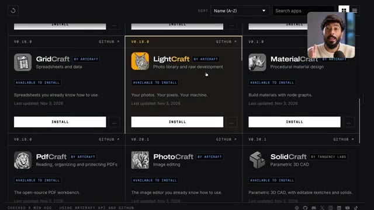
*⏱️ 00:06:38 — Vue d'une interface d'applications montrant LightCraft, GridCraft, PdfCraft et MaterialCraft.*

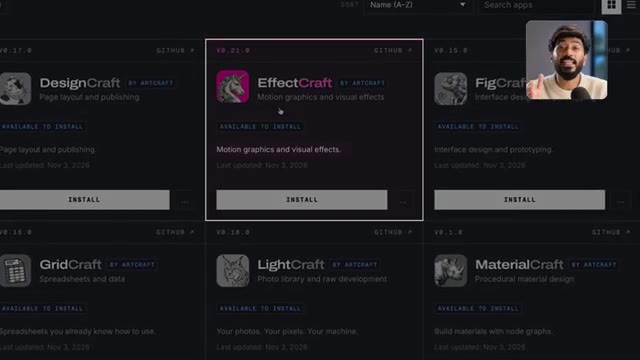
*⏱️ 00:06:43 — Vue de l'interface montrant EffectCraft sélectionné au centre avec les applications DesignCraft et FigCraft.*

---

### ⏱️ `[00:06:53 - 00:07:18]` | Segment #17

**🔊 Audio (Transcription Intégrale Mot pour Mot en Français) :**
> Et l'histoire derrière tout ça est folle, parce que c'est mené par un développeur d'Atlanta, Brandon Thomas, qui reconstruit ces applications avec une petite équipe et Claude. Et les gens l'ont remarqué, parce que le projet a dépassé les 38 000 étoiles sur GitHub, et une étoile, c'est en gros quelqu'un qui l'ajoute à ses favoris. Et leur propre site web résume les choses en une seule phrase : Arrêtez de louer des sites web, car ceux-ci vous appartiennent pour de bon et sans abonnement.

**👁️ Analyse Visuelle d'Écran (gemini-3.5-flash-lite) :**
**Interface & Outils** : Navigateur web affichant Twitter (X) et le site GitHub.

**Contenu textuel & Code** : Mention de 38,5k étoiles sur GitHub et description du projet ArtCraft comme un moteur de création open-source pour artistes et designers.

**Action / Démonstration** : Présentation visuelle d'un tweet d'actualité et d'un dépôt GitHub populaire pour illustrer le succès du projet open-source.

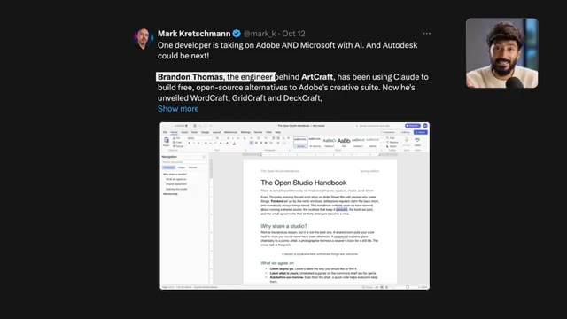
*⏱️ 00:06:59 — Un tweet de Mark Kretschmann présentant le développeur Brandon Thomas et le projet ArtCraft, avec une interface de traitement de texte en bas.*

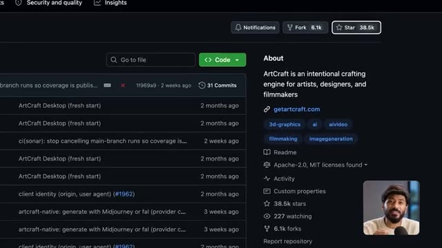
*⏱️ 00:07:05 — La page du dépôt GitHub du projet ArtCraft, affichant 38,5k étoiles et des informations sur le projet.*

---

### ⏱️ `[00:07:18 - 00:07:42]` | Segment #18

**🔊 Audio (Transcription Intégrale Mot pour Mot en Français) :**
> L'obtenir est simple. Vous allez sur leur site web et vous téléchargez un lanceur pour Mac ou Windows. Ensuite, chaque application se trouve dans cette même fenêtre avec son propre bouton d'installation, de sorte que vous ne prenez que celles dont vous avez besoin. Maintenant, la plupart de ces versions sont des versions préliminaires, alors s'il vous plaît, ne résiliez rien pour l'instant. Mais la suite complète d'Adobe coûte environ 70 dollars par mois, et même Photoshop ou Premiere pris séparément coûtent environ 23 dollars par mois chacun.

**👁️ Analyse Visuelle d'Écran (gemini-3.5-flash-lite) :**
**Interface & Outils** : Application Artcraft Craft App Suite et page web de tarification Adobe.

**Contenu textuel & Code** : Noms des logiciels (CADCraft, Craft Anything, DeckCraft, DesignCraft, EffectCraft, FigCraft) et tarifs Adobe (Creative Cloud Pro à $69.99/mois).

**Action / Démonstration** : Présentation du catalogue d'applications d'Artcraft et affichage comparatif des prix d'Adobe.

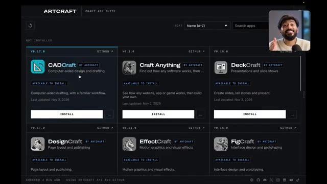
*⏱️ 00:07:24 — Interface sombre d'Artcraft montrant un catalogue d'applications logicielles (CADCraft, Craft Anything, DeckCraft, etc.) avec des boutons d'installation.*

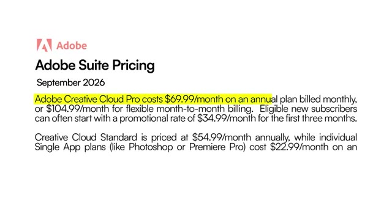
*⏱️ 00:07:36 — Page de tarification d'Adobe montrant le coût de la suite Creative Cloud Pro à $69.99/mois avec une ligne surlignée en jaune.*

---

### ⏱️ `[00:07:42 - 00:08:02]` | Segment #19

**🔊 Audio (Transcription Intégrale Mot pour Mot en Français) :**
> Si vous montez des vidéos avec un budget limité, Filmcraft vaut le téléchargement rien qu'à lui seul, et les autres applications valent la peine d'être essayées avant de renouveler quoi que ce soit. C'est la moitié de faite, il en reste cinq, plus un bonus à la fin pour tous ceux qui cherchent du travail. Et n'oubliez pas, le document gratuit dans la communauté WhatsApp contient cinq autres outils qui n'ont pas rentré dans cette vidéo, vous pouvez donc commencer à les utiliser dès aujourd'hui.

**👁️ Analyse Visuelle d'Écran (gemini-3.5-flash-lite) :**
**Interface & Outils** : Navigateur web affichant le site ArtCraft / Mockup de smartphone montrant une application de messagerie (WhatsApp ou similaire).

**Contenu textuel & Code** : Noms des applications de bureau open-source développées en Rust (PhotoCraft, VectorCraft, FilmCraft, etc.) / Texte promotionnel pour rejoindre la communauté IA.

**Action / Démonstration** : Présentation visuelle de la liste complète des applications logicielles abordées dans la vidéo, suivie d'un appel à l'action pour rejoindre la communauté.

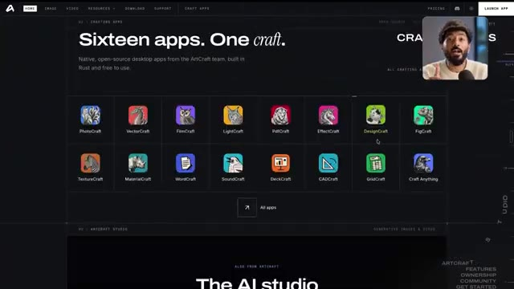
*⏱️ 00:07:47 — Capture d'écran du site web affichant la grille des applications de bureau open-source "Sixteen apps. One craft" avec leurs différentes icônes (PhotoCraft, FilmCraft, etc.).*

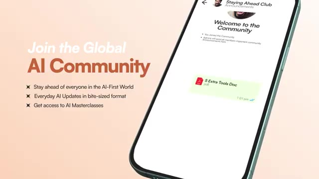
*⏱️ 00:07:57 — Visuel promotionnel présentant sur la gauche un appel à rejoindre la communauté IA ("Join the Global AI Community") et sur la droite la maquette d'un écran de smartphone affichant un canal de discussion avec le document "5 Extra Tools Doc".*

---

### ⏱️ `[00:08:02 - 00:08:21]` | Segment #20

**🔊 Audio (Transcription Intégrale Mot pour Mot en Français) :**
> Le lien est juste en dessous. Donc After Hours est créé et la vidéo de lancement est montée. Mais est-ce que quelqu'un va vraiment l'utiliser ? Est-ce qu'une IA gratuite peut vous le dire avant que vous ne dépensiez quoi que ce soit pour le lancement ? Le numéro 6 commence avec des gens qui n'existent pas. Et ils viennent de passer 3 rounds à débattre d'After Hours, l'application que nous venons de créer.

**👁️ Analyse Visuelle d'Écran (gemini-3.5-flash-lite) :**
**Interface & Outils** : Interface web MiroFish (plateforme de simulation/rapports prédictifs).

**Contenu textuel & Code** : Texte du rapport de prédiction : 'Future Prediction Report on Afterhours Music Discovery Concept Simulation' avec des sections sur l'engagement utilisateur et la dynamique sociale.

**Action / Démonstration** : Présentation du rapport d'analyse généré par l'IA concernant l'utilisation du concept Afterhours.

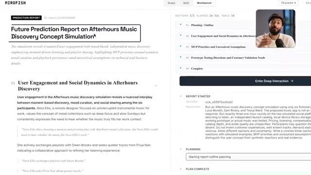
*⏱️ 00:08:16 — Capture d'écran montrant l'interface d'un outil d'IA (MiroFish) affichant un rapport de prédiction sur l'application Afterhours.*

---

### ⏱️ `[00:08:21 - 00:08:46]` | Segment #21

**🔊 Audio (Transcription Intégrale Mot pour Mot en Français) :**
> Nous voulions savoir si quelqu'un utiliserait vraiment une application musicale qui choisit la bande originale de votre journée. Une concentration intense, un dimanche tranquille, une promenade tard dans la nuit. Et au lieu de demander à nos amis, qui seraient juste gentils avec nous, nous l'avons confié à un outil appelé Mirofish. C'est gratuit et open source, près de 84 000 étoiles sur GitHub, et cela crée toute une foule de personnes IA, chacune avec un nom, un parcours et une opinion.

**👁️ Analyse Visuelle d'Écran (gemini-3.5-flash-lite) :**
**Interface & Outils** : Application web Mirofish (localhost:3000) et plateforme GitHub.

**Contenu textuel & Code** : Code source, arborescence de fichiers d'un dépôt GitHub (dossiers .github, backend, frontend, scripts, tests, Dockerfile), et description du moteur d'intelligence en essaim MiroFish.

**Action / Démonstration** : Navigation et présentation de l'application de simulation et du dépôt de code open-source associé.

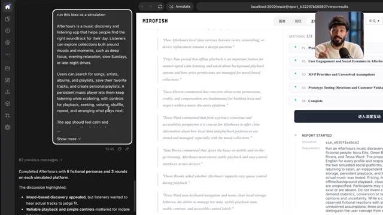
*⏱️ 00:08:27 — Capture d'écran montrant l'interface d'une application web de simulation (Mirofish) affichant un rapport détaillé avec des sections textuelles, des retours d'utilisateurs et des prompts de simulation.*

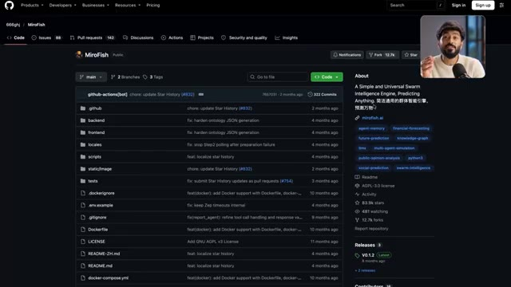
*⏱️ 00:08:33 — Capture d'écran montrant le dépôt GitHub du projet MiroFish avec la liste des répertoires du code source et la description du projet sur le panneau latéral droit.*

---

### ⏱️ `[00:08:46 - 00:09:05]` | Segment #22

**🔊 Audio (Transcription Intégrale Mot pour Mot en Français) :**
> Nous avons collé un pitch d'une page et tapé, lance cette idée comme une simulation. Ça a créé six personnes, ça a exécuté trois rounds, et ça a écrit le rapport en environ deux minutes et demie. Et les conclusions sont utiles. Ils ont adoré l'idée de choisir la musique par haine, mais ils voulaient entendre un morceau avant de lui faire confiance, et ils voulaient une lecture qui fonctionne tout simplement.

**👁️ Analyse Visuelle d'Écran (gemini-3.5-flash-lite) :**
**Interface & Outils** : Application web Mirofish (Workbench / Dashboard de simulation)

**Contenu textuel & Code** : "Future Prediction Report on Afterhours Music Discovery Concept Simulation", journaux d'exécution (logs console), sections de rapport (Planning, User Engagement, MVP Priorities).

**Action / Démonstration** : Présentation et navigation dans le rapport de simulation généré automatiquement par l'outil Mirofish.

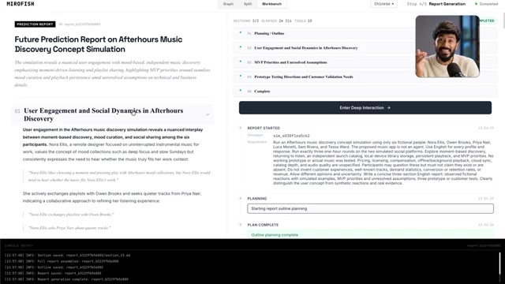
*⏱️ 00:08:50 — Interface de la plateforme de simulation Mirofish affichant un rapport de prédiction avec le détail des sections générées.*

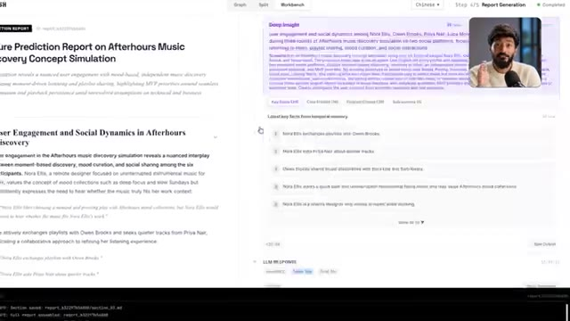
*⏱️ 00:08:55 — Vue de l'interface Mirofish montrant les insights approfondis et les données textuelles issues de la simulation.*

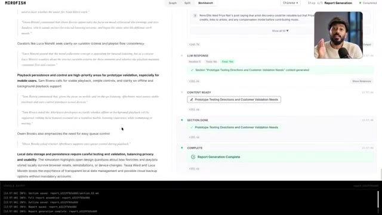
*⏱️ 00:09:00 — Affichage final de la génération du rapport dans l'interface Mirofish avec les étapes de validation complétées.*

---

### ⏱️ `[00:09:05 - 00:09:27]` | Segment #23

**🔊 Audio (Transcription Intégrale Mot pour Mot en Français) :**
> Maintenant, dire qu'on aime quelque chose et l'utiliser tous les jours, ce sont deux choses différentes. Nous avons donc utilisé un deuxième outil gratuit de Google appelé Times FM. Vous lui montrez vos chiffres passés, comme le nombre de personnes qui ont utilisé votre application chaque jour, et il devine les quelques semaines à venir. Nous n'avons pas encore de vrais utilisateurs, alors nous lui avons donné 6 mois d'auditeurs quotidiens inventés et nous avons demandé les deux semaines suivantes.

**👁️ Analyse Visuelle d'Écran (gemini-3.5-flash-lite) :**
**Interface & Outils** : Navigateur web affichant un dépôt GitHub (README.md) en mode sombre, avec une incrustation vidéo du présentateur.

**Contenu textuel & Code** : Texte descriptif de TimesFM (Time Series Foundation Model), liens vers la recherche, points de contrôle (Checkpoint), et mentions des versions (TimesFM 3.0).

**Action / Démonstration** : Le présentateur commente la documentation du modèle de prédiction de séries temporelles de Google.

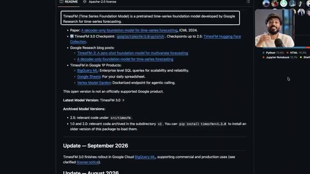
*⏱️ 00:09:11 — Capture d'écran montrant la page README d'un dépôt GitHub pour "TimesFM" (Time Series Foundation Model) développé par Google Research, avec la vidéo du présentateur incrustée en haut à droite.*

---

### ⏱️ `[00:09:27 - 00:09:48]` | Segment #24

**🔊 Audio (Transcription Intégrale Mot pour Mot en Français) :**
> Et regardez la partie ombragée, c'est la fourchette à laquelle il s'attend, un bon jour et un mauvais jour, vous pouvez donc planifier en fonction des deux. Nous l'avons même testé sur deux quinzaines qu'il n'avait pas vues, et 12 de ces 14 jours se sont inscrits dans sa fourchette. Donc Mirofish pour l'idée et Times FM pour les chiffres. Et c'est une répétition pour votre lancement qui ne vous coûte rien.

**👁️ Analyse Visuelle d'Écran (gemini-3.5-flash-lite) :**
**Interface & Outils** : Interface web Mirofish, graphiques de prévision temporelle (TimesFM), panneaux de rapport et de simulation.

**Contenu textuel & Code** : Prédictions de données d'usage (Daily listeners, TimesFM median + p10-p90), graphiques de backtest et rapports de simulation d'utilisateurs.

**Action / Démonstration** : Présentation des résultats de prévision temporelle, analyse de la fourchette attendue et affichage d'un rapport de simulation détaillé.

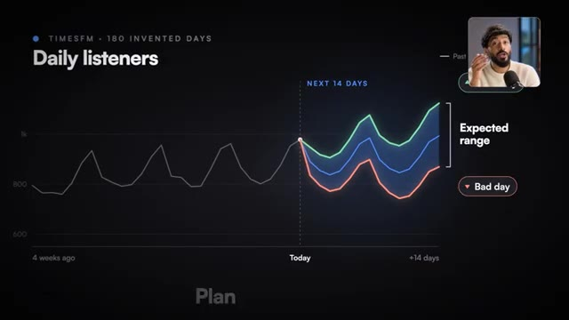
*⏱️ 00:09:32 — Graphique montrant les prévisions de 'Daily listeners' pour les 14 prochains jours avec une fourchette attendue (Expected range).*

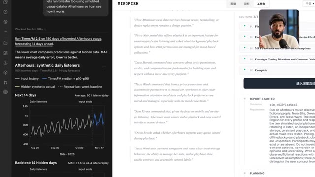
*⏱️ 00:09:38 — Interface Mirofish affichant un rapport de prévision avec graphiques temporels et commentaires textuels d'utilisateurs simulés.*

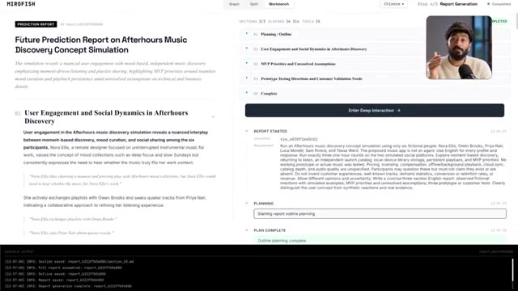
*⏱️ 00:09:43 — Interface Mirofish affichant un rapport complet 'Future Prediction Report on Afterhours Music Discovery Concept Simulation' avec un panneau de terminal en bas.*

---

### ⏱️ `[00:09:48 - 00:10:10]` | Segment #25

**🔊 Audio (Transcription Intégrale Mot pour Mot en Français) :**
> Donc maintenant, After Hours a besoin d'une publication de lancement. Peux-tu en concevoir une sans payer pour Canva ? Le numéro 7 est un Canva gratuit qui fonctionne sur notre propre ordinateur portable. Il s'appelle Doori. Il est open source et fonctionne directement dans votre navigateur. Notre agent de codage l'a installé à partir du lien GitHub et l'a ouvert dans le navigateur pour nous. Et si vous ne voulez rien installer du tout, la même application est en ligne sur dhuri.art.

**👁️ Analyse Visuelle d'Écran (gemini-3.5-flash-lite) :**
**Interface & Outils** : Navigateur web, GitHub, interface utilisateur de Doory.

**Contenu textuel & Code** : Documentation README du projet GitHub, description de Doory en tant qu'éditeur de design open source fonctionnant dans le navigateur sans abonnement.

**Action / Démonstration** : Navigation et présentation de l'outil de design open source Doory et de sa page GitHub.

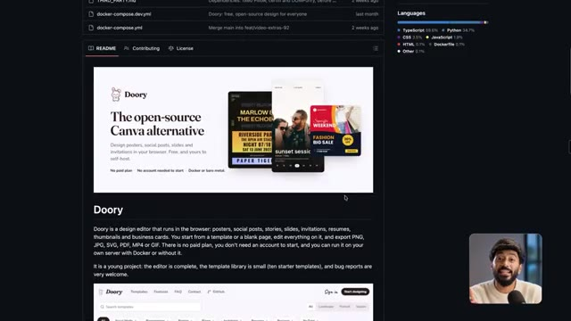
*⏱️ 00:09:59 — La page GitHub du projet open source Doory, présenté comme une alternative gratuite à Canva.*

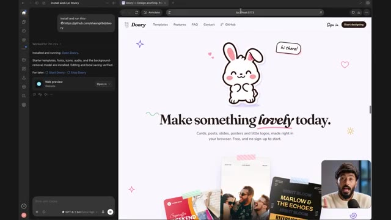
*⏱️ 00:10:05 — L'interface web de Doory en cours d'utilisation, affichant la page d'accueil de l'application de design.*

---

### ⏱️ `[00:10:10 - 00:10:30]` | Segment #26

**🔊 Audio (Transcription Intégrale Mot pour Mot en Français) :**
> Tu choisis un format, une publication Instagram, une miniature YouTube, une affiche ou un logo, et tu te retrouves directement dans l'éditeur. Tu obtiens des textes, des photos de stock et des animations pour tes publications. Et quand tu as terminé, cela exporte une image normale, un PNG transparent, un PDF, un SVG, et même un MP4 ou un GIF.

**👁️ Analyse Visuelle d'Écran (gemini-3.5-flash-lite) :**
**Interface & Outils** : Doory (outil de design et création graphique web / alternative open-source à Canva).

**Contenu textuel & Code** : Options de dimensions prédéfinies (Instagram Post, Presentation 16:9, Poster, A4 Document, YouTube Thumbnail, Instagram Story, Logo), panneau d'outils "Shapes" (Basic shapes, Decorative, Lines and arrows).

**Action / Démonstration** : Navigation sur l'interface d'accueil pour choisir un modèle de document, suivie de l'accès au canevas d'édition graphique.

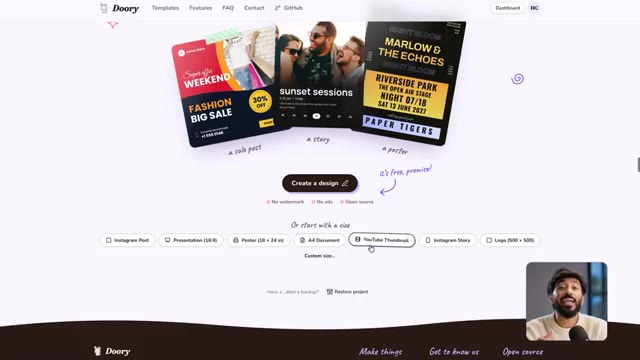
*⏱️ 00:10:15 — Page d'accueil de l'application Doory présentant les choix de formats de création graphique (Instagram Post, YouTube Thumbnail, Poster, Logo).*

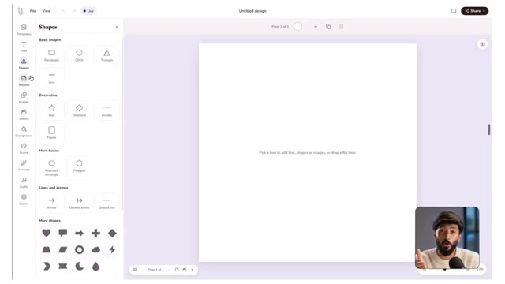
*⏱️ 00:10:20 — Interface de l'éditeur graphique Doory avec un canevas vierge au centre et le menu latéral de sélection de formes géométriques.*

---

### ⏱️ `[00:10:30 - 00:10:48]` | Segment #27

**🔊 Audio (Transcription Intégrale Mot pour Mot en Français) :**
> Pour être tout à fait honnête, c'est un jeune projet. Il propose 10 modèles de départ et ce n'outer pas un designer IA, donc il ne concevra pas le post pour vous. Mais si vous utilisez principalement Canva pour vos posts et vos stories, tout ce dont vous avez besoin est ici, gratuitement, et sans filigrane. Le suivant résout la tâche la plus ennuyeuse de la création de contenu.

**👁️ Analyse Visuelle d'Écran (gemini-3.5-flash-lite) :**
**Interface & Outils** : Interface web d'édition graphique similaire à Canva.

**Contenu textuel & Code** : Un visuel publicitaire pour un produit de mode (Fashion Big Sale, 30% off, Super offer weekend).

**Action / Démonstration** : Présentation et illustration visuelle de l'outil de création graphique mentionné dans l'audio.

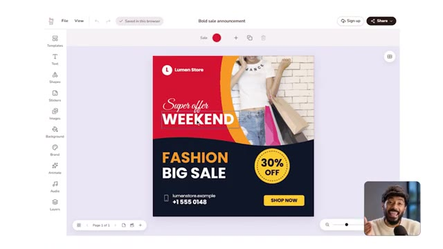
*⏱️ 00:10:34 — Capture d'écran montrant une interface de type Canva avec un modèle de publication publicitaire "Bold sale announcement" pour "Lumen Store".*

---

### ⏱️ `[00:10:48 - 00:11:07]` | Segment #28

**🔊 Audio (Transcription Intégrale Mot pour Mot en Français) :**
> Un seul prompt peut-il transformer une longue vidéo en Reels ? Ces trois Reels sont le numéro huit, et ils proviennent d'un seul long podcast, à partir d'un seul prompt. Tout comme Opus Clip facture entre 15 et 29 dollars par mois pour cela. Nous l'avons fait avec les compétences d'agent gratuites de ReMotion, qui est gratuit pour les particuliers et les petites équipes.

**👁️ Analyse Visuelle d'Écran (gemini-3.5-flash-lite) :**
**Interface & Outils** : Interface de workflow d'agent IA d'édition vidéo et grille tarifaire SaaS Opus Clip.

**Contenu textuel & Code** : Image 1 : Aperçu vidéo vertical "What gets you hired now?", historique de conversations/prompts, jauge "8/10". Image 2 : Plans tarifaires Starter 15 $/mois, Pro 29 $/mois, Free 0 $/mois.

**Action / Démonstration** : Démonstration de l'alternative IA gratuite à la découpe automatique de vidéos face au modèle payant d'Opus Clip.

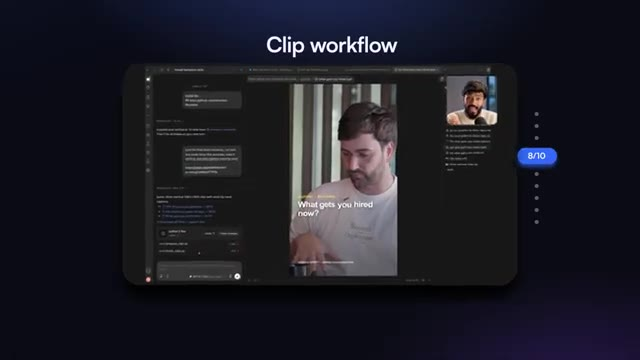
*⏱️ 00:10:53 — Interface "Clip workflow" présentant la génération automatique d'un clip vidéo au format Reel vertical à partir d’un prompt d'agent IA (étape 8/10).*

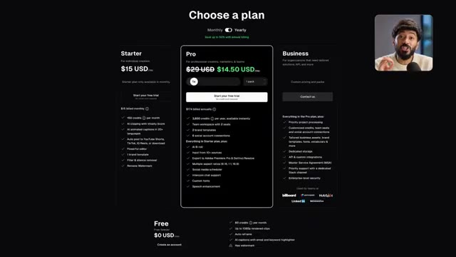
*⏱️ 00:10:58 — Page de tarification d'un service SaaS (Opus Clip) affichant les plans Starter (15 $ USD), Pro (29 $ USD) et Free (0 $ USD).*

---

### ⏱️ `[00:11:07 - 00:11:28]` | Segment #29

**🔊 Audio (Transcription Intégrale Mot pour Mot en Français) :**
> ReMotion permet à une IA de créer des vidéos de la même manière qu'elle écrit du code, ainsi l'agent écrit le montage et ReMotion le transforme en un véritable fichier vidéo. Et il y en a un autre gratuit appelé Hyperframes de HeyGen qui fait le même travail avec des pages web. Alors choisissez celui que votre agent préfère. Tout d'abord, notre agent de codage a installé l'ensemble des 13 compétences de ReMotion.

**👁️ Analyse Visuelle d'Écran (gemini-3.5-flash-lite) :**
**Interface & Outils** : GitHub (profil et README du projet open-source HyperFrames / HeyGen)

**Contenu textuel & Code** : Dépôt `hyperframes`, titre "HyperFrames: Agent-Native HTML to Video Rendering for URLs, Data, and Web Code", description de la conversion HTML, CSS et JS vers un rendu vidéo MP4.

**Action / Démonstration** : Présentation de la documentation et du fonctionnement de l'outil HyperFrames pour la génération vidéo basée sur des technologies web.

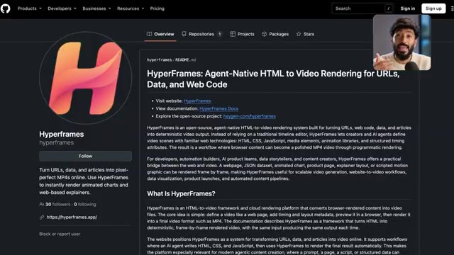
*⏱️ 00:11:17 — Page GitHub du projet open-source HyperFrames présentant la documentation README.md.*

---

### ⏱️ `[00:11:28 - 00:11:48]` | Segment #30

**🔊 Audio (Transcription Intégrale Mot pour Mot en Français) :**
> Ensuite, le prompt était simple : trouve les trois meilleurs moments, coupe chacun pour qu'il fasse moins de 45 secondes, mets-le au format vertical et ajoute des sous-titres mot par mot. Et on lui a donné notre dernier podcast, celui avec Thibaut d'OpenAI. Ça a tourné pendant environ 20 minutes, a sélectionné les moments, les a coupés, les a sous-titrés et a rendu les trois.

**👁️ Analyse Visuelle d'Écran (gemini-3.5-flash-lite) :**
**Interface & Outils** : Interface de chat et d'automatisation d'agent IA (style Claude Code / agent de développement).

**Contenu textuel & Code** : Prompt texte ("Find the three best moments, cut each one under forty-five seconds, make it vertical, and add captions word by word"), URL YouTube du podcast, durée de travail (19m 31s), résultats des clips au format 1080x1920 (16.9s, 38.2s, 33.5s) et modification des scripts Python `prepare_clips.py` (+184) et `finish_clips.py` (+62).

**Action / Démonstration** : Exécution automatique d'une tâche d'édition et de sous-titrage vidéo par l'IA à partir d'un simple prompt et d'un lien YouTube.

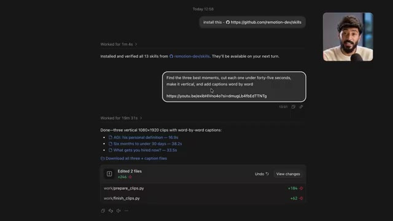
*⏱️ 00:11:33 — Capture d'écran de l'interface d'un agent IA affichant le prompt exécuté pour extraire et formater trois clips vidéo verticaux avec sous-titres ainsi que les fichiers Python générés.*

---

### ⏱️ `[00:11:48 - 00:12:08]` | Segment #31

**🔊 Audio (Transcription Intégrale Mot pour Mot en Français) :**
> Et il n'y a pas de filigrane, parce que c'est vous qui le faites. Personne ne vous le loue. Et une fois que ce prompt fonctionne, vous le réutilisez pour votre podcast ou votre cours sur Zoom, exactement le même prompt chaque semaine. Et si vous créez du contenu et que cela vous fait déjà économiser de l'argent, abonnez-vous. Nous testons de nouveaux outils gratuits comme ceux-ci toutes les quelques semaines, pour que vous n'ayez pas à le faire.

**👁️ Analyse Visuelle d'Écran (gemini-3.5-flash-lite) :**
**Interface & Outils** : Cursor (IDE), lecteur vidéo intégré, interface de chat d'agent IA.

**Contenu textuel & Code** : Prompt d'automatisation vidéo ("Find the three best moments, cut each one under forty-five seconds, make it vertical, and add captions word by word"), fichiers Python générés (`work/prepare_clips.py`, `work/finish_clips.py`), aperçu du clip vertical 1080x1920 avec sous-titre dynamique.

**Action / Démonstration** : Génération et prévisualisation automatique de clips vidéo verticaux sous-titrés à l'aide d'un prompt et de compétences Remotion exécutées par l'agent IA.

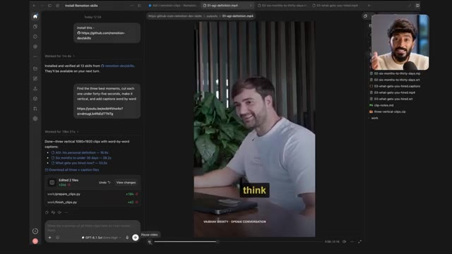
*⏱️ 00:11:53 — Interface de l'éditeur de code Cursor affichant un chat d'agent IA à gauche et la prévisualisation d'une vidéo verticale générée au centre.*

---

### ⏱️ `[00:12:08 - 00:12:38]` | Segment #32

**🔊 Audio (Transcription Intégrale Mot pour Mot en Français) :**
> Maintenant, si vous enregistrez votre écran pour des vidéos comme celles-ci, un enregistreur gratuit peut-il faire les zooms à votre place ? Le numéro 9 est un enregistreur qui affirme qu'il zoome tout seul sur vos clics, afin que le spectateur sache toujours où regarder. Et c'est gratuit. Il s'appelle OpenScreen. Il est open source, sans filigrane et sans abonnement. Et il fonctionne sur Windows, Mac et Linux. Vous pouvez enregistrer une fenêtre ou l'intégralité de votre écran avec votre micro, le son de votre système et votre webcam par-dessus. Il ajoute également automatiquement des sous-titres.

**👁️ Analyse Visuelle d'Écran (gemini-3.5-flash-lite) :**
**Interface & Outils** : Présentation ou face-caméra explicatif de l'intervenant sans interface logicielle partagée.

**Contenu textuel & Code** : Explications orales des concepts, architectures, stratégies ou retours d'expérience.

**Action / Démonstration** : Explications face caméra et analyse méthodologique.

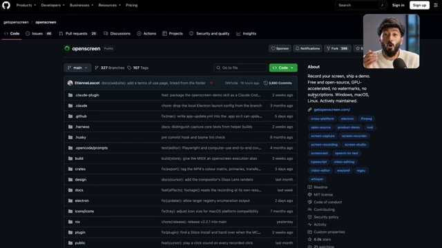
*⏱️ 00:12:23 — Page GitHub du projet open-source OpenScreen avec le présentateur incrusté en haut à droite.*

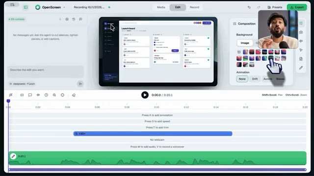
*⏱️ 00:12:31 — Interface de l'application d*

---

### ⏱️ `[00:12:38 - 00:13:00]` | Segment #33

**🔊 Audio (Transcription Intégrale Mot pour Mot en Français) :**
> Et il y me semble qu'il y a un assistant IA qui peut couper vos silences et resserrer les pauses. Vous l'ouvrez et cette petite barre d'outils est tout ce qu'il y a. Vous choisissez votre écran et vous appuyez sur enregistrer. Votre votre curseur est enregistré sur son propre calque, vous pouvez donc en modifier le style et ajouter les zooms plus tard dans l'éditeur. Screen Studio facture environ 29 $ par mois pour exactement cela, et c'est uniquement sur Mac.

**👁️ Analyse Visuelle d'Écran (gemini-3.5-flash-lite) :**
**Interface & Outils** : Système d'exploitation macOS, navigateur web affichant le site de Screen Studio, barre d'outils de l'application.

**Contenu textuel & Code** : Interface utilisateur de Screen Studio, boutons d'enregistrement et options de capture d'écran.

**Action / Démonstration** : Le présentateur illustre l'utilisation de l'outil Screen Studio pour l'enregistrement d'écran.

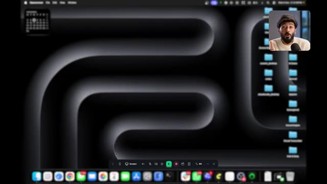
*⏱️ 00:12:44 — Capture montrant un bureau d'ordinateur avec une barre d'outils de capture d'écran Screen Studio visible en bas.*

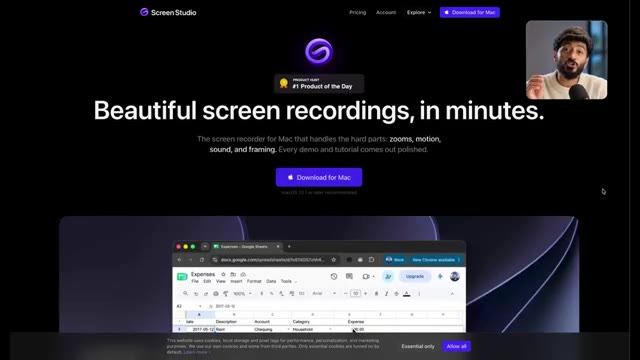
*⏱️ 00:12:55 — Page d'accueil du site web du logiciel Screen Studio avec le slogan "Beautiful screen recordings, in minutes."*

---

### ⏱️ `[00:13:00 - 00:13:20]` | Segment #34

**🔊 Audio (Transcription Intégrale Mot pour Mot en Français) :**
> Si vous envoyez des présentations de produits ou des vidéos explicatives à votre équipe, voici la version gratuite, également sur Windows. Et une fois la démonstration enregistrée, tout doit être intégré dans une présentation pour l'équipe. Une suite bureautique gratuite peut-elle créer les diapositives pour vous ? Word 10 rassemble Docs, Sheets, Slides, PDF, Markdown et pages Web dans une seule application gratuite.

**👁️ Analyse Visuelle d'Écran (gemini-3.5-flash-lite) :**
**Interface & Outils** : Navigateur web affichant le dépôt GitHub du projet OpenScreen.

**Contenu textuel & Code** : Page de dépôt GitHub du logiciel OpenScreen (getopenscreen/openscreen) avec la description des fonctionnalités de capture d'écran, les fichiers du projet et les tags de technologies.

**Action / Démonstration** : Présentation de la page d'accueil GitHub d'un outil open-source de capture et d'enregistrement d'écran.

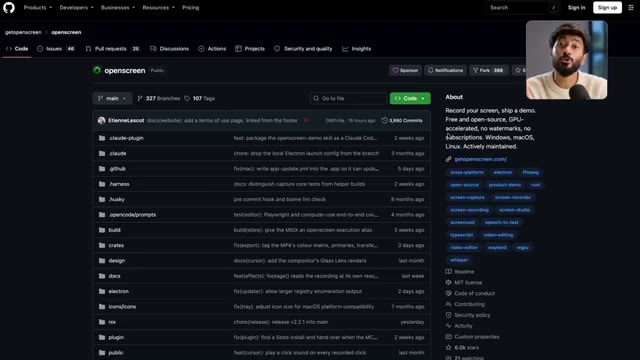
*⏱️ 00:13:05 — Capture d'écran montrant le dépôt GitHub du projet OpenScreen, avec une incrustation vidéo du présentateur en haut à droite.*

---

### ⏱️ `[00:13:20 - 00:13:38]` | Segment #35

**🔊 Audio (Transcription Intégrale Mot pour Mot en Français) :**
> Il s'appelle GenOffice. C'est open source et il ouvre et enregistre les mêmes fichiers Word, Excel et PowerPoint que vous utilisez déjà. Voici l'éditeur de documents. Il ressemble et fonctionne comme Word, il n'y a donc rien de nouveau à apprendre. Il y a un tableur qui fonctionne comme Excel, des diaporamas comme PowerPoint, et un éditeur de PDF aussi.

**👁️ Analyse Visuelle d'Écran (gemini-3.5-flash-lite) :**
**Interface & Outils** : Interface web GitHub et interface de présentation de la suite GenOffice.

**Contenu textuel & Code** : Documentation technique décrivant les fonctionnalités open source de GenOffice pour l'édition de documents Word, Excel et PowerPoint avec IA.

**Action / Démonstration** : Présentation des fonctionnalités clés de GenOffice et démonstration visuelle des différents modules de la suite bureautique.

*⏱️ 00:13:24 — Page de présentation de GenOffice avec le logo, la description de la suite bureautique open source intégrant l'IA, et un aperçu des formats pris en charge (Word, Excel, PowerPoint, PDF).*

*⏱️ 00:13:29 — Documentation GitHub de GenOffice montrant la section Demo avec des captures d'écran illustrant l'édition de documents Word (.docx) avec l'assistant IA.*

*⏱️ 00:13:34 — Continuation de la documentation GitHub montrant la section sur les feuilles de calcul (.xlsx) avec graphiques et formules dynamiques.*

---

### ⏱️ `[00:13:38 - 00:13:57]` | Segment #36

**🔊 Audio (Transcription Intégrale Mot pour Mot en Français) :**
> Et chaque application dispose d'un panneau d'IA intégré. Il vous suffit de décrire ce que vous voulez, comme une présentation de bilan trimestriel, et elle le crée sur le canevas. Dans leur propre démo, une seule frase crée une feuille de résumé avec un graphique, et toutes les modifications arrivent en un seul lot que vous pouvez annuler. Les éditeurs sont gratuits sur Mac, Windows et Linux.

**👁️ Analyse Visuelle d'Écran (gemini-3.5-flash-lite) :**
**Interface & Outils** : Documentation GitHub (README) intégrant des captures d'interface logicielle et un terminal de code (Claude Code).

**Contenu textuel & Code** : Documentation technique décrivant les fonctionnalités d'IA (Ask AI, Markdown, recherche, CLI et protocole MCP) avec des extraits de code et d'interface.

**Action / Démonstration** : Défilement de la page de documentation technique présentant les capacités d'intelligence artificielle et d'automatisation de l'application GenOffice.

*⏱️ 00:13:43 — Capture d'écran montrant la documentation (README) de l'outil avec la section Markdown et Ask AI, incluant des aperçus visuels d'interface.*

*⏱️ 00:13:47 — Capture d'écran affichant la section 'Ask AI' de la documentation, avec un aperçu de l'interface de recherche et de lecture de fichiers étoilés.*

*⏱️ 00:13:52 — Capture d'écran montrant la section 'MCP' avec un terminal intégré (Claude Code) en cours d'exécution de commandes automatisées.*

---

### ⏱️ `[00:13:57 - 00:14:16]` | Segment #37

**🔊 Audio (Transcription Intégrale Mot pour Mot en Français) :**
> L'IA utilise des crédits GenSpark, ou vous pouvez intégrer votre propre clé. Microsoft 365 coûte environ 10 $ par mois. Pour les lettres, tableurs et diaporamas de tous les jours, cela fait l'affaire gratuitement. Mais il y a un bonus pour tous ceux qui cherchent un emploi en ce moment. Est-ce qu'une IA gratuite peut vous trouver des emplois et réécrire votre CV pour chacun d'eux ?

**👁️ Analyse Visuelle d'Écran (gemini-3.5-flash-lite) :**
**Interface & Outils** : Interface graphique minimaliste affichant une application de type Microsoft 365.

**Contenu textuel & Code** : Texte "Microsoft 365", options "Letters", "Spreadsheets", "Slides" et le prix de "0,79 $".

**Action / Démonstration** : Présentation visuelle du coût d'un outil bureautique alternatif.

*⏱️ 00:14:02 — Une interface graphique sombre montrant "Microsoft 365" avec trois icônes (Letters, Spreadsheets, Slides) et le montant de "0,79 $".*

---

### ⏱️ `[00:14:16 - 00:14:36]` | Segment #38

**🔊 Audio (Transcription Intégrale Mot pour Mot en Français) :**
> Et le bonus ! On a donné à celui-ci un profil LinkedIn et il a déterminé quels rôles cette personne devrait cibler, du plus compatible au moins compatible. Ça s'appelle CareerOps et il a près de 80 000 étoiles sur GitHub. Tu lui donnes ton CV, il scanne les sites d'emploi et il note chaque emploi de 1 à 5 selon ton degré de correspondance.

**👁️ Analyse Visuelle d'Écran (gemini-3.5-flash-lite) :**
**Interface & Outils** : Navigateur web affichant GitHub (dépôt CareerOps).

**Contenu textuel & Code** : Description du dépôt GitHub, statistiques (commits, forks, étoiles), schéma de fonctionnement (URL -> Archetype Detection -> A-H Evaluation -> Report / Tailored CV / Tracker) et commande d'initialisation `npx @santifer/career-ops init`.

**Action / Démonstration** : Présentation visuelle de la page GitHub de l'outil CareerOps et explication de son fonctionnement technique.

*⏱️ 00:14:26 — Page GitHub du projet "CareerOps" présentant l'agent IA de recherche d'emploi open-source.*

*⏱️ 00:14:31 — Schéma d'architecture "How It Works" et commandes d'installation rapide (Quick Start) de CareerOps.*

---

### ⏱️ `[00:14:36 - 00:14:55]` | Segment #39

**🔊 Audio (Transcription Intégrale Mot pour Mot en Français) :**
> Alors au lieu de postuler à 200 offres d'emploi et de ne recevoir aucune réponse, vous voyez lesquelles valent le coup d'y passer du temps. Notre agent de codage l'a configuré pour nous à partir du lien GitHub, donc il n'y avait rien à configurer à la main. Ensuite, nous avons téléchargé le profil au format PDF, il a lu les six pages et il nous a demandé de confirmer avant d'utiliser quoi que ce soit.

**👁️ Analyse Visuelle d'Écran (gemini-3.5-flash-lite) :**
**Interface & Outils** : Application web locale (localhost:3030) avec un tableau de bord sombre 'Career Ops' et un panneau d'assistant IA intégré.

**Contenu textuel & Code** : Tableau de bord affichant 'You're all caught up', des menus de navigation (Today, Explore, Pipeline, Analytics, CV, etc.), et dans le volet gauche, un aperçu du fichier PDF du profil ('Profile (2).pdf') avec le message de l'IA indiquant la lecture du profil LinkedIn de Vaibhav Sisinty.

**Action / Démonstration** : Le présentateur montre l'interface de l'application où le profil utilisateur a été téléchargé et analysé par l'assistant IA intégré.

*⏱️ 00:14:41 — Capture d'écran montrant l'interface utilisateur de l'application 'Career Ops' avec un tableau de bord sombre et un volet de chat à gauche affichant l'analyse d'un profil PDF téléchargé.*

---

### ⏱️ `[00:14:55 - 00:15:15]` | Segment #40

**🔊 Audio (Transcription Intégrale Mot pour Mot en Français) :**
> Et vous obtenez un tableau de bord complet pour votre recherche d'emploi, avec des analyses, un pipeline, des suivis, et vos documents, le tout fonctionnant sur votre propre ordinateur portable. Ensuite, il adapte votre CV et votre lettre de motivation pour un emploi à la fois en utilisant les mots que cette offre d'emploi demande. Et il ne postule jamais de lui-même. Il remplit tout et vous appuyez sur envoyer.

**👁️ Analyse Visuelle d'Écran (gemini-3.5-flash-lite) :**
**Interface & Outils** : Application Career Ops, Interface web et éditeur de code Markdown (Cursor/VS Code)

**Contenu textuel & Code** : Menu de navigation de l'application de recherche d'emploi, tableau de bord analytique, et affichage du code source/markdown du CV de Vaibhav Sisinty.

**Action / Démonstration** : Navigation dans les options du tableau de bord Career Ops et visualisation du CV formaté en Markdown dans l'éditeur.

*⏱️ 00:15:00 — Interface de l'application Career Ops montrant le menu latéral de navigation (Today, Explore, Pipeline, Follow-ups, Analytics, Documents, Config) et le tableau de bord de recherche d'emploi.*

*⏱️ 00:15:05 — Éditeur de code (interface de type VS Code ou Cursor) affichant le profil CV au format Markdown (cv.md) de Vaibhav Sisinty avec les sections Summary et Experience.*

---

### ⏱️ `[00:15:15 - 00:15:53]` | Segment #41

**🔊 Audio (Transcription Intégrale Mot pour Mot en Français) :**
> Si vous cherchez un emploi en ce moment, c'est celui-ci qu'il faut configurer aujourd'hui. Donc ça fait 10, plus le bonus. Si vous avez une idée d'application, commencez par Replica, puis testez-la sur un public avec Mirofish avant de la lancer. Si vous créez du contenu, gardez Voice Studio et le flux de travail Clip sur votre ordinateur portable, car vous les utiliserez chaque semaine. Si vous êtes en réunion toute la journée, configurez Foresight. Et si vous cherchez un emploi, configurez Career Ops dès aujourd'hui. Et la vue d'ensemble est la suivante. Il y a un an, chacun de ces travaux nécessitait une application payante ou une personne à embaucher. Et aujourd'hui, il faut un ordinateur portable et le bon outil gratuit. Chaque lien et chaque étape de cette vidéo se trouve dans

**👁️ Analyse Visuelle d'Écran (gemini-3.5-flash-lite) :**
**Interface & Outils** : Interface graphique de présentation (diapositive style SaaS).

**Contenu textuel & Code** : Texte "Where to start", une bulle avec l'icône d'une ampoule "Got an app idea?" connectée par une flèche à un encadré violet "Replica - Build it".

**Action / Démonstration** : Présentation du point de départ recommandé pour le développement d'une application à partir d'une idée.

*⏱️ 00:15:24 — Une diapositive sombre montrant un organigramme minimaliste avec le titre "Where to start", indiquant comment transformer une idée d'application en utilisant l'outil Replica.*

---

### ⏱️ `[00:15:53 - 00:16:10]` | Segment #42

**🔊 Audio (Transcription Intégrale Mot pour Mot en Français) :**
> Document gratuit dans la communauté WhatsApp, ainsi que les cinq outils supplémentaires. Les liens sont juste en dessous. Si vous ne vous êtes pas encore abonné, c'est le moment, car cette liste change tous les quelques mois et nous continuerons à faire des tests. Et si vous en voulez 10 de plus, regardez ensuite notre dernière vidéo sur le top 10 des outils d'IA. Elle est juste ici à l'écran.

**👁️ Analyse Visuelle d'Écran (gemini-3.5-flash-lite) :**
**Interface & Outils** : Mockup graphique de smartphone intégrant une interface de messagerie.

**Contenu textuel & Code** : Textes textuels promotionnels "Join the Global AI Community", "Five extra tools", et boutons d'appel à l'action.

**Action / Démonstration** : Présentation visuelle de la ressource communautaire et des documents disponibles via le lien.

*⏱️ 00:15:57 — Capture d'écran montrant l'appel à rejoindre la communauté WhatsApp avec un mockup de smartphone affichant des documents PDF.*

---

